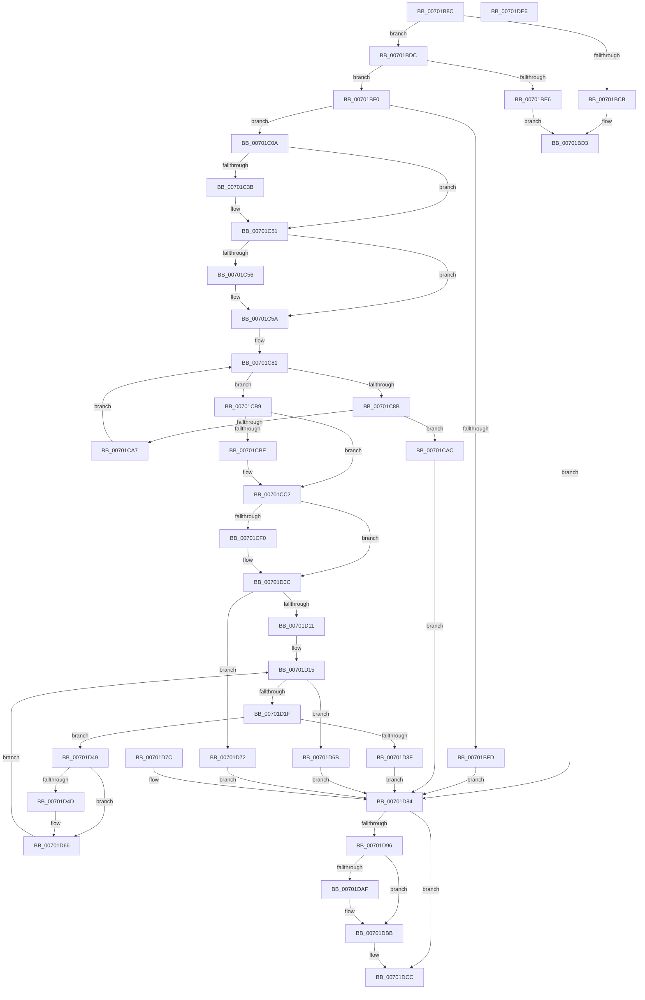

# EtwQueryProcessTelemetryCoverage

- RVA: `0x00701B8C`–`0x00701DE7` (길이 `603` bytes)
- VA: `0x0000000140701B8C`
- 실행 섹션: `PAGE`
- PDB 이름 있음: `예`; PDB Function 태그: `아니요`
- unwind 정보 RVA: `0x000BF6AC`
- 디코드: `148`개 명령, `603/603` bytes 표시
- 미해석 바이트: `0` (있으면 어셈블리에 `.byte`로 보존)

> 이 문서는 커널 이미지의 기계어와 PDB 기호를 분석해 생성했습니다. 4번과 5번은 함수 원형과 자료형을 바이너리 사용 방식에서 추정한 C 해석이며 원본 소스 복구 결과는 아닙니다.

## 1. Dependencies

- 직접 호출 지점: **8**; 고유 호출 대상: **7**
- 직접 호출자로 확인된 함수: **1**
- RIP 상대 이미지 참조: **6**

### Outgoing calls
- `0x00701BF0` → [EtwpCoverageUserIsAdmin](../9F/EtwpCoverageUserIsAdmin_function_009FE548.md) (function, `0x009FE548`)
- `0x00701C27` → [KeAbPreAcquire](../../text/21/KeAbPreAcquire_function_00210230.md) (function, `0x00210230`)
- `0x00701C4C` → [ExfAcquirePushLockExclusiveEx](../../text/20/ExfAcquirePushLockExclusiveEx_function_0020FC90.md) (function, `0x0020FC90`)
- `0x00701CF8` → [memcpy](../../text/6C/memcpy_function_006C6840.md) (function, `0x006C6840`)
- `0x00701D59` → [memcpy](../../text/6C/memcpy_function_006C6840.md) (function, `0x006C6840`)
- `0x00701DB6` → [ExfTryToWakePushLock](../../text/26/ExfTryToWakePushLock_function_00265DD0.md) (function, `0x00265DD0`)
- `0x00701DC2` → [KeAbPostRelease](../../text/2E/KeAbPostRelease_function_002E1600.md) (function, `0x002E1600`)
- `0x00701DC7` → [KeLeaveCriticalRegion](../../text/25/KeLeaveCriticalRegion_function_0025D8B0.md) (function, `0x0025D8B0`)

### Direct callers
- [NtQueryInformationProcess](../9A/NtQueryInformationProcess_function_009AA250.md) at `0x009AE33A`

### Static image references
- `0x00701BDC` → RVA `0x00E684E8` (`.data`; read)
- `0x00701C20` → RVA `0x00EFF1B8` (`.data`; read)
- `0x00701C2F` → RVA `0x00EFF1B8` (`.data`; read/write)
- `0x00701C63` → RVA `0x00E684E0` (`.data`; write)
- `0x00701D8D` → RVA `0x00E684E0` (`.data`; read)
- `0x00701D96` → RVA `0x00E684E0` (`.data`; read/write)

## 2. Other-region calls and transfers

- 다른 실행 섹션으로 향하는 call: **7**
  - `0x00701C27` → [KeAbPreAcquire](../../text/21/KeAbPreAcquire_function_00210230.md) (`PAGE` → `.text`)
  - `0x00701C4C` → [ExfAcquirePushLockExclusiveEx](../../text/20/ExfAcquirePushLockExclusiveEx_function_0020FC90.md) (`PAGE` → `.text`)
  - `0x00701CF8` → [memcpy](../../text/6C/memcpy_function_006C6840.md) (`PAGE` → `.text`)
  - `0x00701D59` → [memcpy](../../text/6C/memcpy_function_006C6840.md) (`PAGE` → `.text`)
  - `0x00701DB6` → [ExfTryToWakePushLock](../../text/26/ExfTryToWakePushLock_function_00265DD0.md) (`PAGE` → `.text`)
  - `0x00701DC2` → [KeAbPostRelease](../../text/2E/KeAbPostRelease_function_002E1600.md) (`PAGE` → `.text`)
  - `0x00701DC7` → [KeLeaveCriticalRegion](../../text/25/KeLeaveCriticalRegion_function_0025D8B0.md) (`PAGE` → `.text`)
- 별도 외부 분기/꼬리 이동을 확인하지 못했습니다.

## 3. Assembly (complete function range)

```asm
00701B8C  48 8B C4                        mov rax, rsp
00701B8F  48 89 58 10                     mov qword ptr [rax + 0x10], rbx
00701B93  44 89 40 18                     mov dword ptr [rax + 0x18], r8d
00701B97  57                              push rdi
00701B98  41 54                           push r12
00701B9A  41 55                           push r13
00701B9C  41 56                           push r14
00701B9E  41 57                           push r15
00701BA0  48 83 EC 50                     sub rsp, 0x50
00701BA4  4D 8B E9                        mov r13, r9
00701BA7  4C 8B FA                        mov r15, rdx
00701BAA  48 83 60 C0 00                  and qword ptr [rax - 0x40], 0
00701BAF  48 83 60 B0 00                  and qword ptr [rax - 0x50], 0
00701BB4  48 83 60 C8 00                  and qword ptr [rax - 0x38], 0
00701BB9  65 48 8B 04 25 88 01 00 00      mov rax, qword ptr gs:[0x188]
00701BC2  48 3B 88 B8 00 00 00            cmp rcx, qword ptr [rax + 0xb8]
00701BC9  74 11                           je 0x140701bdc
00701BCB  C7 44 24 24 BB 00 00 C0         mov dword ptr [rsp + 0x24], 0xc00000bb
00701BD3  48 83 CB FF                     or rbx, 0xffffffffffffffff
00701BD7  E9 A8 01 00 00                  jmp 0x140701d84
00701BDC  48 83 3D 04 69 76 00 00         cmp qword ptr [rip + 0x766904], 0
00701BE4  75 0A                           jne 0x140701bf0
00701BE6  C7 44 24 24 B7 00 00 C0         mov dword ptr [rsp + 0x24], 0xc00000b7
00701BEE  EB E3                           jmp 0x140701bd3
00701BF0  E8 53 C9 2F 00                  call 0x1409fe548
00701BF5  48 83 CB FF                     or rbx, 0xffffffffffffffff
00701BF9  84 C0                           test al, al
00701BFB  75 0D                           jne 0x140701c0a
00701BFD  C7 44 24 24 22 00 00 C0         mov dword ptr [rsp + 0x24], 0xc0000022
00701C05  E9 7A 01 00 00                  jmp 0x140701d84
00701C0A  65 48 8B 04 25 88 01 00 00      mov rax, qword ptr gs:[0x188]
00701C13  66 01 98 E4 01 00 00            add word ptr [rax + 0x1e4], bx
00701C1A  90                              nop
00701C1B  45 33 C0                        xor r8d, r8d
00701C1E  33 D2                           xor edx, edx
00701C20  48 8D 0D 91 D5 7F 00            lea rcx, [rip + 0x7fd591]
00701C27  E8 04 E6 B0 FF                  call 0x140210230
00701C2C  48 8B F8                        mov rdi, rax
00701C2F  F0 48 0F BA 2D 7F D5 7F 00 00   lock bts qword ptr [rip + 0x7fd57f], 0
00701C39  73 16                           jae 0x140701c51
00701C3B  4C 8D 05 76 D5 7F 00            lea r8, [rip + 0x7fd576]
00701C42  48 8B D0                        mov rdx, rax
00701C45  48 8D 0D 6C D5 7F 00            lea rcx, [rip + 0x7fd56c]
00701C4C  E8 3F E0 B0 FF                  call 0x14020fc90
00701C51  48 85 FF                        test rdi, rdi
00701C54  74 04                           je 0x140701c5a
00701C56  C6 47 0A 01                     mov byte ptr [rdi + 0xa], 1
00701C5A  65 48 8B 04 25 88 01 00 00      mov rax, qword ptr gs:[0x188]
00701C63  48 89 05 76 68 76 00            mov qword ptr [rip + 0x766876], rax
00701C6A  48 8B 15 77 68 76 00            mov rdx, qword ptr [rip + 0x766877]
00701C71  48 8B 42 10                     mov rax, qword ptr [rdx + 0x10]
00701C75  44 8B 70 10                     mov r14d, dword ptr [rax + 0x10]
00701C79  4C 8D 62 30                     lea r12, [rdx + 0x30]
00701C7D  49 8B 0C 24                     mov rcx, qword ptr [r12]
00701C81  48 89 4C 24 30                  mov qword ptr [rsp + 0x30], rcx
00701C86  49 3B CC                        cmp rcx, r12
00701C89  74 2E                           je 0x140701cb9
00701C8B  48 89 4C 24 38                  mov qword ptr [rsp + 0x38], rcx
00701C90  8B 41 18                        mov eax, dword ptr [rcx + 0x18]
00701C93  2B C1                           sub eax, ecx
00701C95  83 E8 28                        sub eax, 0x28
00701C98  89 84 24 80 00 00 00            mov dword ptr [rsp + 0x80], eax
00701C9F  44 03 F0                        add r14d, eax
00701CA2  44 3B F0                        cmp r14d, eax
00701CA5  72 05                           jb 0x140701cac
00701CA7  48 8B 09                        mov rcx, qword ptr [rcx]
00701CAA  EB D5                           jmp 0x140701c81
00701CAC  C7 44 24 24 95 00 00 C0         mov dword ptr [rsp + 0x24], 0xc0000095
00701CB4  E9 CB 00 00 00                  jmp 0x140701d84
00701CB9  4D 85 ED                        test r13, r13
00701CBC  74 04                           je 0x140701cc2
00701CBE  45 89 75 00                     mov dword ptr [r13], r14d
00701CC2  4C 89 7C 24 28                  mov qword ptr [rsp + 0x28], r15
00701CC7  45 8B EE                        mov r13d, r14d
00701CCA  4D 03 EF                        add r13, r15
00701CCD  4C 89 6C 24 40                  mov qword ptr [rsp + 0x40], r13
00701CD2  48 8B 52 10                     mov rdx, qword ptr [rdx + 0x10]
00701CD6  8B 42 10                        mov eax, dword ptr [rdx + 0x10]
00701CD9  8B 8C 24 90 00 00 00            mov ecx, dword ptr [rsp + 0x90]
00701CE0  3B C8                           cmp ecx, eax
00701CE2  0F 42 C1                        cmovb eax, ecx
00701CE5  89 84 24 80 00 00 00            mov dword ptr [rsp + 0x80], eax
00701CEC  85 C0                           test eax, eax
00701CEE  74 1C                           je 0x140701d0c
00701CF0  8B F8                           mov edi, eax
00701CF2  44 8B C0                        mov r8d, eax
00701CF5  49 8B CF                        mov rcx, r15
00701CF8  E8 43 4B FC FF                  call 0x1406c6840
00701CFD  4C 03 FF                        add r15, rdi
00701D00  4C 89 7C 24 28                  mov qword ptr [rsp + 0x28], r15
00701D05  8B 8C 24 90 00 00 00            mov ecx, dword ptr [rsp + 0x90]
00701D0C  41 3B CE                        cmp ecx, r14d
00701D0F  72 61                           jb 0x140701d72
00701D11  4D 8B 34 24                     mov r14, qword ptr [r12]
00701D15  4C 89 74 24 30                  mov qword ptr [rsp + 0x30], r14
00701D1A  4D 3B F4                        cmp r14, r12
00701D1D  74 4C                           je 0x140701d6b
00701D1F  4C 89 74 24 38                  mov qword ptr [rsp + 0x38], r14
00701D24  41 8B 4E 18                     mov ecx, dword ptr [r14 + 0x18]
00701D28  41 2B CE                        sub ecx, r14d
00701D2B  83 E9 28                        sub ecx, 0x28
00701D2E  89 8C 24 80 00 00 00            mov dword ptr [rsp + 0x80], ecx
00701D35  41 8B C5                        mov eax, r13d
00701D38  41 2B C7                        sub eax, r15d
00701D3B  3B C8                           cmp ecx, eax
00701D3D  76 0A                           jbe 0x140701d49
00701D3F  C7 44 24 24 2D 02 00 C0         mov dword ptr [rsp + 0x24], 0xc000022d
00701D47  EB 3B                           jmp 0x140701d84
00701D49  85 C9                           test ecx, ecx
00701D4B  74 19                           je 0x140701d66
00701D4D  8B F9                           mov edi, ecx
00701D4F  49 8D 56 28                     lea rdx, [r14 + 0x28]
00701D53  44 8B C1                        mov r8d, ecx
00701D56  49 8B CF                        mov rcx, r15
00701D59  E8 E2 4A FC FF                  call 0x1406c6840
00701D5E  4C 03 FF                        add r15, rdi
00701D61  4C 89 7C 24 28                  mov qword ptr [rsp + 0x28], r15
00701D66  4D 8B 36                        mov r14, qword ptr [r14]
00701D69  EB AA                           jmp 0x140701d15
00701D6B  83 64 24 24 00                  and dword ptr [rsp + 0x24], 0
00701D70  EB 12                           jmp 0x140701d84
00701D72  C7 44 24 24 05 00 00 80         mov dword ptr [rsp + 0x24], 0x80000005
00701D7A  EB 08                           jmp 0x140701d84
00701D7C  89 44 24 24                     mov dword ptr [rsp + 0x24], eax
00701D80  48 83 CB FF                     or rbx, 0xffffffffffffffff
00701D84  65 48 8B 04 25 88 01 00 00      mov rax, qword ptr gs:[0x188]
00701D8D  48 39 05 4C 67 76 00            cmp qword ptr [rip + 0x76674c], rax
00701D94  75 36                           jne 0x140701dcc
00701D96  48 83 25 42 67 76 00 00         and qword ptr [rip + 0x766742], 0
00701D9E  F0 48 0F C1 1D 11 D4 7F 00      lock xadd qword ptr [rip + 0x7fd411], rbx
00701DA7  80 E3 06                        and bl, 6
00701DAA  80 FB 02                        cmp bl, 2
00701DAD  75 0C                           jne 0x140701dbb
00701DAF  48 8D 0D 02 D4 7F 00            lea rcx, [rip + 0x7fd402]
00701DB6  E8 15 40 B6 FF                  call 0x140265dd0
00701DBB  48 8D 0D F6 D3 7F 00            lea rcx, [rip + 0x7fd3f6]
00701DC2  E8 39 F8 BD FF                  call 0x1402e1600
00701DC7  E8 E4 BA B5 FF                  call 0x14025d8b0
00701DCC  8B 44 24 24                     mov eax, dword ptr [rsp + 0x24]
00701DD0  48 8B 9C 24 88 00 00 00         mov rbx, qword ptr [rsp + 0x88]
00701DD8  48 83 C4 50                     add rsp, 0x50
00701DDC  41 5F                           pop r15
00701DDE  41 5E                           pop r14
00701DE0  41 5D                           pop r13
00701DE2  41 5C                           pop r12
00701DE4  5F                              pop rdi
00701DE5  C3                              ret
00701DE6  CC                              int3
```

## 4. C-style interpretation (structured pseudocode)

```c
__int64 __fastcall EtwQueryProcessTelemetryCoverage(__int64 a1, __int64 a2, int a3, __int64 a4)
{
    __int64 result;
    __int64 v_r13;
    __int64 v_r14;
    __int64 v_r15;
    __int64 v_rbx;
    __int64 v_rdi;
    __int64 v_rsp;
    unsigned __int64 v_stack_m38;
    unsigned __int64 v_stack_m40;
    unsigned __int64 v_stack_m48;
    unsigned __int64 v_stack_m50;
    unsigned int v_stack_m54;
    unsigned __int64 v_stack_p10;
    unsigned int v_stack_p18;
    unsigned int v_stack_p8;

    *(unsigned __int64 *)(v_rsp + 16) = v_rbx;
    *(unsigned int *)(v_rsp + 24) = a3;
    v_rsp = (v_rsp) - (80);
    if (a1 == (*(unsigned __int64 *)(*(unsigned __int64 *)(gs_base + (0 + 392)) + 184))) goto loc_00701BDC;
    v_stack_m54 = 0xC00000BBULL;
loc_00701BD3:
    v_rbx = (v_rbx) | (-1);
    goto loc_00701D84;
loc_00701BDC:
    if ((*(unsigned __int64 *)(v_rip + 7760132)) != 0) goto loc_00701BF0;
    v_stack_m54 = 0xC00000B7ULL;
    goto loc_00701BD3;
loc_00701BF0:
    result = EtwpCoverageUserIsAdmin(a1, a2, a3, a4);
    v_rbx = (v_rbx) | (-1);
    if ((unsigned __int8)(result) != 0) goto loc_00701C0A;
    v_stack_m54 = 0xC0000022ULL;
    goto loc_00701D84;
loc_00701C0A:
    a3 = 0;
    a2 = 0;
    result = KeAbPreAcquire(v_rip + 8377745, a2, a3, a4);
    if (!(condition_is_above_or_equal)) {
        a3 = v_rip + 8377718;
        a2 = result;
        a1 = v_rip + 8377708;
        result = ExfAcquirePushLockExclusiveEx(a1, a2, a3, a4);
    }
    if (result != 0) {
        *(unsigned __int8 *)(result + 10) = 1;
    }
    *(unsigned __int64 *)(v_rip + 7759990) = *(unsigned __int64 *)(gs_base + (0 + 392));
loc_00701C81:
    v_stack_m48 = *(unsigned __int64 *)(*(unsigned __int64 *)(v_rip + 7759991) + 48);
    if ((*(unsigned __int64 *)(*(unsigned __int64 *)(v_rip + 7759991) + 48)) == (*(unsigned __int64 *)(v_rip + 7759991) + 48)) goto loc_00701CB9;
    v_stack_m40 = *(unsigned __int64 *)(*(unsigned __int64 *)(v_rip + 7759991) + 48);
    result = (unsigned int)(((unsigned int)(*(unsigned int *)(*(unsigned __int64 *)(*(unsigned __int64 *)(v_rip + 7759991) + 48) + 24))) - ((unsigned int)(*(unsigned __int64 *)(*(unsigned __int64 *)(v_rip + 7759991) + 48))));
    result = (unsigned int)((result) - (40));
    v_stack_p8 = (unsigned int)(result);
    v_r14 = (unsigned int)(((unsigned int)(*(unsigned int *)(*(unsigned __int64 *)(*(unsigned __int64 *)(v_rip + 7759991) + 16) + 16))) + ((unsigned int)(result)));
    if (((unsigned int)(v_r14)) < ((unsigned int)(result))) goto loc_00701CAC;
    goto loc_00701C81;
loc_00701CAC:
    v_stack_m54 = 0xC0000095ULL;
    goto loc_00701D84;
loc_00701CB9:
    if (a4 != 0) {
        *(unsigned int *)(a4) = (unsigned int)(v_r14);
    }
    v_stack_m50 = a2;
    v_r13 = ((unsigned int)((unsigned int)(v_r14))) + (a2);
    v_stack_m38 = v_r13;
    result = (unsigned int)(*(unsigned int *)(*(unsigned __int64 *)(*(unsigned __int64 *)(v_rip + 7759991) + 16) + 16));
    if (((unsigned int)((unsigned int)(v_stack_p18))) < ((unsigned int)((unsigned int)(*(unsigned int *)(*(unsigned __int64 *)(*(unsigned __int64 *)(v_rip + 7759991) + 16) + 16))))) { result = (unsigned int)((unsigned int)(v_stack_p18)); }
    v_stack_p8 = (unsigned int)(result);
    v_rdi = result;
    v_r15 = a2;
    if ((unsigned int)(result) != 0) {
        v_rdi = (unsigned int)(result);
        a3 = (unsigned int)(result);
        a1 = a2;
        result = memcpy(a1, *(unsigned __int64 *)(*(unsigned __int64 *)(v_rip + 7759991) + 16), a3, a4);
        v_r15 = (a2) + (v_rdi);
        v_stack_m50 = v_r15;
        a1 = v_stack_p18;
    }
    if (((unsigned int)(a1)) < ((unsigned int)(v_r14))) goto loc_00701D72;
loc_00701D15:
    v_stack_m48 = *(unsigned __int64 *)(*(unsigned __int64 *)(v_rip + 7759991) + 48);
    if ((*(unsigned __int64 *)(*(unsigned __int64 *)(v_rip + 7759991) + 48)) == (*(unsigned __int64 *)(v_rip + 7759991) + 48)) goto loc_00701D6B;
    v_stack_m40 = *(unsigned __int64 *)(*(unsigned __int64 *)(v_rip + 7759991) + 48);
    a1 = (unsigned int)(((unsigned int)(*(unsigned int *)(*(unsigned __int64 *)(*(unsigned __int64 *)(v_rip + 7759991) + 48) + 24))) - ((unsigned int)(*(unsigned __int64 *)(*(unsigned __int64 *)(v_rip + 7759991) + 48))));
    a1 = (unsigned int)((a1) - (40));
    v_stack_p8 = (unsigned int)(a1);
    result = (unsigned int)(((unsigned int)((unsigned int)(v_r13))) - ((unsigned int)(v_r15)));
    if (((unsigned int)(a1)) <= ((unsigned int)(result))) goto loc_00701D49;
    v_stack_m54 = 0xC000022DULL;
    goto loc_00701D84;
loc_00701D49:
    if ((unsigned int)(a1) != 0) {
        v_rdi = (unsigned int)(a1);
        a2 = *(unsigned __int64 *)(*(unsigned __int64 *)(v_rip + 7759991) + 48) + 40;
        a3 = (unsigned int)(a1);
        a1 = v_r15;
        result = memcpy(a1, a2, a3, a4);
        v_r15 = (v_r15) + (v_rdi);
        v_stack_m50 = v_r15;
    }
    goto loc_00701D15;
loc_00701D6B:
    goto loc_00701D84;
loc_00701D72:
    v_stack_m54 = 0x80000005ULL;
    goto loc_00701D84;
loc_00701D84:
    if ((*(unsigned __int64 *)(v_rip + 7759692)) != (*(unsigned __int64 *)(gs_base + (0 + 392)))) goto loc_00701DCC;
    v_rbx = (unsigned __int8)((v_rbx) & (6));
    result = *(unsigned __int64 *)(gs_base + (0 + 392));
    if (((unsigned __int8)(v_rbx)) == 2) {
        a1 = v_rip + 8377346;
        result = ExfTryToWakePushLock(a1, a2, a3, a4);
    }
    result = KeAbPostRelease(v_rip + 8377334, a2, a3, a4);
    result = KeLeaveCriticalRegion(v_rip + 8377334, a2, a3, a4);
loc_00701DCC:
    v_rsp = (v_rsp) + (80);
    return (unsigned int)(v_stack_m54);
}
```

## 5. (Beta) C Style

```c
int64_t EtwQueryProcessTelemetryCoverage(int64_t Arg1, int64_t Arg2, int32_t Arg3, int64_t Arg4)
{
    int64_t result;
    int64_t local_r13;
    int64_t local_r14;
    int64_t local_r15;
    int64_t local_rbx;
    int64_t local_rdi;
    int64_t local_rsp;
    uint64_t v_stack_m38;
    uint64_t v_stack_m40;
    uint64_t v_stack_m48;
    uint64_t v_stack_m50;
    uint32_t v_stack_m54;
    uint64_t v_stack_p10;
    uint32_t v_stack_p18;
    uint32_t v_stack_p8;

    *(uint64_t *)(local_rsp + 0x10) = local_rbx;
    *(uint32_t *)(local_rsp + 0x18) = Arg3;
    local_rsp = (local_rsp) - (80);
    if (Arg1 == (*(uint64_t *)(*(uint64_t *)(gs_base + (0 + 0x188)) + 0xB8))) goto loc_00701BDC;
    v_stack_m54 = 0xC00000BBULL;
loc_00701BD3:
    local_rbx = (local_rbx) | (-1);
    goto loc_00701D84;
loc_00701BDC:
    if ((*(uint64_t *)(v_rip + 0x766904)) != 0) goto loc_00701BF0;
    v_stack_m54 = 0xC00000B7ULL;
    goto loc_00701BD3;
loc_00701BF0:
    result = EtwpCoverageUserIsAdmin(Arg1, Arg2, Arg3, Arg4);
    local_rbx = (local_rbx) | (-1);
    if ((uint8_t)(result) != 0) goto loc_00701C0A;
    v_stack_m54 = 0xC0000022ULL;
    goto loc_00701D84;
loc_00701C0A:
    Arg3 = 0;
    Arg2 = 0;
    result = KeAbPreAcquire(v_rip + 8377745, Arg2, Arg3, Arg4);
    if (!(condition_is_above_or_equal)) {
        Arg3 = v_rip + 8377718;
        Arg2 = result;
        Arg1 = v_rip + 8377708;
        result = ExfAcquirePushLockExclusiveEx(Arg1, Arg2, Arg3, Arg4);
    }
    if (result != 0) {
        *(uint8_t *)(result + 0xA) = 1;
    }
    *(uint64_t *)(v_rip + 0x766876) = *(uint64_t *)(gs_base + (0 + 0x188));
loc_00701C81:
    v_stack_m48 = *(uint64_t *)(*(uint64_t *)(v_rip + 0x766877) + 0x30);
    if ((*(uint64_t *)(*(uint64_t *)(v_rip + 0x766877) + 0x30)) == (*(uint64_t *)(v_rip + 0x766877) + 48)) goto loc_00701CB9;
    v_stack_m40 = *(uint64_t *)(*(uint64_t *)(v_rip + 0x766877) + 0x30);
    result = (uint32_t)(((uint32_t)(*(uint32_t *)(*(uint64_t *)(*(uint64_t *)(v_rip + 0x766877) + 0x30) + 0x18))) - ((uint32_t)(*(uint64_t *)(*(uint64_t *)(v_rip + 0x766877) + 0x30))));
    result = (uint32_t)((result) - (40));
    v_stack_p8 = (uint32_t)(result);
    local_r14 = (uint32_t)(((uint32_t)(*(uint32_t *)(*(uint64_t *)(*(uint64_t *)(v_rip + 0x766877) + 0x10) + 0x10))) + ((uint32_t)(result)));
    if (((uint32_t)(local_r14)) < ((uint32_t)(result))) goto loc_00701CAC;
    goto loc_00701C81;
loc_00701CAC:
    v_stack_m54 = 0xC0000095ULL;
    goto loc_00701D84;
loc_00701CB9:
    if (Arg4 != 0) {
        *(uint32_t *)(Arg4) = (uint32_t)(local_r14);
    }
    v_stack_m50 = Arg2;
    local_r13 = ((uint32_t)((uint32_t)(local_r14))) + (Arg2);
    v_stack_m38 = local_r13;
    result = (uint32_t)(*(uint32_t *)(*(uint64_t *)(*(uint64_t *)(v_rip + 0x766877) + 0x10) + 0x10));
    if (((uint32_t)((uint32_t)(v_stack_p18))) < ((uint32_t)((uint32_t)(*(uint32_t *)(*(uint64_t *)(*(uint64_t *)(v_rip + 0x766877) + 0x10) + 0x10))))) { result = (uint32_t)((uint32_t)(v_stack_p18)); }
    v_stack_p8 = (uint32_t)(result);
    local_rdi = result;
    local_r15 = Arg2;
    if ((uint32_t)(result) != 0) {
        local_rdi = (uint32_t)(result);
        Arg3 = (uint32_t)(result);
        Arg1 = Arg2;
        result = memcpy(Arg1, *(uint64_t *)(*(uint64_t *)(v_rip + 0x766877) + 0x10), Arg3, Arg4);
        local_r15 = (Arg2) + (local_rdi);
        v_stack_m50 = local_r15;
        Arg1 = v_stack_p18;
    }
    if (((uint32_t)(Arg1)) < ((uint32_t)(local_r14))) goto loc_00701D72;
loc_00701D15:
    v_stack_m48 = *(uint64_t *)(*(uint64_t *)(v_rip + 0x766877) + 0x30);
    if ((*(uint64_t *)(*(uint64_t *)(v_rip + 0x766877) + 0x30)) == (*(uint64_t *)(v_rip + 0x766877) + 48)) goto loc_00701D6B;
    v_stack_m40 = *(uint64_t *)(*(uint64_t *)(v_rip + 0x766877) + 0x30);
    Arg1 = (uint32_t)(((uint32_t)(*(uint32_t *)(*(uint64_t *)(*(uint64_t *)(v_rip + 0x766877) + 0x30) + 0x18))) - ((uint32_t)(*(uint64_t *)(*(uint64_t *)(v_rip + 0x766877) + 0x30))));
    Arg1 = (uint32_t)((Arg1) - (40));
    v_stack_p8 = (uint32_t)(Arg1);
    result = (uint32_t)(((uint32_t)((uint32_t)(local_r13))) - ((uint32_t)(local_r15)));
    if (((uint32_t)(Arg1)) <= ((uint32_t)(result))) goto loc_00701D49;
    v_stack_m54 = 0xC000022DULL;
    goto loc_00701D84;
loc_00701D49:
    if ((uint32_t)(Arg1) != 0) {
        local_rdi = (uint32_t)(Arg1);
        Arg2 = *(uint64_t *)(*(uint64_t *)(v_rip + 0x766877) + 0x30) + 40;
        Arg3 = (uint32_t)(Arg1);
        Arg1 = local_r15;
        result = memcpy(Arg1, Arg2, Arg3, Arg4);
        local_r15 = (local_r15) + (local_rdi);
        v_stack_m50 = local_r15;
    }
    goto loc_00701D15;
loc_00701D6B:
    goto loc_00701D84;
loc_00701D72:
    v_stack_m54 = 0x80000005ULL;
    goto loc_00701D84;
loc_00701D84:
    if ((*(uint64_t *)(v_rip + 0x76674C)) != (*(uint64_t *)(gs_base + (0 + 0x188)))) goto loc_00701DCC;
    local_rbx = (uint8_t)((local_rbx) & (6));
    result = *(uint64_t *)(gs_base + (0 + 0x188));
    if (((uint8_t)(local_rbx)) == 2) {
        Arg1 = v_rip + 8377346;
        result = ExfTryToWakePushLock(Arg1, Arg2, Arg3, Arg4);
    }
    result = KeAbPostRelease(v_rip + 8377334, Arg2, Arg3, Arg4);
    result = KeLeaveCriticalRegion(v_rip + 8377334, Arg2, Arg3, Arg4);
loc_00701DCC:
    local_rsp = (local_rsp) + (80);
    return (uint32_t)(v_stack_m54);
}
```

## 6. Execution-region graph

[열기: 2D/3D 그래프와 함수 탐색 컨트롤 패널](../../../control-panel.html?section=page&rva=0x00701B8C&view=graph)

- 2D 그래프는 위에서 아래로 흐르고, 3D 그래프는 빈 공간을 드래그해 회전합니다. Shift+드래그는 이동, 휠은 확대·축소, 함수 노드 선택은 대상 보고서 이동입니다.

### Static fallback


