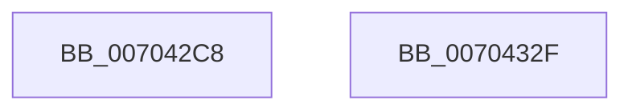

# EtwTraceWakeEvent

- RVA: `0x007042C8`–`0x00704330` (길이 `104` bytes)
- VA: `0x00000001407042C8`
- 실행 섹션: `PAGE`
- PDB 이름 있음: `예`; PDB Function 태그: `아니요`
- unwind 정보 RVA: `0x000B8004`
- 디코드: `23`개 명령, `104/104` bytes 표시
- 미해석 바이트: `0` (있으면 어셈블리에 `.byte`로 보존)

> 이 문서는 커널 이미지의 기계어와 PDB 기호를 분석해 생성했습니다. 4번과 5번은 함수 원형과 자료형을 바이너리 사용 방식에서 추정한 C 해석이며 원본 소스 복구 결과는 아닙니다.

## 1. Dependencies

- 직접 호출 지점: **2**; 고유 호출 대상: **2**
- 직접 호출자로 확인된 함수: **3**
- RIP 상대 이미지 참조: **1**

### Outgoing calls
- `0x00704318` → [EtwTraceKernelEvent](../../text/23/EtwTraceKernelEvent_function_00235350.md) (function, `0x00235350`)
- `0x00704325` → [_security_check_cookie](../../text/6A/_security_check_cookie_function_006AC640.md) (function, `0x006AC640`)

### Direct callers
- [PspChargeProcessWakeCounter](../88/PspChargeProcessWakeCounter_function_0088D2A0.md) at `0x0088D6A9`
- [PspChargeJobWakeCounter](../9D/PspChargeJobWakeCounter_function_009D5D20.md) at `0x009D60B9`
- [PspSendWakeNotification](../9F/PspSendWakeNotification_function_009FB394.md) at `0x009FB449`

### Static image references
- `0x007042D3` → RVA `0x00E0A740` (`.data`; read)

## 2. Other-region calls and transfers

- 다른 실행 섹션으로 향하는 call: **2**
  - `0x00704318` → [EtwTraceKernelEvent](../../text/23/EtwTraceKernelEvent_function_00235350.md) (`PAGE` → `.text`)
  - `0x00704325` → [_security_check_cookie](../../text/6A/_security_check_cookie_function_006AC640.md) (`PAGE` → `.text`)
- 별도 외부 분기/꼬리 이동을 확인하지 못했습니다.

## 3. Assembly (complete function range)

```asm
007042C8  4C 8B DC                        mov r11, rsp
007042CB  49 89 4B 08                     mov qword ptr [r11 + 8], rcx
007042CF  48 83 EC 58                     sub rsp, 0x58
007042D3  48 8B 05 66 64 70 00            mov rax, qword ptr [rip + 0x706466]
007042DA  48 33 C4                        xor rax, rsp
007042DD  48 89 44 24 40                  mov qword ptr [rsp + 0x40], rax
007042E2  49 8D 43 08                     lea rax, [r11 + 8]
007042E6  C7 44 24 20 02 19 60 00         mov dword ptr [rsp + 0x20], 0x601902
007042EE  49 89 43 D8                     mov qword ptr [r11 - 0x28], rax
007042F2  49 8D 4B D8                     lea rcx, [r11 - 0x28]
007042F6  83 64 24 3C 00                  and dword ptr [rsp + 0x3c], 0
007042FB  41 B9 60 03 00 00               mov r9d, 0x360
00704301  66 44 03 CA                     add r9w, dx
00704305  C7 44 24 38 08 00 00 00         mov dword ptr [rsp + 0x38], 8
0070430D  BA 01 00 00 00                  mov edx, 1
00704312  41 B8 00 04 00 80               mov r8d, 0x80000400
00704318  E8 33 10 B3 FF                  call 0x140235350
0070431D  48 8B 4C 24 40                  mov rcx, qword ptr [rsp + 0x40]
00704322  48 33 CC                        xor rcx, rsp
00704325  E8 16 83 FA FF                  call 0x1406ac640
0070432A  48 83 C4 58                     add rsp, 0x58
0070432E  C3                              ret
0070432F  CC                              int3
```

## 4. C-style interpretation (structured pseudocode)

```c
__int64 __fastcall EtwTraceWakeEvent(__int64 a1, unsigned __int16 a2)
{
    __int64 result;
    __int64 v_rsp;
    unsigned __int64 v_stack_m18;
    unsigned int v_stack_m1C;
    unsigned int v_stack_m20;
    unsigned int v_stack_m38;

    *(unsigned __int64 *)(v_rsp + 8) = a1;
    v_rsp = (v_rsp) - (88);
    result = (*(unsigned __int64 *)(v_rip + 7365734)) ^ (v_rsp);
    v_stack_m18 = result;
    v_stack_m38 = 0x601902ULL;
    *(unsigned __int64 *)(v_rsp - 40) = v_rsp + 8;
    a4 = (unsigned __int16)((864) + (a2));
    v_stack_m20 = 8;
    result = EtwTraceKernelEvent(v_rsp - 40, 1, (unsigned int)(0x80000400ULL), a4);
    a1 = (v_stack_m18) ^ (v_rsp);
    result = _security_check_cookie(a1, 1, (unsigned int)(0x80000400ULL), a4);
    v_rsp = (v_rsp) + (88);
    return result;
}
```

## 5. (Beta) C Style

```c
int64_t EtwTraceWakeEvent(int64_t Arg1, uint16_t Arg2)
{
    int64_t result;
    int64_t local_rsp;
    uint64_t v_stack_m18;
    uint32_t v_stack_m1C;
    uint32_t v_stack_m20;
    uint32_t v_stack_m38;

    *(uint64_t *)(local_rsp + 0x8) = Arg1;
    local_rsp = (local_rsp) - (88);
    result = (*(uint64_t *)(v_rip + 0x706466)) ^ (local_rsp);
    v_stack_m18 = result;
    v_stack_m38 = 0x601902ULL;
    *(uint64_t *)(local_rsp - 0x28) = local_rsp + 8;
    a4 = (uint16_t)((864) + (Arg2));
    v_stack_m20 = 8;
    result = EtwTraceKernelEvent(local_rsp - 40, 1, (uint32_t)(0x80000400ULL), a4);
    Arg1 = (v_stack_m18) ^ (local_rsp);
    result = _security_check_cookie(Arg1, 1, (uint32_t)(0x80000400ULL), a4);
    local_rsp = (local_rsp) + (88);
    return result;
}
```

## 6. Execution-region graph

[열기: 2D/3D 그래프와 함수 탐색 컨트롤 패널](../../../control-panel.html?section=page&rva=0x007042C8&view=graph)

- 2D 그래프는 위에서 아래로 흐르고, 3D 그래프는 빈 공간을 드래그해 회전합니다. Shift+드래그는 이동, 휠은 확대·축소, 함수 노드 선택은 대상 보고서 이동입니다.

### Static fallback


