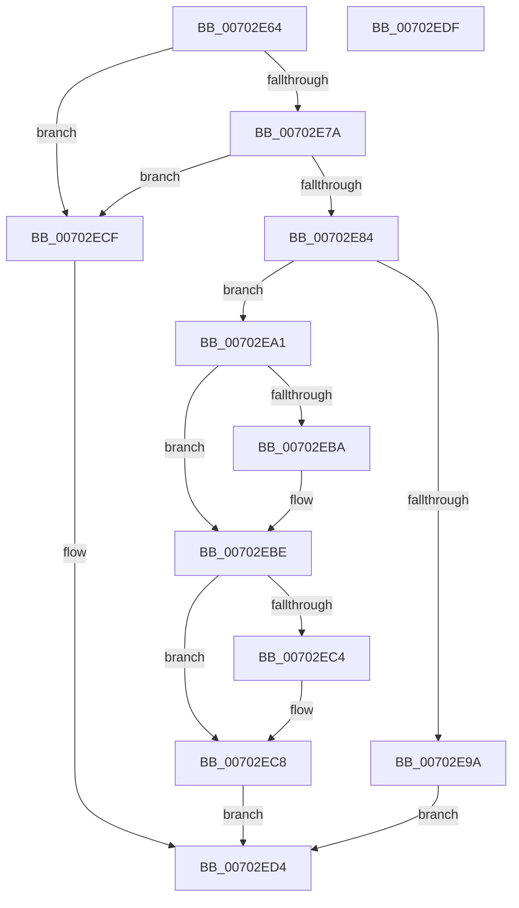

# EtwpAllocateLevelKwFilter

- RVA: `0x00702E64`–`0x00702EE0` (길이 `124` bytes)
- VA: `0x0000000140702E64`
- 실행 섹션: `PAGE`
- PDB 이름 있음: `예`; PDB Function 태그: `아니요`
- unwind 정보 RVA: `0x0005CAAC`
- 디코드: `38`개 명령, `124/124` bytes 표시
- 미해석 바이트: `0` (있으면 어셈블리에 `.byte`로 보존)

> 이 문서는 커널 이미지의 기계어와 PDB 기호를 분석해 생성했습니다. 4번과 5번은 함수 원형과 자료형을 바이너리 사용 방식에서 추정한 C 해석이며 원본 소스 복구 결과는 아닙니다.

## 1. Dependencies

- 직접 호출 지점: **1**; 고유 호출 대상: **1**
- 직접 호출자로 확인된 함수: **1**
- RIP 상대 이미지 참조: **0**

### Outgoing calls
- `0x00702E8D` → [ExAllocatePool2](../../poolcode/B8/ExAllocatePool2_function_00B820F0.md) (function, `0x00B820F0`)

### Direct callers
- [EtwpAllocateFilter](../9F/EtwpAllocateFilter_function_009FC948.md) at `0x009FCAC2`

### Static image references
- 디코드된 RIP-relative 메모리 참조가 없습니다.

## 2. Other-region calls and transfers

- 다른 실행 섹션으로 향하는 call: **1**
  - `0x00702E8D` → [ExAllocatePool2](../../poolcode/B8/ExAllocatePool2_function_00B820F0.md) (`PAGE` → `POOLCODE`)
- 별도 외부 분기/꼬리 이동을 확인하지 못했습니다.

## 3. Assembly (complete function range)

```asm
00702E64  48 89 5C 24 08                  mov qword ptr [rsp + 8], rbx
00702E69  57                              push rdi
00702E6A  48 83 EC 20                     sub rsp, 0x20
00702E6E  48 83 3A 00                     cmp qword ptr [rdx], 0
00702E72  48 8B DA                        mov rbx, rdx
00702E75  48 8B F9                        mov rdi, rcx
00702E78  75 55                           jne 0x140702ecf
00702E7A  BA 18 00 00 00                  mov edx, 0x18
00702E7F  39 51 08                        cmp dword ptr [rcx + 8], edx
00702E82  75 4B                           jne 0x140702ecf
00702E84  8D 4A 28                        lea ecx, [rdx + 0x28]
00702E87  41 B8 45 74 77 46               mov r8d, 0x46777445
00702E8D  E8 5E F2 47 00                  call 0x140b820f0
00702E92  48 8B D0                        mov rdx, rax
00702E95  48 85 C0                        test rax, rax
00702E98  75 07                           jne 0x140702ea1
00702E9A  B8 17 00 00 C0                  mov eax, 0xc0000017
00702E9F  EB 33                           jmp 0x140702ed4
00702EA1  48 8B 07                        mov rax, qword ptr [rdi]
00702EA4  0F 10 00                        movups xmm0, xmmword ptr [rax]
00702EA7  0F 11 02                        movups xmmword ptr [rdx], xmm0
00702EAA  F2 0F 10 48 10                  movsd xmm1, qword ptr [rax + 0x10]
00702EAF  F2 0F 11 4A 10                  movsd qword ptr [rdx + 0x10], xmm1
00702EB4  48 83 3A 00                     cmp qword ptr [rdx], 0
00702EB8  75 04                           jne 0x140702ebe
00702EBA  48 83 0A FF                     or qword ptr [rdx], 0xffffffffffffffff
00702EBE  80 7A 10 00                     cmp byte ptr [rdx + 0x10], 0
00702EC2  75 04                           jne 0x140702ec8
00702EC4  C6 42 10 FF                     mov byte ptr [rdx + 0x10], 0xff
00702EC8  48 89 13                        mov qword ptr [rbx], rdx
00702ECB  33 C0                           xor eax, eax
00702ECD  EB 05                           jmp 0x140702ed4
00702ECF  B8 0D 00 00 C0                  mov eax, 0xc000000d
00702ED4  48 8B 5C 24 30                  mov rbx, qword ptr [rsp + 0x30]
00702ED9  48 83 C4 20                     add rsp, 0x20
00702EDD  5F                              pop rdi
00702EDE  C3                              ret
00702EDF  CC                              int3
```

## 4. C-style interpretation (structured pseudocode)

```c
__int64 __fastcall EtwpAllocateLevelKwFilter(__int64 a1, __int64 a2)
{
    __int64 result;
    __int64 v_rsp;
    unsigned __int64 v_stack_p8;

    v_stack_p8 = v_rbx;
    v_rsp = (v_rsp) - (32);
    if ((*(unsigned __int64 *)(a2)) != 0) goto loc_00702ECF;
    if ((*(unsigned int *)(a1 + 8)) != 24) goto loc_00702ECF;
    result = ExAllocatePool2(24 + 40, 24, (unsigned int)(0x46777445ULL), a4);
    if (result != 0) goto loc_00702EA1;
    goto loc_00702ED4;
loc_00702EA1:
    *(unsigned __int64 *)(result) = v_xmm0;
    *(unsigned __int64 *)(result + 16) = v_xmm1;
    if ((*(unsigned __int64 *)(result)) == 0) {
    }
    if ((*(unsigned __int8 *)(result + 16)) == 0) {
        *(unsigned __int8 *)(result + 16) = 255;
    }
    *(unsigned __int64 *)(a2) = result;
    result = 0;
    goto loc_00702ED4;
loc_00702ECF:
loc_00702ED4:
    v_rsp = (v_rsp) + (32);
    return (unsigned int)(0xC000000DULL);
}
```

## 5. (Beta) C Style

```c
int64_t EtwpAllocateLevelKwFilter(void *Arg1, void *Arg2)
{
    uint8_t *arg1 = (uint8_t *)Arg1;
    uint8_t *arg2 = (uint8_t *)Arg2;

    int64_t result;
    int64_t local_rsp;
    uint64_t v_stack_p8;

    v_stack_p8 = local_rbx;
    local_rsp = (local_rsp) - (32);
    if ((*(uint64_t *)(arg2)) != 0) goto loc_00702ECF;
    if ((*(uint32_t *)(arg1 + 0x8)) != 24) goto loc_00702ECF;
    result = ExAllocatePool2(24 + 40, 24, (uint32_t)(0x46777445ULL), a4);
    if (result != 0) goto loc_00702EA1;
    goto loc_00702ED4;
loc_00702EA1:
    *(uint64_t *)(result) = v_xmm0;
    *(uint64_t *)(result + 0x10) = v_xmm1;
    if ((*(uint64_t *)(result)) == 0) {
    }
    if ((*(uint8_t *)(result + 0x10)) == 0) {
        *(uint8_t *)(result + 0x10) = 255;
    }
    *(uint64_t *)(arg2) = result;
    result = 0;
    goto loc_00702ED4;
loc_00702ECF:
loc_00702ED4:
    local_rsp = (local_rsp) + (32);
    return (uint32_t)(0xC000000DULL);
}
```

### 관측된 메모리 오프셋

구조체 형식이 확인되지 않은 접근은 인자 기준의 오프셋으로만 기록했습니다.

| 기준 인자 | 오프셋 표현 | 폭 (bit) | 접근 |
|---|---:|---:|---|
| `Arg1` | `+ 0x0` | `64` | `R` |
| `Arg1` | `+ 0x8` | `32` | `R` |
| `Arg2` | `+ 0x0` | `64` | `R` |
| `Arg2` | `+ 0x0` | `64` | `W` |

## 6. Execution-region graph

[열기: 2D/3D 그래프와 함수 탐색 컨트롤 패널](../../../control-panel.html?section=page&rva=0x00702E64&view=graph)

- 2D 그래프는 위에서 아래로 흐르고, 3D 그래프는 빈 공간을 드래그해 회전합니다. Shift+드래그는 이동, 휠은 확대·축소, 함수 노드 선택은 대상 보고서 이동입니다.

### Static fallback


