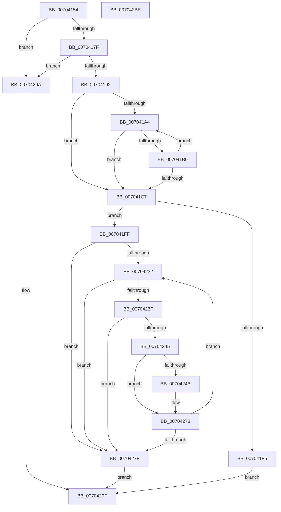

# EtwpAllocateStringFilterData

- RVA: `0x00704154`–`0x007042BF` (길이 `363` bytes)
- VA: `0x0000000140704154`
- 실행 섹션: `PAGE`
- PDB 이름 있음: `예`; PDB Function 태그: `아니요`
- unwind 정보 RVA: `0x0005FEF8`
- 디코드: `105`개 명령, `363/363` bytes 표시
- 미해석 바이트: `0` (있으면 어셈블리에 `.byte`로 보존)

> 이 문서는 커널 이미지의 기계어와 PDB 기호를 분석해 생성했습니다. 4번과 5번은 함수 원형과 자료형을 바이너리 사용 방식에서 추정한 C 해석이며 원본 소스 복구 결과는 아닙니다.

## 1. Dependencies

- 직접 호출 지점: **2**; 고유 호출 대상: **2**
- 직접 호출자로 확인된 함수: **1**
- RIP 상대 이미지 참조: **0**

### Outgoing calls
- `0x007041E8` → [ExAllocatePool2](../../poolcode/B8/ExAllocatePool2_function_00B820F0.md) (function, `0x00B820F0`)
- `0x0070421C` → [memcpy](../../text/6C/memcpy_function_006C6840.md) (function, `0x006C6840`)

### Direct callers
- [EtwpAllocateFilter](../9F/EtwpAllocateFilter_function_009FC948.md) at `0x009FCAE1`
- [EtwpAllocateFilter](../9F/EtwpAllocateFilter_function_009FC948.md) at `0x009FCB00`
- [EtwpAllocateFilter](../9F/EtwpAllocateFilter_function_009FC948.md) at `0x009FCB1F`
- [EtwpAllocateFilter](../9F/EtwpAllocateFilter_function_009FC948.md) at `0x009FCB3E`

### Static image references
- 디코드된 RIP-relative 메모리 참조가 없습니다.

## 2. Other-region calls and transfers

- 다른 실행 섹션으로 향하는 call: **2**
  - `0x007041E8` → [ExAllocatePool2](../../poolcode/B8/ExAllocatePool2_function_00B820F0.md) (`PAGE` → `POOLCODE`)
  - `0x0070421C` → [memcpy](../../text/6C/memcpy_function_006C6840.md) (`PAGE` → `.text`)
- 별도 외부 분기/꼬리 이동을 확인하지 못했습니다.

## 3. Assembly (complete function range)

```asm
00704154  48 8B C4                        mov rax, rsp
00704157  48 89 58 08                     mov qword ptr [rax + 8], rbx
0070415B  48 89 68 10                     mov qword ptr [rax + 0x10], rbp
0070415F  48 89 70 18                     mov qword ptr [rax + 0x18], rsi
00704163  48 89 78 20                     mov qword ptr [rax + 0x20], rdi
00704167  41 54                           push r12
00704169  41 56                           push r14
0070416B  41 57                           push r15
0070416D  48 83 EC 20                     sub rsp, 0x20
00704171  33 ED                           xor ebp, ebp
00704173  4C 8B F2                        mov r14, rdx
00704176  48 39 2A                        cmp qword ptr [rdx], rbp
00704179  0F 85 1B 01 00 00               jne 0x14070429a
0070417F  44 8B 41 08                     mov r8d, dword ptr [rcx + 8]
00704183  41 8D 40 FE                     lea eax, [r8 - 2]
00704187  3D FE 03 00 00                  cmp eax, 0x3fe
0070418C  0F 87 08 01 00 00               ja 0x14070429a
00704192  41 D1 E8                        shr r8d, 1
00704195  44 8D 65 01                     lea r12d, [rbp + 1]
00704199  4C 8B 39                        mov r15, qword ptr [rcx]
0070419C  41 0F B7 F4                     movzx esi, r12w
007041A0  8B DD                           mov ebx, ebp
007041A2  74 23                           je 0x1407041c7
007041A4  8B C3                           mov eax, ebx
007041A6  41 0F B7 0C 47                  movzx ecx, word ptr [r15 + rax*2]
007041AB  66 85 C9                        test cx, cx
007041AE  74 17                           je 0x1407041c7
007041B0  41 03 DC                        add ebx, r12d
007041B3  41 8D 04 34                     lea eax, [r12 + rsi]
007041B7  66 83 F9 3B                     cmp cx, 0x3b
007041BB  66 0F 45 C6                     cmovne ax, si
007041BF  0F B7 F0                        movzx esi, ax
007041C2  41 3B D8                        cmp ebx, r8d
007041C5  72 DD                           jb 0x1407041a4
007041C7  FF C3                           inc ebx
007041C9  0F B7 C6                        movzx eax, si
007041CC  44 3B C3                        cmp r8d, ebx
007041CF  41 0F 46 D8                     cmovbe ebx, r8d
007041D3  41 B8 45 74 77 46               mov r8d, 0x46777445
007041D9  8D 0C C3                        lea ecx, [rbx + rax*8]
007041DC  8D 14 4D 18 00 00 00            lea edx, [rcx*2 + 0x18]
007041E3  B9 00 01 00 00                  mov ecx, 0x100
007041E8  E8 03 DF 47 00                  call 0x140b820f0
007041ED  48 8B F8                        mov rdi, rax
007041F0  48 85 C0                        test rax, rax
007041F3  75 0A                           jne 0x1407041ff
007041F5  B8 17 00 00 C0                  mov eax, 0xc0000017
007041FA  E9 A0 00 00 00                  jmp 0x14070429f
007041FF  66 89 30                        mov word ptr [rax], si
00704202  49 8B D7                        mov rdx, r15
00704205  0F B7 F6                        movzx esi, si
00704208  48 C1 E6 04                     shl rsi, 4
0070420C  48 83 C6 18                     add rsi, 0x18
00704210  44 8B C3                        mov r8d, ebx
00704213  48 03 F7                        add rsi, rdi
00704216  4D 03 C0                        add r8, r8
00704219  48 8B CE                        mov rcx, rsi
0070421C  E8 1F 26 FC FF                  call 0x1406c6840
00704221  48 89 77 10                     mov qword ptr [rdi + 0x10], rsi
00704225  45 0F B7 C4                     movzx r8d, r12w
00704229  44 8B D5                        mov r10d, ebp
0070422C  8B D5                           mov edx, ebp
0070422E  85 DB                           test ebx, ebx
00704230  74 4D                           je 0x14070427f
00704232  44 8B CA                        mov r9d, edx
00704235  42 0F B7 04 4E                  movzx eax, word ptr [rsi + r9*2]
0070423A  66 85 C0                        test ax, ax
0070423D  74 40                           je 0x14070427f
0070423F  66 44 3B 07                     cmp r8w, word ptr [rdi]
00704243  73 3A                           jae 0x14070427f
00704245  66 83 F8 3B                     cmp ax, 0x3b
00704249  75 2D                           jne 0x140704278
0070424B  41 0F B7 C8                     movzx ecx, r8w
0070424F  0F B7 C2                        movzx eax, dx
00704252  66 41 2B C2                     sub ax, r10w
00704256  66 42 89 2C 4E                  mov word ptr [rsi + r9*2], bp
0070425B  48 03 C9                        add rcx, rcx
0070425E  44 8D 52 01                     lea r10d, [rdx + 1]
00704262  66 45 03 C4                     add r8w, r12w
00704266  66 89 44 CF F8                  mov word ptr [rdi + rcx*8 - 8], ax
0070426B  49 8D 41 01                     lea rax, [r9 + 1]
0070426F  48 8D 04 46                     lea rax, [rsi + rax*2]
00704273  48 89 44 CF 10                  mov qword ptr [rdi + rcx*8 + 0x10], rax
00704278  41 03 D4                        add edx, r12d
0070427B  3B D3                           cmp edx, ebx
0070427D  72 B3                           jb 0x140704232
0070427F  66 41 2B DA                     sub bx, r10w
00704283  41 0F B7 C0                     movzx eax, r8w
00704287  48 03 C0                        add rax, rax
0070428A  66 41 2B DC                     sub bx, r12w
0070428E  66 89 5C C7 F8                  mov word ptr [rdi + rax*8 - 8], bx
00704293  33 C0                           xor eax, eax
00704295  49 89 3E                        mov qword ptr [r14], rdi
00704298  EB 05                           jmp 0x14070429f
0070429A  B8 0D 00 00 C0                  mov eax, 0xc000000d
0070429F  48 8B 5C 24 40                  mov rbx, qword ptr [rsp + 0x40]
007042A4  48 8B 6C 24 48                  mov rbp, qword ptr [rsp + 0x48]
007042A9  48 8B 74 24 50                  mov rsi, qword ptr [rsp + 0x50]
007042AE  48 8B 7C 24 58                  mov rdi, qword ptr [rsp + 0x58]
007042B3  48 83 C4 20                     add rsp, 0x20
007042B7  41 5F                           pop r15
007042B9  41 5E                           pop r14
007042BB  41 5C                           pop r12
007042BD  C3                              ret
007042BE  CC                              int3
```

## 4. C-style interpretation (structured pseudocode)

```c
__int64 __fastcall EtwpAllocateStringFilterData(__int64 a1, __int64 a2)
{
    __int64 result;
    __int64 v_r10;
    __int64 v_rbp;
    __int64 v_rbx;
    __int64 v_rsi;
    __int64 v_rsp;
    unsigned __int64 v_stack_p10;
    unsigned __int64 v_stack_p18;
    unsigned __int64 v_stack_p20;
    unsigned __int64 v_stack_p8;

    *(unsigned __int64 *)(v_rsp + 8) = v_rbx;
    *(unsigned __int64 *)(v_rsp + 16) = v_rbp;
    *(unsigned __int64 *)(v_rsp + 24) = v_rsi;
    *(unsigned __int64 *)(v_rsp + 32) = v_rdi;
    v_rsp = (v_rsp) - (32);
    v_rbp = 0;
    if ((*(unsigned __int64 *)(a2)) != 0) goto loc_0070429A;
    if (((unsigned int)((unsigned int)(*(unsigned int *)(a1 + 8)) - 2)) > 0x3FEULL) goto loc_0070429A;
    a3 = (unsigned int)(((unsigned int)(*(unsigned int *)(a1 + 8))) >> (1));
    if (condition_is_equal) goto loc_007041C7;
loc_007041A4:
    if ((unsigned __int16)(*(unsigned __int16 *)(*(unsigned __int64 *)(a1) + 0 * 2)) == 0) goto loc_007041C7;
    v_rbx = (unsigned int)((0) + ((unsigned int)(v_rbp + 1)));
    result = v_rbp + 1 + (unsigned __int16)(v_rbp + 1) * 1;
    if (((unsigned __int16)(*(unsigned __int16 *)(*(unsigned __int64 *)(a1) + 0 * 2))) != 59) { result = (unsigned __int16)((unsigned __int16)(v_rbp + 1)); }
    if (((unsigned int)(v_rbx)) < ((unsigned int)(a3))) goto loc_007041A4;
loc_007041C7:
    v_rbx = (unsigned int)((v_rbx) + 1);
    if (((unsigned int)(a3)) <= ((unsigned int)(v_rbx))) { v_rbx = (unsigned int)(a3); }
    result = ExAllocatePool2(256, v_rbx + (unsigned __int16)((unsigned __int16)(result)) * 8 * 2 + 24, (unsigned int)(0x46777445ULL), a4);
    if (result != 0) goto loc_007041FF;
    goto loc_0070429F;
loc_007041FF:
    *(unsigned __int16 *)((unsigned int)(0xC0000017ULL)) = (unsigned __int16)((unsigned __int16)(result));
    v_rsi = ((unsigned __int16)((unsigned __int16)(result))) << (4);
    v_rsi = (v_rsi) + (24);
    v_rsi = (v_rsi) + (result);
    a3 = ((unsigned int)((unsigned int)(v_rbx))) + ((unsigned int)((unsigned int)(v_rbx)));
    result = memcpy(v_rsi, *(unsigned __int64 *)(a1), a3, a4);
    *(unsigned __int64 *)(result + 16) = v_rsi;
    if ((unsigned int)(v_rbx) == 0) goto loc_0070427F;
loc_00704232:
    if ((unsigned __int16)(*(unsigned __int16 *)(v_rsi + 0 * 2)) == 0) goto loc_0070427F;
    if (((unsigned __int16)((unsigned __int16)(v_rbp + 1))) >= (*(unsigned __int16 *)(result))) goto loc_0070427F;
    result = *(unsigned __int16 *)(v_rsi + 0 * 2);
    v_r10 = 0;
    if (((unsigned __int16)(*(unsigned __int16 *)(v_rsi + 0 * 2))) == 59) {
        a1 = (unsigned __int16)((unsigned __int16)(v_rbp + 1));
        result = 0;
        result = (unsigned __int16)((result) - (0));
        *(unsigned __int16 *)(v_rsi + 0 * 2) = 0;
        a1 = (a1) + (a1);
        v_r10 = 0 + 1;
        a3 = (unsigned __int16)(((unsigned __int16)(v_rbp + 1)) + ((unsigned __int16)(v_rbp + 1)));
        *(unsigned __int16 *)(result + a1 * 8 - 8) = (unsigned __int16)(result);
        result = 0 + 1;
        result = v_rsi + result * 2;
        *(unsigned __int64 *)(result + a1 * 8 + 16) = result;
    }
    a2 = (unsigned int)((0) + ((unsigned int)(v_rbp + 1)));
    if (((unsigned int)(a2)) < ((unsigned int)(v_rbx))) goto loc_00704232;
loc_0070427F:
    v_rbx = (unsigned __int16)((v_rbx) - ((unsigned __int16)(v_r10)));
    result = ((unsigned __int16)(a3)) + ((unsigned __int16)(a3));
    v_rbx = (unsigned __int16)((v_rbx) - ((unsigned __int16)(v_rbp + 1)));
    *(unsigned __int16 *)(result + result * 8 - 8) = (unsigned __int16)(v_rbx);
    result = 0;
    *(unsigned __int64 *)(a2) = 0;
    goto loc_0070429F;
loc_0070429A:
loc_0070429F:
    v_rsp = (v_rsp) + (32);
    return (unsigned int)(0xC000000DULL);
}
```

## 5. (Beta) C Style

```c
int64_t EtwpAllocateStringFilterData(void *Arg1, void *Arg2)
{
    uint8_t *arg1 = (uint8_t *)Arg1;
    uint8_t *arg2 = (uint8_t *)Arg2;

    int64_t result;
    int64_t local_r10;
    int64_t local_rbp;
    int64_t local_rbx;
    int64_t local_rsi;
    int64_t local_rsp;
    uint64_t v_stack_p10;
    uint64_t v_stack_p18;
    uint64_t v_stack_p20;
    uint64_t v_stack_p8;

    *(uint64_t *)(local_rsp + 0x8) = local_rbx;
    *(uint64_t *)(local_rsp + 0x10) = local_rbp;
    *(uint64_t *)(local_rsp + 0x18) = local_rsi;
    *(uint64_t *)(local_rsp + 0x20) = local_rdi;
    local_rsp = (local_rsp) - (32);
    local_rbp = 0;
    if ((*(uint64_t *)(arg2)) != 0) goto loc_0070429A;
    if (((uint32_t)((uint32_t)(*(uint32_t *)(arg1 + 0x8)) - 2)) > 0x3FEULL) goto loc_0070429A;
    a3 = (uint32_t)(((uint32_t)(*(uint32_t *)(arg1 + 0x8))) >> (1));
    if (condition_is_equal) goto loc_007041C7;
loc_007041A4:
    if ((uint16_t)(*(uint16_t *)(*(uint64_t *)(arg1) + 0x0 * 2)) == 0) goto loc_007041C7;
    local_rbx = (uint32_t)((0) + ((uint32_t)(local_rbp + 1)));
    result = local_rbp + 1 + (uint16_t)(local_rbp + 1) * 1;
    if (((uint16_t)(*(uint16_t *)(*(uint64_t *)(arg1) + 0x0 * 2))) != 59) { result = (uint16_t)((uint16_t)(local_rbp + 1)); }
    if (((uint32_t)(local_rbx)) < ((uint32_t)(a3))) goto loc_007041A4;
loc_007041C7:
    local_rbx = (uint32_t)((local_rbx) + 1);
    if (((uint32_t)(a3)) <= ((uint32_t)(local_rbx))) { local_rbx = (uint32_t)(a3); }
    result = ExAllocatePool2(256, local_rbx + (uint16_t)((uint16_t)(result)) * 8 * 2 + 24, (uint32_t)(0x46777445ULL), a4);
    if (result != 0) goto loc_007041FF;
    goto loc_0070429F;
loc_007041FF:
    *(uint16_t *)((uint32_t)(0xC0000017ULL)) = (uint16_t)((uint16_t)(result));
    local_rsi = ((uint16_t)((uint16_t)(result))) << (4);
    local_rsi = (local_rsi) + (24);
    local_rsi = (local_rsi) + (result);
    a3 = ((uint32_t)((uint32_t)(local_rbx))) + ((uint32_t)((uint32_t)(local_rbx)));
    result = memcpy(local_rsi, *(uint64_t *)(arg1), a3, a4);
    *(uint64_t *)(result + 0x10) = local_rsi;
    if ((uint32_t)(local_rbx) == 0) goto loc_0070427F;
loc_00704232:
    if ((uint16_t)(*(uint16_t *)(local_rsi + 0x0 * 2)) == 0) goto loc_0070427F;
    if (((uint16_t)((uint16_t)(local_rbp + 1))) >= (*(uint16_t *)(result))) goto loc_0070427F;
    result = *(uint16_t *)(local_rsi + 0x0 * 2);
    local_r10 = 0;
    if (((uint16_t)(*(uint16_t *)(local_rsi + 0x0 * 2))) == 59) {
        Arg1 = (uint16_t)((uint16_t)(local_rbp + 1));
        result = 0;
        result = (uint16_t)((result) - (0));
        *(uint16_t *)(local_rsi + 0x0 * 2) = 0;
        Arg1 = (Arg1) + (Arg1);
        local_r10 = 0 + 1;
        a3 = (uint16_t)(((uint16_t)(local_rbp + 1)) + ((uint16_t)(local_rbp + 1)));
        *(uint16_t *)(result + arg1 * 8 - 0x8) = (uint16_t)(result);
        result = 0 + 1;
        result = local_rsi + result * 2;
        *(uint64_t *)(result + arg1 * 8 + 0x10) = result;
    }
    Arg2 = (uint32_t)((0) + ((uint32_t)(local_rbp + 1)));
    if (((uint32_t)(Arg2)) < ((uint32_t)(local_rbx))) goto loc_00704232;
loc_0070427F:
    local_rbx = (uint16_t)((local_rbx) - ((uint16_t)(local_r10)));
    result = ((uint16_t)(a3)) + ((uint16_t)(a3));
    local_rbx = (uint16_t)((local_rbx) - ((uint16_t)(local_rbp + 1)));
    *(uint16_t *)(result + result * 8 - 0x8) = (uint16_t)(local_rbx);
    result = 0;
    *(uint64_t *)(arg2) = 0;
    goto loc_0070429F;
loc_0070429A:
loc_0070429F:
    local_rsp = (local_rsp) + (32);
    return (uint32_t)(0xC000000DULL);
}
```

### 관측된 메모리 오프셋

구조체 형식이 확인되지 않은 접근은 인자 기준의 오프셋으로만 기록했습니다.

| 기준 인자 | 오프셋 표현 | 폭 (bit) | 접근 |
|---|---:|---:|---|
| `Arg1` | `+ 0x0` | `64` | `R` |
| `Arg1` | `+ 0x8` | `32` | `R` |
| `Arg2` | `+ 0x0` | `64` | `R` |
| `Arg2` | `+ 0x0` | `64` | `W` |

## 6. Execution-region graph

[열기: 2D/3D 그래프와 함수 탐색 컨트롤 패널](../../../control-panel.html?section=page&rva=0x00704154&view=graph)

- 2D 그래프는 위에서 아래로 흐르고, 3D 그래프는 빈 공간을 드래그해 회전합니다. Shift+드래그는 이동, 휠은 확대·축소, 함수 노드 선택은 대상 보고서 이동입니다.

### Static fallback


