# EtwpCoverageEnsureContext

- RVA: `0x007028E4`–`0x00702DD1` (길이 `1,261` bytes)
- VA: `0x00000001407028E4`
- 실행 섹션: `PAGE`
- PDB 이름 있음: `예`; PDB Function 태그: `아니요`
- unwind 정보 RVA: `0x000BF840`
- 디코드: `304`개 명령, `1,261/1,261` bytes 표시
- 미해석 바이트: `0` (있으면 어셈블리에 `.byte`로 보존)

> 이 문서는 커널 이미지의 기계어와 PDB 기호를 분석해 생성했습니다. 4번과 5번은 함수 원형과 자료형을 바이너리 사용 방식에서 추정한 C 해석이며 원본 소스 복구 결과는 아닙니다.

## 1. Dependencies

- 직접 호출 지점: **24**; 고유 호출 대상: **18**
- 직접 호출자로 확인된 함수: **2**
- RIP 상대 이미지 참조: **28**

### Outgoing calls
- `0x0070298C` → [ExAllocatePool2](../../poolcode/B8/ExAllocatePool2_function_00B820F0.md) (function, `0x00B820F0`)
- `0x007029AE` → [memset](../../text/6C/memset_function_006C6C40.md) (function, `0x006C6C40`)
- `0x007029CE` → [ExAllocatePool2](../../poolcode/B8/ExAllocatePool2_function_00B820F0.md) (function, `0x00B820F0`)
- `0x007029ED` → [memset](../../text/6C/memset_function_006C6C40.md) (function, `0x006C6C40`)
- `0x00702A63` → [KeInitializeTimer2](../../text/3A/KeInitializeTimer2_function_003A30B0.md) (function, `0x003A30B0`)
- `0x00702A7C` → [KeInitializeTimer2](../../text/3A/KeInitializeTimer2_function_003A30B0.md) (function, `0x003A30B0`)
- `0x00702AC2` → [EtwpCoverageEnsureStringBuffer](../7B/EtwpCoverageEnsureStringBuffer_function_007B9CDC.md) (function, `0x007B9CDC`)
- `0x00702B11` → [MmCreateSection](../98/MmCreateSection_function_009838B0.md) (function, `0x009838B0`)
- `0x00702B3B` → [MmMapViewInSessionSpace](../98/MmMapViewInSessionSpace_function_00982480.md) (function, `0x00982480`)
- `0x00702BF0` → [KeAbPreAcquire](../../text/21/KeAbPreAcquire_function_00210230.md) (function, `0x00210230`)
- `0x00702C09` → [ExfAcquirePushLockExclusiveEx](../../text/20/ExfAcquirePushLockExclusiveEx_function_0020FC90.md) (function, `0x0020FC90`)
- `0x00702C97` → [KeSetTimer2](../../text/3A/KeSetTimer2_function_003A08E0.md) (function, `0x003A08E0`)
- `0x00702CB7` → [ExfTryToWakePushLock](../../text/26/ExfTryToWakePushLock_function_00265DD0.md) (function, `0x00265DD0`)
- `0x00702CBF` → [KeAbPostRelease](../../text/2E/KeAbPostRelease_function_002E1600.md) (function, `0x002E1600`)
- `0x00702CC4` → [KeLeaveCriticalRegion](../../text/25/KeLeaveCriticalRegion_function_0025D8B0.md) (function, `0x0025D8B0`)
- `0x00702CFD` → [TelemetryCoverageStringHashInternal](../../text/4D/TelemetryCoverageStringHashInternal_function_004D51A0.md) (function, `0x004D51A0`)
- `0x00702D0F` → [EtwTelemetryCoverageReport](../../text/46/EtwTelemetryCoverageReport_function_00460430.md) (function, `0x00460430`)
- `0x00702D47` → [TelemetryCoverageStringHashInternal](../../text/4D/TelemetryCoverageStringHashInternal_function_004D51A0.md) (function, `0x004D51A0`)
- `0x00702D59` → [EtwTelemetryCoverageReport](../../text/46/EtwTelemetryCoverageReport_function_00460430.md) (function, `0x00460430`)
- `0x00702D72` → [MiRemoveFromSystemSpace](../../text/29/MiRemoveFromSystemSpace_function_002962FC.md) (function, `0x002962FC`)
- `0x00702D84` → [ObfDereferenceObject](../../text/2F/ObfDereferenceObject_function_002F9350.md) (function, `0x002F9350`)
- `0x00702D9A` → [ExFreePoolWithTag](../../poolcode/B8/ExFreePoolWithTag_function_00B82870.md) (function, `0x00B82870`)
- `0x00702DA4` → [EtwpCoverageFreeStringBuffers](../7B/EtwpCoverageFreeStringBuffers_function_007B9EA0.md) (function, `0x007B9EA0`)
- `0x00702DB1` → [ExFreePoolWithTag](../../poolcode/B8/ExFreePoolWithTag_function_00B82870.md) (function, `0x00B82870`)

### Direct callers
- [sub_006F23BA](../../text/6F/Unknown_function_006F23BA.md) at `0x006F23BA`
- [EtwSetProcessTelemetryCoverage](../98/EtwSetProcessTelemetryCoverage_function_009804E0.md) at `0x00980546`

### Static image references
- `0x007028FE` → RVA `0x00EFF284` (`.data`; read)
- `0x00702911` → RVA `0x00E0EB60` (`.data`; read)
- `0x00702953` → RVA `0x00E0EB60` (`.data`; write)
- `0x00702959` → RVA `0x00E0EB5C` (`.data`; read)
- `0x00702961` → RVA `0x00E0EB5C` (`.data`; write)
- `0x0070296C` → RVA `0x00E0EB58` (`.data`; read)
- `0x00702974` → RVA `0x00E0EB58` (`.data`; write)
- `0x007029F5` → RVA `0x00651D60` (`EtwpCoverageResetTimerCallback`; read)
- `0x00702A13` → RVA `0x00651B00` (`EtwpCoverageHighIrqlCPWorkItemCallback`; read)
- `0x00702A6B` → RVA `0x00651AD0` (`EtwpCoverageFlushTimerCallback`; read)
- `0x00702A84` → RVA `0x007BA450` (`EtwpCoverageResetWorkItemCallback`; read)
- `0x00702A92` → RVA `0x007B9D90` (`EtwpCoverageFlushWorkItemCallback`; read)
- `0x00702B72` → RVA `0x00FC5008` (`ALMOSTRO`; read)
- `0x00702BBC` → RVA `0x00EFF1B8` (`.data`; read)
- `0x00702C20` → RVA `0x00E684E8` (`.data`; read)
- `0x00702C27` → RVA `0x00E684E0` (`.data`; write)
- `0x00702C30` → RVA `0x00E684F8` (`.data`; read)
- `0x00702C3A` → RVA `0x00E684E8` (`.data`; write)
- `0x00702C44` → RVA `0x00E684F0` (`.data`; write)
- `0x00702CA3` → RVA `0x00EFF1B8` (`.data`; read/write)
- `0x00702CD5` → RVA `0x00E0921C` (`.data`; read)
- `0x00702CDD` → RVA `0x00E09218` (`.data`; read)
- `0x00702CE6` → RVA `0x00E09210` (`.data`; read)
- `0x00702D02` → RVA `0x00E09218` (`.data`; write)
- `0x00702D1F` → RVA `0x00E09264` (`.data`; read)
- `0x00702D27` → RVA `0x00E09260` (`.data`; read)
- `0x00702D30` → RVA `0x00E09258` (`.data`; read)
- `0x00702D4C` → RVA `0x00E09260` (`.data`; write)

## 2. Other-region calls and transfers

- 다른 실행 섹션으로 향하는 call: **20**
  - `0x0070298C` → [ExAllocatePool2](../../poolcode/B8/ExAllocatePool2_function_00B820F0.md) (`PAGE` → `POOLCODE`)
  - `0x007029AE` → [memset](../../text/6C/memset_function_006C6C40.md) (`PAGE` → `.text`)
  - `0x007029CE` → [ExAllocatePool2](../../poolcode/B8/ExAllocatePool2_function_00B820F0.md) (`PAGE` → `POOLCODE`)
  - `0x007029ED` → [memset](../../text/6C/memset_function_006C6C40.md) (`PAGE` → `.text`)
  - `0x00702A63` → [KeInitializeTimer2](../../text/3A/KeInitializeTimer2_function_003A30B0.md) (`PAGE` → `.text`)
  - `0x00702A7C` → [KeInitializeTimer2](../../text/3A/KeInitializeTimer2_function_003A30B0.md) (`PAGE` → `.text`)
  - `0x00702BF0` → [KeAbPreAcquire](../../text/21/KeAbPreAcquire_function_00210230.md) (`PAGE` → `.text`)
  - `0x00702C09` → [ExfAcquirePushLockExclusiveEx](../../text/20/ExfAcquirePushLockExclusiveEx_function_0020FC90.md) (`PAGE` → `.text`)
  - `0x00702C97` → [KeSetTimer2](../../text/3A/KeSetTimer2_function_003A08E0.md) (`PAGE` → `.text`)
  - `0x00702CB7` → [ExfTryToWakePushLock](../../text/26/ExfTryToWakePushLock_function_00265DD0.md) (`PAGE` → `.text`)
  - `0x00702CBF` → [KeAbPostRelease](../../text/2E/KeAbPostRelease_function_002E1600.md) (`PAGE` → `.text`)
  - `0x00702CC4` → [KeLeaveCriticalRegion](../../text/25/KeLeaveCriticalRegion_function_0025D8B0.md) (`PAGE` → `.text`)
  - `0x00702CFD` → [TelemetryCoverageStringHashInternal](../../text/4D/TelemetryCoverageStringHashInternal_function_004D51A0.md) (`PAGE` → `.text`)
  - `0x00702D0F` → [EtwTelemetryCoverageReport](../../text/46/EtwTelemetryCoverageReport_function_00460430.md) (`PAGE` → `.text`)
  - `0x00702D47` → [TelemetryCoverageStringHashInternal](../../text/4D/TelemetryCoverageStringHashInternal_function_004D51A0.md) (`PAGE` → `.text`)
  - `0x00702D59` → [EtwTelemetryCoverageReport](../../text/46/EtwTelemetryCoverageReport_function_00460430.md) (`PAGE` → `.text`)
  - `0x00702D72` → [MiRemoveFromSystemSpace](../../text/29/MiRemoveFromSystemSpace_function_002962FC.md) (`PAGE` → `.text`)
  - `0x00702D84` → [ObfDereferenceObject](../../text/2F/ObfDereferenceObject_function_002F9350.md) (`PAGE` → `.text`)
  - `0x00702D9A` → [ExFreePoolWithTag](../../poolcode/B8/ExFreePoolWithTag_function_00B82870.md) (`PAGE` → `POOLCODE`)
  - `0x00702DB1` → [ExFreePoolWithTag](../../poolcode/B8/ExFreePoolWithTag_function_00B82870.md) (`PAGE` → `POOLCODE`)
- 별도 외부 분기/꼬리 이동을 확인하지 못했습니다.

## 3. Assembly (complete function range)

```asm
007028E4  48 89 5C 24 20                  mov qword ptr [rsp + 0x20], rbx
007028E9  55                              push rbp
007028EA  56                              push rsi
007028EB  57                              push rdi
007028EC  41 54                           push r12
007028EE  41 55                           push r13
007028F0  41 56                           push r14
007028F2  41 57                           push r15
007028F4  48 83 EC 50                     sub rsp, 0x50
007028F8  41 BF 01 00 00 00               mov r15d, 1
007028FE  44 38 3D 7F C9 7F 00            cmp byte ptr [rip + 0x7fc97f], r15b
00702905  77 0A                           ja 0x140702911
00702907  BE BB 00 00 C0                  mov esi, 0xc00000bb
0070290C  E9 A5 04 00 00                  jmp 0x140702db6
00702911  8B 15 49 C2 70 00               mov edx, dword ptr [rip + 0x70c249]
00702917  45 33 ED                        xor r13d, r13d
0070291A  85 D2                           test edx, edx
0070291C  74 E9                           je 0x140702907
0070291E  B8 00 00 08 00                  mov eax, 0x80000
00702923  3B D0                           cmp edx, eax
00702925  72 02                           jb 0x140702929
00702927  8B D0                           mov edx, eax
00702929  BB 40 00 00 00                  mov ebx, 0x40
0070292E  3B D3                           cmp edx, ebx
00702930  77 02                           ja 0x140702934
00702932  8B D3                           mov edx, ebx
00702934  8D 42 FF                        lea eax, [rdx - 1]
00702937  85 C2                           test edx, eax
00702939  74 13                           je 0x14070294e
0070293B  83 C9 FF                        or ecx, 0xffffffff
0070293E  85 D2                           test edx, edx
00702940  74 07                           je 0x140702949
00702942  41 03 CF                        add ecx, r15d
00702945  D1 EA                           shr edx, 1
00702947  75 F9                           jne 0x140702942
00702949  41 8B D7                        mov edx, r15d
0070294C  D3 E2                           shl edx, cl
0070294E  B8 E8 03 00 00                  mov eax, 0x3e8
00702953  89 15 07 C2 70 00               mov dword ptr [rip + 0x70c207], edx
00702959  39 05 FD C1 70 00               cmp dword ptr [rip + 0x70c1fd], eax
0070295F  77 06                           ja 0x140702967
00702961  89 05 F5 C1 70 00               mov dword ptr [rip + 0x70c1f5], eax
00702967  B8 80 EE 36 00                  mov eax, 0x36ee80
0070296C  39 05 E6 C1 70 00               cmp dword ptr [rip + 0x70c1e6], eax
00702972  77 06                           ja 0x14070297a
00702974  89 05 DE C1 70 00               mov dword ptr [rip + 0x70c1de], eax
0070297A  BE 48 00 00 00                  mov esi, 0x48
0070297F  41 B8 45 74 77 56               mov r8d, 0x56777445
00702985  8B D6                           mov edx, esi
00702987  B9 00 01 00 00                  mov ecx, 0x100
0070298C  E8 5F F7 47 00                  call 0x140b820f0
00702991  48 8B F8                        mov rdi, rax
00702994  48 8B E8                        mov rbp, rax
00702997  48 85 C0                        test rax, rax
0070299A  75 0A                           jne 0x1407029a6
0070299C  BE 9A 00 00 C0                  mov esi, 0xc000009a
007029A1  E9 10 04 00 00                  jmp 0x140702db6
007029A6  4C 8B C6                        mov r8, rsi
007029A9  33 D2                           xor edx, edx
007029AB  48 8B CF                        mov rcx, rdi
007029AE  E8 8D 42 FC FF                  call 0x1406c6c40
007029B3  48 8D 47 30                     lea rax, [rdi + 0x30]
007029B7  BE B8 01 00 00                  mov esi, 0x1b8
007029BC  8B D6                           mov edx, esi
007029BE  48 89 40 08                     mov qword ptr [rax + 8], rax
007029C2  41 B8 45 74 77 56               mov r8d, 0x56777445
007029C8  48 89 00                        mov qword ptr [rax], rax
007029CB  48 8B CB                        mov rcx, rbx
007029CE  E8 1D F7 47 00                  call 0x140b820f0
007029D3  48 89 07                        mov qword ptr [rdi], rax
007029D6  48 85 C0                        test rax, rax
007029D9  75 0A                           jne 0x1407029e5
007029DB  BE 9A 00 00 C0                  mov esi, 0xc000009a
007029E0  E9 81 03 00 00                  jmp 0x140702d66
007029E5  4C 8B C6                        mov r8, rsi
007029E8  33 D2                           xor edx, edx
007029EA  48 8B C8                        mov rcx, rax
007029ED  E8 4E 42 FC FF                  call 0x1406c6c40
007029F2  48 8B 0F                        mov rcx, qword ptr [rdi]
007029F5  48 8D 15 64 F3 F4 FF            lea rdx, [rip - 0xb0c9c]
007029FC  BB 08 00 00 00                  mov ebx, 8
00702A01  44 8B CB                        mov r9d, ebx
00702A04  4C 89 69 18                     mov qword ptr [rcx + 0x18], r13
00702A08  48 8D 41 28                     lea rax, [rcx + 0x28]
00702A0C  48 89 40 08                     mov qword ptr [rax + 8], rax
00702A10  48 89 00                        mov qword ptr [rax], rax
00702A13  48 8D 05 E6 F0 F4 FF            lea rax, [rip - 0xb0f1a]
00702A1A  48 89 41 48                     mov qword ptr [rcx + 0x48], rax
00702A1E  48 89 79 50                     mov qword ptr [rcx + 0x50], rdi
00702A22  4C 89 69 38                     mov qword ptr [rcx + 0x38], r13
00702A26  48 B9 04 00 00 00 80 F7 FF FF   movabs rcx, 0xfffff78000000004
00702A30  8B 05 26 C1 70 00               mov eax, dword ptr [rip + 0x70c126]
00702A36  89 47 1C                        mov dword ptr [rdi + 0x1c], eax
00702A39  48 B8 20 03 00 00 80 F7 FF FF   movabs rax, 0xfffff78000000320
00702A43  48 8B 00                        mov rax, qword ptr [rax]
00702A46  44 8B 21                        mov r12d, dword ptr [rcx]
00702A49  4C 0F AF E0                     imul r12, rax
00702A4D  48 8B 07                        mov rax, qword ptr [rdi]
00702A50  49 C1 EC 18                     shr r12, 0x18
00702A54  44 89 60 10                     mov dword ptr [rax + 0x10], r12d
00702A58  4C 8B 07                        mov r8, qword ptr [rdi]
00702A5B  44 89 67 18                     mov dword ptr [rdi + 0x18], r12d
00702A5F  49 8D 48 68                     lea rcx, [r8 + 0x68]
00702A63  E8 48 06 CA FF                  call 0x1403a30b0
00702A68  4C 8B 07                        mov r8, qword ptr [rdi]
00702A6B  48 8D 15 5E F0 F4 FF            lea rdx, [rip - 0xb0fa2]
00702A72  44 8B CB                        mov r9d, ebx
00702A75  49 8D 88 F0 00 00 00            lea rcx, [r8 + 0xf0]
00702A7C  E8 2F 06 CA FF                  call 0x1403a30b0
00702A81  48 8B 07                        mov rax, qword ptr [rdi]
00702A84  48 8D 0D C5 79 0B 00            lea rcx, [rip + 0xb79c5]
00702A8B  48 89 88 A8 01 00 00            mov qword ptr [rax + 0x1a8], rcx
00702A92  48 8D 0D F7 72 0B 00            lea rcx, [rip + 0xb72f7]
00702A99  48 89 B8 B0 01 00 00            mov qword ptr [rax + 0x1b0], rdi
00702AA0  4C 89 A8 98 01 00 00            mov qword ptr [rax + 0x198], r13
00702AA7  48 8B 07                        mov rax, qword ptr [rdi]
00702AAA  48 89 88 88 01 00 00            mov qword ptr [rax + 0x188], rcx
00702AB1  48 8B CF                        mov rcx, rdi
00702AB4  48 89 B8 90 01 00 00            mov qword ptr [rax + 0x190], rdi
00702ABB  4C 89 A8 78 01 00 00            mov qword ptr [rax + 0x178], r13
00702AC2  E8 15 72 0B 00                  call 0x1407b9cdc
00702AC7  8B F0                           mov esi, eax
00702AC9  85 C0                           test eax, eax
00702ACB  0F 88 95 02 00 00               js 0x140702d66
00702AD1  8B 1D 89 C0 70 00               mov ebx, dword ptr [rip + 0x70c089]
00702AD7  4C 8D 8C 24 98 00 00 00         lea r9, [rsp + 0x98]
00702ADF  4C 89 6C 24 38                  mov qword ptr [rsp + 0x38], r13
00702AE4  48 8D 4F 08                     lea rcx, [rdi + 8]
00702AE8  4C 89 6C 24 30                  mov qword ptr [rsp + 0x30], r13
00702AED  45 33 C0                        xor r8d, r8d
00702AF0  48 C1 E3 02                     shl rbx, 2
00702AF4  BA 1F 00 0F 00                  mov edx, 0xf001f
00702AF9  C7 44 24 28 00 00 00 08         mov dword ptr [rsp + 0x28], 0x8000000
00702B01  48 89 9C 24 98 00 00 00         mov qword ptr [rsp + 0x98], rbx
00702B09  C7 44 24 20 04 00 00 00         mov dword ptr [rsp + 0x20], 4
00702B11  E8 9A 0D 28 00                  call 0x1409838b0
00702B16  8B F0                           mov esi, eax
00702B18  85 C0                           test eax, eax
00702B1A  0F 88 46 02 00 00               js 0x140702d66
00702B20  48 8B 4F 08                     mov rcx, qword ptr [rdi + 8]
00702B24  4C 8D 77 10                     lea r14, [rdi + 0x10]
00702B28  49 8B D6                        mov rdx, r14
00702B2B  4C 89 AC 24 A0 00 00 00         mov qword ptr [rsp + 0xa0], r13
00702B33  4C 8D 84 24 A0 00 00 00         lea r8, [rsp + 0xa0]
00702B3B  E8 40 F9 27 00                  call 0x140982480
00702B40  8B F0                           mov esi, eax
00702B42  85 C0                           test eax, eax
00702B44  0F 88 1C 02 00 00               js 0x140702d66
00702B4A  49 8B 06                        mov rax, qword ptr [r14]
00702B4D  83 C3 CC                        add ebx, -0x34
00702B50  C6 00 02                        mov byte ptr [rax], 2
00702B53  49 8B 06                        mov rax, qword ptr [r14]
00702B56  44 88 78 01                     mov byte ptr [rax + 1], r15b
00702B5A  49 8B 06                        mov rax, qword ptr [r14]
00702B5D  44 89 78 18                     mov dword ptr [rax + 0x18], r15d
00702B61  49 8B 06                        mov rax, qword ptr [r14]
00702B64  48 8B 0F                        mov rcx, qword ptr [rdi]
00702B67  8B 40 18                        mov eax, dword ptr [rax + 0x18]
00702B6A  89 01                           mov dword ptr [rcx], eax
00702B6C  49 8B 06                        mov rax, qword ptr [r14]
00702B6F  8B 48 18                        mov ecx, dword ptr [rax + 0x18]
00702B72  48 8B 05 8F 24 8C 00            mov rax, qword ptr [rip + 0x8c248f]
00702B79  89 88 7C 03 00 00               mov dword ptr [rax + 0x37c], ecx
00702B7F  49 8B 06                        mov rax, qword ptr [r14]
00702B82  44 89 60 14                     mov dword ptr [rax + 0x14], r12d
00702B86  49 8B 06                        mov rax, qword ptr [r14]
00702B89  48 8B 0F                        mov rcx, qword ptr [rdi]
00702B8C  8B 40 14                        mov eax, dword ptr [rax + 0x14]
00702B8F  89 41 14                        mov dword ptr [rcx + 0x14], eax
00702B92  8B 0D C8 BF 70 00               mov ecx, dword ptr [rip + 0x70bfc8]
00702B98  49 8B 06                        mov rax, qword ptr [r14]
00702B9B  FF C9                           dec ecx
00702B9D  C1 EB 02                        shr ebx, 2
00702BA0  89 48 08                        mov dword ptr [rax + 8], ecx
00702BA3  B9 02 00 00 00                  mov ecx, 2
00702BA8  49 8B 06                        mov rax, qword ptr [r14]
00702BAB  89 58 04                        mov dword ptr [rax + 4], ebx
00702BAE  49 2B CF                        sub rcx, r15
00702BB1  75 F5                           jne 0x140702ba8
00702BB3  49 8B 0E                        mov rcx, qword ptr [r14]
00702BB6  45 33 C0                        xor r8d, r8d
00702BB9  C1 EB 02                        shr ebx, 2
00702BBC  4C 8D 35 F5 C5 7F 00            lea r14, [rip + 0x7fc5f5]
00702BC3  33 D2                           xor edx, edx
00702BC5  8D 04 5B                        lea eax, [rbx + rbx*2]
00702BC8  48 83 CB FF                     or rbx, 0xffffffffffffffff
00702BCC  89 47 20                        mov dword ptr [rdi + 0x20], eax
00702BCF  8B 41 04                        mov eax, dword ptr [rcx + 4]
00702BD2  8D 04 85 34 00 00 00            lea eax, [rax*4 + 0x34]
00702BD9  89 41 10                        mov dword ptr [rcx + 0x10], eax
00702BDC  49 8B CE                        mov rcx, r14
00702BDF  65 48 8B 04 25 88 01 00 00      mov rax, qword ptr gs:[0x188]
00702BE8  66 01 98 E4 01 00 00            add word ptr [rax + 0x1e4], bx
00702BEF  90                              nop
00702BF0  E8 3B D6 B0 FF                  call 0x140210230
00702BF5  F0 49 0F BA 2E 00               lock bts qword ptr [r14], 0
00702BFB  48 8B F0                        mov rsi, rax
00702BFE  73 0E                           jae 0x140702c0e
00702C00  4D 8B C6                        mov r8, r14
00702C03  48 8B D0                        mov rdx, rax
00702C06  49 8B CE                        mov rcx, r14
00702C09  E8 82 D0 B0 FF                  call 0x14020fc90
00702C0E  48 85 F6                        test rsi, rsi
00702C11  74 04                           je 0x140702c17
00702C13  44 88 7E 0A                     mov byte ptr [rsi + 0xa], r15b
00702C17  65 48 8B 04 25 88 01 00 00      mov rax, qword ptr gs:[0x188]
00702C20  4C 39 2D C1 58 76 00            cmp qword ptr [rip + 0x7658c1], r13
00702C27  48 89 05 B2 58 76 00            mov qword ptr [rip + 0x7658b2], rax
00702C2E  75 6C                           jne 0x140702c9c
00702C30  44 39 2D C1 58 76 00            cmp dword ptr [rip + 0x7658c1], r13d
00702C37  48 8B 07                        mov rax, qword ptr [rdi]
00702C3A  48 89 3D A7 58 76 00            mov qword ptr [rip + 0x7658a7], rdi
00702C41  49 8B FD                        mov rdi, r13
00702C44  48 89 05 A5 58 76 00            mov qword ptr [rip + 0x7658a5], rax
00702C4B  74 1A                           je 0x140702c67
00702C4D  48 8B 45 10                     mov rax, qword ptr [rbp + 0x10]
00702C51  66 44 09 78 02                  or word ptr [rax + 2], r15w
00702C56  48 8B 05 AB 23 8C 00            mov rax, qword ptr [rip + 0x8c23ab]
00702C5D  C7 80 7C 03 00 00 00 FF FF FF   mov dword ptr [rax + 0x37c], 0xffffff00
00702C67  8B 05 EB BE 70 00               mov eax, dword ptr [rip + 0x70beeb]
00702C6D  4C 8D 4C 24 40                  lea r9, [rsp + 0x40]
00702C72  4C 69 C0 10 27 00 00            imul r8, rax, 0x2710
00702C79  48 8B 05 68 58 76 00            mov rax, qword ptr [rip + 0x765868]
00702C80  49 8B D0                        mov rdx, r8
00702C83  4C 89 6C 24 40                  mov qword ptr [rsp + 0x40], r13
00702C88  48 F7 DA                        neg rdx
00702C8B  48 89 5C 24 48                  mov qword ptr [rsp + 0x48], rbx
00702C90  48 8B 08                        mov rcx, qword ptr [rax]
00702C93  48 83 C1 68                     add rcx, 0x68
00702C97  E8 44 DC C9 FF                  call 0x1403a08e0
00702C9C  4C 89 2D 3D 58 76 00            mov qword ptr [rip + 0x76583d], r13
00702CA3  F0 48 0F C1 1D 0C C5 7F 00      lock xadd qword ptr [rip + 0x7fc50c], rbx
00702CAC  80 E3 06                        and bl, 6
00702CAF  80 FB 02                        cmp bl, 2
00702CB2  75 08                           jne 0x140702cbc
00702CB4  49 8B CE                        mov rcx, r14
00702CB7  E8 14 31 B6 FF                  call 0x140265dd0
00702CBC  49 8B CE                        mov rcx, r14
00702CBF  E8 3C E9 BD FF                  call 0x1402e1600
00702CC4  E8 E7 AB B5 FF                  call 0x14025d8b0
00702CC9  48 BB 7C 03 00 00 80 F7 FF FF   movabs rbx, 0xfffff7800000037c
00702CD3  8B 03                           mov eax, dword ptr [rbx]
00702CD5  39 05 41 65 70 00               cmp dword ptr [rip + 0x706541], eax
00702CDB  73 37                           jae 0x140702d14
00702CDD  44 39 2D 34 65 70 00            cmp dword ptr [rip + 0x706534], r13d
00702CE4  75 22                           jne 0x140702d08
00702CE6  48 8B 0D 23 65 70 00            mov rcx, qword ptr [rip + 0x706523]
00702CED  48 8D 94 24 90 00 00 00         lea rdx, [rsp + 0x90]
00702CF5  44 89 AC 24 90 00 00 00         mov dword ptr [rsp + 0x90], r13d
00702CFD  E8 9E 24 DD FF                  call 0x1404d51a0
00702D02  89 05 10 65 70 00               mov dword ptr [rip + 0x706510], eax
00702D08  48 8D 0D 01 65 70 00            lea rcx, [rip + 0x706501]
00702D0F  E8 1C D7 D5 FF                  call 0x140460430
00702D14  44 39 2D DD 57 76 00            cmp dword ptr [rip + 0x7657dd], r13d
00702D1B  74 41                           je 0x140702d5e
00702D1D  8B 03                           mov eax, dword ptr [rbx]
00702D1F  39 05 3F 65 70 00               cmp dword ptr [rip + 0x70653f], eax
00702D25  73 37                           jae 0x140702d5e
00702D27  44 39 2D 32 65 70 00            cmp dword ptr [rip + 0x706532], r13d
00702D2E  75 22                           jne 0x140702d52
00702D30  48 8B 0D 21 65 70 00            mov rcx, qword ptr [rip + 0x706521]
00702D37  48 8D 94 24 90 00 00 00         lea rdx, [rsp + 0x90]
00702D3F  44 89 AC 24 90 00 00 00         mov dword ptr [rsp + 0x90], r13d
00702D47  E8 54 24 DD FF                  call 0x1404d51a0
00702D4C  89 05 0E 65 70 00               mov dword ptr [rip + 0x70650e], eax
00702D52  48 8D 0D FF 64 70 00            lea rcx, [rip + 0x7064ff]
00702D59  E8 D2 D6 D5 FF                  call 0x140460430
00702D5E  41 8B F5                        mov esi, r13d
00702D61  48 85 FF                        test rdi, rdi
00702D64  74 50                           je 0x140702db6
00702D66  48 8B 4F 10                     mov rcx, qword ptr [rdi + 0x10]
00702D6A  48 85 C9                        test rcx, rcx
00702D6D  74 0C                           je 0x140702d7b
00702D6F  41 8B D7                        mov edx, r15d
00702D72  E8 85 35 B9 FF                  call 0x1402962fc
00702D77  4C 89 6F 10                     mov qword ptr [rdi + 0x10], r13
00702D7B  48 8B 4F 08                     mov rcx, qword ptr [rdi + 8]
00702D7F  48 85 C9                        test rcx, rcx
00702D82  74 09                           je 0x140702d8d
00702D84  E8 C7 65 BF FF                  call 0x1402f9350
00702D89  4C 89 6F 08                     mov qword ptr [rdi + 8], r13
00702D8D  48 8B 0F                        mov rcx, qword ptr [rdi]
00702D90  48 85 C9                        test rcx, rcx
00702D93  74 0A                           je 0x140702d9f
00702D95  BA 45 74 77 56                  mov edx, 0x56777445
00702D9A  E8 D1 FA 47 00                  call 0x140b82870
00702D9F  33 D2                           xor edx, edx
00702DA1  48 8B CF                        mov rcx, rdi
00702DA4  E8 F7 70 0B 00                  call 0x1407b9ea0
00702DA9  BA 45 74 77 56                  mov edx, 0x56777445
00702DAE  48 8B CF                        mov rcx, rdi
00702DB1  E8 BA FA 47 00                  call 0x140b82870
00702DB6  48 8B 9C 24 A8 00 00 00         mov rbx, qword ptr [rsp + 0xa8]
00702DBE  8B C6                           mov eax, esi
00702DC0  48 83 C4 50                     add rsp, 0x50
00702DC4  41 5F                           pop r15
00702DC6  41 5E                           pop r14
00702DC8  41 5D                           pop r13
00702DCA  41 5C                           pop r12
00702DCC  5F                              pop rdi
00702DCD  5E                              pop rsi
00702DCE  5D                              pop rbp
00702DCF  C3                              ret
00702DD0  CC                              int3
```

## 4. C-style interpretation (structured pseudocode)

```c
__int64 __fastcall EtwpCoverageEnsureContext(int a1)
{
    __int64 result;
    __int64 v_r12;
    __int64 v_r13;
    __int64 v_rbx;
    __int64 v_rsp;
    unsigned __int64 v_stack_m40;
    unsigned __int64 v_stack_m48;
    unsigned __int64 v_stack_m50;
    unsigned __int64 v_stack_m58;
    unsigned int v_stack_m60;
    unsigned int v_stack_m68;
    unsigned __int64 v_stack_p10;
    unsigned __int64 v_stack_p18;
    unsigned __int64 v_stack_p20;
    unsigned __int64 v_stack_p8;

    v_stack_p20 = v_rbx;
    v_rsp = (v_rsp) - (80);
    if ((*(unsigned __int8 *)(v_rip + 8374655)) > 1) goto loc_00702911;
loc_00702907:
    goto loc_00702DB6;
loc_00702911:
    v_r13 = 0;
    if ((unsigned int)((unsigned int)(*(unsigned int *)(v_rip + 7389769))) == 0) goto loc_00702907;
    if (((unsigned int)((unsigned int)(*(unsigned int *)(v_rip + 7389769)))) >= ((unsigned int)((unsigned int)(0x80000ULL)))) {
        a2 = (unsigned int)((unsigned int)(0x80000ULL));
    }
    if (((unsigned int)(a2)) <= 64) {
        a2 = 64;
    }
    if ((((unsigned int)(a2)) & ((unsigned int)(a2 - 1))) == 0) goto loc_0070294E;
    a1 = (unsigned int)((a1) | (0xFFFFFFFFULL));
    if ((unsigned int)(a2) == 0) goto loc_00702949;
loc_00702942:
    a1 = (unsigned int)((a1) + (1));
    a2 = (unsigned int)((a2) >> (1));
    if (condition_is_not_equal) goto loc_00702942;
loc_00702949:
    a2 = (unsigned int)((1) << ((unsigned __int8)(a1)));
loc_0070294E:
    *(unsigned int *)(v_rip + 7389703) = (unsigned int)(a2);
    if ((*(unsigned int *)(v_rip + 7389693)) <= 1000) {
        *(unsigned int *)(v_rip + 7389685) = 1000;
    }
    if ((*(unsigned int *)(v_rip + 7389670)) <= ((unsigned int)((unsigned int)(0x36EE80ULL)))) {
        *(unsigned int *)(v_rip + 7389662) = (unsigned int)((unsigned int)(0x36EE80ULL));
    }
    result = ExAllocatePool2(256, 72, (unsigned int)(0x56777445ULL), a4);
    if (result != 0) goto loc_007029A6;
    goto loc_00702DB6;
loc_007029A6:
    a2 = 0;
    result = memset(result, a2, (unsigned int)(0xC000009AULL), a4);
    *(unsigned __int64 *)(result + 48 + 8) = result + 48;
    *(unsigned __int64 *)(result + 48) = result + 48;
    result = ExAllocatePool2(64, 440, (unsigned int)(0x56777445ULL), a4);
    *(unsigned __int64 *)(result) = result;
    if (result != 0) goto loc_007029E5;
    goto loc_00702D66;
loc_007029E5:
    a2 = 0;
    result = memset(result, a2, (unsigned int)(0xC000009AULL), a4);
    *(unsigned __int64 *)(*(unsigned __int64 *)(result) + 24) = 0;
    *(unsigned __int64 *)(*(unsigned __int64 *)(result) + 40 + 8) = *(unsigned __int64 *)(result) + 40;
    *(unsigned __int64 *)(*(unsigned __int64 *)(result) + 40) = *(unsigned __int64 *)(result) + 40;
    *(unsigned __int64 *)(*(unsigned __int64 *)(result) + 72) = v_rip - 724762;
    *(unsigned __int64 *)(*(unsigned __int64 *)(result) + 80) = result;
    *(unsigned __int64 *)(*(unsigned __int64 *)(result) + 56) = 0;
    *(unsigned int *)(result + 28) = (unsigned int)((unsigned int)(*(unsigned int *)(v_rip + 7389478)));
    v_r12 = ((unsigned int)(*(unsigned int *)(*(unsigned __int64 *)(result)))) * (*(unsigned __int64 *)((unsigned int)(*(unsigned int *)(v_rip + 7389478))));
    v_r12 = (v_r12) >> (24);
    *(unsigned int *)(*(unsigned __int64 *)(result) + 16) = (unsigned int)(v_r12);
    *(unsigned int *)(result + 24) = (unsigned int)(v_r12);
    result = KeInitializeTimer2(*(unsigned __int64 *)(result) + 104, v_rip - 724124, *(unsigned __int64 *)(result), 8);
    result = KeInitializeTimer2(*(unsigned __int64 *)(result) + 240, v_rip - 724898, *(unsigned __int64 *)(result), 8);
    *(unsigned __int64 *)(*(unsigned __int64 *)(result) + 424) = v_rip + 752069;
    *(unsigned __int64 *)(*(unsigned __int64 *)(result) + 432) = result;
    *(unsigned __int64 *)(*(unsigned __int64 *)(result) + 408) = 0;
    *(unsigned __int64 *)(*(unsigned __int64 *)(result) + 392) = v_rip + 750327;
    *(unsigned __int64 *)(*(unsigned __int64 *)(result) + 400) = result;
    *(unsigned __int64 *)(*(unsigned __int64 *)(result) + 376) = 0;
    result = EtwpCoverageEnsureStringBuffer(result, v_rip - 724898, *(unsigned __int64 *)(result), 8);
    if (sign_flag) goto loc_00702D66;
    v_stack_m50 = 0;
    v_stack_m58 = 0;
    a3 = 0;
    v_rbx = ((unsigned int)(*(unsigned int *)(v_rip + 7389321))) << (2);
    v_stack_m60 = 0x8000000ULL;
    v_stack_p10 = v_rbx;
    v_stack_m68 = 4;
    result = MmCreateSection(result + 8, (unsigned int)(0xF001FULL), a3, v_stack_p10);
    if (sign_flag) goto loc_00702D66;
    v_stack_p18 = 0;
    result = MmMapViewInSessionSpace(*(unsigned __int64 *)(result + 8), result + 16, v_stack_p18, v_stack_p10);
    if (sign_flag) goto loc_00702D66;
    v_rbx = (unsigned int)((v_rbx) + (-52));
    *(unsigned __int8 *)(*(unsigned __int64 *)(result + 16)) = 2;
    *(unsigned __int8 *)(*(unsigned __int64 *)(result + 16) + 1) = 1;
    *(unsigned int *)(*(unsigned __int64 *)(result + 16) + 24) = 1;
    *(unsigned int *)(*(unsigned __int64 *)(result)) = (unsigned int)((unsigned int)(*(unsigned int *)(*(unsigned __int64 *)(result + 16) + 24)));
    *(unsigned int *)(*(unsigned __int64 *)(v_rip + 9184399) + 892) = (unsigned int)((unsigned int)(*(unsigned int *)(*(unsigned __int64 *)(result + 16) + 24)));
    *(unsigned int *)(*(unsigned __int64 *)(result + 16) + 20) = (unsigned int)(v_r12);
    *(unsigned int *)(*(unsigned __int64 *)(result) + 20) = (unsigned int)((unsigned int)(*(unsigned int *)(*(unsigned __int64 *)(result + 16) + 20)));
    a1 = (unsigned int)(((unsigned int)(*(unsigned int *)(v_rip + 7389128))) - 1);
    v_rbx = (unsigned int)((v_rbx) >> (2));
    *(unsigned int *)(*(unsigned __int64 *)(result + 16) + 8) = a1;
loc_00702BA8:
    *(unsigned int *)(*(unsigned __int64 *)(result + 16) + 4) = (unsigned int)(v_rbx);
    a1 = (2) - (1);
    if (condition_is_not_equal) goto loc_00702BA8;
    a3 = 0;
    v_rbx = (unsigned int)((v_rbx) >> (2));
    a2 = 0;
    v_rbx = (v_rbx) | (-1);
    *(unsigned int *)(result + 32) = (unsigned int)(v_rbx + v_rbx * 2);
    *(unsigned int *)(*(unsigned __int64 *)(result + 16) + 16) = (unsigned int)((unsigned int)(*(unsigned int *)(*(unsigned __int64 *)(result + 16) + 4)) * 4 + 52);
    result = KeAbPreAcquire(v_rip + 8373749, a2, a3, v_stack_p10);
    if (!(condition_is_above_or_equal)) {
        a3 = v_rip + 8373749;
        a2 = result;
        a1 = v_rip + 8373749;
        result = ExfAcquirePushLockExclusiveEx(a1, a2, a3, v_stack_p10);
    }
    if (result != 0) {
        *(unsigned __int8 *)(result + 10) = 1;
    }
    *(unsigned __int64 *)(v_rip + 7755954) = *(unsigned __int64 *)(gs_base + (0 + 392));
    if ((*(unsigned __int64 *)(v_rip + 7755969)) != 0) goto loc_00702C9C;
    *(unsigned __int64 *)(v_rip + 7755943) = result;
    *(unsigned __int64 *)(v_rip + 7755941) = *(unsigned __int64 *)(result);
    result = *(unsigned __int64 *)(result);
    if ((*(unsigned int *)(v_rip + 7755969)) != 0) {
        result = *(unsigned __int64 *)(result + 16);
        result = *(unsigned __int64 *)(v_rip + 9184171);
        *(unsigned int *)(result + 892) = 0xFFFFFF00ULL;
    }
    a3 = (a3) * ((unsigned int)(*(unsigned int *)(v_rip + 7388907)));
    v_stack_m48 = 0;
    a2 = -(a3);
    v_stack_m40 = v_rbx;
    a1 = (*(unsigned __int64 *)(*(unsigned __int64 *)(v_rip + 7755880))) + (104);
    result = KeSetTimer2(a1, a2, a3, v_stack_m48);
loc_00702C9C:
    *(unsigned __int64 *)(v_rip + 7755837) = 0;
    v_rbx = (unsigned __int8)((v_rbx) & (6));
    if (((unsigned __int8)(v_rbx)) == 2) {
        a1 = v_rip + 8373749;
        result = ExfTryToWakePushLock(a1, a2, a3, v_stack_m48);
    }
    result = KeAbPostRelease(v_rip + 8373749, a2, a3, v_stack_m48);
    result = KeLeaveCriticalRegion(v_rip + 8373749, a2, a3, v_stack_m48);
    if ((*(unsigned int *)(v_rip + 7365953)) >= ((unsigned int)((unsigned int)(*(unsigned int *)(v_rbx))))) goto loc_00702D14;
    result = (unsigned int)(*(unsigned int *)(v_rbx));
    if ((*(unsigned int *)(v_rip + 7365940)) == 0) {
        a1 = *(unsigned __int64 *)(v_rip + 7365923);
        a2 = v_stack_p8;
        v_stack_p8 = 0;
        result = TelemetryCoverageStringHashInternal(a1, a2, a3, v_stack_m48);
        *(unsigned int *)(v_rip + 7365904) = (unsigned int)(result);
    }
    result = EtwTelemetryCoverageReport(v_rip + 7365889, a2, a3, v_stack_m48);
loc_00702D14:
    if ((*(unsigned int *)(v_rip + 7755741)) == 0) goto loc_00702D5E;
    if ((*(unsigned int *)(v_rip + 7365951)) >= ((unsigned int)((unsigned int)(*(unsigned int *)(v_rbx))))) goto loc_00702D5E;
    result = (unsigned int)(*(unsigned int *)(v_rbx));
    if ((*(unsigned int *)(v_rip + 7365938)) == 0) {
        a1 = *(unsigned __int64 *)(v_rip + 7365921);
        a2 = v_stack_p8;
        v_stack_p8 = 0;
        result = TelemetryCoverageStringHashInternal(a1, a2, a3, v_stack_m48);
        *(unsigned int *)(v_rip + 7365902) = (unsigned int)(result);
    }
    result = EtwTelemetryCoverageReport(v_rip + 7365887, a2, a3, v_stack_m48);
loc_00702D5E:
    if (0 == 0) goto loc_00702DB6;
loc_00702D66:
    if (*(unsigned __int64 *)(0 + 16) != 0) {
        a2 = 1;
        result = MiRemoveFromSystemSpace(*(unsigned __int64 *)(0 + 16), a2, a3, v_stack_m48);
        *(unsigned __int64 *)(0 + 16) = 0;
    }
    if (*(unsigned __int64 *)(0 + 8) != 0) {
        result = ObfDereferenceObject(*(unsigned __int64 *)(0 + 8), a2, a3, v_stack_m48);
        *(unsigned __int64 *)(0 + 8) = 0;
    }
    if (*(unsigned __int64 *)(0) != 0) {
        a2 = 0x56777445ULL;
        result = ExFreePoolWithTag(*(unsigned __int64 *)(0), a2, a3, v_stack_m48);
    }
    a2 = 0;
    result = EtwpCoverageFreeStringBuffers(0, a2, a3, v_stack_m48);
    result = ExFreePoolWithTag(0, (unsigned int)(0x56777445ULL), a3, v_stack_m48);
loc_00702DB6:
    v_rsp = (v_rsp) + (80);
    return 0;
}
```

## 5. (Beta) C Style

```c
int64_t EtwpCoverageEnsureContext(int32_t Arg1)
{
    int64_t result;
    int64_t local_r12;
    int64_t local_r13;
    int64_t local_rbx;
    int64_t local_rsp;
    uint64_t v_stack_m40;
    uint64_t v_stack_m48;
    uint64_t v_stack_m50;
    uint64_t v_stack_m58;
    uint32_t v_stack_m60;
    uint32_t v_stack_m68;
    uint64_t v_stack_p10;
    uint64_t v_stack_p18;
    uint64_t v_stack_p20;
    uint64_t v_stack_p8;

    v_stack_p20 = local_rbx;
    local_rsp = (local_rsp) - (80);
    if ((*(uint8_t *)(v_rip + 0x7FC97F)) > 1) goto loc_00702911;
loc_00702907:
    goto loc_00702DB6;
loc_00702911:
    local_r13 = 0;
    if ((uint32_t)((uint32_t)(*(uint32_t *)(v_rip + 0x70C249))) == 0) goto loc_00702907;
    if (((uint32_t)((uint32_t)(*(uint32_t *)(v_rip + 0x70C249)))) >= ((uint32_t)((uint32_t)(0x80000ULL)))) {
        a2 = (uint32_t)((uint32_t)(0x80000ULL));
    }
    if (((uint32_t)(a2)) <= 64) {
        a2 = 64;
    }
    if ((((uint32_t)(a2)) & ((uint32_t)(a2 - 1))) == 0) goto loc_0070294E;
    Arg1 = (uint32_t)((Arg1) | (0xFFFFFFFFULL));
    if ((uint32_t)(a2) == 0) goto loc_00702949;
loc_00702942:
    Arg1 = (uint32_t)((Arg1) + (1));
    a2 = (uint32_t)((a2) >> (1));
    if (condition_is_not_equal) goto loc_00702942;
loc_00702949:
    a2 = (uint32_t)((1) << ((uint8_t)(Arg1)));
loc_0070294E:
    *(uint32_t *)(v_rip + 0x70C207) = (uint32_t)(a2);
    if ((*(uint32_t *)(v_rip + 0x70C1FD)) <= 1000) {
        *(uint32_t *)(v_rip + 0x70C1F5) = 1000;
    }
    if ((*(uint32_t *)(v_rip + 0x70C1E6)) <= ((uint32_t)((uint32_t)(0x36EE80ULL)))) {
        *(uint32_t *)(v_rip + 0x70C1DE) = (uint32_t)((uint32_t)(0x36EE80ULL));
    }
    result = ExAllocatePool2(256, 72, (uint32_t)(0x56777445ULL), a4);
    if (result != 0) goto loc_007029A6;
    goto loc_00702DB6;
loc_007029A6:
    a2 = 0;
    result = memset(result, a2, (uint32_t)(0xC000009AULL), a4);
    *(uint64_t *)(result + 0x30 + 0x8) = result + 48;
    *(uint64_t *)(result + 0x30) = result + 48;
    result = ExAllocatePool2(64, 440, (uint32_t)(0x56777445ULL), a4);
    *(uint64_t *)(result) = result;
    if (result != 0) goto loc_007029E5;
    goto loc_00702D66;
loc_007029E5:
    a2 = 0;
    result = memset(result, a2, (uint32_t)(0xC000009AULL), a4);
    *(uint64_t *)(*(uint64_t *)(result) + 0x18) = 0;
    *(uint64_t *)(*(uint64_t *)(result) + 0x28 + 0x8) = *(uint64_t *)(result) + 40;
    *(uint64_t *)(*(uint64_t *)(result) + 0x28) = *(uint64_t *)(result) + 40;
    *(uint64_t *)(*(uint64_t *)(result) + 0x48) = v_rip - 724762;
    *(uint64_t *)(*(uint64_t *)(result) + 0x50) = result;
    *(uint64_t *)(*(uint64_t *)(result) + 0x38) = 0;
    *(uint32_t *)(result + 0x1C) = (uint32_t)((uint32_t)(*(uint32_t *)(v_rip + 0x70C126)));
    local_r12 = ((uint32_t)(*(uint32_t *)(*(uint64_t *)(result)))) * (*(uint64_t *)((uint32_t)(*(uint32_t *)(v_rip + 0x70C126))));
    local_r12 = (local_r12) >> (24);
    *(uint32_t *)(*(uint64_t *)(result) + 0x10) = (uint32_t)(local_r12);
    *(uint32_t *)(result + 0x18) = (uint32_t)(local_r12);
    result = KeInitializeTimer2(*(uint64_t *)(result) + 104, v_rip - 724124, *(uint64_t *)(result), 8);
    result = KeInitializeTimer2(*(uint64_t *)(result) + 240, v_rip - 724898, *(uint64_t *)(result), 8);
    *(uint64_t *)(*(uint64_t *)(result) + 0x1A8) = v_rip + 752069;
    *(uint64_t *)(*(uint64_t *)(result) + 0x1B0) = result;
    *(uint64_t *)(*(uint64_t *)(result) + 0x198) = 0;
    *(uint64_t *)(*(uint64_t *)(result) + 0x188) = v_rip + 750327;
    *(uint64_t *)(*(uint64_t *)(result) + 0x190) = result;
    *(uint64_t *)(*(uint64_t *)(result) + 0x178) = 0;
    result = EtwpCoverageEnsureStringBuffer(result, v_rip - 724898, *(uint64_t *)(result), 8);
    if (sign_flag) goto loc_00702D66;
    v_stack_m50 = 0;
    v_stack_m58 = 0;
    a3 = 0;
    local_rbx = ((uint32_t)(*(uint32_t *)(v_rip + 0x70C089))) << (2);
    v_stack_m60 = 0x8000000ULL;
    v_stack_p10 = local_rbx;
    v_stack_m68 = 4;
    result = MmCreateSection(result + 8, (uint32_t)(0xF001FULL), a3, v_stack_p10);
    if (sign_flag) goto loc_00702D66;
    v_stack_p18 = 0;
    result = MmMapViewInSessionSpace(*(uint64_t *)(result + 0x8), result + 16, v_stack_p18, v_stack_p10);
    if (sign_flag) goto loc_00702D66;
    local_rbx = (uint32_t)((local_rbx) + (-52));
    *(uint8_t *)(*(uint64_t *)(result + 0x10)) = 2;
    *(uint8_t *)(*(uint64_t *)(result + 0x10) + 0x1) = 1;
    *(uint32_t *)(*(uint64_t *)(result + 0x10) + 0x18) = 1;
    *(uint32_t *)(*(uint64_t *)(result)) = (uint32_t)((uint32_t)(*(uint32_t *)(*(uint64_t *)(result + 0x10) + 0x18)));
    *(uint32_t *)(*(uint64_t *)(v_rip + 0x8C248F) + 0x37C) = (uint32_t)((uint32_t)(*(uint32_t *)(*(uint64_t *)(result + 0x10) + 0x18)));
    *(uint32_t *)(*(uint64_t *)(result + 0x10) + 0x14) = (uint32_t)(local_r12);
    *(uint32_t *)(*(uint64_t *)(result) + 0x14) = (uint32_t)((uint32_t)(*(uint32_t *)(*(uint64_t *)(result + 0x10) + 0x14)));
    Arg1 = (uint32_t)(((uint32_t)(*(uint32_t *)(v_rip + 0x70BFC8))) - 1);
    local_rbx = (uint32_t)((local_rbx) >> (2));
    *(uint32_t *)(*(uint64_t *)(result + 0x10) + 0x8) = Arg1;
loc_00702BA8:
    *(uint32_t *)(*(uint64_t *)(result + 0x10) + 0x4) = (uint32_t)(local_rbx);
    Arg1 = (2) - (1);
    if (condition_is_not_equal) goto loc_00702BA8;
    a3 = 0;
    local_rbx = (uint32_t)((local_rbx) >> (2));
    a2 = 0;
    local_rbx = (local_rbx) | (-1);
    *(uint32_t *)(result + 0x20) = (uint32_t)(local_rbx + local_rbx * 2);
    *(uint32_t *)(*(uint64_t *)(result + 0x10) + 0x10) = (uint32_t)((uint32_t)(*(uint32_t *)(*(uint64_t *)(result + 0x10) + 0x4)) * 4 + 52);
    result = KeAbPreAcquire(v_rip + 8373749, a2, a3, v_stack_p10);
    if (!(condition_is_above_or_equal)) {
        a3 = v_rip + 8373749;
        a2 = result;
        Arg1 = v_rip + 8373749;
        result = ExfAcquirePushLockExclusiveEx(Arg1, a2, a3, v_stack_p10);
    }
    if (result != 0) {
        *(uint8_t *)(result + 0xA) = 1;
    }
    *(uint64_t *)(v_rip + 0x7658B2) = *(uint64_t *)(gs_base + (0 + 0x188));
    if ((*(uint64_t *)(v_rip + 0x7658C1)) != 0) goto loc_00702C9C;
    *(uint64_t *)(v_rip + 0x7658A7) = result;
    *(uint64_t *)(v_rip + 0x7658A5) = *(uint64_t *)(result);
    result = *(uint64_t *)(result);
    if ((*(uint32_t *)(v_rip + 0x7658C1)) != 0) {
        result = *(uint64_t *)(result + 0x10);
        result = *(uint64_t *)(v_rip + 0x8C23AB);
        *(uint32_t *)(result + 0x37C) = 0xFFFFFF00ULL;
    }
    a3 = (a3) * ((uint32_t)(*(uint32_t *)(v_rip + 0x70BEEB)));
    v_stack_m48 = 0;
    a2 = -(a3);
    v_stack_m40 = local_rbx;
    Arg1 = (*(uint64_t *)(*(uint64_t *)(v_rip + 0x765868))) + (104);
    result = KeSetTimer2(Arg1, a2, a3, v_stack_m48);
loc_00702C9C:
    *(uint64_t *)(v_rip + 0x76583D) = 0;
    local_rbx = (uint8_t)((local_rbx) & (6));
    if (((uint8_t)(local_rbx)) == 2) {
        Arg1 = v_rip + 8373749;
        result = ExfTryToWakePushLock(Arg1, a2, a3, v_stack_m48);
    }
    result = KeAbPostRelease(v_rip + 8373749, a2, a3, v_stack_m48);
    result = KeLeaveCriticalRegion(v_rip + 8373749, a2, a3, v_stack_m48);
    if ((*(uint32_t *)(v_rip + 0x706541)) >= ((uint32_t)((uint32_t)(*(uint32_t *)(local_rbx))))) goto loc_00702D14;
    result = (uint32_t)(*(uint32_t *)(local_rbx));
    if ((*(uint32_t *)(v_rip + 0x706534)) == 0) {
        Arg1 = *(uint64_t *)(v_rip + 0x706523);
        a2 = v_stack_p8;
        v_stack_p8 = 0;
        result = TelemetryCoverageStringHashInternal(Arg1, a2, a3, v_stack_m48);
        *(uint32_t *)(v_rip + 0x706510) = (uint32_t)(result);
    }
    result = EtwTelemetryCoverageReport(v_rip + 7365889, a2, a3, v_stack_m48);
loc_00702D14:
    if ((*(uint32_t *)(v_rip + 0x7657DD)) == 0) goto loc_00702D5E;
    if ((*(uint32_t *)(v_rip + 0x70653F)) >= ((uint32_t)((uint32_t)(*(uint32_t *)(local_rbx))))) goto loc_00702D5E;
    result = (uint32_t)(*(uint32_t *)(local_rbx));
    if ((*(uint32_t *)(v_rip + 0x706532)) == 0) {
        Arg1 = *(uint64_t *)(v_rip + 0x706521);
        a2 = v_stack_p8;
        v_stack_p8 = 0;
        result = TelemetryCoverageStringHashInternal(Arg1, a2, a3, v_stack_m48);
        *(uint32_t *)(v_rip + 0x70650E) = (uint32_t)(result);
    }
    result = EtwTelemetryCoverageReport(v_rip + 7365887, a2, a3, v_stack_m48);
loc_00702D5E:
    if (0 == 0) goto loc_00702DB6;
loc_00702D66:
    if (*(uint64_t *)(0 + 0x10) != 0) {
        a2 = 1;
        result = MiRemoveFromSystemSpace(*(uint64_t *)(0 + 0x10), a2, a3, v_stack_m48);
        *(uint64_t *)(0 + 0x10) = 0;
    }
    if (*(uint64_t *)(0 + 0x8) != 0) {
        result = ObfDereferenceObject(*(uint64_t *)(0 + 0x8), a2, a3, v_stack_m48);
        *(uint64_t *)(0 + 0x8) = 0;
    }
    if (*(uint64_t *)(0) != 0) {
        a2 = 0x56777445ULL;
        result = ExFreePoolWithTag(*(uint64_t *)(0), a2, a3, v_stack_m48);
    }
    a2 = 0;
    result = EtwpCoverageFreeStringBuffers(0, a2, a3, v_stack_m48);
    result = ExFreePoolWithTag(0, (uint32_t)(0x56777445ULL), a3, v_stack_m48);
loc_00702DB6:
    local_rsp = (local_rsp) + (80);
    return 0;
}
```

## 6. Execution-region graph

[열기: 2D/3D 그래프와 함수 탐색 컨트롤 패널](../../../control-panel.html?section=page&rva=0x007028E4&view=graph)

- 2D 그래프는 위에서 아래로 흐르고, 3D 그래프는 빈 공간을 드래그해 회전합니다. Shift+드래그는 이동, 휠은 확대·축소, 함수 노드 선택은 대상 보고서 이동입니다.

### Static fallback

```mermaid
flowchart TD
  bb_007028E4[BB_007028E4]
  bb_00702907[BB_00702907]
  bb_00702911[BB_00702911]
  bb_0070291E[BB_0070291E]
  bb_00702927[BB_00702927]
  bb_00702929[BB_00702929]
  bb_00702932[BB_00702932]
  bb_00702934[BB_00702934]
  bb_0070293B[BB_0070293B]
  bb_00702942[BB_00702942]
  bb_00702949[BB_00702949]
  bb_0070294E[BB_0070294E]
  bb_00702961[BB_00702961]
  bb_00702967[BB_00702967]
  bb_00702974[BB_00702974]
  bb_0070297A[BB_0070297A]
  bb_0070299C[BB_0070299C]
  bb_007029A6[BB_007029A6]
  bb_007029DB[BB_007029DB]
  bb_007029E5[BB_007029E5]
  bb_00702AD1[BB_00702AD1]
  bb_00702B20[BB_00702B20]
  bb_00702B4A[BB_00702B4A]
  bb_00702BA8[BB_00702BA8]
  bb_00702BB3[BB_00702BB3]
  bb_00702C00[BB_00702C00]
  bb_00702C0E[BB_00702C0E]
  bb_00702C13[BB_00702C13]
  bb_00702C17[BB_00702C17]
  bb_00702C30[BB_00702C30]
  bb_00702C4D[BB_00702C4D]
  bb_00702C67[BB_00702C67]
  bb_00702C9C[BB_00702C9C]
  bb_00702CB4[BB_00702CB4]
  bb_00702CBC[BB_00702CBC]
  bb_00702CDD[BB_00702CDD]
  bb_00702CE6[BB_00702CE6]
  bb_00702D08[BB_00702D08]
  bb_00702D14[BB_00702D14]
  bb_00702D1D[BB_00702D1D]
  bb_00702D27[BB_00702D27]
  bb_00702D30[BB_00702D30]
  bb_00702D52[BB_00702D52]
  bb_00702D5E[BB_00702D5E]
  bb_00702D66[BB_00702D66]
  bb_00702D6F[BB_00702D6F]
  bb_00702D7B[BB_00702D7B]
  bb_00702D84[BB_00702D84]
  bb_00702D8D[BB_00702D8D]
  bb_00702D95[BB_00702D95]
  bb_00702D9F[BB_00702D9F]
  bb_00702DB6[BB_00702DB6]
  bb_00702DD0[BB_00702DD0]
  bb_007028E4 -->|branch| bb_00702911
  bb_007028E4 -->|fallthrough| bb_00702907
  bb_00702907 -->|branch| bb_00702DB6
  bb_00702911 -->|branch| bb_00702907
  bb_00702911 -->|fallthrough| bb_0070291E
  bb_0070291E -->|branch| bb_00702929
  bb_0070291E -->|fallthrough| bb_00702927
  bb_00702927 -->|flow| bb_00702929
  bb_00702929 -->|branch| bb_00702934
  bb_00702929 -->|fallthrough| bb_00702932
  bb_00702932 -->|flow| bb_00702934
  bb_00702934 -->|branch| bb_0070294E
  bb_00702934 -->|fallthrough| bb_0070293B
  bb_0070293B -->|branch| bb_00702949
  bb_0070293B -->|fallthrough| bb_00702942
  bb_00702942 -->|branch| bb_00702942
  bb_00702942 -->|fallthrough| bb_00702949
  bb_00702949 -->|flow| bb_0070294E
  bb_0070294E -->|branch| bb_00702967
  bb_0070294E -->|fallthrough| bb_00702961
  bb_00702961 -->|flow| bb_00702967
  bb_00702967 -->|branch| bb_0070297A
  bb_00702967 -->|fallthrough| bb_00702974
  bb_00702974 -->|flow| bb_0070297A
  bb_0070297A -->|branch| bb_007029A6
  bb_0070297A -->|fallthrough| bb_0070299C
  bb_0070299C -->|branch| bb_00702DB6
  bb_007029A6 -->|branch| bb_007029E5
  bb_007029A6 -->|fallthrough| bb_007029DB
  bb_007029DB -->|branch| bb_00702D66
  bb_007029E5 -->|branch| bb_00702D66
  bb_007029E5 -->|fallthrough| bb_00702AD1
  bb_00702AD1 -->|branch| bb_00702D66
  bb_00702AD1 -->|fallthrough| bb_00702B20
  bb_00702B20 -->|branch| bb_00702D66
  bb_00702B20 -->|fallthrough| bb_00702B4A
  bb_00702B4A -->|flow| bb_00702BA8
  bb_00702BA8 -->|branch| bb_00702BA8
  bb_00702BA8 -->|fallthrough| bb_00702BB3
  bb_00702BB3 -->|branch| bb_00702C0E
  bb_00702BB3 -->|fallthrough| bb_00702C00
  bb_00702C00 -->|flow| bb_00702C0E
  bb_00702C0E -->|branch| bb_00702C17
  bb_00702C0E -->|fallthrough| bb_00702C13
  bb_00702C13 -->|flow| bb_00702C17
  bb_00702C17 -->|branch| bb_00702C9C
  bb_00702C17 -->|fallthrough| bb_00702C30
  bb_00702C30 -->|branch| bb_00702C67
  bb_00702C30 -->|fallthrough| bb_00702C4D
  bb_00702C4D -->|flow| bb_00702C67
  bb_00702C67 -->|flow| bb_00702C9C
  bb_00702C9C -->|branch| bb_00702CBC
  bb_00702C9C -->|fallthrough| bb_00702CB4
  bb_00702CB4 -->|flow| bb_00702CBC
  bb_00702CBC -->|branch| bb_00702D14
  bb_00702CBC -->|fallthrough| bb_00702CDD
  bb_00702CDD -->|branch| bb_00702D08
  bb_00702CDD -->|fallthrough| bb_00702CE6
  bb_00702CE6 -->|flow| bb_00702D08
  bb_00702D08 -->|flow| bb_00702D14
  bb_00702D14 -->|branch| bb_00702D5E
  bb_00702D14 -->|fallthrough| bb_00702D1D
  bb_00702D1D -->|branch| bb_00702D5E
  bb_00702D1D -->|fallthrough| bb_00702D27
  bb_00702D27 -->|branch| bb_00702D52
  bb_00702D27 -->|fallthrough| bb_00702D30
  bb_00702D30 -->|flow| bb_00702D52
  bb_00702D52 -->|flow| bb_00702D5E
  bb_00702D5E -->|branch| bb_00702DB6
  bb_00702D5E -->|fallthrough| bb_00702D66
  bb_00702D66 -->|branch| bb_00702D7B
  bb_00702D66 -->|fallthrough| bb_00702D6F
  bb_00702D6F -->|flow| bb_00702D7B
  bb_00702D7B -->|branch| bb_00702D8D
  bb_00702D7B -->|fallthrough| bb_00702D84
  bb_00702D84 -->|flow| bb_00702D8D
  bb_00702D8D -->|branch| bb_00702D9F
  bb_00702D8D -->|fallthrough| bb_00702D95
  bb_00702D95 -->|flow| bb_00702D9F
  bb_00702D9F -->|flow| bb_00702DB6
```


