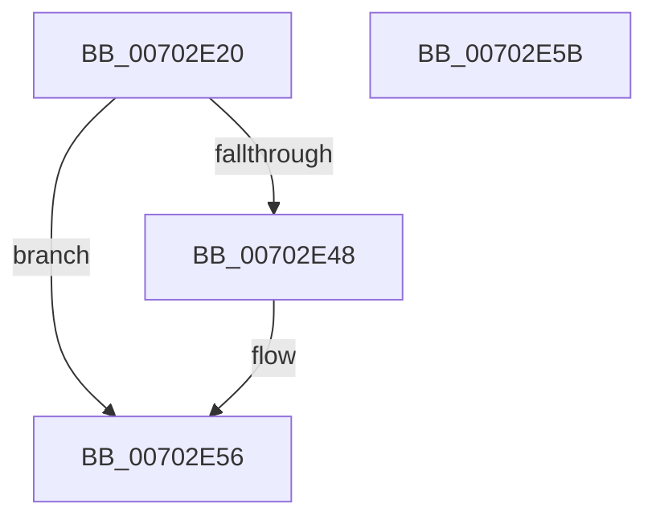

# ExQueryBootEntropyInformation

- RVA: `0x00702E20`–`0x00702E5C` (길이 `60` bytes)
- VA: `0x0000000140702E20`
- 실행 섹션: `PAGE`
- PDB 이름 있음: `예`; PDB Function 태그: `아니요`
- unwind 정보 RVA: `0x00085914`
- 디코드: `15`개 명령, `60/60` bytes 표시
- 미해석 바이트: `0` (있으면 어셈블리에 `.byte`로 보존)

> 이 문서는 커널 이미지의 기계어와 PDB 기호를 분석해 생성했습니다. 4번과 5번은 함수 원형과 자료형을 바이너리 사용 방식에서 추정한 C 해석이며 원본 소스 복구 결과는 아닙니다.

## 1. Dependencies

- 직접 호출 지점: **1**; 고유 호출 대상: **1**
- 직접 호출자로 확인된 함수: **2**
- RIP 상대 이미지 참조: **2**

### Outgoing calls
- `0x00702E3F` → [RtlRunOnceExecuteOnce](../95/RtlRunOnceExecuteOnce_function_0095DC00.md) (function, `0x0095DC00`)

### Direct callers
- [ExpQuerySystemInformation](../A5/ExpQuerySystemInformation_function_00A57858.md) at `0x00A597F6`
- [Phase1InitializationIoReady](../../init/C7/Phase1InitializationIoReady_function_00C70458.md) at `0x00C707A7`

### Static image references
- `0x00702E31` → RVA `0x007C42C0` (`ExpInitBootEntropyInformation`; read)
- `0x00702E38` → RVA `0x00FD85C0` (`PAGEDATA`; read)

## 2. Other-region calls and transfers

- 다른 실행 섹션으로 향하는 call: **0**
- 별도 외부 분기/꼬리 이동을 확인하지 못했습니다.

## 3. Assembly (complete function range)

```asm
00702E20  48 89 4C 24 08                  mov qword ptr [rsp + 8], rcx
00702E25  48 83 EC 28                     sub rsp, 0x28
00702E29  45 33 C9                        xor r9d, r9d
00702E2C  4C 8D 44 24 30                  lea r8, [rsp + 0x30]
00702E31  48 8D 15 88 14 0C 00            lea rdx, [rip + 0xc1488]
00702E38  48 8D 0D 81 57 8D 00            lea rcx, [rip + 0x8d5781]
00702E3F  E8 BC AD 25 00                  call 0x14095dc00
00702E44  85 C0                           test eax, eax
00702E46  78 0E                           js 0x140702e56
00702E48  48 83 7C 24 30 FF               cmp qword ptr [rsp + 0x30], -1
00702E4E  B9 01 00 00 C0                  mov ecx, 0xc0000001
00702E53  0F 45 C1                        cmovne eax, ecx
00702E56  48 83 C4 28                     add rsp, 0x28
00702E5A  C3                              ret
00702E5B  CC                              int3
```

## 4. C-style interpretation (structured pseudocode)

```c
__int64 __fastcall ExQueryBootEntropyInformation(__int64 a1, __int64 a2, __int64 a3, int a4)
{
    __int64 result;
    __int64 v_rsp;
    unsigned __int64 v_stack_p8;

    v_stack_p8 = a1;
    v_rsp = (v_rsp) - (40);
    a4 = 0;
    result = RtlRunOnceExecuteOnce(v_rip + 9262977, v_rip + 791688, v_stack_p8, a4);
    if (!(sign_flag)) {
        a1 = 0xC0000001ULL;
        if (v_stack_p8 != -1) { result = (unsigned int)(a1); }
    }
    v_rsp = (v_rsp) + (40);
    return result;
}
```

## 5. (Beta) C Style

```c
int64_t ExQueryBootEntropyInformation(int64_t Arg1, int64_t Arg2, int64_t Arg3, int32_t Arg4)
{
    int64_t result;
    int64_t local_rsp;
    uint64_t v_stack_p8;

    v_stack_p8 = Arg1;
    local_rsp = (local_rsp) - (40);
    Arg4 = 0;
    result = RtlRunOnceExecuteOnce(v_rip + 9262977, v_rip + 791688, v_stack_p8, Arg4);
    if (!(sign_flag)) {
        Arg1 = 0xC0000001ULL;
        if (v_stack_p8 != -1) { result = (uint32_t)(Arg1); }
    }
    local_rsp = (local_rsp) + (40);
    return result;
}
```

## 6. Execution-region graph

[열기: 2D/3D 그래프와 함수 탐색 컨트롤 패널](../../../control-panel.html?section=page&rva=0x00702E20&view=graph)

- 2D 그래프는 위에서 아래로 흐르고, 3D 그래프는 빈 공간을 드래그해 회전합니다. Shift+드래그는 이동, 휠은 확대·축소, 함수 노드 선택은 대상 보고서 이동입니다.

### Static fallback


