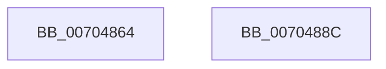

# ExpCheckTestsigningEnabled

- RVA: `0x00704864`–`0x0070488D` (길이 `41` bytes)
- VA: `0x0000000140704864`
- 실행 섹션: `PAGE`
- PDB 이름 있음: `예`; PDB Function 태그: `아니요`
- unwind 정보 RVA: `0x0005C788`
- 디코드: `10`개 명령, `41/41` bytes 표시
- 미해석 바이트: `0` (있으면 어셈블리에 `.byte`로 보존)

> 이 문서는 커널 이미지의 기계어와 PDB 기호를 분석해 생성했습니다. 4번과 5번은 함수 원형과 자료형을 바이너리 사용 방식에서 추정한 C 해석이며 원본 소스 복구 결과는 아닙니다.

## 1. Dependencies

- 직접 호출 지점: **1**; 고유 호출 대상: **1**
- 직접 호출자로 확인된 함수: **1**
- RIP 상대 이미지 참조: **3**

### Outgoing calls
- `0x0070487C` → [RtlRunOnceExecuteOnce](../95/RtlRunOnceExecuteOnce_function_0095DC00.md) (function, `0x0095DC00`)

### Direct callers
- [ExpSetTimerObject](../../text/23/ExpSetTimerObject_function_00231730.md) at `0x002323AE`

### Static image references
- `0x0070486B` → RVA `0x00659800` (`ExpInitExpCheckTestSigningInfo`; read)
- `0x00704875` → RVA `0x00E685C0` (`.data`; read)
- `0x00704881` → RVA `0x00EFAB78` (`.data`; read)

## 2. Other-region calls and transfers

- 다른 실행 섹션으로 향하는 call: **0**
- 별도 외부 분기/꼬리 이동을 확인하지 못했습니다.

## 3. Assembly (complete function range)

```asm
00704864  48 83 EC 28                     sub rsp, 0x28
00704868  45 33 C9                        xor r9d, r9d
0070486B  48 8D 15 8E 4F F5 FF            lea rdx, [rip - 0xab072]
00704872  45 33 C0                        xor r8d, r8d
00704875  48 8D 0D 44 3D 76 00            lea rcx, [rip + 0x763d44]
0070487C  E8 7F 93 25 00                  call 0x14095dc00
00704881  8A 05 F1 62 7F 00               mov al, byte ptr [rip + 0x7f62f1]
00704887  48 83 C4 28                     add rsp, 0x28
0070488B  C3                              ret
0070488C  CC                              int3
```

## 4. C-style interpretation (structured pseudocode)

```c
__int64 __fastcall ExpCheckTestsigningEnabled(__int64 a1, __int64 a2, int a3, int a4)
{
    __int64 result;
    __int64 v_rsp;

    v_rsp = (v_rsp) - (40);
    a4 = 0;
    a3 = 0;
    result = RtlRunOnceExecuteOnce(v_rip + 7748932, v_rip - 700530, a3, a4);
    v_rsp = (v_rsp) + (40);
    return *(unsigned __int8 *)(v_rip + 8348401);
}
```

## 5. (Beta) C Style

```c
int64_t ExpCheckTestsigningEnabled(int64_t Arg1, int64_t Arg2, int32_t Arg3, int32_t Arg4)
{
    int64_t result;
    int64_t local_rsp;

    local_rsp = (local_rsp) - (40);
    Arg4 = 0;
    Arg3 = 0;
    result = RtlRunOnceExecuteOnce(v_rip + 7748932, v_rip - 700530, Arg3, Arg4);
    local_rsp = (local_rsp) + (40);
    return *(uint8_t *)(v_rip + 0x7F62F1);
}
```

## 6. Execution-region graph

[열기: 2D/3D 그래프와 함수 탐색 컨트롤 패널](../../../control-panel.html?section=page&rva=0x00704864&view=graph)

- 2D 그래프는 위에서 아래로 흐르고, 3D 그래프는 빈 공간을 드래그해 회전합니다. Shift+드래그는 이동, 휠은 확대·축소, 함수 노드 선택은 대상 보고서 이동입니다.

### Static fallback


