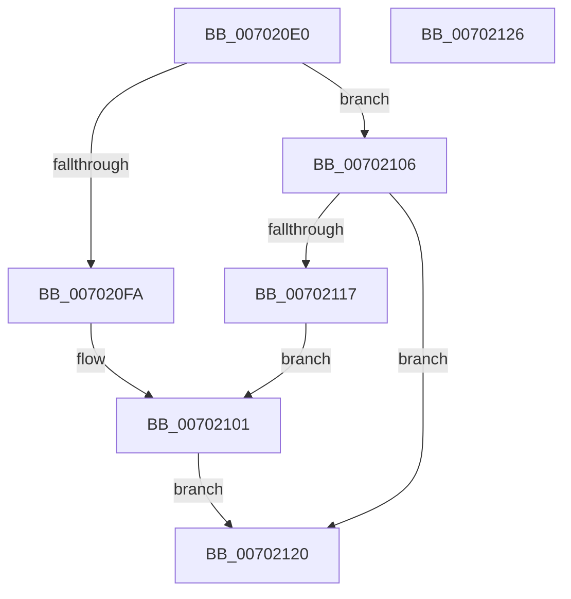

# ExpGetExtensionHostForCrossVmObject

- RVA: `0x007020E0`–`0x00702127` (길이 `71` bytes)
- VA: `0x00000001407020E0`
- 실행 섹션: `PAGE`
- PDB 이름 있음: `예`; PDB Function 태그: `아니요`
- unwind 정보 RVA: `0x0005CF00`
- 디코드: `20`개 명령, `71/71` bytes 표시
- 미해석 바이트: `0` (있으면 어셈블리에 `.byte`로 보존)

> 이 문서는 커널 이미지의 기계어와 PDB 기호를 분석해 생성했습니다. 4번과 5번은 함수 원형과 자료형을 바이너리 사용 방식에서 추정한 C 해석이며 원본 소스 복구 결과는 아닙니다.

## 1. Dependencies

- 직접 호출 지점: **2**; 고유 호출 대상: **1**
- 직접 호출자로 확인된 함수: **8**
- RIP 상대 이미지 참조: **2**

### Outgoing calls
- `0x007020F0` → [ExGetExtensionTable](../../text/42/ExGetExtensionTable_function_00428814.md) (function, `0x00428814`)
- `0x0070210D` → [ExGetExtensionTable](../../text/42/ExGetExtensionTable_function_00428814.md) (function, `0x00428814`)

### Direct callers
- [NtAcquireCrossVmMutant](../7D/NtAcquireCrossVmMutant_function_007D26C0.md) at `0x007D2771`
- [ExpObCloseCrossVmEvent](../7D/ExpObCloseCrossVmEvent_function_007D5630.md) at `0x007D5659`
- [ExpObCloseCrossVmMutant](../7D/ExpObCloseCrossVmMutant_function_007D56A0.md) at `0x007D56C9`
- [ExpObDeleteCrossVmEvent](../7D/ExpObDeleteCrossVmEvent_function_007D5710.md) at `0x007D5724`
- [ExpObDeleteCrossVmMutant](../7D/ExpObDeleteCrossVmMutant_function_007D5760.md) at `0x007D5774`
- [ExpPulseCrossVmEvent](../7D/ExpPulseCrossVmEvent_function_007D57A4.md) at `0x007D57BF`
- [ExpReleaseCrossVmMutant](../7D/ExpReleaseCrossVmMutant_function_007D5800.md) at `0x007D581B`
- [ExpResetCrossVmEvent](../7D/ExpResetCrossVmEvent_function_007D585C.md) at `0x007D5877`

### Static image references
- `0x007020E6` → RVA `0x00EFA120` (`.data`; read)
- `0x00702106` → RVA `0x00EFA118` (`.data`; read)

## 2. Other-region calls and transfers

- 다른 실행 섹션으로 향하는 call: **2**
  - `0x007020F0` → [ExGetExtensionTable](../../text/42/ExGetExtensionTable_function_00428814.md) (`PAGE` → `.text`)
  - `0x0070210D` → [ExGetExtensionTable](../../text/42/ExGetExtensionTable_function_00428814.md) (`PAGE` → `.text`)
- 별도 외부 분기/꼬리 이동을 확인하지 못했습니다.

## 3. Assembly (complete function range)

```asm
007020E0  40 53                           push rbx
007020E2  48 83 EC 20                     sub rsp, 0x20
007020E6  48 8B 0D 33 80 7F 00            mov rcx, qword ptr [rip + 0x7f8033]
007020ED  48 8B DA                        mov rbx, rdx
007020F0  E8 1F 67 D2 FF                  call 0x140428814
007020F5  48 85 C0                        test rax, rax
007020F8  74 0C                           je 0x140702106
007020FA  48 8B 0D 1F 80 7F 00            mov rcx, qword ptr [rip + 0x7f801f]
00702101  48 89 0B                        mov qword ptr [rbx], rcx
00702104  EB 1A                           jmp 0x140702120
00702106  48 8B 0D 0B 80 7F 00            mov rcx, qword ptr [rip + 0x7f800b]
0070210D  E8 02 67 D2 FF                  call 0x140428814
00702112  48 85 C0                        test rax, rax
00702115  74 09                           je 0x140702120
00702117  48 8B 0D FA 7F 7F 00            mov rcx, qword ptr [rip + 0x7f7ffa]
0070211E  EB E1                           jmp 0x140702101
00702120  48 83 C4 20                     add rsp, 0x20
00702124  5B                              pop rbx
00702125  C3                              ret
00702126  CC                              int3
```

## 4. C-style interpretation (structured pseudocode)

```c
__int64 __fastcall ExpGetExtensionHostForCrossVmObject(__int64 a1, __int64 a2)
{
    __int64 result;
    __int64 v_rsp;

    v_rsp = (v_rsp) - (32);
    result = ExGetExtensionTable(*(unsigned __int64 *)(v_rip + 8355891), a2, a3, a4);
    if (result == 0) goto loc_00702106;
loc_00702101:
    *(unsigned __int64 *)(a2) = *(unsigned __int64 *)(v_rip + 8355871);
    goto loc_00702120;
loc_00702106:
    result = ExGetExtensionTable(*(unsigned __int64 *)(v_rip + 8355851), a2, a3, a4);
    if (result == 0) goto loc_00702120;
    goto loc_00702101;
loc_00702120:
    v_rsp = (v_rsp) + (32);
    return result;
}
```

## 5. (Beta) C Style

```c
int64_t ExpGetExtensionHostForCrossVmObject(int64_t Arg1, void *Arg2)
{
    uint8_t *arg2 = (uint8_t *)Arg2;

    int64_t result;
    int64_t local_rsp;

    local_rsp = (local_rsp) - (32);
    result = ExGetExtensionTable(*(uint64_t *)(v_rip + 0x7F8033), Arg2, a3, a4);
    if (result == 0) goto loc_00702106;
loc_00702101:
    *(uint64_t *)(arg2) = *(uint64_t *)(v_rip + 0x7F801F);
    goto loc_00702120;
loc_00702106:
    result = ExGetExtensionTable(*(uint64_t *)(v_rip + 0x7F800B), Arg2, a3, a4);
    if (result == 0) goto loc_00702120;
    goto loc_00702101;
loc_00702120:
    local_rsp = (local_rsp) + (32);
    return result;
}
```

### 관측된 메모리 오프셋

구조체 형식이 확인되지 않은 접근은 인자 기준의 오프셋으로만 기록했습니다.

| 기준 인자 | 오프셋 표현 | 폭 (bit) | 접근 |
|---|---:|---:|---|
| `Arg2` | `+ 0x0` | `64` | `W` |

## 6. Execution-region graph

[열기: 2D/3D 그래프와 함수 탐색 컨트롤 패널](../../../control-panel.html?section=page&rva=0x007020E0&view=graph)

- 2D 그래프는 위에서 아래로 흐르고, 3D 그래프는 빈 공간을 드래그해 회전합니다. Shift+드래그는 이동, 휠은 확대·축소, 함수 노드 선택은 대상 보고서 이동입니다.

### Static fallback


