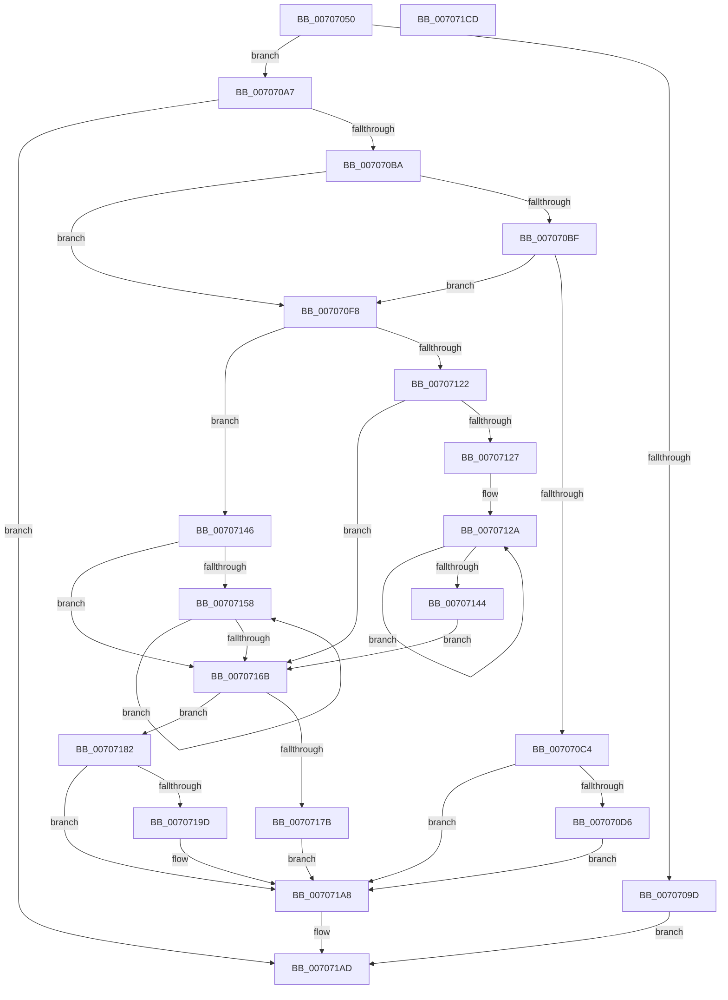

# HalAllocateHardwareCounters

- RVA: `0x00707050`–`0x007071CE` (길이 `382` bytes)
- VA: `0x0000000140707050`
- 실행 섹션: `PAGE`
- PDB 이름 있음: `예`; PDB Function 태그: `아니요`
- unwind 정보 RVA: `0x000C39E4`
- 디코드: `107`개 명령, `382/382` bytes 표시
- 미해석 바이트: `0` (있으면 어셈블리에 `.byte`로 보존)

> 이 문서는 커널 이미지의 기계어와 PDB 기호를 분석해 생성했습니다. 4번과 5번은 함수 원형과 자료형을 바이너리 사용 방식에서 추정한 C 해석이며 원본 소스 복구 결과는 아닙니다.

## 1. Dependencies

- 직접 호출 지점: **11**; 고유 호출 대상: **9**
- 직접 호출자로 확인된 함수: **0**
- RIP 상대 이미지 참조: **3**

### Outgoing calls
- `0x0070708E` → [memset](../../text/6C/memset_function_006C6C40.md) (function, `0x006C6C40`)
- `0x007070AB` → [HalpRequestPmuAccess](../AD/HalpRequestPmuAccess_function_00ADB340.md) (function, `0x00ADB340`)
- `0x007070C7` → [HalpGetFullPmuOwnership](../../text/53/HalpGetFullPmuOwnership_function_0053FFB8.md) (function, `0x0053FFB8`)
- `0x007070DB` → [KeQueryActiveProcessorCountEx](../../text/24/KeQueryActiveProcessorCountEx_function_00249EF0.md) (function, `0x00249EF0`)
- `0x00707118` → [memset](../../text/6C/memset_function_006C6C40.md) (function, `0x006C6C40`)
- `0x00707136` → [KeAddGroupAffinityEx](../../text/25/KeAddGroupAffinityEx_function_0025B6C0.md) (function, `0x0025B6C0`)
- `0x0070714B` → [KeQueryActiveProcessorCountEx](../../text/24/KeQueryActiveProcessorCountEx_function_00249EF0.md) (function, `0x00249EF0`)
- `0x0070715F` → [KeAddProcessorAffinityEx](../../text/25/KeAddProcessorAffinityEx_function_0025B6F0.md) (function, `0x0025B6F0`)
- `0x00707192` → [guard_dispatch_icall](../../text/6B/guard_dispatch_icall_function_006BAAD0.md) (function, `0x006BAAD0`)
- `0x007071A8` → [HalpReleasePmuAccessRequest](../../text/54/HalpReleasePmuAccessRequest_function_005477A0.md) (function, `0x005477A0`)
- `0x007071B6` → [_security_check_cookie](../../text/6A/_security_check_cookie_function_006AC640.md) (function, `0x006AC640`)

### Direct callers
- 이 함수 시작 RVA로 연결되는 직접 call은 확인되지 않았습니다. 간접 호출은 완전히 역산할 수 없습니다.

### Static image references
- `0x00707067` → RVA `0x00E0A740` (`.data`; read)
- `0x007070E8` → RVA `0x00FC2B4C` (`.data`; read/write)
- `0x0070716B` → RVA `0x00E03B20` (`.data`; read)

## 2. Other-region calls and transfers

- 다른 실행 섹션으로 향하는 call: **10**
  - `0x0070708E` → [memset](../../text/6C/memset_function_006C6C40.md) (`PAGE` → `.text`)
  - `0x007070C7` → [HalpGetFullPmuOwnership](../../text/53/HalpGetFullPmuOwnership_function_0053FFB8.md) (`PAGE` → `.text`)
  - `0x007070DB` → [KeQueryActiveProcessorCountEx](../../text/24/KeQueryActiveProcessorCountEx_function_00249EF0.md) (`PAGE` → `.text`)
  - `0x00707118` → [memset](../../text/6C/memset_function_006C6C40.md) (`PAGE` → `.text`)
  - `0x00707136` → [KeAddGroupAffinityEx](../../text/25/KeAddGroupAffinityEx_function_0025B6C0.md) (`PAGE` → `.text`)
  - `0x0070714B` → [KeQueryActiveProcessorCountEx](../../text/24/KeQueryActiveProcessorCountEx_function_00249EF0.md) (`PAGE` → `.text`)
  - `0x0070715F` → [KeAddProcessorAffinityEx](../../text/25/KeAddProcessorAffinityEx_function_0025B6F0.md) (`PAGE` → `.text`)
  - `0x00707192` → [guard_dispatch_icall](../../text/6B/guard_dispatch_icall_function_006BAAD0.md) (`PAGE` → `.text`)
  - `0x007071A8` → [HalpReleasePmuAccessRequest](../../text/54/HalpReleasePmuAccessRequest_function_005477A0.md) (`PAGE` → `.text`)
  - `0x007071B6` → [_security_check_cookie](../../text/6A/_security_check_cookie_function_006AC640.md) (`PAGE` → `.text`)
- 별도 외부 분기/꼬리 이동을 확인하지 못했습니다.

## 3. Assembly (complete function range)

```asm
00707050  40 55                           push rbp
00707052  53                              push rbx
00707053  56                              push rsi
00707054  57                              push rdi
00707055  41 55                           push r13
00707057  41 56                           push r14
00707059  41 57                           push r15
0070705B  48 8D 6C 24 A0                  lea rbp, [rsp - 0x60]
00707060  48 81 EC 60 01 00 00            sub rsp, 0x160
00707067  48 8B 05 D2 36 70 00            mov rax, qword ptr [rip + 0x7036d2]
0070706E  48 33 C4                        xor rax, rsp
00707071  48 89 45 50                     mov qword ptr [rbp + 0x50], rax
00707075  4D 8B F8                        mov r15, r8
00707078  44 8B F2                        mov r14d, edx
0070707B  48 8B F9                        mov rdi, rcx
0070707E  33 D2                           xor edx, edx
00707080  41 B8 08 01 00 00               mov r8d, 0x108
00707086  48 8D 4C 24 40                  lea rcx, [rsp + 0x40]
0070708B  49 8B F1                        mov rsi, r9
0070708E  E8 AD FB FB FF                  call 0x1406c6c40
00707093  83 64 24 30 00                  and dword ptr [rsp + 0x30], 0
00707098  48 85 F6                        test rsi, rsi
0070709B  75 0A                           jne 0x1407070a7
0070709D  BB 0D 00 00 C0                  mov ebx, 0xc000000d
007070A2  E9 06 01 00 00                  jmp 0x1407071ad
007070A7  48 83 26 00                     and qword ptr [rsi], 0
007070AB  E8 90 42 3D 00                  call 0x140adb340
007070B0  8B D8                           mov ebx, eax
007070B2  85 C0                           test eax, eax
007070B4  0F 88 F3 00 00 00               js 0x1407071ad
007070BA  48 85 FF                        test rdi, rdi
007070BD  75 39                           jne 0x1407070f8
007070BF  4D 85 FF                        test r15, r15
007070C2  75 34                           jne 0x1407070f8
007070C4  48 8B CE                        mov rcx, rsi
007070C7  E8 EC 8E E3 FF                  call 0x14053ffb8
007070CC  8B D8                           mov ebx, eax
007070CE  85 C0                           test eax, eax
007070D0  0F 88 D2 00 00 00               js 0x1407071a8
007070D6  B9 FF FF 00 00                  mov ecx, 0xffff
007070DB  E8 10 2E B4 FF                  call 0x140249ef0
007070E0  C7 44 24 30 00 00 00 80         mov dword ptr [rsp + 0x30], 0x80000000
007070E8  F0 81 05 59 BA 8B 00 00 00 00 80  lock add dword ptr [rip + 0x8bba59], 0x80000000
007070F3  E9 B0 00 00 00                  jmp 0x1407071a8
007070F8  83 64 24 44 00                  and dword ptr [rsp + 0x44], 0
007070FD  48 8D 4C 24 48                  lea rcx, [rsp + 0x48]
00707102  33 D2                           xor edx, edx
00707104  C7 44 24 40 01 00 20 00         mov dword ptr [rsp + 0x40], 0x200001
0070710C  41 B8 00 01 00 00               mov r8d, 0x100
00707112  41 BD 01 00 00 00               mov r13d, 1
00707118  E8 23 FB FB FF                  call 0x1406c6c40
0070711D  48 85 FF                        test rdi, rdi
00707120  74 24                           je 0x140707146
00707122  45 85 F6                        test r14d, r14d
00707125  74 44                           je 0x14070716b
00707127  49 8B DE                        mov rbx, r14
0070712A  4C 8B 07                        mov r8, qword ptr [rdi]
0070712D  48 8D 4C 24 40                  lea rcx, [rsp + 0x40]
00707132  0F B7 57 08                     movzx edx, word ptr [rdi + 8]
00707136  E8 85 45 B5 FF                  call 0x14025b6c0
0070713B  48 8D 7F 10                     lea rdi, [rdi + 0x10]
0070713F  49 2B DD                        sub rbx, r13
00707142  75 E6                           jne 0x14070712a
00707144  EB 25                           jmp 0x14070716b
00707146  B9 FF FF 00 00                  mov ecx, 0xffff
0070714B  E8 A0 2D B4 FF                  call 0x140249ef0
00707150  33 DB                           xor ebx, ebx
00707152  8B F8                           mov edi, eax
00707154  85 C0                           test eax, eax
00707156  74 13                           je 0x14070716b
00707158  8B D3                           mov edx, ebx
0070715A  48 8D 4C 24 40                  lea rcx, [rsp + 0x40]
0070715F  E8 8C 45 B5 FF                  call 0x14025b6f0
00707164  41 03 DD                        add ebx, r13d
00707167  3B DF                           cmp ebx, edi
00707169  72 ED                           jb 0x140707158
0070716B  48 8B 05 AE C9 6F 00            mov rax, qword ptr [rip + 0x6fc9ae]
00707172  48 8B 40 70                     mov rax, qword ptr [rax + 0x70]
00707176  48 85 C0                        test rax, rax
00707179  75 07                           jne 0x140707182
0070717B  BB 9A 00 00 C0                  mov ebx, 0xc000009a
00707180  EB 26                           jmp 0x1407071a8
00707182  4C 8D 4C 24 30                  lea r9, [rsp + 0x30]
00707187  4C 8B C6                        mov r8, rsi
0070718A  49 8B D7                        mov rdx, r15
0070718D  48 8D 4C 24 40                  lea rcx, [rsp + 0x40]
00707192  E8 39 39 FB FF                  call 0x1406baad0
00707197  8B D8                           mov ebx, eax
00707199  85 C0                           test eax, eax
0070719B  78 0B                           js 0x1407071a8
0070719D  8B 44 24 30                     mov eax, dword ptr [rsp + 0x30]
007071A1  F0 01 05 A4 B9 8B 00            lock add dword ptr [rip + 0x8bb9a4], eax
007071A8  E8 F3 05 E4 FF                  call 0x1405477a0
007071AD  8B C3                           mov eax, ebx
007071AF  48 8B 4D 50                     mov rcx, qword ptr [rbp + 0x50]
007071B3  48 33 CC                        xor rcx, rsp
007071B6  E8 85 54 FA FF                  call 0x1406ac640
007071BB  48 81 C4 60 01 00 00            add rsp, 0x160
007071C2  41 5F                           pop r15
007071C4  41 5E                           pop r14
007071C6  41 5D                           pop r13
007071C8  5F                              pop rdi
007071C9  5E                              pop rsi
007071CA  5B                              pop rbx
007071CB  5D                              pop rbp
007071CC  C3                              ret
007071CD  CC                              int3
```

## 4. C-style interpretation (structured pseudocode)

```c
__int64 __fastcall HalAllocateHardwareCounters(__int64 a1, int a2, __int64 a3, __int64 a4)
{
    __int64 result;
    __int64 v_rbx;
    __int64 v_rsp;
    unsigned __int64 v_stack_m150;
    unsigned int v_stack_m154;
    unsigned __int64 v_stack_m158;
    unsigned int v_stack_m168;
    unsigned __int64 v_stack_m48;
    unsigned __int64 v_stack_m98;

    v_rsp = (v_rsp) - (352);
    result = (*(unsigned __int64 *)(v_rip + 7354066)) ^ (v_rsp);
    v_stack_m48 = result;
    a2 = 0;
    result = memset(v_stack_m158, a2, 264, a4);
    if (a4 != 0) goto loc_007070A7;
    goto loc_007071AD;
loc_007070A7:
    result = HalpRequestPmuAccess(v_stack_m158, a2, 264, a4);
    if (sign_flag) goto loc_007071AD;
    if (a1 != 0) goto loc_007070F8;
    if (a3 != 0) goto loc_007070F8;
    result = HalpGetFullPmuOwnership(a4, a2, 264, a4);
    if (sign_flag) goto loc_007071A8;
    result = KeQueryActiveProcessorCountEx((unsigned int)(0xFFFFULL), a2, 264, a4);
    v_stack_m168 = 0x80000000ULL;
    goto loc_007071A8;
loc_007070F8:
    a2 = 0;
    v_stack_m158 = 0x200001ULL;
    result = memset(v_stack_m150, a2, 256, a4);
    if (a1 == 0) goto loc_00707146;
    if ((unsigned int)((unsigned int)(a2)) == 0) goto loc_0070716B;
loc_0070712A:
    result = KeAddGroupAffinityEx(v_stack_m158, *(unsigned __int16 *)(a1 + 8), *(unsigned __int64 *)(a1), a4);
    v_rbx = ((unsigned int)(a2)) - (1);
    if (condition_is_not_equal) goto loc_0070712A;
    goto loc_0070716B;
loc_00707146:
    result = KeQueryActiveProcessorCountEx((unsigned int)(0xFFFFULL), *(unsigned __int16 *)(a1 + 8), *(unsigned __int64 *)(a1), a4);
    v_rbx = 0;
    if ((unsigned int)(result) == 0) goto loc_0070716B;
loc_00707158:
    result = KeAddProcessorAffinityEx(v_stack_m158, 0, *(unsigned __int64 *)(a1), a4);
    v_rbx = (unsigned int)((v_rbx) + (1));
    if (((unsigned int)(v_rbx)) < ((unsigned int)((unsigned int)((unsigned int)(result))))) goto loc_00707158;
loc_0070716B:
    if (*(unsigned __int64 *)(*(unsigned __int64 *)(v_rip + 7326126) + 112) != 0) goto loc_00707182;
    goto loc_007071A8;
loc_00707182:
    result = guard_dispatch_icall(v_stack_m158, a3, a4, v_stack_m168);
    if (!(sign_flag)) {
        result = v_stack_m168;
    }
    result = HalpReleasePmuAccessRequest(v_stack_m158, a3, a4, v_stack_m168);
loc_007071AD:
    a1 = (v_stack_m48) ^ (v_rsp);
    result = _security_check_cookie(a1, a3, a4, v_stack_m168);
    v_rsp = (v_rsp) + (352);
    return result;
}
```

## 5. (Beta) C Style

```c
int64_t HalAllocateHardwareCounters(int64_t Arg1, int32_t Arg2, int64_t Arg3, int64_t Arg4)
{
    int64_t result;
    int64_t local_rbx;
    int64_t local_rsp;
    uint64_t v_stack_m150;
    uint32_t v_stack_m154;
    uint64_t v_stack_m158;
    uint32_t v_stack_m168;
    uint64_t v_stack_m48;
    uint64_t v_stack_m98;

    local_rsp = (local_rsp) - (352);
    result = (*(uint64_t *)(v_rip + 0x7036D2)) ^ (local_rsp);
    v_stack_m48 = result;
    Arg2 = 0;
    result = memset(v_stack_m158, Arg2, 264, Arg4);
    if (Arg4 != 0) goto loc_007070A7;
    goto loc_007071AD;
loc_007070A7:
    result = HalpRequestPmuAccess(v_stack_m158, Arg2, 264, Arg4);
    if (sign_flag) goto loc_007071AD;
    if (Arg1 != 0) goto loc_007070F8;
    if (Arg3 != 0) goto loc_007070F8;
    result = HalpGetFullPmuOwnership(Arg4, Arg2, 264, Arg4);
    if (sign_flag) goto loc_007071A8;
    result = KeQueryActiveProcessorCountEx((uint32_t)(0xFFFFULL), Arg2, 264, Arg4);
    v_stack_m168 = 0x80000000ULL;
    goto loc_007071A8;
loc_007070F8:
    Arg2 = 0;
    v_stack_m158 = 0x200001ULL;
    result = memset(v_stack_m150, Arg2, 256, Arg4);
    if (Arg1 == 0) goto loc_00707146;
    if ((uint32_t)((uint32_t)(Arg2)) == 0) goto loc_0070716B;
loc_0070712A:
    result = KeAddGroupAffinityEx(v_stack_m158, *(uint16_t *)(Arg1 + 0x8), *(uint64_t *)(Arg1), Arg4);
    local_rbx = ((uint32_t)(Arg2)) - (1);
    if (condition_is_not_equal) goto loc_0070712A;
    goto loc_0070716B;
loc_00707146:
    result = KeQueryActiveProcessorCountEx((uint32_t)(0xFFFFULL), *(uint16_t *)(Arg1 + 0x8), *(uint64_t *)(Arg1), Arg4);
    local_rbx = 0;
    if ((uint32_t)(result) == 0) goto loc_0070716B;
loc_00707158:
    result = KeAddProcessorAffinityEx(v_stack_m158, 0, *(uint64_t *)(Arg1), Arg4);
    local_rbx = (uint32_t)((local_rbx) + (1));
    if (((uint32_t)(local_rbx)) < ((uint32_t)((uint32_t)((uint32_t)(result))))) goto loc_00707158;
loc_0070716B:
    if (*(uint64_t *)(*(uint64_t *)(v_rip + 0x6FC9AE) + 0x70) != 0) goto loc_00707182;
    goto loc_007071A8;
loc_00707182:
    result = guard_dispatch_icall(v_stack_m158, Arg3, Arg4, v_stack_m168);
    if (!(sign_flag)) {
        result = v_stack_m168;
    }
    result = HalpReleasePmuAccessRequest(v_stack_m158, Arg3, Arg4, v_stack_m168);
loc_007071AD:
    Arg1 = (v_stack_m48) ^ (local_rsp);
    result = _security_check_cookie(Arg1, Arg3, Arg4, v_stack_m168);
    local_rsp = (local_rsp) + (352);
    return result;
}
```

## 6. Execution-region graph

[열기: 2D/3D 그래프와 함수 탐색 컨트롤 패널](../../../control-panel.html?section=page&rva=0x00707050&view=graph)

- 2D 그래프는 위에서 아래로 흐르고, 3D 그래프는 빈 공간을 드래그해 회전합니다. Shift+드래그는 이동, 휠은 확대·축소, 함수 노드 선택은 대상 보고서 이동입니다.

### Static fallback


