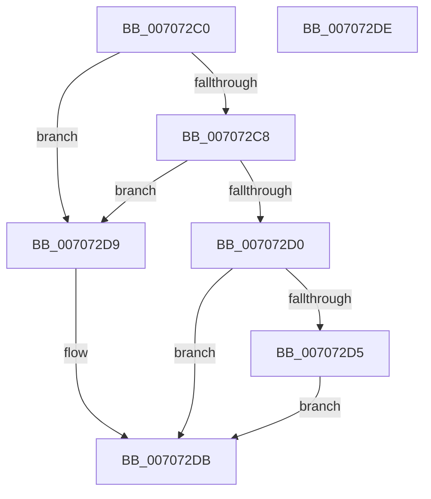

# HalConvertDeviceIdtToIrql

- RVA: `0x007072C0`–`0x007072DF` (길이 `31` bytes)
- VA: `0x00000001407072C0`
- 실행 섹션: `PAGE`
- PDB 이름 있음: `예`; PDB Function 태그: `아니요`
- unwind 정보 RVA: `0x000DB714`
- 디코드: `13`개 명령, `31/31` bytes 표시
- 미해석 바이트: `0` (있으면 어셈블리에 `.byte`로 보존)

> 이 문서는 커널 이미지의 기계어와 PDB 기호를 분석해 생성했습니다. 4번과 5번은 함수 원형과 자료형을 바이너리 사용 방식에서 추정한 C 해석이며 원본 소스 복구 결과는 아닙니다.

## 1. Dependencies

- 직접 호출 지점: **0**; 고유 호출 대상: **0**
- 직접 호출자로 확인된 함수: **1**
- RIP 상대 이미지 참조: **0**

### Outgoing calls
- 직접 디코드된 call 명령이 없습니다.

### Direct callers
- [HalpQueryResources](HalpQueryResources_function_007086B0.md) at `0x007087AD`

### Static image references
- 디코드된 RIP-relative 메모리 참조가 없습니다.

## 2. Other-region calls and transfers

- 다른 실행 섹션으로 향하는 call: **0**
- 별도 외부 분기/꼬리 이동을 확인하지 못했습니다.

## 3. Assembly (complete function range)

```asm
007072C0  81 F9 00 01 00 00               cmp ecx, 0x100
007072C6  73 11                           jae 0x1407072d9
007072C8  C0 E9 04                        shr cl, 4
007072CB  80 F9 03                        cmp cl, 3
007072CE  72 09                           jb 0x1407072d9
007072D0  80 F9 0C                        cmp cl, 0xc
007072D3  76 06                           jbe 0x1407072db
007072D5  B1 0C                           mov cl, 0xc
007072D7  EB 02                           jmp 0x1407072db
007072D9  B1 03                           mov cl, 3
007072DB  8A C1                           mov al, cl
007072DD  C3                              ret
007072DE  CC                              int3
```

## 4. C-style interpretation (structured pseudocode)

```c
__int64 __fastcall HalConvertDeviceIdtToIrql(int a1)
{
    if (a1 >= 256) goto loc_007072D9;
    a1 = (unsigned __int8)((a1) >> (4));
    if (((unsigned __int8)(a1)) < 3) goto loc_007072D9;
    if (((unsigned __int8)(a1)) <= 12) goto loc_007072DB;
    goto loc_007072DB;
loc_007072D9:
loc_007072DB:
    return 3;
}
```

## 5. (Beta) C Style

```c
int64_t HalConvertDeviceIdtToIrql(int32_t Arg1)
{
    if (Arg1 >= 256) goto loc_007072D9;
    Arg1 = (uint8_t)((Arg1) >> (4));
    if (((uint8_t)(Arg1)) < 3) goto loc_007072D9;
    if (((uint8_t)(Arg1)) <= 12) goto loc_007072DB;
    goto loc_007072DB;
loc_007072D9:
loc_007072DB:
    return 3;
}
```

## 6. Execution-region graph

[열기: 2D/3D 그래프와 함수 탐색 컨트롤 패널](../../../control-panel.html?section=page&rva=0x007072C0&view=graph)

- 2D 그래프는 위에서 아래로 흐르고, 3D 그래프는 빈 공간을 드래그해 회전합니다. Shift+드래그는 이동, 휠은 확대·축소, 함수 노드 선택은 대상 보고서 이동입니다.

### Static fallback


