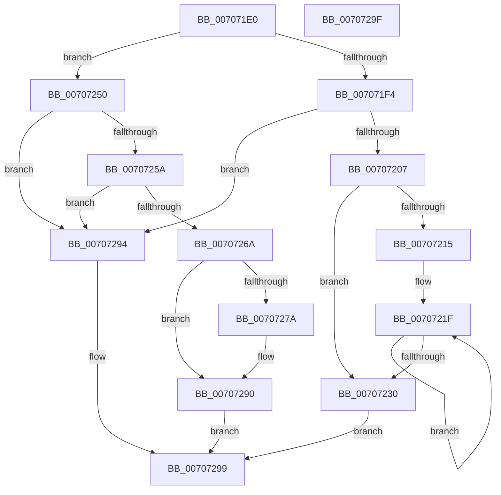

# HalFreeHardwareCounters

- RVA: `0x007071E0`–`0x007072A0` (길이 `192` bytes)
- VA: `0x00000001407071E0`
- 실행 섹션: `PAGE`
- PDB 이름 있음: `예`; PDB Function 태그: `아니요`
- unwind 정보 RVA: `0x0005CF00`
- 디코드: `51`개 명령, `192/192` bytes 표시
- 미해석 바이트: `0` (있으면 어셈블리에 `.byte`로 보존)

> 이 문서는 커널 이미지의 기계어와 PDB 기호를 분석해 생성했습니다. 4번과 5번은 함수 원형과 자료형을 바이너리 사용 방식에서 추정한 C 해석이며 원본 소스 복구 결과는 아닙니다.

## 1. Dependencies

- 직접 호출 지점: **4**; 고유 호출 대상: **3**
- 직접 호출자로 확인된 함수: **0**
- RIP 상대 이미지 참조: **4**

### Outgoing calls
- `0x0070720C` → [KeQueryActiveProcessorCountEx](../../text/24/KeQueryActiveProcessorCountEx_function_00249EF0.md) (function, `0x00249EF0`)
- `0x00707247` → [HalpNotifyActorIfPmuAvailable](HalpNotifyActorIfPmuAvailable_function_00707880.md) (function, `0x00707880`)
- `0x0070726F` → [guard_dispatch_icall](../../text/6B/guard_dispatch_icall_function_006BAAD0.md) (function, `0x006BAAD0`)
- `0x0070728B` → [HalpNotifyActorIfPmuAvailable](HalpNotifyActorIfPmuAvailable_function_00707880.md) (function, `0x00707880`)

### Direct callers
- 이 함수 시작 RVA로 연결되는 직접 call은 확인되지 않았습니다. 간접 호출은 완전히 역산할 수 없습니다.

### Static image references
- `0x007071EB` → RVA `0x00E0A760` (`.data`; read)
- `0x00707215` → RVA `0x00FC8C40` (`ALMOSTRO`; read)
- `0x00707238` → RVA `0x00FC2B4C` (`.data`; read/write)
- `0x0070725A` → RVA `0x00E03B20` (`.data`; read)

## 2. Other-region calls and transfers

- 다른 실행 섹션으로 향하는 call: **2**
  - `0x0070720C` → [KeQueryActiveProcessorCountEx](../../text/24/KeQueryActiveProcessorCountEx_function_00249EF0.md) (`PAGE` → `.text`)
  - `0x0070726F` → [guard_dispatch_icall](../../text/6B/guard_dispatch_icall_function_006BAAD0.md) (`PAGE` → `.text`)
- 별도 외부 분기/꼬리 이동을 확인하지 못했습니다.

## 3. Assembly (complete function range)

```asm
007071E0  40 53                           push rbx
007071E2  48 83 EC 20                     sub rsp, 0x20
007071E6  83 64 24 30 00                  and dword ptr [rsp + 0x30], 0
007071EB  48 3B 0D 6E 35 70 00            cmp rcx, qword ptr [rip + 0x70356e]
007071F2  75 5C                           jne 0x140707250
007071F4  65 48 8B 04 25 20 00 00 00      mov rax, qword ptr gs:[0x20]
007071FD  F6 40 60 01                     test byte ptr [rax + 0x60], 1
00707201  0F 84 8D 00 00 00               je 0x140707294
00707207  B9 FF FF 00 00                  mov ecx, 0xffff
0070720C  E8 DF 2C B4 FF                  call 0x140249ef0
00707211  85 C0                           test eax, eax
00707213  74 1B                           je 0x140707230
00707215  48 8D 0D 24 1A 8C 00            lea rcx, [rip + 0x8c1a24]
0070721C  44 8B C0                        mov r8d, eax
0070721F  48 8B 01                        mov rax, qword ptr [rcx]
00707222  48 8D 49 08                     lea rcx, [rcx + 8]
00707226  F0 FF 48 60                     lock dec dword ptr [rax + 0x60]
0070722A  49 83 E8 01                     sub r8, 1
0070722E  75 EF                           jne 0x14070721f
00707230  C7 44 24 30 00 00 00 80         mov dword ptr [rsp + 0x30], 0x80000000
00707238  F0 81 05 09 B9 8B 00 00 00 00 80  lock add dword ptr [rip + 0x8bb909], 0x80000000
00707243  B2 01                           mov dl, 1
00707245  33 C9                           xor ecx, ecx
00707247  E8 34 06 00 00                  call 0x140707880
0070724C  33 C0                           xor eax, eax
0070724E  EB 49                           jmp 0x140707299
00707250  48 8D 41 FF                     lea rax, [rcx - 1]
00707254  48 83 F8 FD                     cmp rax, -3
00707258  77 3A                           ja 0x140707294
0070725A  48 8B 05 BF C8 6F 00            mov rax, qword ptr [rip + 0x6fc8bf]
00707261  48 8B 40 78                     mov rax, qword ptr [rax + 0x78]
00707265  48 85 C0                        test rax, rax
00707268  74 2A                           je 0x140707294
0070726A  48 8D 54 24 30                  lea rdx, [rsp + 0x30]
0070726F  E8 5C 38 FB FF                  call 0x1406baad0
00707274  8B D8                           mov ebx, eax
00707276  85 C0                           test eax, eax
00707278  78 16                           js 0x140707290
0070727A  8B 4C 24 30                     mov ecx, dword ptr [rsp + 0x30]
0070727E  F7 D9                           neg ecx
00707280  F0 01 0D C5 B8 8B 00            lock add dword ptr [rip + 0x8bb8c5], ecx
00707287  33 D2                           xor edx, edx
00707289  33 C9                           xor ecx, ecx
0070728B  E8 F0 05 00 00                  call 0x140707880
00707290  8B C3                           mov eax, ebx
00707292  EB 05                           jmp 0x140707299
00707294  B8 0D 00 00 C0                  mov eax, 0xc000000d
00707299  48 83 C4 20                     add rsp, 0x20
0070729D  5B                              pop rbx
0070729E  C3                              ret
0070729F  CC                              int3
```

## 4. C-style interpretation (structured pseudocode)

```c
__int64 __fastcall HalFreeHardwareCounters(__int64 a1)
{
    __int64 result;
    __int64 v_rsp;
    unsigned int v_stack_p8;

    v_rsp = (v_rsp) - (32);
    if (a1 != (*(unsigned __int64 *)(v_rip + 7353710))) goto loc_00707250;
    if (((*(unsigned __int8 *)(*(unsigned __int64 *)(gs_base + (0 + 32)) + 96)) & (1)) == 0) goto loc_00707294;
    result = KeQueryActiveProcessorCountEx((unsigned int)(0xFFFFULL), a2, a3, a4);
    if ((unsigned int)(result) == 0) goto loc_00707230;
loc_0070721F:
    a3 = ((unsigned int)((unsigned int)(result))) - (1);
    if (condition_is_not_equal) goto loc_0070721F;
loc_00707230:
    v_stack_p8 = 0x80000000ULL;
    a1 = 0;
    result = HalpNotifyActorIfPmuAvailable(a1, 1, a3, a4);
    result = 0;
    goto loc_00707299;
loc_00707250:
    if ((a1 - 1) > -3) goto loc_00707294;
    if (*(unsigned __int64 *)(*(unsigned __int64 *)(v_rip + 7325887) + 120) == 0) goto loc_00707294;
    result = guard_dispatch_icall(a1, v_stack_p8, a3, a4);
    if (!(sign_flag)) {
        a1 = v_stack_p8;
        a1 = (unsigned int)(-(a1));
        a2 = 0;
        a1 = 0;
        result = HalpNotifyActorIfPmuAvailable(a1, a2, a3, a4);
    }
    goto loc_00707299;
loc_00707294:
loc_00707299:
    v_rsp = (v_rsp) + (32);
    return (unsigned int)(0xC000000DULL);
}
```

## 5. (Beta) C Style

```c
int64_t HalFreeHardwareCounters(int64_t Arg1)
{
    int64_t result;
    int64_t local_rsp;
    uint32_t v_stack_p8;

    local_rsp = (local_rsp) - (32);
    if (Arg1 != (*(uint64_t *)(v_rip + 0x70356E))) goto loc_00707250;
    if (((*(uint8_t *)(*(uint64_t *)(gs_base + (0 + 0x20)) + 0x60)) & (1)) == 0) goto loc_00707294;
    result = KeQueryActiveProcessorCountEx((uint32_t)(0xFFFFULL), a2, a3, a4);
    if ((uint32_t)(result) == 0) goto loc_00707230;
loc_0070721F:
    a3 = ((uint32_t)((uint32_t)(result))) - (1);
    if (condition_is_not_equal) goto loc_0070721F;
loc_00707230:
    v_stack_p8 = 0x80000000ULL;
    Arg1 = 0;
    result = HalpNotifyActorIfPmuAvailable(Arg1, 1, a3, a4);
    result = 0;
    goto loc_00707299;
loc_00707250:
    if ((Arg1 - 1) > -3) goto loc_00707294;
    if (*(uint64_t *)(*(uint64_t *)(v_rip + 0x6FC8BF) + 0x78) == 0) goto loc_00707294;
    result = guard_dispatch_icall(Arg1, v_stack_p8, a3, a4);
    if (!(sign_flag)) {
        Arg1 = v_stack_p8;
        Arg1 = (uint32_t)(-(Arg1));
        a2 = 0;
        Arg1 = 0;
        result = HalpNotifyActorIfPmuAvailable(Arg1, a2, a3, a4);
    }
    goto loc_00707299;
loc_00707294:
loc_00707299:
    local_rsp = (local_rsp) + (32);
    return (uint32_t)(0xC000000DULL);
}
```

## 6. Execution-region graph

[열기: 2D/3D 그래프와 함수 탐색 컨트롤 패널](../../../control-panel.html?section=page&rva=0x007071E0&view=graph)

- 2D 그래프는 위에서 아래로 흐르고, 3D 그래프는 빈 공간을 드래그해 회전합니다. Shift+드래그는 이동, 휠은 확대·축소, 함수 노드 선택은 대상 보고서 이동입니다.

### Static fallback


