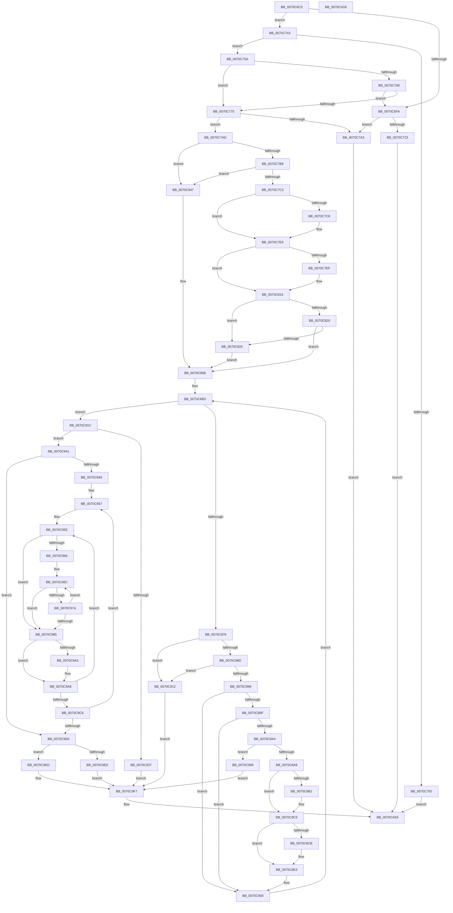

# HalacpiIrqTranslateResourceRequirementsIsa

- RVA: `0x0070C6C0`–`0x0070CA19` (길이 `857` bytes)
- VA: `0x000000014070C6C0`
- 실행 섹션: `PAGE`
- PDB 이름 있음: `예`; PDB Function 태그: `아니요`
- unwind 정보 RVA: `0x00097FE8`
- 디코드: `244`개 명령, `857/857` bytes 표시
- 미해석 바이트: `0` (있으면 어셈블리에 `.byte`로 보존)

> 이 문서는 커널 이미지의 기계어와 PDB 기호를 분석해 생성했습니다. 4번과 5번은 함수 원형과 자료형을 바이너리 사용 방식에서 추정한 C 해석이며 원본 소스 복구 결과는 아닙니다.

## 1. Dependencies

- 직접 호출 지점: **8**; 고유 호출 대상: **4**
- 직접 호출자로 확인된 함수: **0**
- RIP 상대 이미지 참조: **2**

### Outgoing calls
- `0x0070C70A` → [ExAllocatePool2](../../poolcode/B8/ExAllocatePool2_function_00B820F0.md) (function, `0x00B820F0`)
- `0x0070C75F` → [HalpIsInterruptTypeSecondary](../../text/2D/HalpIsInterruptTypeSecondary_function_002D2510.md) (function, `0x002D2510`)
- `0x0070C76C` → [HalpIsInterruptTypeSecondary](../../text/2D/HalpIsInterruptTypeSecondary_function_002D2510.md) (function, `0x002D2510`)
- `0x0070C796` → [ExAllocatePool2](../../poolcode/B8/ExAllocatePool2_function_00B820F0.md) (function, `0x00B820F0`)
- `0x0070C8F4` → [memcpy](../../text/6C/memcpy_function_006C6840.md) (function, `0x006C6840`)
- `0x0070C92A` → [ExAllocatePool2](../../poolcode/B8/ExAllocatePool2_function_00B820F0.md) (function, `0x00B820F0`)
- `0x0070C9F2` → [ExFreePoolWithTag](../../poolcode/B8/ExFreePoolWithTag_function_00B82870.md) (function, `0x00B82870`)
- `0x0070C9FC` → [ExFreePoolWithTag](../../poolcode/B8/ExFreePoolWithTag_function_00B82870.md) (function, `0x00B82870`)

### Direct callers
- 이 함수 시작 RVA로 연결되는 직접 call은 확인되지 않았습니다. 간접 호출은 완전히 역산할 수 없습니다.

### Static image references
- `0x0070C85B` → RVA `0x00FC1B0E` (`.data`; read)
- `0x0070C950` → RVA `0x00025FC0` (`.rdata`; read)

## 2. Other-region calls and transfers

- 다른 실행 섹션으로 향하는 call: **8**
  - `0x0070C70A` → [ExAllocatePool2](../../poolcode/B8/ExAllocatePool2_function_00B820F0.md) (`PAGE` → `POOLCODE`)
  - `0x0070C75F` → [HalpIsInterruptTypeSecondary](../../text/2D/HalpIsInterruptTypeSecondary_function_002D2510.md) (`PAGE` → `.text`)
  - `0x0070C76C` → [HalpIsInterruptTypeSecondary](../../text/2D/HalpIsInterruptTypeSecondary_function_002D2510.md) (`PAGE` → `.text`)
  - `0x0070C796` → [ExAllocatePool2](../../poolcode/B8/ExAllocatePool2_function_00B820F0.md) (`PAGE` → `POOLCODE`)
  - `0x0070C8F4` → [memcpy](../../text/6C/memcpy_function_006C6840.md) (`PAGE` → `.text`)
  - `0x0070C92A` → [ExAllocatePool2](../../poolcode/B8/ExAllocatePool2_function_00B820F0.md) (`PAGE` → `POOLCODE`)
  - `0x0070C9F2` → [ExFreePoolWithTag](../../poolcode/B8/ExFreePoolWithTag_function_00B82870.md) (`PAGE` → `POOLCODE`)
  - `0x0070C9FC` → [ExFreePoolWithTag](../../poolcode/B8/ExFreePoolWithTag_function_00B82870.md) (`PAGE` → `POOLCODE`)
- 별도 외부 분기/꼬리 이동을 확인하지 못했습니다.

## 3. Assembly (complete function range)

```asm
0070C6C0  48 89 5C 24 08                  mov qword ptr [rsp + 8], rbx
0070C6C5  4C 89 4C 24 20                  mov qword ptr [rsp + 0x20], r9
0070C6CA  55                              push rbp
0070C6CB  56                              push rsi
0070C6CC  57                              push rdi
0070C6CD  41 54                           push r12
0070C6CF  41 55                           push r13
0070C6D1  41 56                           push r14
0070C6D3  41 57                           push r15
0070C6D5  48 83 EC 30                     sub rsp, 0x30
0070C6D9  44 8B 72 08                     mov r14d, dword ptr [rdx + 8]
0070C6DD  33 DB                           xor ebx, ebx
0070C6DF  B9 FE FF 0F 00                  mov ecx, 0xffffe
0070C6E4  4D 8B E1                        mov r12, r9
0070C6E7  48 8B FA                        mov rdi, rdx
0070C6EA  8B F3                           mov esi, ebx
0070C6EC  44 8B EB                        mov r13d, ebx
0070C6EF  41 8D 86 00 00 10 00            lea eax, [r14 + 0x100000]
0070C6F6  3B C1                           cmp eax, ecx
0070C6F8  77 49                           ja 0x14070c743
0070C6FA  BA 20 00 00 00                  mov edx, 0x20
0070C6FF  B9 00 01 00 00                  mov ecx, 0x100
0070C704  41 B8 48 61 6C 69               mov r8d, 0x696c6148
0070C70A  E8 E1 59 47 00                  call 0x140b820f0
0070C70F  48 8B 8C 24 90 00 00 00         mov rcx, qword ptr [rsp + 0x90]
0070C717  48 89 01                        mov qword ptr [rcx], rax
0070C71A  48 85 C0                        test rax, rax
0070C71D  0F 84 80 00 00 00               je 0x14070c7a3
0070C723  41 C7 04 24 01 00 00 00         mov dword ptr [r12], 1
0070C72B  48 8B 01                        mov rax, qword ptr [rcx]
0070C72E  0F 10 07                        movups xmm0, xmmword ptr [rdi]
0070C731  0F 11 00                        movups xmmword ptr [rax], xmm0
0070C734  0F 10 4F 10                     movups xmm1, xmmword ptr [rdi + 0x10]
0070C738  0F 11 48 10                     movups xmmword ptr [rax + 0x10], xmm1
0070C73C  33 C0                           xor eax, eax
0070C73E  E9 C0 02 00 00                  jmp 0x14070ca03
0070C743  8B 6A 0C                        mov ebp, dword ptr [rdx + 0xc]
0070C746  8D 85 00 00 10 00               lea eax, [rbp + 0x100000]
0070C74C  3B C1                           cmp eax, ecx
0070C74E  77 0A                           ja 0x14070c75a
0070C750  B8 01 00 00 C0                  mov eax, 0xc0000001
0070C755  E9 A9 02 00 00                  jmp 0x14070ca03
0070C75A  41 8B D6                        mov edx, r14d
0070C75D  33 C9                           xor ecx, ecx
0070C75F  E8 AC 5D BC FF                  call 0x1402d2510
0070C764  84 C0                           test al, al
0070C766  74 0D                           je 0x14070c775
0070C768  8B D5                           mov edx, ebp
0070C76A  33 C9                           xor ecx, ecx
0070C76C  E8 9F 5D BC FF                  call 0x1402d2510
0070C771  84 C0                           test al, al
0070C773  75 85                           jne 0x14070c6fa
0070C775  41 2B EE                        sub ebp, r14d
0070C778  41 BF 00 01 00 00               mov r15d, 0x100
0070C77E  83 C5 03                        add ebp, 3
0070C781  41 B8 48 61 6C 69               mov r8d, 0x696c6148
0070C787  C1 E5 05                        shl ebp, 5
0070C78A  41 8B CF                        mov ecx, r15d
0070C78D  8B C5                           mov eax, ebp
0070C78F  8B D5                           mov edx, ebp
0070C791  48 89 44 24 20                  mov qword ptr [rsp + 0x20], rax
0070C796  E8 55 59 47 00                  call 0x140b820f0
0070C79B  48 8B E8                        mov rbp, rax
0070C79E  48 85 C0                        test rax, rax
0070C7A1  75 0A                           jne 0x14070c7ad
0070C7A3  B8 9A 00 00 C0                  mov eax, 0xc000009a
0070C7A8  E9 56 02 00 00                  jmp 0x14070ca03
0070C7AD  8B 47 08                        mov eax, dword ptr [rdi + 8]
0070C7B0  83 F8 02                        cmp eax, 2
0070C7B3  0F 87 8E 00 00 00               ja 0x14070c847
0070C7B9  83 7F 0C 02                     cmp dword ptr [rdi + 0xc], 2
0070C7BD  0F 82 84 00 00 00               jb 0x14070c847
0070C7C3  83 F8 02                        cmp eax, 2
0070C7C6  73 21                           jae 0x14070c7e9
0070C7C8  0F 10 07                        movups xmm0, xmmword ptr [rdi]
0070C7CB  BE 01 00 00 00                  mov esi, 1
0070C7D0  0F 11 45 00                     movups xmmword ptr [rbp], xmm0
0070C7D4  0F 10 4F 10                     movups xmm1, xmmword ptr [rdi + 0x10]
0070C7D8  0F 11 4D 10                     movups xmmword ptr [rbp + 0x10], xmm1
0070C7DC  8B 47 08                        mov eax, dword ptr [rdi + 8]
0070C7DF  89 45 08                        mov dword ptr [rbp + 8], eax
0070C7E2  C7 45 0C 01 00 00 00            mov dword ptr [rbp + 0xc], 1
0070C7E9  83 7F 0C 02                     cmp dword ptr [rdi + 0xc], 2
0070C7ED  76 27                           jbe 0x14070c816
0070C7EF  0F 10 07                        movups xmm0, xmmword ptr [rdi]
0070C7F2  8B CE                           mov ecx, esi
0070C7F4  48 C1 E1 05                     shl rcx, 5
0070C7F8  FF C6                           inc esi
0070C7FA  0F 11 04 29                     movups xmmword ptr [rcx + rbp], xmm0
0070C7FE  0F 10 4F 10                     movups xmm1, xmmword ptr [rdi + 0x10]
0070C802  0F 11 4C 29 10                  movups xmmword ptr [rcx + rbp + 0x10], xmm1
0070C807  8B 47 0C                        mov eax, dword ptr [rdi + 0xc]
0070C80A  89 44 29 0C                     mov dword ptr [rcx + rbp + 0xc], eax
0070C80E  C7 44 29 08 03 00 00 00         mov dword ptr [rcx + rbp + 8], 3
0070C816  B9 09 00 00 00                  mov ecx, 9
0070C81B  39 4F 08                        cmp dword ptr [rdi + 8], ecx
0070C81E  77 05                           ja 0x14070c825
0070C820  39 4F 0C                        cmp dword ptr [rdi + 0xc], ecx
0070C823  73 36                           jae 0x14070c85b
0070C825  0F 10 07                        movups xmm0, xmmword ptr [rdi]
0070C828  8B C6                           mov eax, esi
0070C82A  48 C1 E0 05                     shl rax, 5
0070C82E  FF C6                           inc esi
0070C830  0F 11 04 28                     movups xmmword ptr [rax + rbp], xmm0
0070C834  0F 10 4F 10                     movups xmm1, xmmword ptr [rdi + 0x10]
0070C838  0F 11 4C 28 10                  movups xmmword ptr [rax + rbp + 0x10], xmm1
0070C83D  89 4C 28 08                     mov dword ptr [rax + rbp + 8], ecx
0070C841  89 4C 28 0C                     mov dword ptr [rax + rbp + 0xc], ecx
0070C845  EB 14                           jmp 0x14070c85b
0070C847  0F 10 07                        movups xmm0, xmmword ptr [rdi]
0070C84A  BE 01 00 00 00                  mov esi, 1
0070C84F  0F 11 45 00                     movups xmmword ptr [rbp], xmm0
0070C853  0F 10 4F 10                     movups xmm1, xmmword ptr [rdi + 0x10]
0070C857  0F 11 4D 10                     movups xmmword ptr [rbp + 0x10], xmm1
0070C85B  0F B7 15 AC 52 8B 00            movzx edx, word ptr [rip + 0x8b52ac]
0070C862  44 8A E3                        mov r12b, bl
0070C865  66 89 54 24 78                  mov word ptr [rsp + 0x78], dx
0070C86A  44 8B F3                        mov r14d, ebx
0070C86D  44 3B F6                        cmp r14d, esi
0070C870  0F 83 A6 00 00 00               jae 0x14070c91c
0070C876  45 8B CE                        mov r9d, r14d
0070C879  49 C1 E1 05                     shl r9, 5
0070C87D  4C 03 CD                        add r9, rbp
0070C880  41 8B 49 0C                     mov ecx, dword ptr [r9 + 0xc]
0070C884  83 F9 10                        cmp ecx, 0x10
0070C887  0F 83 85 00 00 00               jae 0x14070c912
0070C88D  41 8B 41 08                     mov eax, dword ptr [r9 + 8]
0070C891  83 F8 10                        cmp eax, 0x10
0070C894  73 7C                           jae 0x14070c912
0070C896  44 0F B7 C2                     movzx r8d, dx
0070C89A  41 3B C0                        cmp eax, r8d
0070C89D  77 61                           ja 0x14070c900
0070C89F  41 3B C8                        cmp ecx, r8d
0070C8A2  72 5C                           jb 0x14070c900
0070C8A4  45 84 E4                        test r12b, r12b
0070C8A7  75 5F                           jne 0x14070c908
0070C8A9  41 B4 01                        mov r12b, 1
0070C8AC  41 3B C0                        cmp eax, r8d
0070C8AF  73 14                           jae 0x14070c8c5
0070C8B1  8B CE                           mov ecx, esi
0070C8B3  48 C1 E1 05                     shl rcx, 5
0070C8B7  FF C6                           inc esi
0070C8B9  89 44 29 08                     mov dword ptr [rcx + rbp + 8], eax
0070C8BD  41 8D 40 FF                     lea eax, [r8 - 1]
0070C8C1  89 44 29 0C                     mov dword ptr [rcx + rbp + 0xc], eax
0070C8C5  45 39 41 0C                     cmp dword ptr [r9 + 0xc], r8d
0070C8C9  76 18                           jbe 0x14070c8e3
0070C8CB  8B D6                           mov edx, esi
0070C8CD  41 8D 40 01                     lea eax, [r8 + 1]
0070C8D1  48 C1 E2 05                     shl rdx, 5
0070C8D5  FF C6                           inc esi
0070C8D7  89 44 2A 08                     mov dword ptr [rdx + rbp + 8], eax
0070C8DB  41 8B 41 0C                     mov eax, dword ptr [r9 + 0xc]
0070C8DF  89 44 2A 0C                     mov dword ptr [rdx + rbp + 0xc], eax
0070C8E3  44 8B C6                        mov r8d, esi
0070C8E6  49 8D 51 20                     lea rdx, [r9 + 0x20]
0070C8EA  45 2B C6                        sub r8d, r14d
0070C8ED  49 8B C9                        mov rcx, r9
0070C8F0  49 C1 E0 05                     shl r8, 5
0070C8F4  E8 47 9F FB FF                  call 0x1406c6840
0070C8F9  0F B7 54 24 78                  movzx edx, word ptr [rsp + 0x78]
0070C8FE  FF CE                           dec esi
0070C900  41 FF C6                        inc r14d
0070C903  E9 65 FF FF FF                  jmp 0x14070c86d
0070C908  BB E5 00 00 C0                  mov ebx, 0xc00000e5
0070C90D  E9 E5 00 00 00                  jmp 0x14070c9f7
0070C912  BB 01 00 00 C0                  mov ebx, 0xc0000001
0070C917  E9 DB 00 00 00                  jmp 0x14070c9f7
0070C91C  48 8B 54 24 20                  mov rdx, qword ptr [rsp + 0x20]
0070C921  41 B8 48 61 6C 69               mov r8d, 0x696c6148
0070C927  49 8B CF                        mov rcx, r15
0070C92A  E8 C1 57 47 00                  call 0x140b820f0
0070C92F  4C 8B C0                        mov r8, rax
0070C932  48 85 C0                        test rax, rax
0070C935  75 0A                           jne 0x14070c941
0070C937  BB 9A 00 00 C0                  mov ebx, 0xc000009a
0070C93C  E9 B6 00 00 00                  jmp 0x14070c9f7
0070C941  85 F6                           test esi, esi
0070C943  0F 84 87 00 00 00               je 0x14070c9d0
0070C949  4C 8D 4D 0C                     lea r9, [rbp + 0xc]
0070C94D  44 8B F6                        mov r14d, esi
0070C950  4C 8D 25 69 96 91 FF            lea r12, [rip - 0x6e6997]
0070C957  41 8B 51 FC                     mov edx, dword ptr [r9 - 4]
0070C95B  45 8B 19                        mov r11d, dword ptr [r9]
0070C95E  44 8B FA                        mov r15d, edx
0070C961  41 3B D3                        cmp edx, r11d
0070C964  73 1F                           jae 0x14070c985
0070C966  8B C2                           mov eax, edx
0070C968  4D 8D 14 84                     lea r10, [r12 + rax*4]
0070C96C  41 8B 02                        mov eax, dword ptr [r10]
0070C96F  8D 72 01                        lea esi, [rdx + 1]
0070C972  FF C0                           inc eax
0070C974  41 3B 04 B4                     cmp eax, dword ptr [r12 + rsi*4]
0070C978  75 0B                           jne 0x14070c985
0070C97A  49 83 C2 04                     add r10, 4
0070C97E  8B D6                           mov edx, esi
0070C980  41 3B F3                        cmp esi, r11d
0070C983  72 E7                           jb 0x14070c96c
0070C985  0F 10 07                        movups xmm0, xmmword ptr [rdi]
0070C988  41 8B CD                        mov ecx, r13d
0070C98B  48 C1 E1 05                     shl rcx, 5
0070C98F  42 0F 11 04 01                  movups xmmword ptr [rcx + r8], xmm0
0070C994  0F 10 4F 10                     movups xmm1, xmmword ptr [rdi + 0x10]
0070C998  42 0F 11 4C 01 10               movups xmmword ptr [rcx + r8 + 0x10], xmm1
0070C99E  45 85 ED                        test r13d, r13d
0070C9A1  74 05                           je 0x14070c9a8
0070C9A3  42 C6 04 01 08                  mov byte ptr [rcx + r8], 8
0070C9A8  43 8B 04 BC                     mov eax, dword ptr [r12 + r15*4]
0070C9AC  41 FF C5                        inc r13d
0070C9AF  42 89 44 01 08                  mov dword ptr [rcx + r8 + 8], eax
0070C9B4  8B C2                           mov eax, edx
0070C9B6  FF C2                           inc edx
0070C9B8  41 8B 04 84                     mov eax, dword ptr [r12 + rax*4]
0070C9BC  42 89 44 01 0C                  mov dword ptr [rcx + r8 + 0xc], eax
0070C9C1  41 3B D3                        cmp edx, r11d
0070C9C4  76 98                           jbe 0x14070c95e
0070C9C6  49 83 C1 20                     add r9, 0x20
0070C9CA  49 83 EE 01                     sub r14, 1
0070C9CE  75 87                           jne 0x14070c957
0070C9D0  48 8B 84 24 88 00 00 00         mov rax, qword ptr [rsp + 0x88]
0070C9D8  44 89 28                        mov dword ptr [rax], r13d
0070C9DB  45 85 ED                        test r13d, r13d
0070C9DE  74 0D                           je 0x14070c9ed
0070C9E0  48 8B 84 24 90 00 00 00         mov rax, qword ptr [rsp + 0x90]
0070C9E8  4C 89 00                        mov qword ptr [rax], r8
0070C9EB  EB 0A                           jmp 0x14070c9f7
0070C9ED  33 D2                           xor edx, edx
0070C9EF  49 8B C8                        mov rcx, r8
0070C9F2  E8 79 5E 47 00                  call 0x140b82870
0070C9F7  33 D2                           xor edx, edx
0070C9F9  48 8B CD                        mov rcx, rbp
0070C9FC  E8 6F 5E 47 00                  call 0x140b82870
0070CA01  8B C3                           mov eax, ebx
0070CA03  48 8B 5C 24 70                  mov rbx, qword ptr [rsp + 0x70]
0070CA08  48 83 C4 30                     add rsp, 0x30
0070CA0C  41 5F                           pop r15
0070CA0E  41 5E                           pop r14
0070CA10  41 5D                           pop r13
0070CA12  41 5C                           pop r12
0070CA14  5F                              pop rdi
0070CA15  5E                              pop rsi
0070CA16  5D                              pop rbp
0070CA17  C3                              ret
0070CA18  CC                              int3
```

## 4. C-style interpretation (structured pseudocode)

```c
__int64 __fastcall HalacpiIrqTranslateResourceRequirementsIsa(__int64 a1, __int64 a2, __int64 a3, __int64 a4, __int64 a5)
{
    __int64 result;
    __int64 v_r10;
    __int64 v_r13;
    __int64 v_r14;
    __int64 v_rbp;
    __int64 v_rbx;
    __int64 v_rsi;
    __int64 v_rsp;
    unsigned __int64 v_stack_m48;
    unsigned __int16 v_stack_p10;
    unsigned __int64 v_stack_p20;
    unsigned __int64 v_stack_p8;

    v_stack_p8 = v_rbx;
    v_stack_p20 = a4;
    v_rsp = (v_rsp) - (48);
    v_rbx = 0;
    if (((unsigned int)((unsigned int)(*(unsigned int *)(a2 + 8)) + 1048576)) > ((unsigned int)((unsigned int)(0xFFFFEULL)))) goto loc_0070C743;
loc_0070C6FA:
    result = ExAllocatePool2(256, 32, (unsigned int)(0x696C6148ULL), a4);
    *(unsigned __int64 *)(a5) = result;
    if (result == 0) goto loc_0070C7A3;
    *(unsigned int *)(a4) = 1;
    *(unsigned __int64 *)(*(unsigned __int64 *)(a5)) = v_xmm0;
    *(unsigned __int64 *)(*(unsigned __int64 *)(a5) + 16) = v_xmm1;
    result = 0;
    goto loc_0070CA03;
loc_0070C743:
    if (((unsigned int)((unsigned int)(*(unsigned int *)(32 + 12)) + 1048576)) > ((unsigned int)(a5))) goto loc_0070C75A;
    goto loc_0070CA03;
loc_0070C75A:
    a1 = 0;
    result = HalpIsInterruptTypeSecondary(a1, (unsigned int)((unsigned int)((unsigned int)(*(unsigned int *)(a2 + 8)))), (unsigned int)(0x696C6148ULL), a4);
    if ((unsigned __int8)(result) == 0) goto loc_0070C775;
    a1 = 0;
    result = HalpIsInterruptTypeSecondary(a1, (unsigned int)((unsigned int)((unsigned int)(*(unsigned int *)(32 + 12)))), (unsigned int)(0x696C6148ULL), a4);
    if ((unsigned __int8)(result) != 0) goto loc_0070C6FA;
loc_0070C775:
    v_rbp = (unsigned int)(((unsigned int)(*(unsigned int *)(32 + 12))) - ((unsigned int)((unsigned int)(*(unsigned int *)(a2 + 8)))));
    v_rbp = (unsigned int)((v_rbp) + (3));
    v_rbp = (unsigned int)((v_rbp) << (5));
    v_stack_m48 = (unsigned int)((unsigned int)(v_rbp));
    result = ExAllocatePool2(256, (unsigned int)((unsigned int)(v_rbp)), (unsigned int)(0x696C6148ULL), a4);
    if (result != 0) goto loc_0070C7AD;
loc_0070C7A3:
    goto loc_0070CA03;
loc_0070C7AD:
    if (((unsigned int)((unsigned int)(*(unsigned int *)(a2 + 8)))) > 2) goto loc_0070C847;
    if ((*(unsigned int *)(a2 + 12)) < 2) goto loc_0070C847;
    result = (unsigned int)(*(unsigned int *)(a2 + 8));
    v_rsi = 0;
    if (((unsigned int)((unsigned int)(*(unsigned int *)(a2 + 8)))) < 2) {
        v_rsi = 1;
        *(unsigned __int64 *)(result) = v_xmm0;
        *(unsigned __int64 *)(result + 16) = v_xmm1;
        result = *(unsigned int *)(a2 + 8);
        *(unsigned int *)(result + 8) = (unsigned int)(result);
        *(unsigned int *)(result + 12) = 1;
    }
    if ((*(unsigned int *)(a2 + 12)) >= = 2) {
        a1 = (unsigned int)(v_rsi);
        a1 = (a1) << (5);
        v_rsi = (unsigned int)((v_rsi) + 1);
        *(unsigned __int64 *)(a1 + result * 1) = v_xmm0;
        *(unsigned __int64 *)(a1 + result * 1 + 16) = v_xmm1;
        result = *(unsigned int *)(a2 + 12);
        *(unsigned int *)(a1 + result * 1 + 12) = (unsigned int)(result);
        *(unsigned int *)(a1 + result * 1 + 8) = 3;
    }
    if ((*(unsigned int *)(a2 + 8)) > 9) goto loc_0070C825;
    if ((*(unsigned int *)(a2 + 12)) >= 9) goto loc_0070C85B;
loc_0070C825:
    result = ((unsigned int)((unsigned int)(v_rsi))) << (5);
    v_rsi = (unsigned int)((v_rsi) + 1);
    *(unsigned __int64 *)(result + result * 1) = v_xmm0;
    *(unsigned __int64 *)(result + result * 1 + 16) = v_xmm1;
    *(unsigned int *)(result + result * 1 + 8) = 9;
    *(unsigned int *)(result + result * 1 + 12) = 9;
    goto loc_0070C85B;
loc_0070C847:
    *(unsigned __int64 *)(result) = v_xmm0;
    *(unsigned __int64 *)(result + 16) = v_xmm1;
loc_0070C85B:
    v_stack_p10 = (unsigned __int16)(*(unsigned __int16 *)(v_rip + 9130668));
loc_0070C86D:
    if (0 >= 1) goto loc_0070C91C;
    a4 = (0) << (5);
    a4 = (a4) + (result);
    if (((unsigned int)((unsigned int)(*(unsigned int *)(a4 + 12)))) >= 16) goto loc_0070C912;
    if (((unsigned int)((unsigned int)(*(unsigned int *)(a4 + 8)))) >= 16) goto loc_0070C912;
    if (((unsigned int)((unsigned int)(*(unsigned int *)(a4 + 8)))) > ((unsigned int)((unsigned __int16)(*(unsigned __int16 *)(v_rip + 9130668))))) goto loc_0070C900;
    if (((unsigned int)((unsigned int)(*(unsigned int *)(a4 + 12)))) < ((unsigned int)((unsigned __int16)(*(unsigned __int16 *)(v_rip + 9130668))))) goto loc_0070C900;
    if (0 != 0) goto loc_0070C908;
    result = (unsigned int)(*(unsigned int *)(a4 + 8));
    v_rsi = 1;
    if (((unsigned int)((unsigned int)(*(unsigned int *)(a4 + 8)))) < ((unsigned int)((unsigned __int16)(*(unsigned __int16 *)(v_rip + 9130668))))) {
        a1 = 1;
        a1 = (a1) << (5);
        v_rsi = (unsigned int)((1) + 1);
        *(unsigned int *)(a1 + result * 1 + 8) = (unsigned int)((unsigned int)(*(unsigned int *)(a4 + 8)));
        result = (unsigned __int16)(*(unsigned __int16 *)(v_rip + 9130668)) - 1;
        *(unsigned int *)(a1 + result * 1 + 12) = (unsigned int)(result);
    }
    if ((*(unsigned int *)(a4 + 12)) >= = ((unsigned int)((unsigned __int16)(*(unsigned __int16 *)(v_rip + 9130668))))) {
        a2 = (unsigned int)(v_rsi);
        result = (unsigned __int16)(*(unsigned __int16 *)(v_rip + 9130668)) + 1;
        a2 = (a2) << (5);
        v_rsi = (unsigned int)((v_rsi) + 1);
        *(unsigned int *)(a2 + result * 1 + 8) = (unsigned int)(result);
        result = *(unsigned int *)(a4 + 12);
        *(unsigned int *)(a2 + result * 1 + 12) = (unsigned int)(result);
    }
    a3 = (unsigned int)(((unsigned int)((unsigned int)(v_rsi))) - (0));
    a3 = (a3) << (5);
    result = memcpy(a4, a4 + 32, a3, a4);
    v_rsi = (unsigned int)((v_rsi) - 1);
loc_0070C900:
    v_r14 = (unsigned int)((0) + 1);
    goto loc_0070C86D;
loc_0070C908:
    goto loc_0070C9F7;
loc_0070C912:
    goto loc_0070C9F7;
loc_0070C91C:
    result = ExAllocatePool2(256, v_stack_m48, (unsigned int)(0x696C6148ULL), a4);
    if (result != 0) goto loc_0070C941;
    goto loc_0070C9F7;
loc_0070C941:
    if ((unsigned int)(v_rsi) == 0) goto loc_0070C9D0;
loc_0070C957:
loc_0070C95E:
    if (((unsigned int)((unsigned int)(*(unsigned int *)(result + 12 - 4)))) >= ((unsigned int)((unsigned int)(*(unsigned int *)(result + 12))))) goto loc_0070C985;
loc_0070C96C:
    result = (unsigned int)(((unsigned int)(*(unsigned int *)(v_rip - 7235991 + (unsigned int)((unsigned int)((unsigned int)(*(unsigned int *)(result + 12 - 4)))) * 4))) + 1);
    if (((unsigned int)(result)) != (*(unsigned int *)(v_rip - 7235991 + (unsigned int)(*(unsigned int *)(result + 12 - 4)) + 1 * 4))) goto loc_0070C985;
    v_r10 = (v_rip - 7235991 + (unsigned int)((unsigned int)((unsigned int)(*(unsigned int *)(result + 12 - 4)))) * 4) + (4);
    if (((unsigned int)((unsigned int)(*(unsigned int *)(result + 12 - 4)) + 1)) < ((unsigned int)((unsigned int)(*(unsigned int *)(result + 12))))) goto loc_0070C96C;
loc_0070C985:
    a1 = (0) << (5);
    *(unsigned __int64 *)(a1 + result * 1) = v_xmm0;
    *(unsigned __int64 *)(a1 + result * 1 + 16) = v_xmm1;
    if (0 != 0) {
        *(unsigned __int8 *)(a1 + result * 1) = 8;
    }
    v_r13 = (unsigned int)((0) + 1);
    *(unsigned int *)(a1 + result * 1 + 8) = (unsigned int)((unsigned int)(*(unsigned int *)(v_rip - 7235991 + (unsigned int)((unsigned int)((unsigned int)(*(unsigned int *)(result + 12 - 4)))) * 4)));
    a2 = (unsigned int)(((unsigned int)((unsigned int)((unsigned int)(*(unsigned int *)(result + 12 - 4)) + 1))) + 1);
    *(unsigned int *)(a1 + result * 1 + 12) = (unsigned int)((unsigned int)(*(unsigned int *)(v_rip - 7235991 + (unsigned int)((unsigned int)((unsigned int)((unsigned int)((unsigned int)(*(unsigned int *)(result + 12 - 4)) + 1)))) * 4)));
    if (((unsigned int)(a2)) <= ((unsigned int)((unsigned int)(*(unsigned int *)(result + 12))))) goto loc_0070C95E;
    a4 = (result + 12) + (32);
    v_r14 = ((unsigned int)((unsigned int)(v_rsi))) - (1);
    if (condition_is_not_equal) goto loc_0070C957;
loc_0070C9D0:
    *(unsigned int *)(v_stack_p20) = (unsigned int)(v_r13);
    if ((unsigned int)(v_r13) == 0) goto loc_0070C9ED;
    *(unsigned __int64 *)(a5) = result;
    goto loc_0070C9F7;
loc_0070C9ED:
    a2 = 0;
    result = ExFreePoolWithTag(result, a2, result, a4);
loc_0070C9F7:
    a2 = 0;
    result = ExFreePoolWithTag(result, a2, result, a4);
loc_0070CA03:
    v_rsp = (v_rsp) + (48);
    return (unsigned int)((unsigned int)((unsigned int)(0xC000009AULL)));
}
```

## 5. (Beta) C Style

```c
int64_t HalacpiIrqTranslateResourceRequirementsIsa(int64_t Arg1, void *Arg2, int64_t Arg3, void *Arg4, void *Arg5)
{
    uint8_t *arg2 = (uint8_t *)Arg2;
    uint8_t *arg4 = (uint8_t *)Arg4;
    uint8_t *arg5 = (uint8_t *)Arg5;

    int64_t result;
    int64_t local_r10;
    int64_t local_r13;
    int64_t local_r14;
    int64_t local_rbp;
    int64_t local_rbx;
    int64_t local_rsi;
    int64_t local_rsp;
    uint64_t v_stack_m48;
    uint16_t v_stack_p10;
    uint64_t v_stack_p20;
    uint64_t v_stack_p8;

    v_stack_p8 = local_rbx;
    v_stack_p20 = Arg4;
    local_rsp = (local_rsp) - (48);
    local_rbx = 0;
    if (((uint32_t)((uint32_t)(*(uint32_t *)(arg2 + 0x8)) + 1048576)) > ((uint32_t)((uint32_t)(0xFFFFEULL)))) goto loc_0070C743;
loc_0070C6FA:
    result = ExAllocatePool2(256, 32, (uint32_t)(0x696C6148ULL), Arg4);
    *(uint64_t *)(arg5) = result;
    if (result == 0) goto loc_0070C7A3;
    *(uint32_t *)(arg4) = 1;
    *(uint64_t *)(*(uint64_t *)(arg5)) = v_xmm0;
    *(uint64_t *)(*(uint64_t *)(arg5) + 0x10) = v_xmm1;
    result = 0;
    goto loc_0070CA03;
loc_0070C743:
    if (((uint32_t)((uint32_t)(*(uint32_t *)(32 + 0xC)) + 1048576)) > ((uint32_t)(Arg5))) goto loc_0070C75A;
    goto loc_0070CA03;
loc_0070C75A:
    Arg1 = 0;
    result = HalpIsInterruptTypeSecondary(Arg1, (uint32_t)((uint32_t)((uint32_t)(*(uint32_t *)(arg2 + 0x8)))), (uint32_t)(0x696C6148ULL), Arg4);
    if ((uint8_t)(result) == 0) goto loc_0070C775;
    Arg1 = 0;
    result = HalpIsInterruptTypeSecondary(Arg1, (uint32_t)((uint32_t)((uint32_t)(*(uint32_t *)(32 + 0xC)))), (uint32_t)(0x696C6148ULL), Arg4);
    if ((uint8_t)(result) != 0) goto loc_0070C6FA;
loc_0070C775:
    local_rbp = (uint32_t)(((uint32_t)(*(uint32_t *)(32 + 0xC))) - ((uint32_t)((uint32_t)(*(uint32_t *)(arg2 + 0x8)))));
    local_rbp = (uint32_t)((local_rbp) + (3));
    local_rbp = (uint32_t)((local_rbp) << (5));
    v_stack_m48 = (uint32_t)((uint32_t)(local_rbp));
    result = ExAllocatePool2(256, (uint32_t)((uint32_t)(local_rbp)), (uint32_t)(0x696C6148ULL), Arg4);
    if (result != 0) goto loc_0070C7AD;
loc_0070C7A3:
    goto loc_0070CA03;
loc_0070C7AD:
    if (((uint32_t)((uint32_t)(*(uint32_t *)(arg2 + 0x8)))) > 2) goto loc_0070C847;
    if ((*(uint32_t *)(arg2 + 0xC)) < 2) goto loc_0070C847;
    result = (uint32_t)(*(uint32_t *)(arg2 + 0x8));
    local_rsi = 0;
    if (((uint32_t)((uint32_t)(*(uint32_t *)(arg2 + 0x8)))) < 2) {
        local_rsi = 1;
        *(uint64_t *)(result) = v_xmm0;
        *(uint64_t *)(result + 0x10) = v_xmm1;
        result = *(uint32_t *)(arg2 + 0x8);
        *(uint32_t *)(result + 0x8) = (uint32_t)(result);
        *(uint32_t *)(result + 0xC) = 1;
    }
    if ((*(uint32_t *)(arg2 + 0xC)) >= = 2) {
        Arg1 = (uint32_t)(local_rsi);
        Arg1 = (Arg1) << (5);
        local_rsi = (uint32_t)((local_rsi) + 1);
        *(uint64_t *)(Arg1 + result * 1) = v_xmm0;
        *(uint64_t *)(Arg1 + result * 1 + 0x10) = v_xmm1;
        result = *(uint32_t *)(arg2 + 0xC);
        *(uint32_t *)(Arg1 + result * 1 + 0xC) = (uint32_t)(result);
        *(uint32_t *)(Arg1 + result * 1 + 0x8) = 3;
    }
    if ((*(uint32_t *)(arg2 + 0x8)) > 9) goto loc_0070C825;
    if ((*(uint32_t *)(arg2 + 0xC)) >= 9) goto loc_0070C85B;
loc_0070C825:
    result = ((uint32_t)((uint32_t)(local_rsi))) << (5);
    local_rsi = (uint32_t)((local_rsi) + 1);
    *(uint64_t *)(result + result * 1) = v_xmm0;
    *(uint64_t *)(result + result * 1 + 0x10) = v_xmm1;
    *(uint32_t *)(result + result * 1 + 0x8) = 9;
    *(uint32_t *)(result + result * 1 + 0xC) = 9;
    goto loc_0070C85B;
loc_0070C847:
    *(uint64_t *)(result) = v_xmm0;
    *(uint64_t *)(result + 0x10) = v_xmm1;
loc_0070C85B:
    v_stack_p10 = (uint16_t)(*(uint16_t *)(v_rip + 0x8B52AC));
loc_0070C86D:
    if (0 >= 1) goto loc_0070C91C;
    Arg4 = (0) << (5);
    Arg4 = (Arg4) + (result);
    if (((uint32_t)((uint32_t)(*(uint32_t *)(arg4 + 0xC)))) >= 16) goto loc_0070C912;
    if (((uint32_t)((uint32_t)(*(uint32_t *)(arg4 + 0x8)))) >= 16) goto loc_0070C912;
    if (((uint32_t)((uint32_t)(*(uint32_t *)(arg4 + 0x8)))) > ((uint32_t)((uint16_t)(*(uint16_t *)(v_rip + 0x8B52AC))))) goto loc_0070C900;
    if (((uint32_t)((uint32_t)(*(uint32_t *)(arg4 + 0xC)))) < ((uint32_t)((uint16_t)(*(uint16_t *)(v_rip + 0x8B52AC))))) goto loc_0070C900;
    if (0 != 0) goto loc_0070C908;
    result = (uint32_t)(*(uint32_t *)(arg4 + 0x8));
    local_rsi = 1;
    if (((uint32_t)((uint32_t)(*(uint32_t *)(arg4 + 0x8)))) < ((uint32_t)((uint16_t)(*(uint16_t *)(v_rip + 0x8B52AC))))) {
        Arg1 = 1;
        Arg1 = (Arg1) << (5);
        local_rsi = (uint32_t)((1) + 1);
        *(uint32_t *)(Arg1 + result * 1 + 0x8) = (uint32_t)((uint32_t)(*(uint32_t *)(arg4 + 0x8)));
        result = (uint16_t)(*(uint16_t *)(v_rip + 0x8B52AC)) - 1;
        *(uint32_t *)(Arg1 + result * 1 + 0xC) = (uint32_t)(result);
    }
    if ((*(uint32_t *)(arg4 + 0xC)) >= = ((uint32_t)((uint16_t)(*(uint16_t *)(v_rip + 0x8B52AC))))) {
        Arg2 = (uint32_t)(local_rsi);
        result = (uint16_t)(*(uint16_t *)(v_rip + 0x8B52AC)) + 1;
        Arg2 = (Arg2) << (5);
        local_rsi = (uint32_t)((local_rsi) + 1);
        *(uint32_t *)(arg2 + result * 1 + 0x8) = (uint32_t)(result);
        result = *(uint32_t *)(arg4 + 0xC);
        *(uint32_t *)(arg2 + result * 1 + 0xC) = (uint32_t)(result);
    }
    Arg3 = (uint32_t)(((uint32_t)((uint32_t)(local_rsi))) - (0));
    Arg3 = (Arg3) << (5);
    result = memcpy(Arg4, Arg4 + 32, Arg3, Arg4);
    local_rsi = (uint32_t)((local_rsi) - 1);
loc_0070C900:
    local_r14 = (uint32_t)((0) + 1);
    goto loc_0070C86D;
loc_0070C908:
    goto loc_0070C9F7;
loc_0070C912:
    goto loc_0070C9F7;
loc_0070C91C:
    result = ExAllocatePool2(256, v_stack_m48, (uint32_t)(0x696C6148ULL), Arg4);
    if (result != 0) goto loc_0070C941;
    goto loc_0070C9F7;
loc_0070C941:
    if ((uint32_t)(local_rsi) == 0) goto loc_0070C9D0;
loc_0070C957:
loc_0070C95E:
    if (((uint32_t)((uint32_t)(*(uint32_t *)(result + 0xC - 0x4)))) >= ((uint32_t)((uint32_t)(*(uint32_t *)(result + 0xC))))) goto loc_0070C985;
loc_0070C96C:
    result = (uint32_t)(((uint32_t)(*(uint32_t *)(v_rip - 0x6E6997 + (uint32_t)((uint32_t)((uint32_t)(*(uint32_t *)(result + 0xC - 0x4)))) * 4))) + 1);
    if (((uint32_t)(result)) != (*(uint32_t *)(v_rip - 0x6E6997 + (uint32_t)(*(uint32_t *)(result + 0xC - 0x4)) + 0x1 * 4))) goto loc_0070C985;
    local_r10 = (v_rip - 7235991 + (uint32_t)((uint32_t)((uint32_t)(*(uint32_t *)(result + 0xC - 0x4)))) * 4) + (4);
    if (((uint32_t)((uint32_t)(*(uint32_t *)(result + 0xC - 0x4)) + 1)) < ((uint32_t)((uint32_t)(*(uint32_t *)(result + 0xC))))) goto loc_0070C96C;
loc_0070C985:
    Arg1 = (0) << (5);
    *(uint64_t *)(Arg1 + result * 1) = v_xmm0;
    *(uint64_t *)(Arg1 + result * 1 + 0x10) = v_xmm1;
    if (0 != 0) {
        *(uint8_t *)(Arg1 + result * 1) = 8;
    }
    local_r13 = (uint32_t)((0) + 1);
    *(uint32_t *)(Arg1 + result * 1 + 0x8) = (uint32_t)((uint32_t)(*(uint32_t *)(v_rip - 0x6E6997 + (uint32_t)((uint32_t)((uint32_t)(*(uint32_t *)(result + 0xC - 0x4)))) * 4)));
    Arg2 = (uint32_t)(((uint32_t)((uint32_t)((uint32_t)(*(uint32_t *)(result + 0xC - 0x4)) + 1))) + 1);
    *(uint32_t *)(Arg1 + result * 1 + 0xC) = (uint32_t)((uint32_t)(*(uint32_t *)(v_rip - 0x6E6997 + (uint32_t)((uint32_t)((uint32_t)((uint32_t)((uint32_t)(*(uint32_t *)(result + 0xC - 0x4)) + 0x1)))) * 4)));
    if (((uint32_t)(Arg2)) <= ((uint32_t)((uint32_t)(*(uint32_t *)(result + 0xC))))) goto loc_0070C95E;
    Arg4 = (result + 12) + (32);
    local_r14 = ((uint32_t)((uint32_t)(local_rsi))) - (1);
    if (condition_is_not_equal) goto loc_0070C957;
loc_0070C9D0:
    *(uint32_t *)(v_stack_p20) = (uint32_t)(local_r13);
    if ((uint32_t)(local_r13) == 0) goto loc_0070C9ED;
    *(uint64_t *)(arg5) = result;
    goto loc_0070C9F7;
loc_0070C9ED:
    Arg2 = 0;
    result = ExFreePoolWithTag(result, Arg2, result, Arg4);
loc_0070C9F7:
    Arg2 = 0;
    result = ExFreePoolWithTag(result, Arg2, result, Arg4);
loc_0070CA03:
    local_rsp = (local_rsp) + (48);
    return (uint32_t)((uint32_t)((uint32_t)(0xC000009AULL)));
}
```

### 관측된 메모리 오프셋

구조체 형식이 확인되지 않은 접근은 인자 기준의 오프셋으로만 기록했습니다.

| 기준 인자 | 오프셋 표현 | 폭 (bit) | 접근 |
|---|---:|---:|---|
| `Arg2` | `+ 0x0` | `128` | `R` |
| `Arg2` | `+ 0x8` | `32` | `R` |
| `Arg2` | `+ 0xC` | `32` | `R` |
| `Arg2` | `+ 0x10` | `128` | `R` |
| `Arg4` | `+ 0x0` | `32` | `W` |
| `Arg5` | `+ 0x0` | `64` | `R` |
| `Arg5` | `+ 0x0` | `64` | `W` |

## 6. Execution-region graph

[열기: 2D/3D 그래프와 함수 탐색 컨트롤 패널](../../../control-panel.html?section=page&rva=0x0070C6C0&view=graph)

- 2D 그래프는 위에서 아래로 흐르고, 3D 그래프는 빈 공간을 드래그해 회전합니다. Shift+드래그는 이동, 휠은 확대·축소, 함수 노드 선택은 대상 보고서 이동입니다.

### Static fallback


