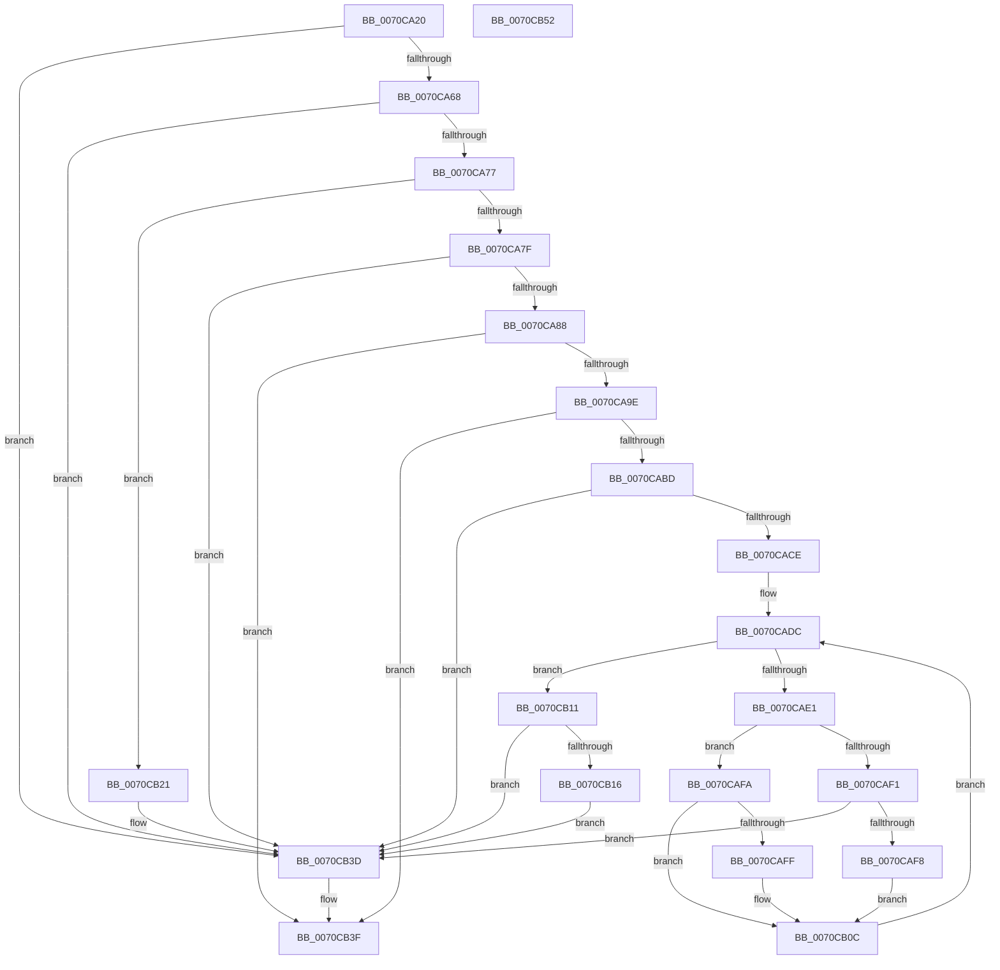

# HalacpiIrqTranslateResourcesIsa

- RVA: `0x0070CA20`–`0x0070CB53` (길이 `307` bytes)
- VA: `0x000000014070CA20`
- 실행 섹션: `PAGE`
- PDB 이름 있음: `예`; PDB Function 태그: `아니요`
- unwind 정보 RVA: `0x00061768`
- 디코드: `87`개 명령, `307/307` bytes 표시
- 미해석 바이트: `0` (있으면 어셈블리에 `.byte`로 보존)

> 이 문서는 커널 이미지의 기계어와 PDB 기호를 분석해 생성했습니다. 4번과 5번은 함수 원형과 자료형을 바이너리 사용 방식에서 추정한 C 해석이며 원본 소스 복구 결과는 아닙니다.

## 1. Dependencies

- 직접 호출 지점: **3**; 고유 호출 대상: **2**
- 직접 호출자로 확인된 함수: **0**
- RIP 상대 이미지 참조: **1**

### Outgoing calls
- `0x0070CA6A` → [HalpIsInterruptTypeSecondary](../../text/2D/HalpIsInterruptTypeSecondary_function_002D2510.md) (function, `0x002D2510`)
- `0x0070CA91` → [TranslateGlobalVectorToIsaVector](TranslateGlobalVectorToIsaVector_function_0070CBC4.md) (function, `0x0070CBC4`)
- `0x0070CAB0` → [TranslateGlobalVectorToIsaVector](TranslateGlobalVectorToIsaVector_function_0070CBC4.md) (function, `0x0070CBC4`)

### Direct callers
- 이 함수 시작 RVA로 연결되는 직접 call은 확인되지 않았습니다. 간접 호출은 완전히 역산할 수 없습니다.

### Static image references
- `0x0070CB25` → RVA `0x00025FC0` (`.rdata`; read)

## 2. Other-region calls and transfers

- 다른 실행 섹션으로 향하는 call: **1**
  - `0x0070CA6A` → [HalpIsInterruptTypeSecondary](../../text/2D/HalpIsInterruptTypeSecondary_function_002D2510.md) (`PAGE` → `.text`)
- 별도 외부 분기/꼬리 이동을 확인하지 못했습니다.

## 3. Assembly (complete function range)

```asm
0070CA20  48 89 5C 24 08                  mov qword ptr [rsp + 8], rbx
0070CA25  48 89 6C 24 18                  mov qword ptr [rsp + 0x18], rbp
0070CA2A  56                              push rsi
0070CA2B  57                              push rdi
0070CA2C  41 56                           push r14
0070CA2E  48 83 EC 20                     sub rsp, 0x20
0070CA32  0F 10 02                        movups xmm0, xmmword ptr [rdx]
0070CA35  48 8B 5C 24 70                  mov rbx, qword ptr [rsp + 0x70]
0070CA3A  48 8B F2                        mov rsi, rdx
0070CA3D  83 64 24 48 00                  and dword ptr [rsp + 0x48], 0
0070CA42  40 32 ED                        xor bpl, bpl
0070CA45  45 8B F1                        mov r14d, r9d
0070CA48  41 8B F8                        mov edi, r8d
0070CA4B  0F 11 03                        movups xmmword ptr [rbx], xmm0
0070CA4E  8B 42 10                        mov eax, dword ptr [rdx + 0x10]
0070CA51  89 43 10                        mov dword ptr [rbx + 0x10], eax
0070CA54  8B 52 08                        mov edx, dword ptr [rdx + 8]
0070CA57  8D 82 00 00 10 00               lea eax, [rdx + 0x100000]
0070CA5D  3D FE FF 0F 00                  cmp eax, 0xffffe
0070CA62  0F 86 D5 00 00 00               jbe 0x14070cb3d
0070CA68  33 C9                           xor ecx, ecx
0070CA6A  E8 A1 5A BC FF                  call 0x1402d2510
0070CA6F  84 C0                           test al, al
0070CA71  0F 85 C6 00 00 00               jne 0x14070cb3d
0070CA77  85 FF                           test edi, edi
0070CA79  0F 84 A2 00 00 00               je 0x14070cb21
0070CA7F  83 FF 01                        cmp edi, 1
0070CA82  0F 85 B5 00 00 00               jne 0x14070cb3d
0070CA88  0F B7 4E 04                     movzx ecx, word ptr [rsi + 4]
0070CA8C  48 8D 54 24 48                  lea rdx, [rsp + 0x48]
0070CA91  E8 2E 01 00 00                  call 0x14070cbc4
0070CA96  85 C0                           test eax, eax
0070CA98  0F 88 A1 00 00 00               js 0x14070cb3f
0070CA9E  44 8B 54 24 48                  mov r10d, dword ptr [rsp + 0x48]
0070CAA3  48 8D 54 24 48                  lea rdx, [rsp + 0x48]
0070CAA8  66 44 89 53 04                  mov word ptr [rbx + 4], r10w
0070CAAD  8B 4E 08                        mov ecx, dword ptr [rsi + 8]
0070CAB0  E8 0F 01 00 00                  call 0x14070cbc4
0070CAB5  85 C0                           test eax, eax
0070CAB7  0F 88 82 00 00 00               js 0x14070cb3f
0070CABD  8B 44 24 48                     mov eax, dword ptr [rsp + 0x48]
0070CAC1  44 8D 5F 08                     lea r11d, [rdi + 8]
0070CAC5  89 43 08                        mov dword ptr [rbx + 8], eax
0070CAC8  66 45 3B D3                     cmp r10w, r11w
0070CACC  75 6F                           jne 0x14070cb3d
0070CACE  48 8B 54 24 60                  mov rdx, qword ptr [rsp + 0x60]
0070CAD3  44 8D 4F 01                     lea r9d, [rdi + 1]
0070CAD7  33 C9                           xor ecx, ecx
0070CAD9  44 8B D7                        mov r10d, edi
0070CADC  41 3B CE                        cmp ecx, r14d
0070CADF  73 30                           jae 0x14070cb11
0070CAE1  8B C1                           mov eax, ecx
0070CAE3  48 C1 E0 05                     shl rax, 5
0070CAE7  44 8B 44 10 08                  mov r8d, dword ptr [rax + rdx + 8]
0070CAEC  45 3B C3                        cmp r8d, r11d
0070CAEF  72 09                           jb 0x14070cafa
0070CAF1  44 39 5C 10 0C                  cmp dword ptr [rax + rdx + 0xc], r11d
0070CAF6  76 45                           jbe 0x14070cb3d
0070CAF8  EB 12                           jmp 0x14070cb0c
0070CAFA  45 3B C1                        cmp r8d, r9d
0070CAFD  72 0D                           jb 0x14070cb0c
0070CAFF  44 39 4C 10 0C                  cmp dword ptr [rax + rdx + 0xc], r9d
0070CB04  40 0F B6 ED                     movzx ebp, bpl
0070CB08  41 0F 46 EA                     cmovbe ebp, r10d
0070CB0C  41 03 CA                        add ecx, r10d
0070CB0F  EB CB                           jmp 0x14070cadc
0070CB11  40 84 ED                        test bpl, bpl
0070CB14  74 27                           je 0x14070cb3d
0070CB16  66 44 89 4B 04                  mov word ptr [rbx + 4], r9w
0070CB1B  44 89 4B 08                     mov dword ptr [rbx + 8], r9d
0070CB1F  EB 1C                           jmp 0x14070cb3d
0070CB21  0F B7 46 04                     movzx eax, word ptr [rsi + 4]
0070CB25  48 8D 0D 94 94 91 FF            lea rcx, [rip - 0x6e6b6c]
0070CB2C  0F B7 04 81                     movzx eax, word ptr [rcx + rax*4]
0070CB30  66 89 43 04                     mov word ptr [rbx + 4], ax
0070CB34  8B 46 08                        mov eax, dword ptr [rsi + 8]
0070CB37  8B 04 81                        mov eax, dword ptr [rcx + rax*4]
0070CB3A  89 43 08                        mov dword ptr [rbx + 8], eax
0070CB3D  33 C0                           xor eax, eax
0070CB3F  48 8B 5C 24 40                  mov rbx, qword ptr [rsp + 0x40]
0070CB44  48 8B 6C 24 50                  mov rbp, qword ptr [rsp + 0x50]
0070CB49  48 83 C4 20                     add rsp, 0x20
0070CB4D  41 5E                           pop r14
0070CB4F  5F                              pop rdi
0070CB50  5E                              pop rsi
0070CB51  C3                              ret
0070CB52  CC                              int3
```

## 4. C-style interpretation (structured pseudocode)

```c
__int64 __fastcall HalacpiIrqTranslateResourcesIsa(int a1, __int64 a2, int a3, int a4, __int64 a5, __int64 a6, __int64 a7)
{
    __int64 result;
    __int64 v_rbp;
    __int64 v_rsp;
    unsigned int v_stack_p10;
    unsigned __int64 v_stack_p18;
    unsigned __int64 v_stack_p8;

    v_stack_p8 = v_rbx;
    v_stack_p18 = v_rbp;
    v_rsp = (v_rsp) - (32);
    v_rbp = 0;
    *(unsigned __int64 *)(a7) = v_xmm0;
    *(unsigned int *)(a7 + 16) = (unsigned int)((unsigned int)(*(unsigned int *)(a2 + 16)));
    if (((unsigned int)((unsigned int)(*(unsigned int *)(a2 + 8)) + 1048576)) <= 0xFFFFEULL) goto loc_0070CB3D;
    a1 = 0;
    result = HalpIsInterruptTypeSecondary(a1, (unsigned int)(*(unsigned int *)(a2 + 8)), a3, a4);
    if ((unsigned __int8)(result) != 0) goto loc_0070CB3D;
    if ((unsigned int)((unsigned int)(a3)) == 0) goto loc_0070CB21;
    if (((unsigned int)((unsigned int)(a3))) != 1) goto loc_0070CB3D;
    result = TranslateGlobalVectorToIsaVector(*(unsigned __int16 *)(a2 + 4), v_stack_p10, a3, a4);
    if (sign_flag) goto loc_0070CB3F;
    *(unsigned __int16 *)(a7 + 4) = (unsigned __int16)((unsigned int)(v_stack_p10));
    result = TranslateGlobalVectorToIsaVector((unsigned int)(*(unsigned int *)(a2 + 8)), v_stack_p10, a3, a4);
    if (sign_flag) goto loc_0070CB3F;
    *(unsigned int *)(a7 + 8) = (unsigned int)((unsigned int)(v_stack_p10));
    if (((unsigned __int16)((unsigned int)(v_stack_p10))) != ((unsigned __int16)((unsigned int)(a3) + 8))) goto loc_0070CB3D;
    a1 = 0;
loc_0070CADC:
    if (0 >= ((unsigned int)((unsigned int)(a4)))) goto loc_0070CB11;
    result = (0) << (5);
    if (((unsigned int)((unsigned int)(*(unsigned int *)(result + a5 * 1 + 8)))) < ((unsigned int)((unsigned int)(a3) + 8))) goto loc_0070CAFA;
    if ((*(unsigned int *)(result + a5 * 1 + 12)) <= ((unsigned int)((unsigned int)(a3) + 8))) goto loc_0070CB3D;
    goto loc_0070CB0C;
loc_0070CAFA:
    if (((unsigned int)((unsigned int)(*(unsigned int *)(result + a5 * 1 + 8)))) >= ((unsigned int)((unsigned int)(a3) + 1))) {
        v_rbp = 0;
        if ((*(unsigned int *)(result + a5 * 1 + 12)) <= ((unsigned int)((unsigned int)(a3) + 1))) { v_rbp = (unsigned int)((unsigned int)((unsigned int)((unsigned int)(a3)))); }
    }
    a1 = (unsigned int)((a1) + ((unsigned int)((unsigned int)((unsigned int)((unsigned int)(a3))))));
    goto loc_0070CADC;
loc_0070CB11:
    if ((unsigned __int8)(v_rbp) == 0) goto loc_0070CB3D;
    *(unsigned __int16 *)(a7 + 4) = (unsigned __int16)((unsigned int)(a3) + 1);
    *(unsigned int *)(a7 + 8) = (unsigned int)((unsigned int)(a3) + 1);
    goto loc_0070CB3D;
loc_0070CB21:
    *(unsigned __int16 *)(a7 + 4) = (unsigned __int16)(*(unsigned __int16 *)(v_rip - 7236460 + *(unsigned __int16 *)(a2 + 4) * 4));
    *(unsigned int *)(a7 + 8) = (unsigned int)((unsigned int)(*(unsigned int *)(v_rip - 7236460 + (unsigned int)(*(unsigned int *)(a2 + 8)) * 4)));
loc_0070CB3D:
    result = 0;
loc_0070CB3F:
    v_rsp = (v_rsp) + (32);
    return result;
}
```

## 5. (Beta) C Style

```c
int64_t HalacpiIrqTranslateResourcesIsa(int32_t Arg1, void *Arg2, int32_t Arg3, int32_t Arg4, int64_t Arg5, uint64_t Arg6, void *Arg7)
{
    uint8_t *arg2 = (uint8_t *)Arg2;
    uint8_t *arg7 = (uint8_t *)Arg7;

    int64_t result;
    int64_t local_rbp;
    int64_t local_rsp;
    uint32_t v_stack_p10;
    uint64_t v_stack_p18;
    uint64_t v_stack_p8;

    v_stack_p8 = local_rbx;
    v_stack_p18 = local_rbp;
    local_rsp = (local_rsp) - (32);
    local_rbp = 0;
    *(uint64_t *)(arg7) = v_xmm0;
    *(uint32_t *)(arg7 + 0x10) = (uint32_t)((uint32_t)(*(uint32_t *)(arg2 + 0x10)));
    if (((uint32_t)((uint32_t)(*(uint32_t *)(arg2 + 0x8)) + 1048576)) <= 0xFFFFEULL) goto loc_0070CB3D;
    Arg1 = 0;
    result = HalpIsInterruptTypeSecondary(Arg1, (uint32_t)(*(uint32_t *)(arg2 + 0x8)), Arg3, Arg4);
    if ((uint8_t)(result) != 0) goto loc_0070CB3D;
    if ((uint32_t)((uint32_t)(Arg3)) == 0) goto loc_0070CB21;
    if (((uint32_t)((uint32_t)(Arg3))) != 1) goto loc_0070CB3D;
    result = TranslateGlobalVectorToIsaVector(*(uint16_t *)(arg2 + 0x4), v_stack_p10, Arg3, Arg4);
    if (sign_flag) goto loc_0070CB3F;
    *(uint16_t *)(arg7 + 0x4) = (uint16_t)((uint32_t)(v_stack_p10));
    result = TranslateGlobalVectorToIsaVector((uint32_t)(*(uint32_t *)(arg2 + 0x8)), v_stack_p10, Arg3, Arg4);
    if (sign_flag) goto loc_0070CB3F;
    *(uint32_t *)(arg7 + 0x8) = (uint32_t)((uint32_t)(v_stack_p10));
    if (((uint16_t)((uint32_t)(v_stack_p10))) != ((uint16_t)((uint32_t)(Arg3) + 8))) goto loc_0070CB3D;
    Arg1 = 0;
loc_0070CADC:
    if (0 >= ((uint32_t)((uint32_t)(Arg4)))) goto loc_0070CB11;
    result = (0) << (5);
    if (((uint32_t)((uint32_t)(*(uint32_t *)(result + Arg5 * 1 + 0x8)))) < ((uint32_t)((uint32_t)(Arg3) + 8))) goto loc_0070CAFA;
    if ((*(uint32_t *)(result + Arg5 * 1 + 0xC)) <= ((uint32_t)((uint32_t)(Arg3) + 8))) goto loc_0070CB3D;
    goto loc_0070CB0C;
loc_0070CAFA:
    if (((uint32_t)((uint32_t)(*(uint32_t *)(result + Arg5 * 1 + 0x8)))) >= ((uint32_t)((uint32_t)(Arg3) + 1))) {
        local_rbp = 0;
        if ((*(uint32_t *)(result + Arg5 * 1 + 0xC)) <= ((uint32_t)((uint32_t)(Arg3) + 1))) { local_rbp = (uint32_t)((uint32_t)((uint32_t)((uint32_t)(Arg3)))); }
    }
    Arg1 = (uint32_t)((Arg1) + ((uint32_t)((uint32_t)((uint32_t)((uint32_t)(Arg3))))));
    goto loc_0070CADC;
loc_0070CB11:
    if ((uint8_t)(local_rbp) == 0) goto loc_0070CB3D;
    *(uint16_t *)(arg7 + 0x4) = (uint16_t)((uint32_t)(Arg3) + 1);
    *(uint32_t *)(arg7 + 0x8) = (uint32_t)((uint32_t)(Arg3) + 1);
    goto loc_0070CB3D;
loc_0070CB21:
    *(uint16_t *)(arg7 + 0x4) = (uint16_t)(*(uint16_t *)(v_rip - 0x6E6B6C + *(uint16_t *)(arg2 + 0x4) * 4));
    *(uint32_t *)(arg7 + 0x8) = (uint32_t)((uint32_t)(*(uint32_t *)(v_rip - 0x6E6B6C + (uint32_t)(*(uint32_t *)(arg2 + 0x8)) * 4)));
loc_0070CB3D:
    result = 0;
loc_0070CB3F:
    local_rsp = (local_rsp) + (32);
    return result;
}
```

### 관측된 메모리 오프셋

구조체 형식이 확인되지 않은 접근은 인자 기준의 오프셋으로만 기록했습니다.

| 기준 인자 | 오프셋 표현 | 폭 (bit) | 접근 |
|---|---:|---:|---|
| `Arg2` | `+ 0x0` | `128` | `R` |
| `Arg2` | `+ 0x4` | `16` | `R` |
| `Arg2` | `+ 0x8` | `32` | `R` |
| `Arg2` | `+ 0x10` | `32` | `R` |
| `Arg7` | `+ 0x0` | `128` | `R` |
| `Arg7` | `+ 0x4` | `16` | `W` |
| `Arg7` | `+ 0x8` | `32` | `W` |
| `Arg7` | `+ 0x10` | `32` | `W` |

## 6. Execution-region graph

[열기: 2D/3D 그래프와 함수 탐색 컨트롤 패널](../../../control-panel.html?section=page&rva=0x0070CA20&view=graph)

- 2D 그래프는 위에서 아래로 흐르고, 3D 그래프는 빈 공간을 드래그해 회전합니다. Shift+드래그는 이동, 휠은 확대·축소, 함수 노드 선택은 대상 보고서 이동입니다.

### Static fallback


