# HaliAcpiMachineStateInit

- RVA: `0x0070B730`–`0x0070BAC4` (길이 `916` bytes)
- VA: `0x000000014070B730`
- 실행 섹션: `PAGE`
- PDB 이름 있음: `예`; PDB Function 태그: `아니요`
- unwind 정보 RVA: `0x000C4880`
- 디코드: `238`개 명령, `916/916` bytes 표시
- 미해석 바이트: `0` (있으면 어셈블리에 `.byte`로 보존)

> 이 문서는 커널 이미지의 기계어와 PDB 기호를 분석해 생성했습니다. 4번과 5번은 함수 원형과 자료형을 바이너리 사용 방식에서 추정한 C 해석이며 원본 소스 복구 결과는 아닙니다.

## 1. Dependencies

- 직접 호출 지점: **15**; 고유 호출 대상: **5**
- 직접 호출자로 확인된 함수: **0**
- RIP 상대 이미지 참조: **12**

### Outgoing calls
- `0x0070B779` → [HalpInterruptModel](../../text/4A/HalpInterruptModel_function_004ACA38.md) (function, `0x004ACA38`)
- `0x0070B78F` → [HalpIsXboxNanovisorPresent](../../text/54/HalpIsXboxNanovisorPresent_function_0054C3C0.md) (function, `0x0054C3C0`)
- `0x0070B7E9` → [ZwPowerInformation](../../text/6A/ZwPowerInformation_function_006ADCB0.md) (function, `0x006ADCB0`)
- `0x0070B801` → [HalpHvSetSleepStateProperty](../../text/54/HalpHvSetSleepStateProperty_function_0054CF70.md) (function, `0x0054CF70`)
- `0x0070B869` → [ZwPowerInformation](../../text/6A/ZwPowerInformation_function_006ADCB0.md) (function, `0x006ADCB0`)
- `0x0070B883` → [HalpHvSetSleepStateProperty](../../text/54/HalpHvSetSleepStateProperty_function_0054CF70.md) (function, `0x0054CF70`)
- `0x0070B8E5` → [ZwPowerInformation](../../text/6A/ZwPowerInformation_function_006ADCB0.md) (function, `0x006ADCB0`)
- `0x0070B8FF` → [HalpHvSetSleepStateProperty](../../text/54/HalpHvSetSleepStateProperty_function_0054CF70.md) (function, `0x0054CF70`)
- `0x0070B95F` → [ZwPowerInformation](../../text/6A/ZwPowerInformation_function_006ADCB0.md) (function, `0x006ADCB0`)
- `0x0070B9C5` → [ZwPowerInformation](../../text/6A/ZwPowerInformation_function_006ADCB0.md) (function, `0x006ADCB0`)
- `0x0070BA1F` → [ZwPowerInformation](../../text/6A/ZwPowerInformation_function_006ADCB0.md) (function, `0x006ADCB0`)
- `0x0070BA39` → [HalpHvSetSleepStateProperty](../../text/54/HalpHvSetSleepStateProperty_function_0054CF70.md) (function, `0x0054CF70`)
- `0x0070BA83` → [ZwPowerInformation](../../text/6A/ZwPowerInformation_function_006ADCB0.md) (function, `0x006ADCB0`)
- `0x0070BA99` → [HalpHvSetSleepStateProperty](../../text/54/HalpHvSetSleepStateProperty_function_0054CF70.md) (function, `0x0054CF70`)
- `0x0070BAA5` → [_security_check_cookie](../../text/6A/_security_check_cookie_function_006AC640.md) (function, `0x006AC640`)

### Direct callers
- 이 함수 시작 RVA로 연결되는 직접 call은 확인되지 않았습니다. 간접 호출은 완전히 역산할 수 없습니다.

### Static image references
- `0x0070B749` → RVA `0x00E0A740` (`.data`; read)
- `0x0070B771` → RVA `0x00F90140` (`.data`; write)
- `0x0070B786` → RVA `0x00FC1ED9` (`.data`; read)
- `0x0070B79A` → RVA `0x0056AD60` (`HaliAcpiSleep`; read)
- `0x0070B7EE` → RVA `0x00FC1C42` (`.data`; read)
- `0x0070B80D` → RVA `0x00FC1AB8` (`.data`; read)
- `0x0070B91A` → RVA `0x00FC1B50` (`.data`; read)
- `0x0070B9A1` → RVA `0x00FC1ED8` (`.data`; read)
- `0x0070B9D0` → RVA `0x00E0A808` (`.data`; read)
- `0x0070BA15` → RVA `0x00FC2C68` (`.data`; write)
- `0x0070BA40` → RVA `0x00FC1A28` (`.data`; read)
- `0x0070BA64` → RVA `0x00546710` (`HalpLegacyShutdown`; read)

## 2. Other-region calls and transfers

- 다른 실행 섹션으로 향하는 call: **15**
  - `0x0070B779` → [HalpInterruptModel](../../text/4A/HalpInterruptModel_function_004ACA38.md) (`PAGE` → `.text`)
  - `0x0070B78F` → [HalpIsXboxNanovisorPresent](../../text/54/HalpIsXboxNanovisorPresent_function_0054C3C0.md) (`PAGE` → `.text`)
  - `0x0070B7E9` → [ZwPowerInformation](../../text/6A/ZwPowerInformation_function_006ADCB0.md) (`PAGE` → `.text`)
  - `0x0070B801` → [HalpHvSetSleepStateProperty](../../text/54/HalpHvSetSleepStateProperty_function_0054CF70.md) (`PAGE` → `.text`)
  - `0x0070B869` → [ZwPowerInformation](../../text/6A/ZwPowerInformation_function_006ADCB0.md) (`PAGE` → `.text`)
  - `0x0070B883` → [HalpHvSetSleepStateProperty](../../text/54/HalpHvSetSleepStateProperty_function_0054CF70.md) (`PAGE` → `.text`)
  - `0x0070B8E5` → [ZwPowerInformation](../../text/6A/ZwPowerInformation_function_006ADCB0.md) (`PAGE` → `.text`)
  - `0x0070B8FF` → [HalpHvSetSleepStateProperty](../../text/54/HalpHvSetSleepStateProperty_function_0054CF70.md) (`PAGE` → `.text`)
  - `0x0070B95F` → [ZwPowerInformation](../../text/6A/ZwPowerInformation_function_006ADCB0.md) (`PAGE` → `.text`)
  - `0x0070B9C5` → [ZwPowerInformation](../../text/6A/ZwPowerInformation_function_006ADCB0.md) (`PAGE` → `.text`)
  - `0x0070BA1F` → [ZwPowerInformation](../../text/6A/ZwPowerInformation_function_006ADCB0.md) (`PAGE` → `.text`)
  - `0x0070BA39` → [HalpHvSetSleepStateProperty](../../text/54/HalpHvSetSleepStateProperty_function_0054CF70.md) (`PAGE` → `.text`)
  - `0x0070BA83` → [ZwPowerInformation](../../text/6A/ZwPowerInformation_function_006ADCB0.md) (`PAGE` → `.text`)
  - `0x0070BA99` → [HalpHvSetSleepStateProperty](../../text/54/HalpHvSetSleepStateProperty_function_0054CF70.md) (`PAGE` → `.text`)
  - `0x0070BAA5` → [_security_check_cookie](../../text/6A/_security_check_cookie_function_006AC640.md) (`PAGE` → `.text`)
- 별도 외부 분기/꼬리 이동을 확인하지 못했습니다.

## 3. Assembly (complete function range)

```asm
0070B730  48 89 5C 24 18                  mov qword ptr [rsp + 0x18], rbx
0070B735  48 89 74 24 20                  mov qword ptr [rsp + 0x20], rsi
0070B73A  55                              push rbp
0070B73B  57                              push rdi
0070B73C  41 54                           push r12
0070B73E  41 55                           push r13
0070B740  41 56                           push r14
0070B742  48 8B EC                        mov rbp, rsp
0070B745  48 83 EC 50                     sub rsp, 0x50
0070B749  48 8B 05 F0 EF 6F 00            mov rax, qword ptr [rip + 0x6feff0]
0070B750  48 33 C4                        xor rax, rsp
0070B753  48 89 45 F8                     mov qword ptr [rbp - 8], rax
0070B757  33 C0                           xor eax, eax
0070B759  0F 57 C0                        xorps xmm0, xmm0
0070B75C  33 F6                           xor esi, esi
0070B75E  48 89 45 F0                     mov qword ptr [rbp - 0x10], rax
0070B762  48 8B D9                        mov rbx, rcx
0070B765  40 0F B6 FE                     movzx edi, sil
0070B769  0F 11 45 E0                     movups xmmword ptr [rbp - 0x20], xmm0
0070B76D  44 8D 60 01                     lea r12d, [rax + 1]
0070B771  66 44 89 25 C7 49 88 00         mov word ptr [rip + 0x8849c7], r12w
0070B779  E8 BA 12 DA FF                  call 0x1404aca38
0070B77E  89 02                           mov dword ptr [rdx], eax
0070B780  40 38 73 09                     cmp byte ptr [rbx + 9], sil
0070B784  74 14                           je 0x14070b79a
0070B786  40 38 35 4C 67 8B 00            cmp byte ptr [rip + 0x8b674c], sil
0070B78D  75 0B                           jne 0x14070b79a
0070B78F  E8 2C 0C E4 FF                  call 0x14054c3c0
0070B794  84 C0                           test al, al
0070B796  41 0F 44 FC                     cmove edi, r12d
0070B79A  48 8D 05 BF F5 E5 FF            lea rax, [rip - 0x1a0a41]
0070B7A1  41 BD 18 00 00 00               mov r13d, 0x18
0070B7A7  45 8D 75 EE                     lea r14d, [r13 - 0x12]
0070B7AB  40 38 33                        cmp byte ptr [rbx], sil
0070B7AE  74 5D                           je 0x14070b80d
0070B7B0  0F B6 4B 02                     movzx ecx, byte ptr [rbx + 2]
0070B7B4  48 8D 55 E0                     lea rdx, [rbp - 0x20]
0070B7B8  83 E1 0F                        and ecx, 0xf
0070B7BB  48 89 45 E8                     mov qword ptr [rbp - 0x18], rax
0070B7BF  0F B6 43 01                     movzx eax, byte ptr [rbx + 1]
0070B7C3  48 81 C9 10 05 00 00            or rcx, 0x510
0070B7CA  48 C1 E1 04                     shl rcx, 4
0070B7CE  83 E0 0F                        and eax, 0xf
0070B7D1  48 0B C8                        or rcx, rax
0070B7D4  44 88 65 E4                     mov byte ptr [rbp - 0x1c], r12b
0070B7D8  48 89 4D F0                     mov qword ptr [rbp - 0x10], rcx
0070B7DC  45 33 C9                        xor r9d, r9d
0070B7DF  41 8B CE                        mov ecx, r14d
0070B7E2  89 74 24 20                     mov dword ptr [rsp + 0x20], esi
0070B7E6  45 8B C5                        mov r8d, r13d
0070B7E9  E8 C2 24 FA FF                  call 0x1406adcb0
0070B7EE  40 38 35 4D 64 8B 00            cmp byte ptr [rip + 0x8b644d], sil
0070B7F5  74 0F                           je 0x14070b806
0070B7F7  44 8A 43 02                     mov r8b, byte ptr [rbx + 2]
0070B7FB  41 8B CC                        mov ecx, r12d
0070B7FE  8A 53 01                        mov dl, byte ptr [rbx + 1]
0070B801  E8 6A 17 E4 FF                  call 0x14054cf70
0070B806  48 8D 05 53 F5 E5 FF            lea rax, [rip - 0x1a0aad]
0070B80D  48 39 35 A4 62 8B 00            cmp qword ptr [rip + 0x8b62a4], rsi
0070B814  0F 84 4C 01 00 00               je 0x14070b966
0070B81A  40 38 73 03                     cmp byte ptr [rbx + 3], sil
0070B81E  74 68                           je 0x14070b888
0070B820  0F B6 4B 04                     movzx ecx, byte ptr [rbx + 4]
0070B824  48 89 45 E8                     mov qword ptr [rbp - 0x18], rax
0070B828  83 E1 0F                        and ecx, 0xf
0070B82B  0F B6 43 05                     movzx eax, byte ptr [rbx + 5]
0070B82F  83 E0 0F                        and eax, 0xf
0070B832  44 89 65 E0                     mov dword ptr [rbp - 0x20], r12d
0070B836  0D 20 05 00 00                  or eax, 0x520
0070B83B  44 88 65 E4                     mov byte ptr [rbp - 0x1c], r12b
0070B83F  C1 E0 04                        shl eax, 4
0070B842  0B C1                           or eax, ecx
0070B844  40 38 35 F7 63 8B 00            cmp byte ptr [rip + 0x8b63f7], sil
0070B84B  75 05                           jne 0x14070b852
0070B84D  0D 00 20 01 00                  or eax, 0x12000
0070B852  8B C8                           mov ecx, eax
0070B854  48 8D 55 E0                     lea rdx, [rbp - 0x20]
0070B858  48 89 4D F0                     mov qword ptr [rbp - 0x10], rcx
0070B85C  45 33 C9                        xor r9d, r9d
0070B85F  41 8B CE                        mov ecx, r14d
0070B862  89 74 24 20                     mov dword ptr [rsp + 0x20], esi
0070B866  45 8B C5                        mov r8d, r13d
0070B869  E8 42 24 FA FF                  call 0x1406adcb0
0070B86E  40 38 35 CD 63 8B 00            cmp byte ptr [rip + 0x8b63cd], sil
0070B875  74 11                           je 0x14070b888
0070B877  44 8A 43 05                     mov r8b, byte ptr [rbx + 5]
0070B87B  B9 02 00 00 00                  mov ecx, 2
0070B880  8A 53 04                        mov dl, byte ptr [rbx + 4]
0070B883  E8 E8 16 E4 FF                  call 0x14054cf70
0070B888  40 38 73 06                     cmp byte ptr [rbx + 6], sil
0070B88C  0F 84 D4 00 00 00               je 0x14070b966
0070B892  0F B6 4B 07                     movzx ecx, byte ptr [rbx + 7]
0070B896  48 8D 05 C3 F4 E5 FF            lea rax, [rip - 0x1a0b3d]
0070B89D  48 89 45 E8                     mov qword ptr [rbp - 0x18], rax
0070B8A1  83 E1 0F                        and ecx, 0xf
0070B8A4  0F B6 43 08                     movzx eax, byte ptr [rbx + 8]
0070B8A8  83 E0 0F                        and eax, 0xf
0070B8AB  C7 45 E0 02 00 00 00            mov dword ptr [rbp - 0x20], 2
0070B8B2  0D 30 05 00 00                  or eax, 0x530
0070B8B7  44 88 65 E4                     mov byte ptr [rbp - 0x1c], r12b
0070B8BB  C1 E0 04                        shl eax, 4
0070B8BE  0B C1                           or eax, ecx
0070B8C0  40 38 35 7B 63 8B 00            cmp byte ptr [rip + 0x8b637b], sil
0070B8C7  75 05                           jne 0x14070b8ce
0070B8C9  0D 00 20 03 00                  or eax, 0x32000
0070B8CE  8B C8                           mov ecx, eax
0070B8D0  48 8D 55 E0                     lea rdx, [rbp - 0x20]
0070B8D4  48 89 4D F0                     mov qword ptr [rbp - 0x10], rcx
0070B8D8  45 33 C9                        xor r9d, r9d
0070B8DB  41 8B CE                        mov ecx, r14d
0070B8DE  89 74 24 20                     mov dword ptr [rsp + 0x20], esi
0070B8E2  45 8B C5                        mov r8d, r13d
0070B8E5  E8 C6 23 FA FF                  call 0x1406adcb0
0070B8EA  40 38 35 51 63 8B 00            cmp byte ptr [rip + 0x8b6351], sil
0070B8F1  74 11                           je 0x14070b904
0070B8F3  44 8A 43 08                     mov r8b, byte ptr [rbx + 8]
0070B8F7  B9 03 00 00 00                  mov ecx, 3
0070B8FC  8A 53 07                        mov dl, byte ptr [rbx + 7]
0070B8FF  E8 6C 16 E4 FF                  call 0x14054cf70
0070B904  40 38 73 06                     cmp byte ptr [rbx + 6], sil
0070B908  74 5C                           je 0x14070b966
0070B90A  40 84 FF                        test dil, dil
0070B90D  48 8D 3D 4C F4 E5 FF            lea rdi, [rip - 0x1a0bb4]
0070B914  0F 84 B0 00 00 00               je 0x14070b9ca
0070B91A  8A 05 30 62 8B 00               mov al, byte ptr [rip + 0x8b6230]
0070B920  48 8D 55 E0                     lea rdx, [rbp - 0x20]
0070B924  0F B6 4B 08                     movzx ecx, byte ptr [rbx + 8]
0070B928  45 33 C9                        xor r9d, r9d
0070B92B  83 E1 0F                        and ecx, 0xf
0070B92E  C0 E8 07                        shr al, 7
0070B931  48 81 C9 40 37 00 00            or rcx, 0x3740
0070B938  88 45 E4                        mov byte ptr [rbp - 0x1c], al
0070B93B  0F B6 43 07                     movzx eax, byte ptr [rbx + 7]
0070B93F  45 8B C5                        mov r8d, r13d
0070B942  48 C1 E1 04                     shl rcx, 4
0070B946  83 E0 0F                        and eax, 0xf
0070B949  48 0B C8                        or rcx, rax
0070B94C  44 89 75 E0                     mov dword ptr [rbp - 0x20], r14d
0070B950  48 89 4D F0                     mov qword ptr [rbp - 0x10], rcx
0070B954  41 8B CE                        mov ecx, r14d
0070B957  48 89 7D E8                     mov qword ptr [rbp - 0x18], rdi
0070B95B  89 74 24 20                     mov dword ptr [rsp + 0x20], esi
0070B95F  E8 4C 23 FA FF                  call 0x1406adcb0
0070B964  EB 0C                           jmp 0x14070b972
0070B966  40 84 FF                        test dil, dil
0070B969  48 8D 3D F0 F3 E5 FF            lea rdi, [rip - 0x1a0c10]
0070B970  74 58                           je 0x14070b9ca
0070B972  8A 05 D8 61 8B 00               mov al, byte ptr [rip + 0x8b61d8]
0070B978  0F B6 4B 0A                     movzx ecx, byte ptr [rbx + 0xa]
0070B97C  C0 E8 07                        shr al, 7
0070B97F  83 E1 0F                        and ecx, 0xf
0070B982  88 45 E4                        mov byte ptr [rbp - 0x1c], al
0070B985  0F B6 43 0B                     movzx eax, byte ptr [rbx + 0xb]
0070B989  83 E0 0F                        and eax, 0xf
0070B98C  C7 45 E0 03 00 00 00            mov dword ptr [rbp - 0x20], 3
0070B993  0D 40 05 00 00                  or eax, 0x540
0070B998  48 89 7D E8                     mov qword ptr [rbp - 0x18], rdi
0070B99C  C1 E0 04                        shl eax, 4
0070B99F  0B C1                           or eax, ecx
0070B9A1  40 38 35 30 65 8B 00            cmp byte ptr [rip + 0x8b6530], sil
0070B9A8  75 04                           jne 0x14070b9ae
0070B9AA  0F BA E8 10                     bts eax, 0x10
0070B9AE  8B C8                           mov ecx, eax
0070B9B0  48 8D 55 E0                     lea rdx, [rbp - 0x20]
0070B9B4  48 89 4D F0                     mov qword ptr [rbp - 0x10], rcx
0070B9B8  45 33 C9                        xor r9d, r9d
0070B9BB  41 8B CE                        mov ecx, r14d
0070B9BE  89 74 24 20                     mov dword ptr [rsp + 0x20], esi
0070B9C2  45 8B C5                        mov r8d, r13d
0070B9C5  E8 E6 22 FA FF                  call 0x1406adcb0
0070B9CA  40 38 73 0C                     cmp byte ptr [rbx + 0xc], sil
0070B9CE  74 70                           je 0x14070ba40
0070B9D0  8B 05 32 EE 6F 00               mov eax, dword ptr [rip + 0x6fee32]
0070B9D6  41 84 C4                        test r12b, al
0070B9D9  74 6E                           je 0x14070ba49
0070B9DB  0F B6 4B 0D                     movzx ecx, byte ptr [rbx + 0xd]
0070B9DF  48 8D 55 E0                     lea rdx, [rbp - 0x20]
0070B9E3  0F B6 43 0E                     movzx eax, byte ptr [rbx + 0xe]
0070B9E7  83 E1 0F                        and ecx, 0xf
0070B9EA  83 E0 0F                        and eax, 0xf
0070B9ED  C7 45 E0 04 00 00 00            mov dword ptr [rbp - 0x20], 4
0070B9F4  0D 50 08 00 00                  or eax, 0x850
0070B9F9  40 88 75 E4                     mov byte ptr [rbp - 0x1c], sil
0070B9FD  C1 E0 04                        shl eax, 4
0070BA00  45 33 C9                        xor r9d, r9d
0070BA03  0B C1                           or eax, ecx
0070BA05  48 89 7D E8                     mov qword ptr [rbp - 0x18], rdi
0070BA09  8B C8                           mov ecx, eax
0070BA0B  45 8B C5                        mov r8d, r13d
0070BA0E  48 89 4D F0                     mov qword ptr [rbp - 0x10], rcx
0070BA12  41 8B CE                        mov ecx, r14d
0070BA15  89 05 4D 72 8B 00               mov dword ptr [rip + 0x8b724d], eax
0070BA1B  89 74 24 20                     mov dword ptr [rsp + 0x20], esi
0070BA1F  E8 8C 22 FA FF                  call 0x1406adcb0
0070BA24  40 38 35 17 62 8B 00            cmp byte ptr [rip + 0x8b6217], sil
0070BA2B  74 71                           je 0x14070ba9e
0070BA2D  44 8A 43 0E                     mov r8b, byte ptr [rbx + 0xe]
0070BA31  B9 05 00 00 00                  mov ecx, 5
0070BA36  8A 53 0D                        mov dl, byte ptr [rbx + 0xd]
0070BA39  E8 32 15 E4 FF                  call 0x14054cf70
0070BA3E  EB 48                           jmp 0x14070ba88
0070BA40  40 38 35 E1 5F 8B 00            cmp byte ptr [rip + 0x8b5fe1], sil
0070BA47  74 3F                           je 0x14070ba88
0070BA49  33 C0                           xor eax, eax
0070BA4B  89 35 17 72 8B 00               mov dword ptr [rip + 0x8b7217], esi
0070BA51  48 89 45 F0                     mov qword ptr [rbp - 0x10], rax
0070BA55  48 8D 55 E0                     lea rdx, [rbp - 0x20]
0070BA59  0F 57 C0                        xorps xmm0, xmm0
0070BA5C  89 74 24 20                     mov dword ptr [rsp + 0x20], esi
0070BA60  0F 11 45 E0                     movups xmmword ptr [rbp - 0x20], xmm0
0070BA64  48 8D 05 A5 AC E3 FF            lea rax, [rip - 0x1c535b]
0070BA6B  C7 45 E0 04 00 00 00            mov dword ptr [rbp - 0x20], 4
0070BA72  45 33 C9                        xor r9d, r9d
0070BA75  48 89 45 E8                     mov qword ptr [rbp - 0x18], rax
0070BA79  45 8B C5                        mov r8d, r13d
0070BA7C  40 88 75 E4                     mov byte ptr [rbp - 0x1c], sil
0070BA80  41 8B CE                        mov ecx, r14d
0070BA83  E8 28 22 FA FF                  call 0x1406adcb0
0070BA88  40 38 35 B3 61 8B 00            cmp byte ptr [rip + 0x8b61b3], sil
0070BA8F  74 0D                           je 0x14070ba9e
0070BA91  45 33 C0                        xor r8d, r8d
0070BA94  33 D2                           xor edx, edx
0070BA96  41 8B CE                        mov ecx, r14d
0070BA99  E8 D2 14 E4 FF                  call 0x14054cf70
0070BA9E  48 8B 4D F8                     mov rcx, qword ptr [rbp - 8]
0070BAA2  48 33 CC                        xor rcx, rsp
0070BAA5  E8 96 0B FA FF                  call 0x1406ac640
0070BAAA  4C 8D 5C 24 50                  lea r11, [rsp + 0x50]
0070BAAF  49 8B 5B 40                     mov rbx, qword ptr [r11 + 0x40]
0070BAB3  49 8B 73 48                     mov rsi, qword ptr [r11 + 0x48]
0070BAB7  49 8B E3                        mov rsp, r11
0070BABA  41 5E                           pop r14
0070BABC  41 5D                           pop r13
0070BABE  41 5C                           pop r12
0070BAC0  5F                              pop rdi
0070BAC1  5D                              pop rbp
0070BAC2  C3                              ret
0070BAC3  CC                              int3
```

## 4. C-style interpretation (structured pseudocode)

```c
__int64 __fastcall HaliAcpiMachineStateInit(__int64 a1, __int64 a2, __int64 a3, int a4)
{
    __int64 result;
    __int64 v_rdi;
    __int64 v_rsi;
    __int64 v_rsp;
    unsigned __int64 v_stack_m28;
    unsigned __int64 v_stack_m30;
    unsigned __int64 v_stack_m38;
    unsigned __int64 v_stack_m40;
    unsigned __int8 v_stack_m44;
    unsigned __int64 v_stack_m48;
    unsigned int v_stack_m58;
    unsigned __int64 v_stack_p18;
    unsigned __int64 v_stack_p20;

    v_stack_p18 = v_rbx;
    v_stack_p20 = v_rsi;
    v_rsp = (v_rsp) - (80);
    result = (*(unsigned __int64 *)(v_rip + 7335920)) ^ (v_rsp);
    v_stack_m30 = result;
    result = 0;
    v_rsi = 0;
    v_stack_m38 = 0;
    v_stack_m48 = v_xmm0;
    *(unsigned __int16 *)(v_rip + 8931783) = (unsigned __int16)(result + 1);
    result = HalpInterruptModel(a1, a2, a3, a4);
    *(unsigned int *)(a2) = (unsigned int)(result);
    if ((*(unsigned __int8 *)(a1 + 9)) == 0) goto loc_0070B79A;
    v_rdi = 0;
    if ((*(unsigned __int8 *)(v_rip + 9135948)) == 0) {
        result = HalpIsXboxNanovisorPresent(a1, a2, a3, a4);
        v_rdi = 0;
        if ((unsigned __int8)(result) == 0) { v_rdi = (unsigned int)(result + 1); }
    }
    if ((*(unsigned __int8 *)(a1)) == 0) goto loc_0070B80D;
    a1 = (unsigned int)((*(unsigned __int8 *)(a1 + 2)) & (15));
    v_stack_m40 = v_rip - 1706561;
    a1 = (a1) | (0x510ULL);
    a1 = (a1) << (4);
    result = (unsigned int)((*(unsigned __int8 *)(a1 + 1)) & (15));
    a1 = (a1) | (result);
    v_stack_m44 = (unsigned __int8)(result + 1);
    v_stack_m38 = a1;
    a4 = 0;
    v_stack_m58 = 0;
    result = ZwPowerInformation((unsigned int)((unsigned int)(24 - 18)), v_stack_m48, 24, a4);
    if ((*(unsigned __int8 *)(v_rip + 9135181)) != 0) {
        a3 = *(unsigned __int8 *)(a1 + 2);
        a1 = (unsigned int)(result + 1);
        a2 = *(unsigned __int8 *)(a1 + 1);
        result = HalpHvSetSleepStateProperty(a1, a2, a3, a4);
    }
loc_0070B80D:
    if ((*(unsigned __int64 *)(v_rip + 9134756)) == 0) goto loc_0070B966;
    if ((*(unsigned __int8 *)(a1 + 3)) == 0) goto loc_0070B888;
    v_stack_m40 = v_rip - 1706669;
    a1 = (unsigned int)((*(unsigned __int8 *)(a1 + 4)) & (15));
    result = (unsigned int)((*(unsigned __int8 *)(a1 + 5)) & (15));
    v_stack_m48 = (unsigned int)(result + 1);
    result = (unsigned int)((result) | (0x520ULL));
    v_stack_m44 = (unsigned __int8)(result + 1);
    result = (unsigned int)((result) << (4));
    result = (unsigned int)((result) | ((unsigned int)(a1)));
    if ((*(unsigned __int8 *)(v_rip + 9135095)) == 0) {
        result = (unsigned int)((result) | (0x12000ULL));
    }
    v_stack_m38 = (unsigned int)((unsigned int)(result));
    a4 = 0;
    v_stack_m58 = 0;
    result = ZwPowerInformation((unsigned int)((unsigned int)(24 - 18)), v_stack_m48, 24, a4);
    if ((*(unsigned __int8 *)(v_rip + 9135053)) != 0) {
        a3 = *(unsigned __int8 *)(a1 + 5);
        a1 = 2;
        a2 = *(unsigned __int8 *)(a1 + 4);
        result = HalpHvSetSleepStateProperty(a1, a2, a3, a4);
    }
    if ((*(unsigned __int8 *)(a1 + 6)) == 0) goto loc_0070B966;
    v_stack_m40 = v_rip - 1706813;
    a1 = (unsigned int)((*(unsigned __int8 *)(a1 + 7)) & (15));
    result = (unsigned int)((*(unsigned __int8 *)(a1 + 8)) & (15));
    v_stack_m48 = 2;
    result = (unsigned int)((result) | (0x530ULL));
    v_stack_m44 = (unsigned __int8)(result + 1);
    result = (unsigned int)((result) << (4));
    result = (unsigned int)((result) | ((unsigned int)(a1)));
    if ((*(unsigned __int8 *)(v_rip + 9134971)) == 0) {
        result = (unsigned int)((result) | (0x32000ULL));
    }
    v_stack_m38 = (unsigned int)((unsigned int)(result));
    a4 = 0;
    v_stack_m58 = 0;
    result = ZwPowerInformation((unsigned int)((unsigned int)(24 - 18)), v_stack_m48, 24, a4);
    if ((*(unsigned __int8 *)(v_rip + 9134929)) != 0) {
        a3 = *(unsigned __int8 *)(a1 + 8);
        a1 = 3;
        a2 = *(unsigned __int8 *)(a1 + 7);
        result = HalpHvSetSleepStateProperty(a1, a2, a3, a4);
    }
    if ((*(unsigned __int8 *)(a1 + 6)) == 0) goto loc_0070B966;
    if ((unsigned __int8)(v_rdi) == 0) goto loc_0070B9CA;
    a4 = 0;
    a1 = (unsigned int)((*(unsigned __int8 *)(a1 + 8)) & (15));
    result = (unsigned __int8)((*(unsigned __int8 *)(v_rip + 9134640)) >> (7));
    a1 = (a1) | (0x3740ULL);
    v_stack_m44 = (unsigned __int8)(result);
    a1 = (a1) << (4);
    result = (unsigned int)((*(unsigned __int8 *)(a1 + 7)) & (15));
    a1 = (a1) | (result);
    v_stack_m48 = (unsigned int)(24 - 18);
    v_stack_m38 = a1;
    v_stack_m40 = v_rip - 1706932;
    v_stack_m58 = 0;
    result = ZwPowerInformation((unsigned int)((unsigned int)(24 - 18)), v_stack_m48, 24, a4);
    goto loc_0070B972;
loc_0070B966:
    if ((unsigned __int8)(v_rip - 1706932) == 0) goto loc_0070B9CA;
loc_0070B972:
    result = (unsigned __int8)((*(unsigned __int8 *)(v_rip + 9134552)) >> (7));
    a1 = (unsigned int)((*(unsigned __int8 *)(a1 + 10)) & (15));
    v_stack_m44 = (unsigned __int8)(result);
    result = (unsigned int)((*(unsigned __int8 *)(a1 + 11)) & (15));
    v_stack_m48 = 3;
    result = (unsigned int)((result) | (0x540ULL));
    v_stack_m40 = v_rip - 1707024;
    result = (unsigned int)((result) << (4));
    result = (unsigned int)((result) | ((unsigned int)(a1)));
    if ((*(unsigned __int8 *)(v_rip + 9135408)) == 0) {
    }
    v_stack_m38 = (unsigned int)((unsigned int)(result));
    a4 = 0;
    v_stack_m58 = 0;
    result = ZwPowerInformation((unsigned int)((unsigned int)(24 - 18)), v_stack_m48, 24, a4);
loc_0070B9CA:
    if ((*(unsigned __int8 *)(a1 + 12)) == 0) goto loc_0070BA40;
    if ((((unsigned __int8)(result + 1)) & ((unsigned __int8)((unsigned int)(*(unsigned int *)(v_rip + 7335474))))) == 0) goto loc_0070BA49;
    a1 = (unsigned int)((*(unsigned __int8 *)(a1 + 13)) & (15));
    result = (unsigned int)((*(unsigned __int8 *)(a1 + 14)) & (15));
    v_stack_m48 = 4;
    result = (unsigned int)((result) | (0x850ULL));
    v_stack_m44 = 0;
    result = (unsigned int)((result) << (4));
    a4 = 0;
    result = (unsigned int)((result) | ((unsigned int)(a1)));
    v_stack_m40 = v_rip - 1707024;
    v_stack_m38 = (unsigned int)((unsigned int)(result));
    *(unsigned int *)(v_rip + 9138765) = (unsigned int)(result);
    v_stack_m58 = 0;
    result = ZwPowerInformation((unsigned int)((unsigned int)(24 - 18)), v_stack_m48, 24, a4);
    if ((*(unsigned __int8 *)(v_rip + 9134615)) == 0) goto loc_0070BA9E;
    result = HalpHvSetSleepStateProperty(5, *(unsigned __int8 *)(a1 + 13), *(unsigned __int8 *)(a1 + 14), a4);
    goto loc_0070BA88;
loc_0070BA40:
    if ((*(unsigned __int8 *)(v_rip + 9134049)) != 0) {
        result = 0;
        *(unsigned int *)(v_rip + 9138711) = 0;
        v_stack_m38 = 0;
        a2 = v_stack_m48;
        v_stack_m58 = 0;
        v_stack_m48 = v_xmm0;
        result = v_rip - 1856347;
        v_stack_m48 = 4;
        a4 = 0;
        v_stack_m40 = result;
        a3 = 24;
        v_stack_m44 = 0;
        a1 = (unsigned int)(24 - 18);
        result = ZwPowerInformation(a1, a2, a3, a4);
    }
    if ((*(unsigned __int8 *)(v_rip + 9134515)) != 0) {
        a3 = 0;
        a2 = 0;
        a1 = (unsigned int)(24 - 18);
        result = HalpHvSetSleepStateProperty(a1, a2, a3, a4);
    }
    a1 = (v_stack_m30) ^ (v_rsp);
    result = _security_check_cookie(a1, a2, a3, a4);
    return result;
}
```

## 5. (Beta) C Style

```c
int64_t HaliAcpiMachineStateInit(void *Arg1, int64_t Arg2, int64_t Arg3, int32_t Arg4)
{
    uint8_t *arg1 = (uint8_t *)Arg1;

    int64_t result;
    int64_t local_rdi;
    int64_t local_rsi;
    int64_t local_rsp;
    uint64_t v_stack_m28;
    uint64_t v_stack_m30;
    uint64_t v_stack_m38;
    uint64_t v_stack_m40;
    uint8_t v_stack_m44;
    uint64_t v_stack_m48;
    uint32_t v_stack_m58;
    uint64_t v_stack_p18;
    uint64_t v_stack_p20;

    v_stack_p18 = local_rbx;
    v_stack_p20 = local_rsi;
    local_rsp = (local_rsp) - (80);
    result = (*(uint64_t *)(v_rip + 0x6FEFF0)) ^ (local_rsp);
    v_stack_m30 = result;
    result = 0;
    local_rsi = 0;
    v_stack_m38 = 0;
    v_stack_m48 = v_xmm0;
    *(uint16_t *)(v_rip + 0x8849C7) = (uint16_t)(result + 1);
    result = HalpInterruptModel(Arg1, Arg2, Arg3, Arg4);
    *(uint32_t *)(Arg2) = (uint32_t)(result);
    if ((*(uint8_t *)(arg1 + 0x9)) == 0) goto loc_0070B79A;
    local_rdi = 0;
    if ((*(uint8_t *)(v_rip + 0x8B674C)) == 0) {
        result = HalpIsXboxNanovisorPresent(Arg1, Arg2, Arg3, Arg4);
        local_rdi = 0;
        if ((uint8_t)(result) == 0) { local_rdi = (uint32_t)(result + 1); }
    }
    if ((*(uint8_t *)(arg1)) == 0) goto loc_0070B80D;
    Arg1 = (uint32_t)((*(uint8_t *)(arg1 + 0x2)) & (15));
    v_stack_m40 = v_rip - 1706561;
    Arg1 = (Arg1) | (0x510ULL);
    Arg1 = (Arg1) << (4);
    result = (uint32_t)((*(uint8_t *)(arg1 + 0x1)) & (15));
    Arg1 = (Arg1) | (result);
    v_stack_m44 = (uint8_t)(result + 1);
    v_stack_m38 = Arg1;
    Arg4 = 0;
    v_stack_m58 = 0;
    result = ZwPowerInformation((uint32_t)((uint32_t)(24 - 18)), v_stack_m48, 24, Arg4);
    if ((*(uint8_t *)(v_rip + 0x8B644D)) != 0) {
        Arg3 = *(uint8_t *)(arg1 + 0x2);
        Arg1 = (uint32_t)(result + 1);
        Arg2 = *(uint8_t *)(arg1 + 0x1);
        result = HalpHvSetSleepStateProperty(Arg1, Arg2, Arg3, Arg4);
    }
loc_0070B80D:
    if ((*(uint64_t *)(v_rip + 0x8B62A4)) == 0) goto loc_0070B966;
    if ((*(uint8_t *)(arg1 + 0x3)) == 0) goto loc_0070B888;
    v_stack_m40 = v_rip - 1706669;
    Arg1 = (uint32_t)((*(uint8_t *)(arg1 + 0x4)) & (15));
    result = (uint32_t)((*(uint8_t *)(arg1 + 0x5)) & (15));
    v_stack_m48 = (uint32_t)(result + 1);
    result = (uint32_t)((result) | (0x520ULL));
    v_stack_m44 = (uint8_t)(result + 1);
    result = (uint32_t)((result) << (4));
    result = (uint32_t)((result) | ((uint32_t)(Arg1)));
    if ((*(uint8_t *)(v_rip + 0x8B63F7)) == 0) {
        result = (uint32_t)((result) | (0x12000ULL));
    }
    v_stack_m38 = (uint32_t)((uint32_t)(result));
    Arg4 = 0;
    v_stack_m58 = 0;
    result = ZwPowerInformation((uint32_t)((uint32_t)(24 - 18)), v_stack_m48, 24, Arg4);
    if ((*(uint8_t *)(v_rip + 0x8B63CD)) != 0) {
        Arg3 = *(uint8_t *)(arg1 + 0x5);
        Arg1 = 2;
        Arg2 = *(uint8_t *)(arg1 + 0x4);
        result = HalpHvSetSleepStateProperty(Arg1, Arg2, Arg3, Arg4);
    }
    if ((*(uint8_t *)(arg1 + 0x6)) == 0) goto loc_0070B966;
    v_stack_m40 = v_rip - 1706813;
    Arg1 = (uint32_t)((*(uint8_t *)(arg1 + 0x7)) & (15));
    result = (uint32_t)((*(uint8_t *)(arg1 + 0x8)) & (15));
    v_stack_m48 = 2;
    result = (uint32_t)((result) | (0x530ULL));
    v_stack_m44 = (uint8_t)(result + 1);
    result = (uint32_t)((result) << (4));
    result = (uint32_t)((result) | ((uint32_t)(Arg1)));
    if ((*(uint8_t *)(v_rip + 0x8B637B)) == 0) {
        result = (uint32_t)((result) | (0x32000ULL));
    }
    v_stack_m38 = (uint32_t)((uint32_t)(result));
    Arg4 = 0;
    v_stack_m58 = 0;
    result = ZwPowerInformation((uint32_t)((uint32_t)(24 - 18)), v_stack_m48, 24, Arg4);
    if ((*(uint8_t *)(v_rip + 0x8B6351)) != 0) {
        Arg3 = *(uint8_t *)(arg1 + 0x8);
        Arg1 = 3;
        Arg2 = *(uint8_t *)(arg1 + 0x7);
        result = HalpHvSetSleepStateProperty(Arg1, Arg2, Arg3, Arg4);
    }
    if ((*(uint8_t *)(arg1 + 0x6)) == 0) goto loc_0070B966;
    if ((uint8_t)(local_rdi) == 0) goto loc_0070B9CA;
    Arg4 = 0;
    Arg1 = (uint32_t)((*(uint8_t *)(arg1 + 0x8)) & (15));
    result = (uint8_t)((*(uint8_t *)(v_rip + 0x8B6230)) >> (7));
    Arg1 = (Arg1) | (0x3740ULL);
    v_stack_m44 = (uint8_t)(result);
    Arg1 = (Arg1) << (4);
    result = (uint32_t)((*(uint8_t *)(arg1 + 0x7)) & (15));
    Arg1 = (Arg1) | (result);
    v_stack_m48 = (uint32_t)(24 - 18);
    v_stack_m38 = Arg1;
    v_stack_m40 = v_rip - 1706932;
    v_stack_m58 = 0;
    result = ZwPowerInformation((uint32_t)((uint32_t)(24 - 18)), v_stack_m48, 24, Arg4);
    goto loc_0070B972;
loc_0070B966:
    if ((uint8_t)(v_rip - 1706932) == 0) goto loc_0070B9CA;
loc_0070B972:
    result = (uint8_t)((*(uint8_t *)(v_rip + 0x8B61D8)) >> (7));
    Arg1 = (uint32_t)((*(uint8_t *)(arg1 + 0xA)) & (15));
    v_stack_m44 = (uint8_t)(result);
    result = (uint32_t)((*(uint8_t *)(arg1 + 0xB)) & (15));
    v_stack_m48 = 3;
    result = (uint32_t)((result) | (0x540ULL));
    v_stack_m40 = v_rip - 1707024;
    result = (uint32_t)((result) << (4));
    result = (uint32_t)((result) | ((uint32_t)(Arg1)));
    if ((*(uint8_t *)(v_rip + 0x8B6530)) == 0) {
    }
    v_stack_m38 = (uint32_t)((uint32_t)(result));
    Arg4 = 0;
    v_stack_m58 = 0;
    result = ZwPowerInformation((uint32_t)((uint32_t)(24 - 18)), v_stack_m48, 24, Arg4);
loc_0070B9CA:
    if ((*(uint8_t *)(arg1 + 0xC)) == 0) goto loc_0070BA40;
    if ((((uint8_t)(result + 1)) & ((uint8_t)((uint32_t)(*(uint32_t *)(v_rip + 0x6FEE32))))) == 0) goto loc_0070BA49;
    Arg1 = (uint32_t)((*(uint8_t *)(arg1 + 0xD)) & (15));
    result = (uint32_t)((*(uint8_t *)(arg1 + 0xE)) & (15));
    v_stack_m48 = 4;
    result = (uint32_t)((result) | (0x850ULL));
    v_stack_m44 = 0;
    result = (uint32_t)((result) << (4));
    Arg4 = 0;
    result = (uint32_t)((result) | ((uint32_t)(Arg1)));
    v_stack_m40 = v_rip - 1707024;
    v_stack_m38 = (uint32_t)((uint32_t)(result));
    *(uint32_t *)(v_rip + 0x8B724D) = (uint32_t)(result);
    v_stack_m58 = 0;
    result = ZwPowerInformation((uint32_t)((uint32_t)(24 - 18)), v_stack_m48, 24, Arg4);
    if ((*(uint8_t *)(v_rip + 0x8B6217)) == 0) goto loc_0070BA9E;
    result = HalpHvSetSleepStateProperty(5, *(uint8_t *)(arg1 + 0xD), *(uint8_t *)(arg1 + 0xE), Arg4);
    goto loc_0070BA88;
loc_0070BA40:
    if ((*(uint8_t *)(v_rip + 0x8B5FE1)) != 0) {
        result = 0;
        *(uint32_t *)(v_rip + 0x8B7217) = 0;
        v_stack_m38 = 0;
        Arg2 = v_stack_m48;
        v_stack_m58 = 0;
        v_stack_m48 = v_xmm0;
        result = v_rip - 1856347;
        v_stack_m48 = 4;
        Arg4 = 0;
        v_stack_m40 = result;
        Arg3 = 24;
        v_stack_m44 = 0;
        Arg1 = (uint32_t)(24 - 18);
        result = ZwPowerInformation(Arg1, Arg2, Arg3, Arg4);
    }
    if ((*(uint8_t *)(v_rip + 0x8B61B3)) != 0) {
        Arg3 = 0;
        Arg2 = 0;
        Arg1 = (uint32_t)(24 - 18);
        result = HalpHvSetSleepStateProperty(Arg1, Arg2, Arg3, Arg4);
    }
    Arg1 = (v_stack_m30) ^ (local_rsp);
    result = _security_check_cookie(Arg1, Arg2, Arg3, Arg4);
    return result;
}
```

### 관측된 메모리 오프셋

구조체 형식이 확인되지 않은 접근은 인자 기준의 오프셋으로만 기록했습니다.

| 기준 인자 | 오프셋 표현 | 폭 (bit) | 접근 |
|---|---:|---:|---|
| `Arg1` | `+ 0x0` | `8` | `R` |
| `Arg1` | `+ 0x1` | `8` | `R` |
| `Arg1` | `+ 0x2` | `8` | `R` |
| `Arg1` | `+ 0x3` | `8` | `R` |
| `Arg1` | `+ 0x4` | `8` | `R` |
| `Arg1` | `+ 0x5` | `8` | `R` |
| `Arg1` | `+ 0x6` | `8` | `R` |
| `Arg1` | `+ 0x7` | `8` | `R` |
| `Arg1` | `+ 0x8` | `8` | `R` |
| `Arg1` | `+ 0x9` | `8` | `R` |
| `Arg1` | `+ 0xA` | `8` | `R` |
| `Arg1` | `+ 0xB` | `8` | `R` |
| `Arg1` | `+ 0xC` | `8` | `R` |
| `Arg1` | `+ 0xD` | `8` | `R` |
| `Arg1` | `+ 0xE` | `8` | `R` |

## 6. Execution-region graph

[열기: 2D/3D 그래프와 함수 탐색 컨트롤 패널](../../../control-panel.html?section=page&rva=0x0070B730&view=graph)

- 2D 그래프는 위에서 아래로 흐르고, 3D 그래프는 빈 공간을 드래그해 회전합니다. Shift+드래그는 이동, 휠은 확대·축소, 함수 노드 선택은 대상 보고서 이동입니다.

### Static fallback

```mermaid
flowchart TD
  bb_0070B730[BB_0070B730]
  bb_0070B786[BB_0070B786]
  bb_0070B78F[BB_0070B78F]
  bb_0070B79A[BB_0070B79A]
  bb_0070B7B0[BB_0070B7B0]
  bb_0070B7F7[BB_0070B7F7]
  bb_0070B806[BB_0070B806]
  bb_0070B80D[BB_0070B80D]
  bb_0070B81A[BB_0070B81A]
  bb_0070B820[BB_0070B820]
  bb_0070B84D[BB_0070B84D]
  bb_0070B852[BB_0070B852]
  bb_0070B877[BB_0070B877]
  bb_0070B888[BB_0070B888]
  bb_0070B892[BB_0070B892]
  bb_0070B8C9[BB_0070B8C9]
  bb_0070B8CE[BB_0070B8CE]
  bb_0070B8F3[BB_0070B8F3]
  bb_0070B904[BB_0070B904]
  bb_0070B90A[BB_0070B90A]
  bb_0070B91A[BB_0070B91A]
  bb_0070B966[BB_0070B966]
  bb_0070B972[BB_0070B972]
  bb_0070B9AA[BB_0070B9AA]
  bb_0070B9AE[BB_0070B9AE]
  bb_0070B9CA[BB_0070B9CA]
  bb_0070B9D0[BB_0070B9D0]
  bb_0070B9DB[BB_0070B9DB]
  bb_0070BA2D[BB_0070BA2D]
  bb_0070BA40[BB_0070BA40]
  bb_0070BA49[BB_0070BA49]
  bb_0070BA88[BB_0070BA88]
  bb_0070BA91[BB_0070BA91]
  bb_0070BA9E[BB_0070BA9E]
  bb_0070BAC3[BB_0070BAC3]
  bb_0070B730 -->|branch| bb_0070B79A
  bb_0070B730 -->|fallthrough| bb_0070B786
  bb_0070B786 -->|branch| bb_0070B79A
  bb_0070B786 -->|fallthrough| bb_0070B78F
  bb_0070B78F -->|flow| bb_0070B79A
  bb_0070B79A -->|branch| bb_0070B80D
  bb_0070B79A -->|fallthrough| bb_0070B7B0
  bb_0070B7B0 -->|branch| bb_0070B806
  bb_0070B7B0 -->|fallthrough| bb_0070B7F7
  bb_0070B7F7 -->|flow| bb_0070B806
  bb_0070B806 -->|flow| bb_0070B80D
  bb_0070B80D -->|branch| bb_0070B966
  bb_0070B80D -->|fallthrough| bb_0070B81A
  bb_0070B81A -->|branch| bb_0070B888
  bb_0070B81A -->|fallthrough| bb_0070B820
  bb_0070B820 -->|branch| bb_0070B852
  bb_0070B820 -->|fallthrough| bb_0070B84D
  bb_0070B84D -->|flow| bb_0070B852
  bb_0070B852 -->|branch| bb_0070B888
  bb_0070B852 -->|fallthrough| bb_0070B877
  bb_0070B877 -->|flow| bb_0070B888
  bb_0070B888 -->|branch| bb_0070B966
  bb_0070B888 -->|fallthrough| bb_0070B892
  bb_0070B892 -->|branch| bb_0070B8CE
  bb_0070B892 -->|fallthrough| bb_0070B8C9
  bb_0070B8C9 -->|flow| bb_0070B8CE
  bb_0070B8CE -->|branch| bb_0070B904
  bb_0070B8CE -->|fallthrough| bb_0070B8F3
  bb_0070B8F3 -->|flow| bb_0070B904
  bb_0070B904 -->|branch| bb_0070B966
  bb_0070B904 -->|fallthrough| bb_0070B90A
  bb_0070B90A -->|branch| bb_0070B9CA
  bb_0070B90A -->|fallthrough| bb_0070B91A
  bb_0070B91A -->|branch| bb_0070B972
  bb_0070B966 -->|branch| bb_0070B9CA
  bb_0070B966 -->|fallthrough| bb_0070B972
  bb_0070B972 -->|branch| bb_0070B9AE
  bb_0070B972 -->|fallthrough| bb_0070B9AA
  bb_0070B9AA -->|flow| bb_0070B9AE
  bb_0070B9AE -->|flow| bb_0070B9CA
  bb_0070B9CA -->|branch| bb_0070BA40
  bb_0070B9CA -->|fallthrough| bb_0070B9D0
  bb_0070B9D0 -->|branch| bb_0070BA49
  bb_0070B9D0 -->|fallthrough| bb_0070B9DB
  bb_0070B9DB -->|branch| bb_0070BA9E
  bb_0070B9DB -->|fallthrough| bb_0070BA2D
  bb_0070BA2D -->|branch| bb_0070BA88
  bb_0070BA40 -->|branch| bb_0070BA88
  bb_0070BA40 -->|fallthrough| bb_0070BA49
  bb_0070BA49 -->|flow| bb_0070BA88
  bb_0070BA88 -->|branch| bb_0070BA9E
  bb_0070BA88 -->|fallthrough| bb_0070BA91
  bb_0070BA91 -->|flow| bb_0070BA9E
```


