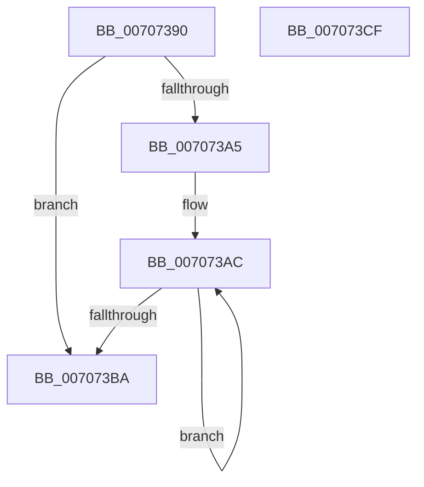

# HaliAddInterruptRemapping

- RVA: `0x00707390`–`0x007073D0` (길이 `64` bytes)
- VA: `0x0000000140707390`
- 실행 섹션: `PAGE`
- PDB 이름 있음: `예`; PDB Function 태그: `아니요`
- unwind 정보 RVA: `0x00064C80`
- 디코드: `19`개 명령, `64/64` bytes 표시
- 미해석 바이트: `0` (있으면 어셈블리에 `.byte`로 보존)

> 이 문서는 커널 이미지의 기계어와 PDB 기호를 분석해 생성했습니다. 4번과 5번은 함수 원형과 자료형을 바이너리 사용 방식에서 추정한 C 해석이며 원본 소스 복구 결과는 아닙니다.

## 1. Dependencies

- 직접 호출 지점: **1**; 고유 호출 대상: **1**
- 직접 호출자로 확인된 함수: **0**
- RIP 상대 이미지 참조: **0**

### Outgoing calls
- `0x007073C4` → [HalpInterruptRemap](../../text/54/HalpInterruptRemap_function_00542AE4.md) (function, `0x00542AE4`)

### Direct callers
- 이 함수 시작 RVA로 연결되는 직접 call은 확인되지 않았습니다. 간접 호출은 완전히 역산할 수 없습니다.

### Static image references
- 디코드된 RIP-relative 메모리 참조가 없습니다.

## 2. Other-region calls and transfers

- 다른 실행 섹션으로 향하는 call: **1**
  - `0x007073C4` → [HalpInterruptRemap](../../text/54/HalpInterruptRemap_function_00542AE4.md) (`PAGE` → `.text`)
- 별도 외부 분기/꼬리 이동을 확인하지 못했습니다.

## 3. Assembly (complete function range)

```asm
00707390  40 53                           push rbx
00707392  48 83 EC 30                     sub rsp, 0x30
00707396  44 8B 5C 24 68                  mov r11d, dword ptr [rsp + 0x68]
0070739B  48 8B 5C 24 60                  mov rbx, qword ptr [rsp + 0x60]
007073A0  45 85 DB                        test r11d, r11d
007073A3  74 15                           je 0x1407073ba
007073A5  48 8D 43 28                     lea rax, [rbx + 0x28]
007073A9  45 8B D3                        mov r10d, r11d
007073AC  0F BA 30 1E                     btr dword ptr [rax], 0x1e
007073B0  48 8D 40 58                     lea rax, [rax + 0x58]
007073B4  49 83 EA 01                     sub r10, 1
007073B8  75 F2                           jne 0x1407073ac
007073BA  44 89 5C 24 28                  mov dword ptr [rsp + 0x28], r11d
007073BF  48 89 5C 24 20                  mov qword ptr [rsp + 0x20], rbx
007073C4  E8 1B B7 E3 FF                  call 0x140542ae4
007073C9  48 83 C4 30                     add rsp, 0x30
007073CD  5B                              pop rbx
007073CE  C3                              ret
007073CF  CC                              int3
```

## 4. C-style interpretation (structured pseudocode)

```c
__int64 __fastcall HaliAddInterruptRemapping(__int64 a1, __int64 a2, __int64 a3, __int64 a4, __int64 a5, unsigned int a6)
{
    __int64 result;
    __int64 v_r10;
    __int64 v_rsp;
    unsigned int v_stack_m10;
    unsigned __int64 v_stack_m18;

    v_rsp = (v_rsp) - (48);
    if ((unsigned int)((unsigned int)(a6)) == 0) goto loc_007073BA;
loc_007073AC:
    v_r10 = ((unsigned int)((unsigned int)((unsigned int)(a6)))) - (1);
    if (condition_is_not_equal) goto loc_007073AC;
loc_007073BA:
    v_stack_m10 = (unsigned int)((unsigned int)(a6));
    v_stack_m18 = a5;
    result = HalpInterruptRemap(a1, a2, a3, a4);
    v_rsp = (v_rsp) + (48);
    return result;
}
```

## 5. (Beta) C Style

```c
int64_t HaliAddInterruptRemapping(int64_t Arg1, int64_t Arg2, int64_t Arg3, int64_t Arg4, void *Arg5, uint32_t Arg6)
{
    uint8_t *arg5 = (uint8_t *)Arg5;

    int64_t result;
    int64_t local_r10;
    int64_t local_rsp;
    uint32_t v_stack_m10;
    uint64_t v_stack_m18;

    local_rsp = (local_rsp) - (48);
    if ((uint32_t)((uint32_t)(Arg6)) == 0) goto loc_007073BA;
loc_007073AC:
    local_r10 = ((uint32_t)((uint32_t)((uint32_t)(Arg6)))) - (1);
    if (condition_is_not_equal) goto loc_007073AC;
loc_007073BA:
    v_stack_m10 = (uint32_t)((uint32_t)(Arg6));
    v_stack_m18 = Arg5;
    result = HalpInterruptRemap(Arg1, Arg2, Arg3, Arg4);
    local_rsp = (local_rsp) + (48);
    return result;
}
```

### 관측된 메모리 오프셋

구조체 형식이 확인되지 않은 접근은 인자 기준의 오프셋으로만 기록했습니다.

| 기준 인자 | 오프셋 표현 | 폭 (bit) | 접근 |
|---|---:|---:|---|
| `Arg5` | `+ 0x0` | `32` | `R/W` |
| `Arg5` | `+ 0x28` | `64` | `R` |
| `Arg5` | `+ 0x58` | `64` | `R` |

## 6. Execution-region graph

[열기: 2D/3D 그래프와 함수 탐색 컨트롤 패널](../../../control-panel.html?section=page&rva=0x00707390&view=graph)

- 2D 그래프는 위에서 아래로 흐르고, 3D 그래프는 빈 공간을 드래그해 회전합니다. Shift+드래그는 이동, 휠은 확대·축소, 함수 노드 선택은 대상 보고서 이동입니다.

### Static fallback


