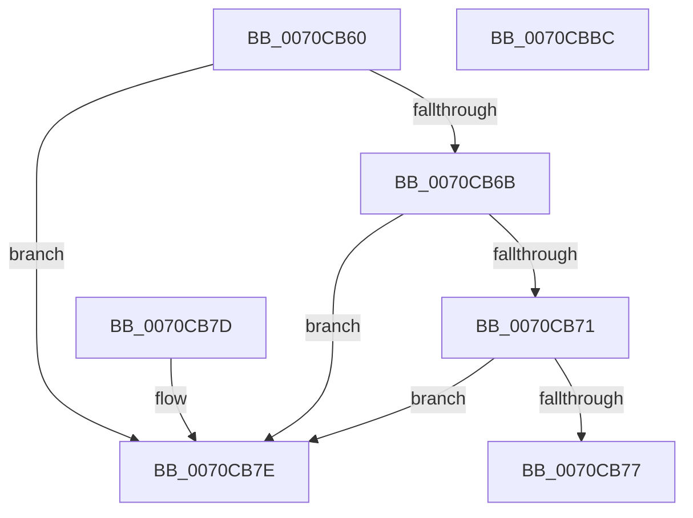

# HaliGetInterruptTranslator

- RVA: `0x0070CB60`–`0x0070CBBD` (길이 `93` bytes)
- VA: `0x000000014070CB60`
- 실행 섹션: `PAGE`
- PDB 이름 있음: `예`; PDB Function 태그: `아니요`
- unwind 정보 RVA: `0x000DB714`
- 디코드: `25`개 명령, `93/93` bytes 표시
- 미해석 바이트: `0` (있으면 어셈블리에 `.byte`로 보존)

> 이 문서는 커널 이미지의 기계어와 PDB 기호를 분석해 생성했습니다. 4번과 5번은 함수 원형과 자료형을 바이너리 사용 방식에서 추정한 C 해석이며 원본 소스 복구 결과는 아닙니다.

## 1. Dependencies

- 직접 호출 지점: **0**; 고유 호출 대상: **0**
- 직접 호출자로 확인된 함수: **0**
- RIP 상대 이미지 참조: **3**

### Outgoing calls
- 직접 디코드된 call 명령이 없습니다.

### Direct callers
- 이 함수 시작 RVA로 연결되는 직접 call은 확인되지 않았습니다. 간접 호출은 완전히 역산할 수 없습니다.

### Static image references
- `0x0070CB80` → RVA `0x0049E550` (`EmpCheckErrataList`; read)
- `0x0070CB9D` → RVA `0x0070CA20` (`HalacpiIrqTranslateResourcesIsa`; read)
- `0x0070CBA8` → RVA `0x0070C6C0` (`HalacpiIrqTranslateResourceRequirementsIsa`; read)

## 2. Other-region calls and transfers

- 다른 실행 섹션으로 향하는 call: **0**
- 별도 외부 분기/꼬리 이동을 확인하지 못했습니다.

## 3. Assembly (complete function range)

```asm
0070CB60  48 8B 44 24 30                  mov rax, qword ptr [rsp + 0x30]
0070CB65  41 83 F8 FF                     cmp r8d, -1
0070CB69  74 13                           je 0x14070cb7e
0070CB6B  41 83 F8 01                     cmp r8d, 1
0070CB6F  74 0D                           je 0x14070cb7e
0070CB71  41 83 F8 02                     cmp r8d, 2
0070CB75  74 07                           je 0x14070cb7e
0070CB77  B8 02 00 00 C0                  mov eax, 0xc0000002
0070CB7C  C3                              ret
0070CB7D  CC                              int3
0070CB7E  33 D2                           xor edx, edx
0070CB80  48 8D 0D C9 19 D9 FF            lea rcx, [rip - 0x26e637]
0070CB87  48 89 50 04                     mov qword ptr [rax + 4], rdx
0070CB8B  89 50 0C                        mov dword ptr [rax + 0xc], edx
0070CB8E  48 89 48 10                     mov qword ptr [rax + 0x10], rcx
0070CB92  48 8D 0D B7 19 D9 FF            lea rcx, [rip - 0x26e649]
0070CB99  48 89 48 18                     mov qword ptr [rax + 0x18], rcx
0070CB9D  48 8D 0D 7C FE FF FF            lea rcx, [rip - 0x184]
0070CBA4  48 89 48 20                     mov qword ptr [rax + 0x20], rcx
0070CBA8  48 8D 0D 11 FB FF FF            lea rcx, [rip - 0x4ef]
0070CBAF  48 89 48 28                     mov qword ptr [rax + 0x28], rcx
0070CBB3  C7 00 30 00 00 00               mov dword ptr [rax], 0x30
0070CBB9  33 C0                           xor eax, eax
0070CBBB  C3                              ret
0070CBBC  CC                              int3
```

## 4. C-style interpretation (structured pseudocode)

```c
__int64 __fastcall HaliGetInterruptTranslator(__int64 a1, int a2, int a3, __int64 a4, __int64 a5, __int64 a6)
{
    __int64 result;

    if (a3 == -1) goto loc_0070CB7E;
    if (a3 == 1) goto loc_0070CB7E;
    if (a3 == 2) goto loc_0070CB7E;
    return (unsigned int)(0xC0000002ULL);
loc_0070CB7E:
    a2 = 0;
    *(unsigned __int64 *)((unsigned int)(0xC0000002ULL) + 4) = 0;
    *(unsigned int *)((unsigned int)(0xC0000002ULL) + 12) = 0;
    *(unsigned __int64 *)((unsigned int)(0xC0000002ULL) + 16) = v_rip - 2549303;
    *(unsigned __int64 *)((unsigned int)(0xC0000002ULL) + 24) = v_rip - 2549321;
    *(unsigned __int64 *)((unsigned int)(0xC0000002ULL) + 32) = v_rip - 388;
    *(unsigned __int64 *)((unsigned int)(0xC0000002ULL) + 40) = v_rip - 1263;
    *(unsigned int *)((unsigned int)(0xC0000002ULL)) = 48;
    result = 0;
    return result;
}
```

## 5. (Beta) C Style

```c
int64_t HaliGetInterruptTranslator(int64_t Arg1, int32_t Arg2, int32_t Arg3, int64_t Arg4, uint64_t Arg5, void *Arg6)
{
    uint8_t *arg6 = (uint8_t *)Arg6;

    int64_t result;

    if (Arg3 == -1) goto loc_0070CB7E;
    if (Arg3 == 1) goto loc_0070CB7E;
    if (Arg3 == 2) goto loc_0070CB7E;
    return (uint32_t)(0xC0000002ULL);
loc_0070CB7E:
    Arg2 = 0;
    *(uint64_t *)((uint32_t)(0xC0000002ULL) + 0x4) = 0;
    *(uint32_t *)((uint32_t)(0xC0000002ULL) + 0xC) = 0;
    *(uint64_t *)((uint32_t)(0xC0000002ULL) + 0x10) = v_rip - 2549303;
    *(uint64_t *)((uint32_t)(0xC0000002ULL) + 0x18) = v_rip - 2549321;
    *(uint64_t *)((uint32_t)(0xC0000002ULL) + 0x20) = v_rip - 388;
    *(uint64_t *)((uint32_t)(0xC0000002ULL) + 0x28) = v_rip - 1263;
    *(uint32_t *)((uint32_t)(0xC0000002ULL)) = 48;
    result = 0;
    return result;
}
```

### 관측된 메모리 오프셋

구조체 형식이 확인되지 않은 접근은 인자 기준의 오프셋으로만 기록했습니다.

| 기준 인자 | 오프셋 표현 | 폭 (bit) | 접근 |
|---|---:|---:|---|
| `Arg6` | `+ 0x0` | `32` | `W` |
| `Arg6` | `+ 0x4` | `64` | `W` |
| `Arg6` | `+ 0xC` | `32` | `W` |
| `Arg6` | `+ 0x10` | `64` | `W` |
| `Arg6` | `+ 0x18` | `64` | `W` |
| `Arg6` | `+ 0x20` | `64` | `W` |
| `Arg6` | `+ 0x28` | `64` | `W` |

## 6. Execution-region graph

[열기: 2D/3D 그래프와 함수 탐색 컨트롤 패널](../../../control-panel.html?section=page&rva=0x0070CB60&view=graph)

- 2D 그래프는 위에서 아래로 흐르고, 3D 그래프는 빈 공간을 드래그해 회전합니다. Shift+드래그는 이동, 휠은 확대·축소, 함수 노드 선택은 대상 보고서 이동입니다.

### Static fallback


