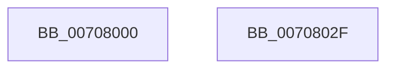

# HaliInitPnpDriver

- RVA: `0x00708000`–`0x00708030` (길이 `48` bytes)
- VA: `0x0000000140708000`
- 실행 섹션: `PAGE`
- PDB 이름 있음: `예`; PDB Function 태그: `아니요`
- unwind 정보 RVA: `0x0005D2F4`
- 디코드: `10`개 명령, `48/48` bytes 표시
- 미해석 바이트: `0` (있으면 어셈블리에 `.byte`로 보존)

> 이 문서는 커널 이미지의 기계어와 PDB 기호를 분석해 생성했습니다. 4번과 5번은 함수 원형과 자료형을 바이너리 사용 방식에서 추정한 C 해석이며 원본 소스 복구 결과는 아닙니다.

## 1. Dependencies

- 직접 호출 지점: **1**; 고유 호출 대상: **1**
- 직접 호출자로 확인된 함수: **0**
- RIP 상대 이미지 참조: **2**

### Outgoing calls
- `0x00708025` → [IoCreateDriver](../AC/IoCreateDriver_function_00AC9D70.md) (function, `0x00AC9D70`)

### Direct callers
- 이 함수 시작 RVA로 연결되는 직접 call은 확인되지 않았습니다. 간접 호출은 완전히 역산할 수 없습니다.

### Static image references
- `0x00708004` → RVA `0x00023F48` (`.rdata`; read)
- `0x00708014` → RVA `0x00708370` (`HalpDriverEntry`; read)

## 2. Other-region calls and transfers

- 다른 실행 섹션으로 향하는 call: **0**
- 별도 외부 분기/꼬리 이동을 확인하지 못했습니다.

## 3. Assembly (complete function range)

```asm
00708000  48 83 EC 38                     sub rsp, 0x38
00708004  48 8D 05 3D BF 91 FF            lea rax, [rip - 0x6e40c3]
0070800B  48 C7 44 24 20 20 00 22 00      mov qword ptr [rsp + 0x20], 0x220020
00708014  48 8D 15 55 03 00 00            lea rdx, [rip + 0x355]
0070801B  48 89 44 24 28                  mov qword ptr [rsp + 0x28], rax
00708020  48 8D 4C 24 20                  lea rcx, [rsp + 0x20]
00708025  E8 46 1D 3C 00                  call 0x140ac9d70
0070802A  48 83 C4 38                     add rsp, 0x38
0070802E  C3                              ret
0070802F  CC                              int3
```

## 4. C-style interpretation (structured pseudocode)

```c
__int64 __fastcall HaliInitPnpDriver(void)
{
    __int64 result;
    __int64 v_rsp;
    unsigned __int64 v_stack_m10;
    unsigned __int64 v_stack_m18;

    v_rsp = (v_rsp) - (56);
    v_stack_m18 = 0x220020ULL;
    v_stack_m10 = v_rip - 7225539;
    result = IoCreateDriver(v_stack_m18, v_rip + 853, a3, a4);
    v_rsp = (v_rsp) + (56);
    return result;
}
```

## 5. (Beta) C Style

```c
void HaliInitPnpDriver(void)
{
    int64_t result;
    int64_t local_rsp;
    uint64_t v_stack_m10;
    uint64_t v_stack_m18;

    local_rsp = (local_rsp) - (56);
    v_stack_m18 = 0x220020ULL;
    v_stack_m10 = v_rip - 7225539;
    result = IoCreateDriver(v_stack_m18, v_rip + 853, a3, a4);
    local_rsp = (local_rsp) + (56);
    return result;
}
```

## 6. Execution-region graph

[열기: 2D/3D 그래프와 함수 탐색 컨트롤 패널](../../../control-panel.html?section=page&rva=0x00708000&view=graph)

- 2D 그래프는 위에서 아래로 흐르고, 3D 그래프는 빈 공간을 드래그해 회전합니다. Shift+드래그는 이동, 휠은 확대·축소, 함수 노드 선택은 대상 보고서 이동입니다.

### Static fallback


