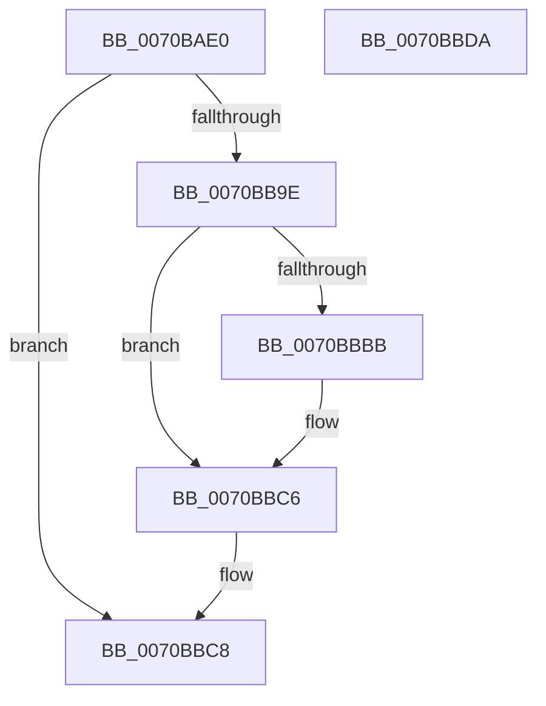

# HaliInitPowerManagement

- RVA: `0x0070BAE0`–`0x0070BBDB` (길이 `251` bytes)
- VA: `0x000000014070BAE0`
- 실행 섹션: `PAGE`
- PDB 이름 있음: `예`; PDB Function 태그: `아니요`
- unwind 정보 RVA: `0x000C48B8`
- 디코드: `58`개 명령, `251/251` bytes 표시
- 미해석 바이트: `0` (있으면 어셈블리에 `.byte`로 보존)

> 이 문서는 커널 이미지의 기계어와 PDB 기호를 분석해 생성했습니다. 4번과 5번은 함수 원형과 자료형을 바이너리 사용 방식에서 추정한 C 해석이며 원본 소스 복구 결과는 아닙니다.

## 1. Dependencies

- 직접 호출 지점: **6**; 고유 호출 대상: **6**
- 직접 호출자로 확인된 함수: **0**
- RIP 상대 이미지 참조: **11**

### Outgoing calls
- `0x0070BB1A` → [RtlInitUnicodeString](../../text/42/RtlInitUnicodeString_function_0042A780.md) (function, `0x0042A780`)
- `0x0070BB21` → [HalpPiix4Detect](../../pagelk/B7/HalpPiix4Detect_function_00B79E00.md) (function, `0x00B79E00`)
- `0x0070BB26` → [HalpPutAcpiHacksInRegistry](HalpPutAcpiHacksInRegistry_function_0070BC04.md) (function, `0x0070BC04`)
- `0x0070BB95` → [ExCreateCallback](../A7/ExCreateCallback_function_00A7B9D0.md) (function, `0x00A7B9D0`)
- `0x0070BBAC` → [ExRegisterCallback](../../text/4B/ExRegisterCallback_function_004BDFC0.md) (function, `0x004BDFC0`)
- `0x0070BBB1` → [HalpAcpiGetFacsMapping](../../text/53/HalpAcpiGetFacsMapping_function_0053F0F0.md) (function, `0x0053F0F0`)

### Direct callers
- 이 함수 시작 RVA로 연결되는 직접 call은 확인되지 않았습니다. 간접 호출은 완전히 역산할 수 없습니다.

### Static image references
- `0x0070BB08` → RVA `0x000259A0` (`.rdata`; read)
- `0x0070BB30` → RVA `0x000077B0` (`.rdata`; read)
- `0x0070BB47` → RVA `0x00B7D300` (`HaliSetWakeAlarm`; read)
- `0x0070BB4E` → RVA `0x00E11750` (`.data`; write)
- `0x0070BB55` → RVA `0x00E00820` (`.data`; write)
- `0x0070BB5F` → RVA `0x0056AC00` (`HaliInitializePlatformDebugTriggers`; read)
- `0x0070BB6D` → RVA `0x00E00C50` (`.data`; write)
- `0x0070BB77` → RVA `0x0056ACB0` (`HaliRunPlatformDebugTriggers`; read)
- `0x0070BB81` → RVA `0x00E00C58` (`.data`; write)
- `0x0070BBA2` → RVA `0x004B8150` (`HalpPowerStateCallback`; read)
- `0x0070BBBF` → RVA `0x00FC1AB8` (`.data`; write)

## 2. Other-region calls and transfers

- 다른 실행 섹션으로 향하는 call: **4**
  - `0x0070BB1A` → [RtlInitUnicodeString](../../text/42/RtlInitUnicodeString_function_0042A780.md) (`PAGE` → `.text`)
  - `0x0070BB21` → [HalpPiix4Detect](../../pagelk/B7/HalpPiix4Detect_function_00B79E00.md) (`PAGE` → `PAGELK`)
  - `0x0070BBAC` → [ExRegisterCallback](../../text/4B/ExRegisterCallback_function_004BDFC0.md) (`PAGE` → `.text`)
  - `0x0070BBB1` → [HalpAcpiGetFacsMapping](../../text/53/HalpAcpiGetFacsMapping_function_0053F0F0.md) (`PAGE` → `.text`)
- 별도 외부 분기/꼬리 이동을 확인하지 못했습니다.

## 3. Assembly (complete function range)

```asm
0070BAE0  48 89 5C 24 10                  mov qword ptr [rsp + 0x10], rbx
0070BAE5  48 89 7C 24 18                  mov qword ptr [rsp + 0x18], rdi
0070BAEA  55                              push rbp
0070BAEB  48 8B EC                        mov rbp, rsp
0070BAEE  48 83 EC 60                     sub rsp, 0x60
0070BAF2  83 65 EC 00                     and dword ptr [rbp - 0x14], 0
0070BAF6  48 8B FA                        mov rdi, rdx
0070BAF9  48 8B D9                        mov rbx, rcx
0070BAFC  48 C7 45 D0 30 00 00 00         mov qword ptr [rbp - 0x30], 0x30
0070BB04  83 65 D4 00                     and dword ptr [rbp - 0x2c], 0
0070BB08  48 8D 15 91 9E 91 FF            lea rdx, [rip - 0x6e616f]
0070BB0F  0F 57 C0                        xorps xmm0, xmm0
0070BB12  48 8D 4D C0                     lea rcx, [rbp - 0x40]
0070BB16  0F 11 45 C0                     movups xmmword ptr [rbp - 0x40], xmm0
0070BB1A  E8 61 EC D1 FF                  call 0x14042a780
0070BB1F  B1 01                           mov cl, 1
0070BB21  E8 DA E2 46 00                  call 0x140b79e00
0070BB26  E8 D9 00 00 00                  call 0x14070bc04
0070BB2B  48 83 65 D8 00                  and qword ptr [rbp - 0x28], 0
0070BB30  48 8D 05 79 BC 8F FF            lea rax, [rip - 0x704387]
0070BB37  48 83 65 10 00                  and qword ptr [rbp + 0x10], 0
0070BB3C  48 8D 55 D0                     lea rdx, [rbp - 0x30]
0070BB40  48 89 07                        mov qword ptr [rdi], rax
0070BB43  48 8D 4D 10                     lea rcx, [rbp + 0x10]
0070BB47  48 8D 05 B2 17 47 00            lea rax, [rip + 0x4717b2]
0070BB4E  48 89 1D FB 5B 70 00            mov qword ptr [rip + 0x705bfb], rbx
0070BB55  48 89 05 C4 4C 6F 00            mov qword ptr [rip + 0x6f4cc4], rax
0070BB5C  0F 57 C0                        xorps xmm0, xmm0
0070BB5F  48 8D 05 9A F0 E5 FF            lea rax, [rip - 0x1a0f66]
0070BB66  C7 45 E8 50 00 00 00            mov dword ptr [rbp - 0x18], 0x50
0070BB6D  48 89 05 DC 50 6F 00            mov qword ptr [rip + 0x6f50dc], rax
0070BB74  41 B1 01                        mov r9b, 1
0070BB77  48 8D 05 32 F1 E5 FF            lea rax, [rip - 0x1a0ece]
0070BB7E  45 33 C0                        xor r8d, r8d
0070BB81  48 89 05 D0 50 6F 00            mov qword ptr [rip + 0x6f50d0], rax
0070BB88  48 8D 45 C0                     lea rax, [rbp - 0x40]
0070BB8C  48 89 45 E0                     mov qword ptr [rbp - 0x20], rax
0070BB90  F3 0F 7F 45 F0                  movdqu xmmword ptr [rbp - 0x10], xmm0
0070BB95  E8 36 FE 36 00                  call 0x140a7b9d0
0070BB9A  85 C0                           test eax, eax
0070BB9C  78 2A                           js 0x14070bbc8
0070BB9E  48 8B 4D 10                     mov rcx, qword ptr [rbp + 0x10]
0070BBA2  48 8D 15 A7 C5 DA FF            lea rdx, [rip - 0x253a59]
0070BBA9  45 33 C0                        xor r8d, r8d
0070BBAC  E8 0F 24 DB FF                  call 0x1404bdfc0
0070BBB1  E8 3A 35 E3 FF                  call 0x14053f0f0
0070BBB6  48 85 C0                        test rax, rax
0070BBB9  74 0B                           je 0x14070bbc6
0070BBBB  48 83 C0 0C                     add rax, 0xc
0070BBBF  48 89 05 F2 5E 8B 00            mov qword ptr [rip + 0x8b5ef2], rax
0070BBC6  33 C0                           xor eax, eax
0070BBC8  4C 8D 5C 24 60                  lea r11, [rsp + 0x60]
0070BBCD  49 8B 5B 18                     mov rbx, qword ptr [r11 + 0x18]
0070BBD1  49 8B 7B 20                     mov rdi, qword ptr [r11 + 0x20]
0070BBD5  49 8B E3                        mov rsp, r11
0070BBD8  5D                              pop rbp
0070BBD9  C3                              ret
0070BBDA  CC                              int3
```

## 4. C-style interpretation (structured pseudocode)

```c
__int64 __fastcall HaliInitPowerManagement(__int64 a1, __int64 a2, int a3)
{
    __int64 result;
    __int64 v_rsp;
    unsigned __int64 v_stack_m18;
    unsigned int v_stack_m1C;
    unsigned int v_stack_m20;
    unsigned __int64 v_stack_m28;
    unsigned __int64 v_stack_m30;
    unsigned int v_stack_m34;
    unsigned __int64 v_stack_m38;
    unsigned __int64 v_stack_m48;
    unsigned __int64 v_stack_m8;
    unsigned __int64 v_stack_p10;
    unsigned __int64 v_stack_p18;
    unsigned __int64 v_stack_p8;

    v_stack_p10 = v_rbx;
    v_stack_p18 = v_rdi;
    v_rsp = (v_rsp) - (96);
    v_stack_m38 = 48;
    v_stack_m48 = v_xmm0;
    result = RtlInitUnicodeString(v_stack_m48, v_rip - 7233903, a3, a4);
    result = HalpPiix4Detect(1, v_rip - 7233903, a3, a4);
    result = HalpPutAcpiHacksInRegistry(1, v_rip - 7233903, a3, a4);
    *(unsigned __int64 *)(a2) = v_rip - 7357319;
    *(unsigned __int64 *)(v_rip + 7363579) = a1;
    *(unsigned __int64 *)(v_rip + 7294148) = v_rip + 4659122;
    v_stack_m20 = 80;
    *(unsigned __int64 *)(v_rip + 7295196) = v_rip - 1707878;
    a3 = 0;
    *(unsigned __int64 *)(v_rip + 7295184) = v_rip - 1707726;
    v_stack_m28 = v_stack_m48;
    v_stack_m18 = v_xmm0;
    result = ExCreateCallback(v_stack_p8, v_stack_m38, a3, 1);
    if (sign_flag) goto loc_0070BBC8;
    a3 = 0;
    result = ExRegisterCallback(v_stack_p8, v_rip - 2439769, a3, 1);
    result = HalpAcpiGetFacsMapping(v_stack_p8, v_rip - 2439769, a3, 1);
    if (result != 0) {
        result = (result) + (12);
        *(unsigned __int64 *)(v_rip + 9133810) = result;
    }
    result = 0;
loc_0070BBC8:
    return result;
}
```

## 5. (Beta) C Style

```c
int64_t HaliInitPowerManagement(int64_t Arg1, void *Arg2, int32_t Arg3)
{
    uint8_t *arg2 = (uint8_t *)Arg2;

    int64_t result;
    int64_t local_rsp;
    uint64_t v_stack_m18;
    uint32_t v_stack_m1C;
    uint32_t v_stack_m20;
    uint64_t v_stack_m28;
    uint64_t v_stack_m30;
    uint32_t v_stack_m34;
    uint64_t v_stack_m38;
    uint64_t v_stack_m48;
    uint64_t v_stack_m8;
    uint64_t v_stack_p10;
    uint64_t v_stack_p18;
    uint64_t v_stack_p8;

    v_stack_p10 = local_rbx;
    v_stack_p18 = local_rdi;
    local_rsp = (local_rsp) - (96);
    v_stack_m38 = 48;
    v_stack_m48 = v_xmm0;
    result = RtlInitUnicodeString(v_stack_m48, v_rip - 7233903, Arg3, a4);
    result = HalpPiix4Detect(1, v_rip - 7233903, Arg3, a4);
    result = HalpPutAcpiHacksInRegistry(1, v_rip - 7233903, Arg3, a4);
    *(uint64_t *)(arg2) = v_rip - 7357319;
    *(uint64_t *)(v_rip + 0x705BFB) = Arg1;
    *(uint64_t *)(v_rip + 0x6F4CC4) = v_rip + 4659122;
    v_stack_m20 = 80;
    *(uint64_t *)(v_rip + 0x6F50DC) = v_rip - 1707878;
    Arg3 = 0;
    *(uint64_t *)(v_rip + 0x6F50D0) = v_rip - 1707726;
    v_stack_m28 = v_stack_m48;
    v_stack_m18 = v_xmm0;
    result = ExCreateCallback(v_stack_p8, v_stack_m38, Arg3, 1);
    if (sign_flag) goto loc_0070BBC8;
    Arg3 = 0;
    result = ExRegisterCallback(v_stack_p8, v_rip - 2439769, Arg3, 1);
    result = HalpAcpiGetFacsMapping(v_stack_p8, v_rip - 2439769, Arg3, 1);
    if (result != 0) {
        result = (result) + (12);
        *(uint64_t *)(v_rip + 0x8B5EF2) = result;
    }
    result = 0;
loc_0070BBC8:
    return result;
}
```

### 관측된 메모리 오프셋

구조체 형식이 확인되지 않은 접근은 인자 기준의 오프셋으로만 기록했습니다.

| 기준 인자 | 오프셋 표현 | 폭 (bit) | 접근 |
|---|---:|---:|---|
| `Arg2` | `+ 0x0` | `64` | `W` |

## 6. Execution-region graph

[열기: 2D/3D 그래프와 함수 탐색 컨트롤 패널](../../../control-panel.html?section=page&rva=0x0070BAE0&view=graph)

- 2D 그래프는 위에서 아래로 흐르고, 3D 그래프는 빈 공간을 드래그해 회전합니다. Shift+드래그는 이동, 휠은 확대·축소, 함수 노드 선택은 대상 보고서 이동입니다.

### Static fallback


