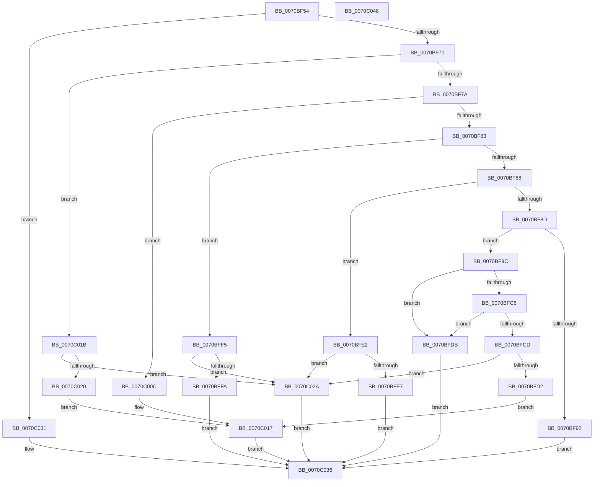

# HaliSetSystemInformation

- RVA: `0x0070BF54`–`0x0070C049` (길이 `245` bytes)
- VA: `0x000000014070BF54`
- 실행 섹션: `PAGE`
- PDB 이름 있음: `예`; PDB Function 태그: `아니요`
- unwind 정보 RVA: `0x0005FD94`
- 디코드: `74`개 명령, `245/245` bytes 표시
- 미해석 바이트: `0` (있으면 어셈블리에 `.byte`로 보존)

> 이 문서는 커널 이미지의 기계어와 PDB 기호를 분석해 생성했습니다. 4번과 5번은 함수 원형과 자료형을 바이너리 사용 방식에서 추정한 C 해석이며 원본 소스 복구 결과는 아닙니다.

## 1. Dependencies

- 직접 호출 지점: **4**; 고유 호출 대상: **4**
- 직접 호출자로 확인된 함수: **1**
- RIP 상대 이미지 참조: **2**

### Outgoing calls
- `0x0070BFBD` → [ZwQuerySystemInformation](../../text/6A/ZwQuerySystemInformation_function_006AD790.md) (function, `0x006AD790`)
- `0x0070BFD4` → [HalpTimerSetClockTimerMinimumInterval](../../text/54/HalpTimerSetClockTimerMinimumInterval_function_00548804.md) (function, `0x00548804`)
- `0x0070C012` → [HalpChannelPowerRequest](HalpChannelPowerRequest_function_0070D62C.md) (function, `0x0070D62C`)
- `0x0070C023` → [HalpRegisterSecondaryIcInterface](../../text/55/HalpRegisterSecondaryIcInterface_function_005571FC.md) (function, `0x005571FC`)

### Direct callers
- [HalpSetSystemInformation](../AB/HalpSetSystemInformation_function_00AB0850.md) at `0x00AB08A5`

### Static image references
- `0x0070BFEC` → RVA `0x00F8FB90` (`.data`; write)
- `0x0070C004` → RVA `0x00E0A794` (`.data`; write)

## 2. Other-region calls and transfers

- 다른 실행 섹션으로 향하는 call: **3**
  - `0x0070BFBD` → [ZwQuerySystemInformation](../../text/6A/ZwQuerySystemInformation_function_006AD790.md) (`PAGE` → `.text`)
  - `0x0070BFD4` → [HalpTimerSetClockTimerMinimumInterval](../../text/54/HalpTimerSetClockTimerMinimumInterval_function_00548804.md) (`PAGE` → `.text`)
  - `0x0070C023` → [HalpRegisterSecondaryIcInterface](../../text/55/HalpRegisterSecondaryIcInterface_function_005571FC.md) (`PAGE` → `.text`)
- 별도 외부 분기/꼬리 이동을 확인하지 못했습니다.

## 3. Assembly (complete function range)

```asm
0070BF54  48 89 5C 24 10                  mov qword ptr [rsp + 0x10], rbx
0070BF59  48 89 74 24 18                  mov qword ptr [rsp + 0x18], rsi
0070BF5E  57                              push rdi
0070BF5F  48 83 EC 20                     sub rsp, 0x20
0070BF63  49 8B F0                        mov rsi, r8
0070BF66  8B FA                           mov edi, edx
0070BF68  83 E9 0B                        sub ecx, 0xb
0070BF6B  0F 84 C0 00 00 00               je 0x14070c031
0070BF71  83 E9 02                        sub ecx, 2
0070BF74  0F 84 A1 00 00 00               je 0x14070c01b
0070BF7A  83 E9 01                        sub ecx, 1
0070BF7D  0F 84 89 00 00 00               je 0x14070c00c
0070BF83  83 E9 02                        sub ecx, 2
0070BF86  74 6D                           je 0x14070bff5
0070BF88  83 E9 02                        sub ecx, 2
0070BF8B  74 55                           je 0x14070bfe2
0070BF8D  83 F9 05                        cmp ecx, 5
0070BF90  74 0A                           je 0x14070bf9c
0070BF92  BB 48 01 00 C0                  mov ebx, 0xc0000148
0070BF97  E9 9A 00 00 00                  jmp 0x14070c036
0070BF9C  33 DB                           xor ebx, ebx
0070BF9E  4C 8D 4C 24 30                  lea r9, [rsp + 0x30]
0070BFA3  48 89 5C 24 48                  mov qword ptr [rsp + 0x48], rbx
0070BFA8  48 8D 54 24 48                  lea rdx, [rsp + 0x48]
0070BFAD  89 5C 24 30                     mov dword ptr [rsp + 0x30], ebx
0070BFB1  44 8D 43 08                     lea r8d, [rbx + 8]
0070BFB5  8D 4B 67                        lea ecx, [rbx + 0x67]
0070BFB8  44 89 44 24 48                  mov dword ptr [rsp + 0x48], r8d
0070BFBD  E8 CE 17 FA FF                  call 0x1406ad790
0070BFC2  85 C0                           test eax, eax
0070BFC4  78 15                           js 0x14070bfdb
0070BFC6  F6 44 24 4C 02                  test byte ptr [rsp + 0x4c], 2
0070BFCB  74 0E                           je 0x14070bfdb
0070BFCD  83 FF 04                        cmp edi, 4
0070BFD0  75 58                           jne 0x14070c02a
0070BFD2  8B 0E                           mov ecx, dword ptr [rsi]
0070BFD4  E8 2B C8 E3 FF                  call 0x140548804
0070BFD9  EB 3C                           jmp 0x14070c017
0070BFDB  BB 22 00 00 C0                  mov ebx, 0xc0000022
0070BFE0  EB 54                           jmp 0x14070c036
0070BFE2  83 FF 04                        cmp edi, 4
0070BFE5  75 43                           jne 0x14070c02a
0070BFE7  33 DB                           xor ebx, ebx
0070BFE9  41 39 18                        cmp dword ptr [r8], ebx
0070BFEC  0F 95 05 9D 3B 88 00            setne byte ptr [rip + 0x883b9d]
0070BFF3  EB 41                           jmp 0x14070c036
0070BFF5  83 FF 04                        cmp edi, 4
0070BFF8  75 30                           jne 0x14070c02a
0070BFFA  33 DB                           xor ebx, ebx
0070BFFC  41 39 18                        cmp dword ptr [r8], ebx
0070BFFF  8B C3                           mov eax, ebx
0070C001  0F 95 C0                        setne al
0070C004  89 05 8A E7 6F 00               mov dword ptr [rip + 0x6fe78a], eax
0070C00A  EB 2A                           jmp 0x14070c036
0070C00C  45 33 C0                        xor r8d, r8d
0070C00F  48 8B CE                        mov rcx, rsi
0070C012  E8 15 16 00 00                  call 0x14070d62c
0070C017  8B D8                           mov ebx, eax
0070C019  EB 1B                           jmp 0x14070c036
0070C01B  83 FF 58                        cmp edi, 0x58
0070C01E  72 0A                           jb 0x14070c02a
0070C020  48 8B CE                        mov rcx, rsi
0070C023  E8 D4 B1 E4 FF                  call 0x1405571fc
0070C028  EB ED                           jmp 0x14070c017
0070C02A  BB 04 00 00 C0                  mov ebx, 0xc0000004
0070C02F  EB 05                           jmp 0x14070c036
0070C031  BB BB 00 00 C0                  mov ebx, 0xc00000bb
0070C036  48 8B 74 24 40                  mov rsi, qword ptr [rsp + 0x40]
0070C03B  8B C3                           mov eax, ebx
0070C03D  48 8B 5C 24 38                  mov rbx, qword ptr [rsp + 0x38]
0070C042  48 83 C4 20                     add rsp, 0x20
0070C046  5F                              pop rdi
0070C047  C3                              ret
0070C048  CC                              int3
```

## 4. C-style interpretation (structured pseudocode)

```c
__int64 __fastcall HaliSetSystemInformation(int a1, int a2, __int64 a3)
{
    __int64 result;
    __int64 v_rbx;
    __int64 v_rsp;
    unsigned __int64 v_stack_p10;
    unsigned __int64 v_stack_p18;
    unsigned __int64 v_stack_p20;
    unsigned __int8 v_stack_p24;
    unsigned __int64 v_stack_p8;

    v_stack_p10 = v_rbx;
    v_stack_p18 = v_rsi;
    v_rsp = (v_rsp) - (32);
    a1 = (unsigned int)((a1) - (11));
    if (condition_is_equal) goto loc_0070C031;
    a1 = (unsigned int)((a1) - (2));
    if (condition_is_equal) goto loc_0070C01B;
    a1 = (unsigned int)((a1) - (1));
    if (condition_is_equal) goto loc_0070C00C;
    a1 = (unsigned int)((a1) - (2));
    if (condition_is_equal) goto loc_0070BFF5;
    a1 = (unsigned int)((a1) - (2));
    if (condition_is_equal) goto loc_0070BFE2;
    if (a1 == 5) goto loc_0070BF9C;
    goto loc_0070C036;
loc_0070BF9C:
    v_rbx = 0;
    v_stack_p20 = 0;
    v_stack_p8 = 0;
    v_stack_p20 = (unsigned int)(v_rbx + 8);
    result = ZwQuerySystemInformation(v_rbx + 103, v_stack_p20, v_rbx + 8, v_stack_p8);
    if (sign_flag) goto loc_0070BFDB;
    if (((v_stack_p24) & (2)) == 0) goto loc_0070BFDB;
    if (((unsigned int)((unsigned int)(a2))) != 4) goto loc_0070C02A;
    result = HalpTimerSetClockTimerMinimumInterval((unsigned int)(*(unsigned int *)(a3)), v_stack_p20, v_rbx + 8, v_stack_p8);
    goto loc_0070C017;
loc_0070BFDB:
    goto loc_0070C036;
loc_0070BFE2:
    if (((unsigned int)((unsigned int)(a2))) != 4) goto loc_0070C02A;
    v_rbx = 0;
    goto loc_0070C036;
loc_0070BFF5:
    if (((unsigned int)((unsigned int)(a2))) != 4) goto loc_0070C02A;
    v_rbx = 0;
    result = ((*(unsigned int *)(v_rbx + 8)) != 0) ? 1 : 0;
    *(unsigned int *)(v_rip + 7333770) = (unsigned int)(result);
    goto loc_0070C036;
loc_0070C00C:
    a3 = 0;
    result = HalpChannelPowerRequest(0, v_stack_p20, a3, v_stack_p8);
loc_0070C017:
    goto loc_0070C036;
loc_0070C01B:
    if (((unsigned int)((unsigned int)(a2))) < 88) goto loc_0070C02A;
    result = HalpRegisterSecondaryIcInterface(0, v_stack_p20, a3, v_stack_p8);
    goto loc_0070C017;
loc_0070C02A:
    goto loc_0070C036;
loc_0070C031:
loc_0070C036:
    v_rsp = (v_rsp) + (32);
    return (unsigned int)((unsigned int)((unsigned int)(0xC00000BBULL)));
}
```

## 5. (Beta) C Style

```c
int64_t HaliSetSystemInformation(int32_t Arg1, int32_t Arg2, void *Arg3)
{
    uint8_t *arg3 = (uint8_t *)Arg3;

    int64_t result;
    int64_t local_rbx;
    int64_t local_rsp;
    uint64_t v_stack_p10;
    uint64_t v_stack_p18;
    uint64_t v_stack_p20;
    uint8_t v_stack_p24;
    uint64_t v_stack_p8;

    v_stack_p10 = local_rbx;
    v_stack_p18 = local_rsi;
    local_rsp = (local_rsp) - (32);
    Arg1 = (uint32_t)((Arg1) - (11));
    if (condition_is_equal) goto loc_0070C031;
    Arg1 = (uint32_t)((Arg1) - (2));
    if (condition_is_equal) goto loc_0070C01B;
    Arg1 = (uint32_t)((Arg1) - (1));
    if (condition_is_equal) goto loc_0070C00C;
    Arg1 = (uint32_t)((Arg1) - (2));
    if (condition_is_equal) goto loc_0070BFF5;
    Arg1 = (uint32_t)((Arg1) - (2));
    if (condition_is_equal) goto loc_0070BFE2;
    if (Arg1 == 5) goto loc_0070BF9C;
    goto loc_0070C036;
loc_0070BF9C:
    local_rbx = 0;
    v_stack_p20 = 0;
    v_stack_p8 = 0;
    v_stack_p20 = (uint32_t)(local_rbx + 8);
    result = ZwQuerySystemInformation(local_rbx + 103, v_stack_p20, local_rbx + 8, v_stack_p8);
    if (sign_flag) goto loc_0070BFDB;
    if (((v_stack_p24) & (2)) == 0) goto loc_0070BFDB;
    if (((uint32_t)((uint32_t)(Arg2))) != 4) goto loc_0070C02A;
    result = HalpTimerSetClockTimerMinimumInterval((uint32_t)(*(uint32_t *)(arg3)), v_stack_p20, local_rbx + 8, v_stack_p8);
    goto loc_0070C017;
loc_0070BFDB:
    goto loc_0070C036;
loc_0070BFE2:
    if (((uint32_t)((uint32_t)(Arg2))) != 4) goto loc_0070C02A;
    local_rbx = 0;
    goto loc_0070C036;
loc_0070BFF5:
    if (((uint32_t)((uint32_t)(Arg2))) != 4) goto loc_0070C02A;
    local_rbx = 0;
    result = ((*(uint32_t *)(local_rbx + 0x8)) != 0) ? 1 : 0;
    *(uint32_t *)(v_rip + 0x6FE78A) = (uint32_t)(result);
    goto loc_0070C036;
loc_0070C00C:
    Arg3 = 0;
    result = HalpChannelPowerRequest(0, v_stack_p20, Arg3, v_stack_p8);
loc_0070C017:
    goto loc_0070C036;
loc_0070C01B:
    if (((uint32_t)((uint32_t)(Arg2))) < 88) goto loc_0070C02A;
    result = HalpRegisterSecondaryIcInterface(0, v_stack_p20, Arg3, v_stack_p8);
    goto loc_0070C017;
loc_0070C02A:
    goto loc_0070C036;
loc_0070C031:
loc_0070C036:
    local_rsp = (local_rsp) + (32);
    return (uint32_t)((uint32_t)((uint32_t)(0xC00000BBULL)));
}
```

### 관측된 메모리 오프셋

구조체 형식이 확인되지 않은 접근은 인자 기준의 오프셋으로만 기록했습니다.

| 기준 인자 | 오프셋 표현 | 폭 (bit) | 접근 |
|---|---:|---:|---|
| `Arg3` | `+ 0x0` | `32` | `R` |

## 6. Execution-region graph

[열기: 2D/3D 그래프와 함수 탐색 컨트롤 패널](../../../control-panel.html?section=page&rva=0x0070BF54&view=graph)

- 2D 그래프는 위에서 아래로 흐르고, 3D 그래프는 빈 공간을 드래그해 회전합니다. Shift+드래그는 이동, 휠은 확대·축소, 함수 노드 선택은 대상 보고서 이동입니다.

### Static fallback


