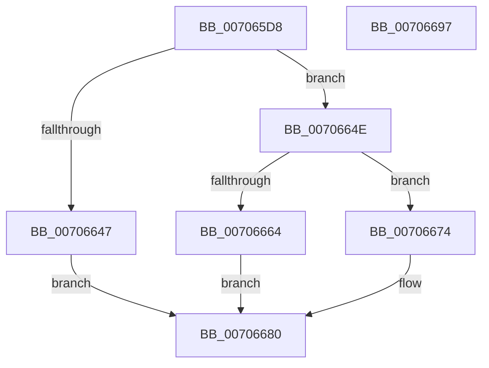

# HalpAcpiRealTimeToUtcTime

- RVA: `0x007065D8`–`0x00706698` (길이 `192` bytes)
- VA: `0x00000001407065D8`
- 실행 섹션: `PAGE`
- PDB 이름 있음: `예`; PDB Function 태그: `아니요`
- unwind 정보 RVA: `0x000C3910`
- 디코드: `53`개 명령, `192/192` bytes 표시
- 미해석 바이트: `0` (있으면 어셈블리에 `.byte`로 보존)

> 이 문서는 커널 이미지의 기계어와 PDB 기호를 분석해 생성했습니다. 4번과 5번은 함수 원형과 자료형을 바이너리 사용 방식에서 추정한 C 해석이며 원본 소스 복구 결과는 아닙니다.

## 1. Dependencies

- 직접 호출 지점: **2**; 고유 호출 대상: **2**
- 직접 호출자로 확인된 함수: **1**
- RIP 상대 이미지 참조: **0**

### Outgoing calls
- `0x0070663E` → [RtlTimeFieldsToTime](../../text/42/RtlTimeFieldsToTime_function_0042E6B0.md) (function, `0x0042E6B0`)
- `0x0070667B` → [ExLocalTimeToSystemTime](../../text/49/ExLocalTimeToSystemTime_function_00494BC0.md) (function, `0x00494BC0`)

### Direct callers
- [HalQueryRealTimeClock](../../text/42/HalQueryRealTimeClock_function_0042D810.md) at `0x0042D95E`

### Static image references
- 디코드된 RIP-relative 메모리 참조가 없습니다.

## 2. Other-region calls and transfers

- 다른 실행 섹션으로 향하는 call: **2**
  - `0x0070663E` → [RtlTimeFieldsToTime](../../text/42/RtlTimeFieldsToTime_function_0042E6B0.md) (`PAGE` → `.text`)
  - `0x0070667B` → [ExLocalTimeToSystemTime](../../text/49/ExLocalTimeToSystemTime_function_00494BC0.md) (`PAGE` → `.text`)
- 별도 외부 분기/꼬리 이동을 확인하지 못했습니다.

## 3. Assembly (complete function range)

```asm
007065D8  48 89 5C 24 10                  mov qword ptr [rsp + 0x10], rbx
007065DD  48 89 74 24 18                  mov qword ptr [rsp + 0x18], rsi
007065E2  48 89 7C 24 20                  mov qword ptr [rsp + 0x20], rdi
007065E7  55                              push rbp
007065E8  48 8B EC                        mov rbp, rsp
007065EB  48 83 EC 30                     sub rsp, 0x30
007065EF  0F B7 01                        movzx eax, word ptr [rcx]
007065F2  48 8B F2                        mov rsi, rdx
007065F5  66 89 45 F0                     mov word ptr [rbp - 0x10], ax
007065F9  48 8D 55 10                     lea rdx, [rbp + 0x10]
007065FD  0F B6 41 02                     movzx eax, byte ptr [rcx + 2]
00706601  48 8B F9                        mov rdi, rcx
00706604  66 89 45 F2                     mov word ptr [rbp - 0xe], ax
00706608  33 DB                           xor ebx, ebx
0070660A  0F B6 41 03                     movzx eax, byte ptr [rcx + 3]
0070660E  66 89 45 F4                     mov word ptr [rbp - 0xc], ax
00706612  0F B6 41 04                     movzx eax, byte ptr [rcx + 4]
00706616  66 89 45 F6                     mov word ptr [rbp - 0xa], ax
0070661A  0F B6 41 05                     movzx eax, byte ptr [rcx + 5]
0070661E  66 89 45 F8                     mov word ptr [rbp - 8], ax
00706622  0F B6 41 06                     movzx eax, byte ptr [rcx + 6]
00706626  66 89 45 FA                     mov word ptr [rbp - 6], ax
0070662A  0F B7 41 08                     movzx eax, word ptr [rcx + 8]
0070662E  48 8D 4D F0                     lea rcx, [rbp - 0x10]
00706632  66 89 45 FC                     mov word ptr [rbp - 4], ax
00706636  48 89 5D 10                     mov qword ptr [rbp + 0x10], rbx
0070663A  66 89 5D FE                     mov word ptr [rbp - 2], bx
0070663E  E8 6D 80 D2 FF                  call 0x14042e6b0
00706643  84 C0                           test al, al
00706645  75 07                           jne 0x14070664e
00706647  BB 01 00 00 C0                  mov ebx, 0xc0000001
0070664C  EB 32                           jmp 0x140706680
0070664E  48 0F BF 4F 0A                  movsx rcx, word ptr [rdi + 0xa]
00706653  B8 A0 05 00 00                  mov eax, 0x5a0
00706658  03 C1                           add eax, ecx
0070665A  BA 40 0B 00 00                  mov edx, 0xb40
0070665F  66 3B C2                        cmp ax, dx
00706662  77 10                           ja 0x140706674
00706664  48 69 C9 00 46 C3 23            imul rcx, rcx, 0x23c34600
0070666B  48 03 4D 10                     add rcx, qword ptr [rbp + 0x10]
0070666F  48 89 0E                        mov qword ptr [rsi], rcx
00706672  EB 0C                           jmp 0x140706680
00706674  48 8B D6                        mov rdx, rsi
00706677  48 8D 4D 10                     lea rcx, [rbp + 0x10]
0070667B  E8 40 E5 D8 FF                  call 0x140494bc0
00706680  48 8B 74 24 50                  mov rsi, qword ptr [rsp + 0x50]
00706685  8B C3                           mov eax, ebx
00706687  48 8B 5C 24 48                  mov rbx, qword ptr [rsp + 0x48]
0070668C  48 8B 7C 24 58                  mov rdi, qword ptr [rsp + 0x58]
00706691  48 83 C4 30                     add rsp, 0x30
00706695  5D                              pop rbp
00706696  C3                              ret
00706697  CC                              int3
```

## 4. C-style interpretation (structured pseudocode)

```c
__int64 __fastcall HalpAcpiRealTimeToUtcTime(__int64 a1, __int64 a2)
{
    __int64 result;
    __int64 v_rbx;
    __int64 v_rsp;
    unsigned __int16 v_stack_m10;
    unsigned __int16 v_stack_m12;
    unsigned __int16 v_stack_m14;
    unsigned __int16 v_stack_m16;
    unsigned __int16 v_stack_m18;
    unsigned __int16 v_stack_mA;
    unsigned __int16 v_stack_mC;
    unsigned __int16 v_stack_mE;
    unsigned __int64 v_stack_p10;
    unsigned __int64 v_stack_p18;
    unsigned __int64 v_stack_p20;
    unsigned __int64 v_stack_p8;

    v_stack_p10 = v_rbx;
    v_stack_p18 = v_rsi;
    v_stack_p20 = v_rdi;
    v_rsp = (v_rsp) - (48);
    v_stack_m18 = (unsigned __int16)(*(unsigned __int16 *)(a1));
    v_stack_m16 = (unsigned __int16)(*(unsigned __int8 *)(a1 + 2));
    v_rbx = 0;
    v_stack_m14 = (unsigned __int16)(*(unsigned __int8 *)(a1 + 3));
    v_stack_m12 = (unsigned __int16)(*(unsigned __int8 *)(a1 + 4));
    v_stack_m10 = (unsigned __int16)(*(unsigned __int8 *)(a1 + 5));
    v_stack_mE = (unsigned __int16)(*(unsigned __int8 *)(a1 + 6));
    v_stack_mC = (unsigned __int16)(*(unsigned __int16 *)(a1 + 8));
    v_stack_p8 = 0;
    v_stack_mA = 0;
    result = RtlTimeFieldsToTime(v_stack_m18, v_stack_p8, a3, a4);
    if ((unsigned __int8)(result) != 0) goto loc_0070664E;
    goto loc_00706680;
loc_0070664E:
    result = (unsigned int)(((unsigned int)(0x5A0ULL)) + ((unsigned int)((__int16)(*(unsigned __int16 *)(a1 + 10)))));
    if (((unsigned __int16)(result)) > ((unsigned __int16)((unsigned int)(0xB40ULL)))) goto loc_00706674;
    a1 = ((__int16)(*(unsigned __int16 *)(a1 + 10))) * ((__int16)(*(unsigned __int16 *)(a1 + 10)));
    a1 = (a1) + (v_stack_p8);
    *(unsigned __int64 *)(a2) = a1;
    goto loc_00706680;
loc_00706674:
    result = ExLocalTimeToSystemTime(v_stack_p8, a2, a3, a4);
loc_00706680:
    v_rsp = (v_rsp) + (48);
    return (unsigned int)((unsigned int)((unsigned int)(0xC0000001ULL)));
}
```

## 5. (Beta) C Style

```c
int64_t HalpAcpiRealTimeToUtcTime(void *Arg1, void *Arg2)
{
    uint8_t *arg1 = (uint8_t *)Arg1;
    uint8_t *arg2 = (uint8_t *)Arg2;

    int64_t result;
    int64_t local_rbx;
    int64_t local_rsp;
    uint16_t v_stack_m10;
    uint16_t v_stack_m12;
    uint16_t v_stack_m14;
    uint16_t v_stack_m16;
    uint16_t v_stack_m18;
    uint16_t v_stack_mA;
    uint16_t v_stack_mC;
    uint16_t v_stack_mE;
    uint64_t v_stack_p10;
    uint64_t v_stack_p18;
    uint64_t v_stack_p20;
    uint64_t v_stack_p8;

    v_stack_p10 = local_rbx;
    v_stack_p18 = local_rsi;
    v_stack_p20 = local_rdi;
    local_rsp = (local_rsp) - (48);
    v_stack_m18 = (uint16_t)(*(uint16_t *)(arg1));
    v_stack_m16 = (uint16_t)(*(uint8_t *)(arg1 + 0x2));
    local_rbx = 0;
    v_stack_m14 = (uint16_t)(*(uint8_t *)(arg1 + 0x3));
    v_stack_m12 = (uint16_t)(*(uint8_t *)(arg1 + 0x4));
    v_stack_m10 = (uint16_t)(*(uint8_t *)(arg1 + 0x5));
    v_stack_mE = (uint16_t)(*(uint8_t *)(arg1 + 0x6));
    v_stack_mC = (uint16_t)(*(uint16_t *)(arg1 + 0x8));
    v_stack_p8 = 0;
    v_stack_mA = 0;
    result = RtlTimeFieldsToTime(v_stack_m18, v_stack_p8, a3, a4);
    if ((uint8_t)(result) != 0) goto loc_0070664E;
    goto loc_00706680;
loc_0070664E:
    result = (uint32_t)(((uint32_t)(0x5A0ULL)) + ((uint32_t)((int16_t)(*(uint16_t *)(arg1 + 0xA)))));
    if (((uint16_t)(result)) > ((uint16_t)((uint32_t)(0xB40ULL)))) goto loc_00706674;
    Arg1 = ((int16_t)(*(uint16_t *)(arg1 + 0xA))) * ((int16_t)(*(uint16_t *)(arg1 + 0xA)));
    Arg1 = (Arg1) + (v_stack_p8);
    *(void **)(arg2) = Arg1;
    goto loc_00706680;
loc_00706674:
    result = ExLocalTimeToSystemTime(v_stack_p8, Arg2, a3, a4);
loc_00706680:
    local_rsp = (local_rsp) + (48);
    return (uint32_t)((uint32_t)((uint32_t)(0xC0000001ULL)));
}
```

### 관측된 메모리 오프셋

구조체 형식이 확인되지 않은 접근은 인자 기준의 오프셋으로만 기록했습니다.

| 기준 인자 | 오프셋 표현 | 폭 (bit) | 접근 |
|---|---:|---:|---|
| `Arg1` | `+ 0x0` | `16` | `R` |
| `Arg1` | `+ 0x2` | `8` | `R` |
| `Arg1` | `+ 0x3` | `8` | `R` |
| `Arg1` | `+ 0x4` | `8` | `R` |
| `Arg1` | `+ 0x5` | `8` | `R` |
| `Arg1` | `+ 0x6` | `8` | `R` |
| `Arg1` | `+ 0x8` | `16` | `R` |
| `Arg1` | `+ 0xA` | `16` | `R` |
| `Arg2` | `+ 0x0` | `64` | `W` |

## 6. Execution-region graph

[열기: 2D/3D 그래프와 함수 탐색 컨트롤 패널](../../../control-panel.html?section=page&rva=0x007065D8&view=graph)

- 2D 그래프는 위에서 아래로 흐르고, 3D 그래프는 빈 공간을 드래그해 회전합니다. Shift+드래그는 이동, 휠은 확대·축소, 함수 노드 선택은 대상 보고서 이동입니다.

### Static fallback


