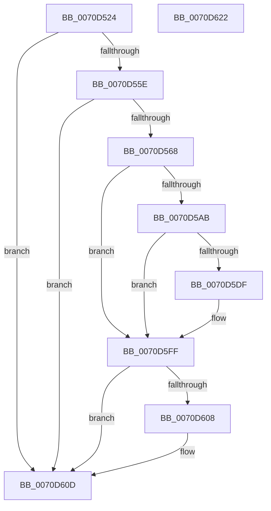

# HalpAcquirePccInterface

- RVA: `0x0070D524`–`0x0070D623` (길이 `255` bytes)
- VA: `0x000000014070D524`
- 실행 섹션: `PAGE`
- PDB 이름 있음: `예`; PDB Function 태그: `아니요`
- unwind 정보 RVA: `0x000BEC00`
- 디코드: `69`개 명령, `255/255` bytes 표시
- 미해석 바이트: `0` (있으면 어셈블리에 `.byte`로 보존)

> 이 문서는 커널 이미지의 기계어와 PDB 기호를 분석해 생성했습니다. 4번과 5번은 함수 원형과 자료형을 바이너리 사용 방식에서 추정한 C 해석이며 원본 소스 복구 결과는 아닙니다.

## 1. Dependencies

- 직접 호출 지점: **5**; 고유 호출 대상: **5**
- 직접 호출자로 확인된 함수: **2**
- RIP 상대 이미지 참조: **0**

### Outgoing calls
- `0x0070D5A0` → [ZwOpenFile](../../text/6A/ZwOpenFile_function_006AD730.md) (function, `0x006AD730`)
- `0x0070D5D4` → [ObpReferenceObjectByHandleWithTag](../86/ObpReferenceObjectByHandleWithTag_function_00869650.md) (function, `0x00869650`)
- `0x0070D5F0` → [HalpQueryPccInterface](HalpQueryPccInterface_function_0070D79C.md) (function, `0x0070D79C`)
- `0x0070D5FA` → [ObfDereferenceObject](../../text/2F/ObfDereferenceObject_function_002F9350.md) (function, `0x002F9350`)
- `0x0070D608` → [ZwClose](../../text/6A/ZwClose_function_006AD2B0.md) (function, `0x006AD2B0`)

### Direct callers
- [HaliInitializePlatformDebugTriggers](../../text/56/HaliInitializePlatformDebugTriggers_function_0056AC00.md) at `0x0056AC8C`
- [HalpStartPccCommand](HalpStartPccCommand_function_0070D8D4.md) at `0x0070D925`

### Static image references
- 디코드된 RIP-relative 메모리 참조가 없습니다.

## 2. Other-region calls and transfers

- 다른 실행 섹션으로 향하는 call: **3**
  - `0x0070D5A0` → [ZwOpenFile](../../text/6A/ZwOpenFile_function_006AD730.md) (`PAGE` → `.text`)
  - `0x0070D5FA` → [ObfDereferenceObject](../../text/2F/ObfDereferenceObject_function_002F9350.md) (`PAGE` → `.text`)
  - `0x0070D608` → [ZwClose](../../text/6A/ZwClose_function_006AD2B0.md) (`PAGE` → `.text`)
- 별도 외부 분기/꼬리 이동을 확인하지 못했습니다.

## 3. Assembly (complete function range)

```asm
0070D524  48 89 5C 24 08                  mov qword ptr [rsp + 8], rbx
0070D529  55                              push rbp
0070D52A  56                              push rsi
0070D52B  57                              push rdi
0070D52C  48 8B EC                        mov rbp, rsp
0070D52F  48 81 EC 80 00 00 00            sub rsp, 0x80
0070D536  48 83 65 38 00                  and qword ptr [rbp + 0x38], 0
0070D53B  33 C0                           xor eax, eax
0070D53D  21 45 EC                        and dword ptr [rbp - 0x14], eax
0070D540  33 FF                           xor edi, edi
0070D542  89 45 D4                        mov dword ptr [rbp - 0x2c], eax
0070D545  0F 57 C0                        xorps xmm0, xmm0
0070D548  21 45 D4                        and dword ptr [rbp - 0x2c], eax
0070D54B  49 8B D8                        mov rbx, r8
0070D54E  0F B6 F1                        movzx esi, cl
0070D551  0F 11 45 C0                     movups xmmword ptr [rbp - 0x40], xmm0
0070D555  48 85 D2                        test rdx, rdx
0070D558  0F 84 AF 00 00 00               je 0x14070d60d
0070D55E  48 39 42 08                     cmp qword ptr [rdx + 8], rax
0070D562  0F 84 A5 00 00 00               je 0x14070d60d
0070D568  21 44 24 28                     and dword ptr [rsp + 0x28], eax
0070D56C  4C 8D 4D C0                     lea r9, [rbp - 0x40]
0070D570  48 21 45 D8                     and qword ptr [rbp - 0x28], rax
0070D574  4C 8D 45 D0                     lea r8, [rbp - 0x30]
0070D578  48 21 45 28                     and qword ptr [rbp + 0x28], rax
0070D57C  48 8D 4D 28                     lea rcx, [rbp + 0x28]
0070D580  21 44 24 20                     and dword ptr [rsp + 0x20], eax
0070D584  48 89 55 E0                     mov qword ptr [rbp - 0x20], rdx
0070D588  BA 89 00 12 00                  mov edx, 0x120089
0070D58D  C7 45 D0 30 00 00 00            mov dword ptr [rbp - 0x30], 0x30
0070D594  C7 45 E8 40 02 00 00            mov dword ptr [rbp - 0x18], 0x240
0070D59B  F3 0F 7F 45 F0                  movdqu xmmword ptr [rbp - 0x10], xmm0
0070D5A0  E8 8B 01 FA FF                  call 0x1406ad730
0070D5A5  8B F8                           mov edi, eax
0070D5A7  85 C0                           test eax, eax
0070D5A9  78 54                           js 0x14070d5ff
0070D5AB  48 83 64 24 38 00               and qword ptr [rsp + 0x38], 0
0070D5B1  48 8D 45 38                     lea rax, [rbp + 0x38]
0070D5B5  48 83 64 24 30 00               and qword ptr [rsp + 0x30], 0
0070D5BB  45 33 C9                        xor r9d, r9d
0070D5BE  48 8B 4D 28                     mov rcx, qword ptr [rbp + 0x28]
0070D5C2  45 33 C0                        xor r8d, r8d
0070D5C5  48 89 44 24 28                  mov qword ptr [rsp + 0x28], rax
0070D5CA  33 D2                           xor edx, edx
0070D5CC  C7 44 24 20 44 66 6C 74         mov dword ptr [rsp + 0x20], 0x746c6644
0070D5D4  E8 77 C0 15 00                  call 0x140869650
0070D5D9  8B F8                           mov edi, eax
0070D5DB  85 C0                           test eax, eax
0070D5DD  78 20                           js 0x14070d5ff
0070D5DF  48 89 5C 24 28                  mov qword ptr [rsp + 0x28], rbx
0070D5E4  48 8B 5D 38                     mov rbx, qword ptr [rbp + 0x38]
0070D5E8  89 74 24 20                     mov dword ptr [rsp + 0x20], esi
0070D5EC  48 8B 4B 08                     mov rcx, qword ptr [rbx + 8]
0070D5F0  E8 A7 01 00 00                  call 0x14070d79c
0070D5F5  48 8B CB                        mov rcx, rbx
0070D5F8  8B F8                           mov edi, eax
0070D5FA  E8 51 BD BE FF                  call 0x1402f9350
0070D5FF  48 8B 4D 28                     mov rcx, qword ptr [rbp + 0x28]
0070D603  48 85 C9                        test rcx, rcx
0070D606  74 05                           je 0x14070d60d
0070D608  E8 A3 FC F9 FF                  call 0x1406ad2b0
0070D60D  48 8B 9C 24 A0 00 00 00         mov rbx, qword ptr [rsp + 0xa0]
0070D615  8B C7                           mov eax, edi
0070D617  48 81 C4 80 00 00 00            add rsp, 0x80
0070D61E  5F                              pop rdi
0070D61F  5E                              pop rsi
0070D620  5D                              pop rbp
0070D621  C3                              ret
0070D622  CC                              int3
```

## 4. C-style interpretation (structured pseudocode)

```c
__int64 __fastcall HalpAcquirePccInterface(unsigned __int8 a1, __int64 a2, __int64 a3)
{
    __int64 result;
    __int64 v_rbx;
    __int64 v_rdi;
    __int64 v_rsp;
    unsigned __int64 v_stack_m28;
    unsigned int v_stack_m2C;
    unsigned int v_stack_m30;
    unsigned __int64 v_stack_m38;
    unsigned __int64 v_stack_m40;
    unsigned int v_stack_m44;
    unsigned __int64 v_stack_m48;
    unsigned __int64 v_stack_m58;
    unsigned __int64 v_stack_m60;
    unsigned __int64 v_stack_m68;
    unsigned int v_stack_m70;
    unsigned int v_stack_m78;
    unsigned __int64 v_stack_p10;
    unsigned __int64 v_stack_p20;
    unsigned __int64 v_stack_p8;

    v_stack_p8 = v_rbx;
    v_rsp = (v_rsp) - (128);
    result = 0;
    v_rdi = 0;
    v_stack_m44 = 0;
    v_stack_m58 = v_xmm0;
    if (a2 == 0) goto loc_0070D60D;
    if ((*(unsigned __int64 *)(a2 + 8)) == 0) goto loc_0070D60D;
    v_stack_m38 = a2;
    v_stack_m48 = 48;
    v_stack_m30 = 576;
    v_stack_m28 = v_xmm0;
    result = ZwOpenFile(v_stack_p10, (unsigned int)(0x120089ULL), v_stack_m48, v_stack_m58);
    if (sign_flag) goto loc_0070D5FF;
    a4 = 0;
    a3 = 0;
    v_stack_m70 = v_stack_p20;
    a2 = 0;
    v_stack_m78 = 0x746C6644ULL;
    result = ObpReferenceObjectByHandleWithTag(v_stack_p10, a2, a3, a4);
    v_rbx = a3;
    v_rdi = (unsigned int)((unsigned int)(result));
    if (!(sign_flag)) {
        v_stack_m70 = 0;
        v_rbx = v_stack_p20;
        v_stack_m78 = a1;
        a1 = *(unsigned __int64 *)(v_rbx + 8);
        result = HalpQueryPccInterface(a1, a2, a3, a4);
        a1 = v_rbx;
        v_rdi = (unsigned int)(result);
        result = ObfDereferenceObject(a1, a2, a3, a4);
    }
    if (v_stack_p10 != 0) {
        result = ZwClose(v_stack_p10, a2, a3, a4);
    }
    v_rsp = (v_rsp) + (128);
    return (unsigned int)((unsigned int)(v_rdi));
}
```

## 5. (Beta) C Style

```c
int64_t HalpAcquirePccInterface(uint8_t Arg1, int64_t Arg2, int64_t Arg3)
{
    int64_t result;
    int64_t local_rbx;
    int64_t local_rdi;
    int64_t local_rsp;
    uint64_t v_stack_m28;
    uint32_t v_stack_m2C;
    uint32_t v_stack_m30;
    uint64_t v_stack_m38;
    uint64_t v_stack_m40;
    uint32_t v_stack_m44;
    uint64_t v_stack_m48;
    uint64_t v_stack_m58;
    uint64_t v_stack_m60;
    uint64_t v_stack_m68;
    uint32_t v_stack_m70;
    uint32_t v_stack_m78;
    uint64_t v_stack_p10;
    uint64_t v_stack_p20;
    uint64_t v_stack_p8;

    v_stack_p8 = local_rbx;
    local_rsp = (local_rsp) - (128);
    result = 0;
    local_rdi = 0;
    v_stack_m44 = 0;
    v_stack_m58 = v_xmm0;
    if (Arg2 == 0) goto loc_0070D60D;
    if ((*(uint64_t *)(Arg2 + 0x8)) == 0) goto loc_0070D60D;
    v_stack_m38 = Arg2;
    v_stack_m48 = 48;
    v_stack_m30 = 576;
    v_stack_m28 = v_xmm0;
    result = ZwOpenFile(v_stack_p10, (uint32_t)(0x120089ULL), v_stack_m48, v_stack_m58);
    if (sign_flag) goto loc_0070D5FF;
    a4 = 0;
    Arg3 = 0;
    v_stack_m70 = v_stack_p20;
    Arg2 = 0;
    v_stack_m78 = 0x746C6644ULL;
    result = ObpReferenceObjectByHandleWithTag(v_stack_p10, Arg2, Arg3, a4);
    local_rbx = Arg3;
    local_rdi = (uint32_t)((uint32_t)(result));
    if (!(sign_flag)) {
        v_stack_m70 = 0;
        local_rbx = v_stack_p20;
        v_stack_m78 = Arg1;
        Arg1 = *(uint64_t *)(local_rbx + 0x8);
        result = HalpQueryPccInterface(Arg1, Arg2, Arg3, a4);
        Arg1 = local_rbx;
        local_rdi = (uint32_t)(result);
        result = ObfDereferenceObject(Arg1, Arg2, Arg3, a4);
    }
    if (v_stack_p10 != 0) {
        result = ZwClose(v_stack_p10, Arg2, Arg3, a4);
    }
    local_rsp = (local_rsp) + (128);
    return (uint32_t)((uint32_t)(local_rdi));
}
```

## 6. Execution-region graph

[열기: 2D/3D 그래프와 함수 탐색 컨트롤 패널](../../../control-panel.html?section=page&rva=0x0070D524&view=graph)

- 2D 그래프는 위에서 아래로 흐르고, 3D 그래프는 빈 공간을 드래그해 회전합니다. Shift+드래그는 이동, 휠은 확대·축소, 함수 노드 선택은 대상 보고서 이동입니다.

### Static fallback


