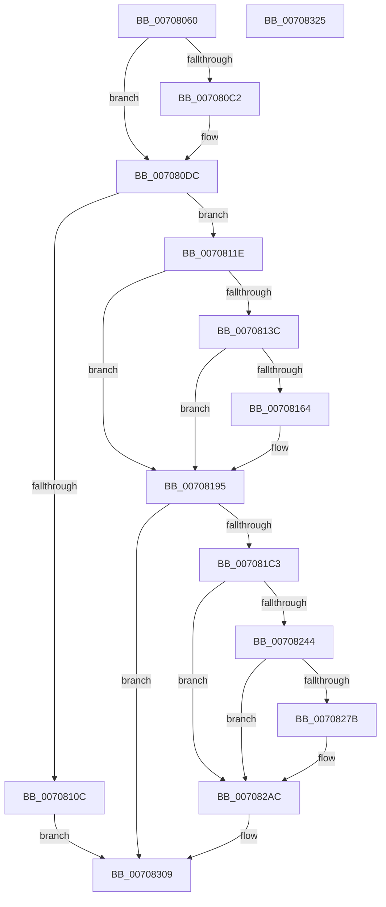

# HalpAddDevice

- RVA: `0x00708060`–`0x00708326` (길이 `710` bytes)
- VA: `0x0000000140708060`
- 실행 섹션: `PAGE`
- PDB 이름 있음: `예`; PDB Function 태그: `아니요`
- unwind 정보 RVA: `0x000B633C`
- 디코드: `174`개 명령, `710/710` bytes 표시
- 미해석 바이트: `0` (있으면 어셈블리에 `.byte`로 보존)

> 이 문서는 커널 이미지의 기계어와 PDB 기호를 분석해 생성했습니다. 4번과 5번은 함수 원형과 자료형을 바이너리 사용 방식에서 추정한 C 해석이며 원본 소스 복구 결과는 아닙니다.

## 1. Dependencies

- 직접 호출 지점: **16**; 고유 호출 대상: **11**
- 직접 호출자로 확인된 함수: **1**
- RIP 상대 이미지 참조: **7**

### Outgoing calls
- `0x007080B9` → [IoCreateDevice](../9A/IoCreateDevice_function_009A4B00.md) (function, `0x009A4B00`)
- `0x007080D6` → [KeBugCheckEx](../../text/4F/KeBugCheckEx_function_004FD660.md) (function, `0x004FD660`)
- `0x00708102` → [IoAttachDeviceToDeviceStack](../../text/41/IoAttachDeviceToDeviceStack_function_00410530.md) (function, `0x00410530`)
- `0x0070810F` → [IoDeleteDevice](../../text/26/IoDeleteDevice_function_0026FE90.md) (function, `0x0026FE90`)
- `0x00708129` → [HalAcpiGetTable](../../text/53/HalAcpiGetTable_function_0053EA00.md) (function, `0x0053EA00`)
- `0x0070815B` → [IoCreateDevice](../9A/IoCreateDevice_function_009A4B00.md) (function, `0x009A4B00`)
- `0x0070818C` → [HalpAddChildPdo](HalpAddChildPdo_function_00708038.md) (function, `0x00708038`)
- `0x007081B6` → [IoCreateDevice](../9A/IoCreateDevice_function_009A4B00.md) (function, `0x009A4B00`)
- `0x007081F2` → [HalpAddChildPdo](HalpAddChildPdo_function_00708038.md) (function, `0x00708038`)
- `0x0070823B` → [ZwOpenKey](../../text/6A/ZwOpenKey_function_006AD310.md) (function, `0x006AD310`)
- `0x00708248` → [ZwClose](../../text/6A/ZwClose_function_006AD2B0.md) (function, `0x006AD2B0`)
- `0x00708272` → [IoCreateDevice](../9A/IoCreateDevice_function_009A4B00.md) (function, `0x009A4B00`)
- `0x007082A3` → [HalpAddChildPdo](HalpAddChildPdo_function_00708038.md) (function, `0x00708038`)
- `0x007082B4` → [HalpInitializeSecondaryInterruptServices](../../init/C2/HalpInitializeSecondaryInterruptServices_function_00C21814.md) (function, `0x00C21814`)
- `0x007082CA` → [KeInitializeEvent](../../text/40/KeInitializeEvent_function_0040DD10.md) (function, `0x0040DD10`)
- `0x007082FC` → [IoRegisterPlugPlayNotification](../95/IoRegisterPlugPlayNotification_function_009535A0.md) (function, `0x009535A0`)

### Direct callers
- [HalpDriverEntry](HalpDriverEntry_function_00708370.md) at `0x007083F5`

### Static image references
- `0x007081CE` → RVA `0x00E10388` (`.data`; write)
- `0x007081F7` → RVA `0x00023F70` (`.rdata`; read)
- `0x007082BE` → RVA `0x00FC1C00` (`.data`; read)
- `0x007082CF` → RVA `0x00FC1C18` (`.data`; read)
- `0x007082DA` → RVA `0x00009DD0` (`.rdata`; read)
- `0x007082EB` → RVA `0x00708410` (`HalpDynamicDeviceInterfaceNotification`; read)
- `0x00708303` → RVA `0x00E10380` (`.data`; write)

## 2. Other-region calls and transfers

- 다른 실행 섹션으로 향하는 call: **8**
  - `0x007080D6` → [KeBugCheckEx](../../text/4F/KeBugCheckEx_function_004FD660.md) (`PAGE` → `.text`)
  - `0x00708102` → [IoAttachDeviceToDeviceStack](../../text/41/IoAttachDeviceToDeviceStack_function_00410530.md) (`PAGE` → `.text`)
  - `0x0070810F` → [IoDeleteDevice](../../text/26/IoDeleteDevice_function_0026FE90.md) (`PAGE` → `.text`)
  - `0x00708129` → [HalAcpiGetTable](../../text/53/HalAcpiGetTable_function_0053EA00.md) (`PAGE` → `.text`)
  - `0x0070823B` → [ZwOpenKey](../../text/6A/ZwOpenKey_function_006AD310.md) (`PAGE` → `.text`)
  - `0x00708248` → [ZwClose](../../text/6A/ZwClose_function_006AD2B0.md) (`PAGE` → `.text`)
  - `0x007082B4` → [HalpInitializeSecondaryInterruptServices](../../init/C2/HalpInitializeSecondaryInterruptServices_function_00C21814.md) (`PAGE` → `INIT`)
  - `0x007082CA` → [KeInitializeEvent](../../text/40/KeInitializeEvent_function_0040DD10.md) (`PAGE` → `.text`)
- 별도 외부 분기/꼬리 이동을 확인하지 못했습니다.

## 3. Assembly (complete function range)

```asm
00708060  48 89 5C 24 08                  mov qword ptr [rsp + 8], rbx
00708065  48 89 74 24 10                  mov qword ptr [rsp + 0x10], rsi
0070806A  55                              push rbp
0070806B  57                              push rdi
0070806C  41 54                           push r12
0070806E  41 56                           push r14
00708070  41 57                           push r15
00708072  48 8D 6C 24 C9                  lea rbp, [rsp - 0x37]
00708077  48 81 EC 90 00 00 00            sub rsp, 0x90
0070807E  45 33 FF                        xor r15d, r15d
00708081  48 8D 45 7F                     lea rax, [rbp + 0x7f]
00708085  48 89 44 24 30                  mov qword ptr [rsp + 0x30], rax
0070808A  4C 8B F2                        mov r14, rdx
0070808D  44 88 7C 24 28                  mov byte ptr [rsp + 0x28], r15b
00708092  45 33 C0                        xor r8d, r8d
00708095  48 8B F1                        mov rsi, rcx
00708098  4C 89 7D EF                     mov qword ptr [rbp - 0x11], r15
0070809C  45 8D 4F 2A                     lea r9d, [r15 + 0x2a]
007080A0  4C 89 7D 7F                     mov qword ptr [rbp + 0x7f], r15
007080A4  41 8D 57 28                     lea edx, [r15 + 0x28]
007080A8  4C 89 7D E7                     mov qword ptr [rbp - 0x19], r15
007080AC  4C 89 7D FF                     mov qword ptr [rbp - 1], r15
007080B0  4C 89 7D 77                     mov qword ptr [rbp + 0x77], r15
007080B4  44 89 7C 24 20                  mov dword ptr [rsp + 0x20], r15d
007080B9  E8 42 CA 29 00                  call 0x1409a4b00
007080BE  85 C0                           test eax, eax
007080C0  79 1A                           jns 0x1407080dc
007080C2  4C 63 C0                        movsxd r8, eax
007080C5  41 8D 4F 5C                     lea ecx, [r15 + 0x5c]
007080C9  45 33 C9                        xor r9d, r9d
007080CC  4C 89 7C 24 20                  mov qword ptr [rsp + 0x20], r15
007080D1  BA 0E 01 00 00                  mov edx, 0x10e
007080D6  E8 85 55 DF FF                  call 0x1404fd660
007080DB  CC                              int3
007080DC  48 8B 7D 7F                     mov rdi, qword ptr [rbp + 0x7f]
007080E0  41 BC 7F FF FF FF               mov r12d, 0xffffff7f
007080E6  49 8B D6                        mov rdx, r14
007080E9  48 8B CF                        mov rcx, rdi
007080EC  48 8B 5F 40                     mov rbx, qword ptr [rdi + 0x40]
007080F0  C7 03 C1 00 00 00               mov dword ptr [rbx], 0xc1
007080F6  4C 89 73 10                     mov qword ptr [rbx + 0x10], r14
007080FA  48 89 7B 18                     mov qword ptr [rbx + 0x18], rdi
007080FE  44 21 67 30                     and dword ptr [rdi + 0x30], r12d
00708102  E8 29 84 D0 FF                  call 0x140410530
00708107  48 85 C0                        test rax, rax
0070810A  75 12                           jne 0x14070811e
0070810C  48 8B CF                        mov rcx, rdi
0070810F  E8 7C 7D B6 FF                  call 0x14026fe90
00708114  B8 0E 00 00 C0                  mov eax, 0xc000000e
00708119  E9 EB 01 00 00                  jmp 0x140708309
0070811E  BA 50 52 4D 54                  mov edx, 0x544d5250
00708123  48 89 43 20                     mov qword ptr [rbx + 0x20], rax
00708127  33 C9                           xor ecx, ecx
00708129  E8 D2 68 E3 FF                  call 0x14053ea00
0070812E  BF 80 00 00 00                  mov edi, 0x80
00708133  44 8D 77 B0                     lea r14d, [rdi - 0x50]
00708137  48 85 C0                        test rax, rax
0070813A  74 59                           je 0x140708195
0070813C  48 8D 45 E7                     lea rax, [rbp - 0x19]
00708140  45 33 C0                        xor r8d, r8d
00708143  48 89 44 24 30                  mov qword ptr [rsp + 0x30], rax
00708148  44 8D 4F AA                     lea r9d, [rdi - 0x56]
0070814C  44 88 7C 24 28                  mov byte ptr [rsp + 0x28], r15b
00708151  41 8B D6                        mov edx, r14d
00708154  48 8B CE                        mov rcx, rsi
00708157  89 7C 24 20                     mov dword ptr [rsp + 0x20], edi
0070815B  E8 A0 C9 29 00                  call 0x1409a4b00
00708160  85 C0                           test eax, eax
00708162  78 31                           js 0x140708195
00708164  4C 8B 4D E7                     mov r9, qword ptr [rbp - 0x19]
00708168  4C 8D 45 77                     lea r8, [rbp + 0x77]
0070816C  48 8B D3                        mov rdx, rbx
0070816F  49 8B 49 40                     mov rcx, qword ptr [r9 + 0x40]
00708173  C7 01 C0 00 00 00               mov dword ptr [rcx], 0xc0
00708179  4C 89 79 08                     mov qword ptr [rcx + 8], r15
0070817D  4C 89 49 10                     mov qword ptr [rcx + 0x10], r9
00708181  48 89 59 18                     mov qword ptr [rcx + 0x18], rbx
00708185  C7 41 20 84 00 00 00            mov dword ptr [rcx + 0x20], 0x84
0070818C  E8 A7 FE FF FF                  call 0x140708038
00708191  45 21 61 30                     and dword ptr [r9 + 0x30], r12d
00708195  48 8D 45 EF                     lea rax, [rbp - 0x11]
00708199  41 B9 2A 00 00 00               mov r9d, 0x2a
0070819F  48 89 44 24 30                  mov qword ptr [rsp + 0x30], rax
007081A4  45 33 C0                        xor r8d, r8d
007081A7  44 88 7C 24 28                  mov byte ptr [rsp + 0x28], r15b
007081AC  41 8B D6                        mov edx, r14d
007081AF  48 8B CE                        mov rcx, rsi
007081B2  89 7C 24 20                     mov dword ptr [rsp + 0x20], edi
007081B6  E8 45 C9 29 00                  call 0x1409a4b00
007081BB  85 C0                           test eax, eax
007081BD  0F 88 46 01 00 00               js 0x140708309
007081C3  48 8B 7D EF                     mov rdi, qword ptr [rbp - 0x11]
007081C7  4C 8D 45 77                     lea r8, [rbp + 0x77]
007081CB  48 8B D3                        mov rdx, rbx
007081CE  48 89 3D B3 81 70 00            mov qword ptr [rip + 0x7081b3], rdi
007081D5  48 8B 4F 40                     mov rcx, qword ptr [rdi + 0x40]
007081D9  C7 01 C0 00 00 00               mov dword ptr [rcx], 0xc0
007081DF  4C 89 79 08                     mov qword ptr [rcx + 8], r15
007081E3  48 89 79 10                     mov qword ptr [rcx + 0x10], rdi
007081E7  48 89 59 18                     mov qword ptr [rcx + 0x18], rbx
007081EB  C7 41 20 81 00 00 00            mov dword ptr [rcx + 0x20], 0x81
007081F2  E8 41 FE FF FF                  call 0x140708038
007081F7  48 8D 05 72 BD 91 FF            lea rax, [rip - 0x6e428e]
007081FE  4C 89 7D 7F                     mov qword ptr [rbp + 0x7f], r15
00708202  48 89 45 F7                     mov qword ptr [rbp - 9], rax
00708206  4C 8D 45 07                     lea r8, [rbp + 7]
0070820A  48 8D 45 EF                     lea rax, [rbp - 0x11]
0070820E  48 C7 45 EF 3E 00 40 00         mov qword ptr [rbp - 0x11], 0x40003e
00708216  0F 57 C0                        xorps xmm0, xmm0
00708219  48 89 45 17                     mov qword ptr [rbp + 0x17], rax
0070821D  BA 19 00 02 00                  mov edx, 0x20019
00708222  4C 89 75 07                     mov qword ptr [rbp + 7], r14
00708226  48 8D 4D 7F                     lea rcx, [rbp + 0x7f]
0070822A  48 C7 45 1F 40 00 00 00         mov qword ptr [rbp + 0x1f], 0x40
00708232  4C 89 7D 0F                     mov qword ptr [rbp + 0xf], r15
00708236  F3 0F 7F 45 27                  movdqu xmmword ptr [rbp + 0x27], xmm0
0070823B  E8 D0 50 FA FF                  call 0x1406ad310
00708240  85 C0                           test eax, eax
00708242  78 68                           js 0x1407082ac
00708244  48 8B 4D 7F                     mov rcx, qword ptr [rbp + 0x7f]
00708248  E8 63 50 FA FF                  call 0x1406ad2b0
0070824D  48 8D 45 FF                     lea rax, [rbp - 1]
00708251  41 B9 2A 00 00 00               mov r9d, 0x2a
00708257  48 89 44 24 30                  mov qword ptr [rsp + 0x30], rax
0070825C  45 33 C0                        xor r8d, r8d
0070825F  44 88 7C 24 28                  mov byte ptr [rsp + 0x28], r15b
00708264  41 8B D6                        mov edx, r14d
00708267  48 8B CE                        mov rcx, rsi
0070826A  C7 44 24 20 80 00 00 00         mov dword ptr [rsp + 0x20], 0x80
00708272  E8 89 C8 29 00                  call 0x1409a4b00
00708277  85 C0                           test eax, eax
00708279  78 31                           js 0x1407082ac
0070827B  4C 8B 4D FF                     mov r9, qword ptr [rbp - 1]
0070827F  4C 8D 45 77                     lea r8, [rbp + 0x77]
00708283  48 8B D3                        mov rdx, rbx
00708286  49 8B 49 40                     mov rcx, qword ptr [r9 + 0x40]
0070828A  C7 01 C0 00 00 00               mov dword ptr [rcx], 0xc0
00708290  4C 89 79 08                     mov qword ptr [rcx + 8], r15
00708294  4C 89 49 10                     mov qword ptr [rcx + 0x10], r9
00708298  48 89 59 18                     mov qword ptr [rcx + 0x18], rbx
0070829C  C7 41 20 83 00 00 00            mov dword ptr [rcx + 0x20], 0x83
007082A3  E8 90 FD FF FF                  call 0x140708038
007082A8  45 21 61 30                     and dword ptr [r9 + 0x30], r12d
007082AC  44 21 67 30                     and dword ptr [rdi + 0x30], r12d
007082B0  4C 89 7D 77                     mov qword ptr [rbp + 0x77], r15
007082B4  E8 5B 95 51 00                  call 0x140c21814
007082B9  BB 01 00 00 00                  mov ebx, 1
007082BE  48 8D 0D 3B 99 8B 00            lea rcx, [rip + 0x8b993b]
007082C5  44 8A C3                        mov r8b, bl
007082C8  8B D3                           mov edx, ebx
007082CA  E8 41 5A D0 FF                  call 0x14040dd10
007082CF  4C 8B 0D 42 99 8B 00            mov r9, qword ptr [rip + 0x8b9942]
007082D6  48 8D 45 77                     lea rax, [rbp + 0x77]
007082DA  4C 8B 05 EF 1A 90 FF            mov r8, qword ptr [rip - 0x6fe511]
007082E1  8D 4B 01                        lea ecx, [rbx + 1]
007082E4  48 89 44 24 30                  mov qword ptr [rsp + 0x30], rax
007082E9  8B D3                           mov edx, ebx
007082EB  48 8D 05 1E 01 00 00            lea rax, [rip + 0x11e]
007082F2  4C 89 7C 24 28                  mov qword ptr [rsp + 0x28], r15
007082F7  48 89 44 24 20                  mov qword ptr [rsp + 0x20], rax
007082FC  E8 9F B2 24 00                  call 0x1409535a0
00708301  33 C0                           xor eax, eax
00708303  88 1D 77 80 70 00               mov byte ptr [rip + 0x708077], bl
00708309  4C 8D 9C 24 90 00 00 00         lea r11, [rsp + 0x90]
00708311  49 8B 5B 30                     mov rbx, qword ptr [r11 + 0x30]
00708315  49 8B 73 38                     mov rsi, qword ptr [r11 + 0x38]
00708319  49 8B E3                        mov rsp, r11
0070831C  41 5F                           pop r15
0070831E  41 5E                           pop r14
00708320  41 5C                           pop r12
00708322  5F                              pop rdi
00708323  5D                              pop rbp
00708324  C3                              ret
00708325  CC                              int3
```

## 4. C-style interpretation (structured pseudocode)

```c
__int64 __fastcall HalpAddDevice(__int64 a1, __int64 a2, int a3)
{
    __int64 result;
    __int64 v_r15;
    __int64 v_rsp;
    unsigned __int64 v_stack_m28;
    unsigned __int64 v_stack_m38;
    unsigned __int64 v_stack_m40;
    unsigned __int64 v_stack_m48;
    unsigned __int64 v_stack_m50;
    unsigned __int64 v_stack_m58;
    unsigned __int64 v_stack_m5F;
    unsigned __int64 v_stack_m60;
    unsigned __int64 v_stack_m68;
    unsigned __int64 v_stack_m70;
    unsigned __int64 v_stack_m78;
    unsigned __int64 v_stack_m88;
    unsigned __int8 v_stack_m90;
    unsigned int v_stack_m98;
    unsigned __int64 v_stack_p10;
    unsigned __int64 v_stack_p18;
    unsigned __int64 v_stack_p20;
    unsigned __int64 v_stack_p8;

    v_stack_p8 = v_rbx;
    v_stack_p10 = v_rsi;
    v_rsp = (v_rsp) - (144);
    v_r15 = 0;
    v_stack_m88 = v_stack_p20;
    v_stack_m90 = 0;
    a3 = 0;
    v_stack_m70 = 0;
    v_stack_p20 = 0;
    v_stack_m78 = 0;
    v_stack_m60 = 0;
    v_stack_p18 = 0;
    v_stack_m98 = 0;
    result = IoCreateDevice(a1, v_r15 + 40, a3, v_r15 + 42);
    if (sign_flag) {
        a3 = (int)((unsigned int)(result));
        a1 = v_r15 + 92;
        a4 = 0;
        v_stack_m98 = 0;
        a2 = 270;
        result = KeBugCheckEx(a1, a2, a3, a4);
    }
    *(unsigned int *)(*(unsigned __int64 *)(v_stack_p20 + 64)) = 193;
    *(unsigned __int64 *)(*(unsigned __int64 *)(v_stack_p20 + 64) + 16) = a2;
    *(unsigned __int64 *)(*(unsigned __int64 *)(v_stack_p20 + 64) + 24) = v_stack_p20;
    result = IoAttachDeviceToDeviceStack(v_stack_p20, a2, a3, a4);
    if (result != 0) goto loc_0070811E;
    result = IoDeleteDevice(v_stack_p20, a2, a3, a4);
    goto loc_00708309;
loc_0070811E:
    *(unsigned __int64 *)(*(unsigned __int64 *)(v_stack_p20 + 64) + 32) = (unsigned int)(0xC000000EULL);
    a1 = 0;
    result = HalAcpiGetTable(a1, (unsigned int)(0x544D5250ULL), a3, a4);
    if (result == 0) goto loc_00708195;
    a3 = 0;
    v_stack_m88 = v_stack_m78;
    v_stack_m90 = 0;
    v_stack_m98 = 128;
    result = IoCreateDevice(0, (unsigned int)((unsigned int)(128 - 80)), a3, 128 - 86);
    if (!(sign_flag)) {
        a4 = v_stack_m78;
        a3 = v_stack_p18;
        a2 = *(unsigned __int64 *)(v_stack_p20 + 64);
        a1 = *(unsigned __int64 *)(a4 + 64);
        *(unsigned int *)(a1) = 192;
        *(unsigned __int64 *)(a1 + 8) = 0;
        *(unsigned __int64 *)(a1 + 16) = a4;
        *(unsigned __int64 *)(a1 + 24) = *(unsigned __int64 *)(v_stack_p20 + 64);
        *(unsigned int *)(a1 + 32) = 132;
        result = HalpAddChildPdo(a1, a2, a3, a4);
    }
    v_stack_m88 = v_stack_m70;
    a3 = 0;
    v_stack_m90 = 0;
    v_stack_m98 = 128;
    result = IoCreateDevice(a1, (unsigned int)((unsigned int)(128 - 80)), a3, 42);
    if (sign_flag) goto loc_00708309;
    *(unsigned __int64 *)(v_rip + 7373235) = v_stack_m70;
    *(unsigned int *)(*(unsigned __int64 *)(v_stack_m70 + 64)) = 192;
    *(unsigned __int64 *)(*(unsigned __int64 *)(v_stack_m70 + 64) + 8) = 0;
    *(unsigned __int64 *)(*(unsigned __int64 *)(v_stack_m70 + 64) + 16) = v_stack_m70;
    *(unsigned __int64 *)(*(unsigned __int64 *)(v_stack_m70 + 64) + 24) = *(unsigned __int64 *)(v_stack_p20 + 64);
    *(unsigned int *)(*(unsigned __int64 *)(v_stack_m70 + 64) + 32) = 129;
    result = HalpAddChildPdo(*(unsigned __int64 *)(v_stack_m70 + 64), *(unsigned __int64 *)(v_stack_p20 + 64), v_stack_p18, 42);
    v_stack_p20 = 0;
    v_stack_m68 = v_rip - 7225998;
    v_stack_m70 = 0x40003EULL;
    v_stack_m48 = v_stack_m70;
    v_stack_m58 = 128 - 80;
    v_stack_m40 = 64;
    v_stack_m50 = 0;
    v_stack_m38 = v_xmm0;
    result = ZwOpenKey(v_stack_p20, (unsigned int)(0x20019ULL), v_stack_m58, 42);
    if (sign_flag) goto loc_007082AC;
    result = ZwClose(v_stack_p20, (unsigned int)(0x20019ULL), v_stack_m58, 42);
    v_stack_m88 = v_stack_m60;
    a3 = 0;
    v_stack_m90 = 0;
    v_stack_m98 = 128;
    result = IoCreateDevice(a1, (unsigned int)((unsigned int)(128 - 80)), a3, 42);
    if (!(sign_flag)) {
        a4 = v_stack_m60;
        a3 = v_stack_p18;
        a2 = *(unsigned __int64 *)(v_stack_p20 + 64);
        a1 = *(unsigned __int64 *)(a4 + 64);
        *(unsigned int *)(a1) = 192;
        *(unsigned __int64 *)(a1 + 8) = 0;
        *(unsigned __int64 *)(a1 + 16) = a4;
        *(unsigned __int64 *)(a1 + 24) = *(unsigned __int64 *)(v_stack_p20 + 64);
        *(unsigned int *)(a1 + 32) = 131;
        result = HalpAddChildPdo(a1, a2, a3, a4);
    }
    v_stack_p18 = 0;
    result = HalpInitializeSecondaryInterruptServices(a1, a2, a3, a4);
    result = KeInitializeEvent(v_rip + 9148731, 1, 1, a4);
    v_stack_m88 = v_stack_p18;
    v_stack_m90 = 0;
    v_stack_m98 = v_rip + 286;
    result = IoRegisterPlugPlayNotification(1 + 1, 1, *(unsigned __int64 *)(v_rip - 7333137), *(unsigned __int64 *)(v_rip + 9148738));
    result = 0;
    *(unsigned __int8 *)(v_rip + 7372919) = 1;
loc_00708309:
    return result;
}
```

## 5. (Beta) C Style

```c
int64_t HalpAddDevice(int64_t Arg1, int64_t Arg2, int32_t Arg3)
{
    int64_t result;
    int64_t local_r15;
    int64_t local_rsp;
    uint64_t v_stack_m28;
    uint64_t v_stack_m38;
    uint64_t v_stack_m40;
    uint64_t v_stack_m48;
    uint64_t v_stack_m50;
    uint64_t v_stack_m58;
    uint64_t v_stack_m5F;
    uint64_t v_stack_m60;
    uint64_t v_stack_m68;
    uint64_t v_stack_m70;
    uint64_t v_stack_m78;
    uint64_t v_stack_m88;
    uint8_t v_stack_m90;
    uint32_t v_stack_m98;
    uint64_t v_stack_p10;
    uint64_t v_stack_p18;
    uint64_t v_stack_p20;
    uint64_t v_stack_p8;

    v_stack_p8 = local_rbx;
    v_stack_p10 = local_rsi;
    local_rsp = (local_rsp) - (144);
    local_r15 = 0;
    v_stack_m88 = v_stack_p20;
    v_stack_m90 = 0;
    Arg3 = 0;
    v_stack_m70 = 0;
    v_stack_p20 = 0;
    v_stack_m78 = 0;
    v_stack_m60 = 0;
    v_stack_p18 = 0;
    v_stack_m98 = 0;
    result = IoCreateDevice(Arg1, local_r15 + 40, Arg3, local_r15 + 42);
    if (sign_flag) {
        Arg3 = (int32_t)((uint32_t)(result));
        Arg1 = local_r15 + 92;
        a4 = 0;
        v_stack_m98 = 0;
        Arg2 = 270;
        result = KeBugCheckEx(Arg1, Arg2, Arg3, a4);
    }
    *(uint32_t *)(*(uint64_t *)(v_stack_p20 + 0x40)) = 193;
    *(uint64_t *)(*(uint64_t *)(v_stack_p20 + 0x40) + 0x10) = Arg2;
    *(uint64_t *)(*(uint64_t *)(v_stack_p20 + 0x40) + 0x18) = v_stack_p20;
    result = IoAttachDeviceToDeviceStack(v_stack_p20, Arg2, Arg3, a4);
    if (result != 0) goto loc_0070811E;
    result = IoDeleteDevice(v_stack_p20, Arg2, Arg3, a4);
    goto loc_00708309;
loc_0070811E:
    *(uint64_t *)(*(uint64_t *)(v_stack_p20 + 0x40) + 0x20) = (uint32_t)(0xC000000EULL);
    Arg1 = 0;
    result = HalAcpiGetTable(Arg1, (uint32_t)(0x544D5250ULL), Arg3, a4);
    if (result == 0) goto loc_00708195;
    Arg3 = 0;
    v_stack_m88 = v_stack_m78;
    v_stack_m90 = 0;
    v_stack_m98 = 128;
    result = IoCreateDevice(0, (uint32_t)((uint32_t)(128 - 80)), Arg3, 128 - 86);
    if (!(sign_flag)) {
        a4 = v_stack_m78;
        Arg3 = v_stack_p18;
        Arg2 = *(uint64_t *)(v_stack_p20 + 0x40);
        Arg1 = *(uint64_t *)(a4 + 0x40);
        *(uint32_t *)(Arg1) = 192;
        *(uint64_t *)(Arg1 + 0x8) = 0;
        *(uint64_t *)(Arg1 + 0x10) = a4;
        *(uint64_t *)(Arg1 + 0x18) = *(uint64_t *)(v_stack_p20 + 0x40);
        *(uint32_t *)(Arg1 + 0x20) = 132;
        result = HalpAddChildPdo(Arg1, Arg2, Arg3, a4);
    }
    v_stack_m88 = v_stack_m70;
    Arg3 = 0;
    v_stack_m90 = 0;
    v_stack_m98 = 128;
    result = IoCreateDevice(Arg1, (uint32_t)((uint32_t)(128 - 80)), Arg3, 42);
    if (sign_flag) goto loc_00708309;
    *(uint64_t *)(v_rip + 0x7081B3) = v_stack_m70;
    *(uint32_t *)(*(uint64_t *)(v_stack_m70 + 0x40)) = 192;
    *(uint64_t *)(*(uint64_t *)(v_stack_m70 + 0x40) + 0x8) = 0;
    *(uint64_t *)(*(uint64_t *)(v_stack_m70 + 0x40) + 0x10) = v_stack_m70;
    *(uint64_t *)(*(uint64_t *)(v_stack_m70 + 0x40) + 0x18) = *(uint64_t *)(v_stack_p20 + 0x40);
    *(uint32_t *)(*(uint64_t *)(v_stack_m70 + 0x40) + 0x20) = 129;
    result = HalpAddChildPdo(*(uint64_t *)(v_stack_m70 + 0x40), *(uint64_t *)(v_stack_p20 + 0x40), v_stack_p18, 42);
    v_stack_p20 = 0;
    v_stack_m68 = v_rip - 7225998;
    v_stack_m70 = 0x40003EULL;
    v_stack_m48 = v_stack_m70;
    v_stack_m58 = 128 - 80;
    v_stack_m40 = 64;
    v_stack_m50 = 0;
    v_stack_m38 = v_xmm0;
    result = ZwOpenKey(v_stack_p20, (uint32_t)(0x20019ULL), v_stack_m58, 42);
    if (sign_flag) goto loc_007082AC;
    result = ZwClose(v_stack_p20, (uint32_t)(0x20019ULL), v_stack_m58, 42);
    v_stack_m88 = v_stack_m60;
    Arg3 = 0;
    v_stack_m90 = 0;
    v_stack_m98 = 128;
    result = IoCreateDevice(Arg1, (uint32_t)((uint32_t)(128 - 80)), Arg3, 42);
    if (!(sign_flag)) {
        a4 = v_stack_m60;
        Arg3 = v_stack_p18;
        Arg2 = *(uint64_t *)(v_stack_p20 + 0x40);
        Arg1 = *(uint64_t *)(a4 + 0x40);
        *(uint32_t *)(Arg1) = 192;
        *(uint64_t *)(Arg1 + 0x8) = 0;
        *(uint64_t *)(Arg1 + 0x10) = a4;
        *(uint64_t *)(Arg1 + 0x18) = *(uint64_t *)(v_stack_p20 + 0x40);
        *(uint32_t *)(Arg1 + 0x20) = 131;
        result = HalpAddChildPdo(Arg1, Arg2, Arg3, a4);
    }
    v_stack_p18 = 0;
    result = HalpInitializeSecondaryInterruptServices(Arg1, Arg2, Arg3, a4);
    result = KeInitializeEvent(v_rip + 9148731, 1, 1, a4);
    v_stack_m88 = v_stack_p18;
    v_stack_m90 = 0;
    v_stack_m98 = v_rip + 286;
    result = IoRegisterPlugPlayNotification(1 + 1, 1, *(uint64_t *)(v_rip - 0x6FE511), *(uint64_t *)(v_rip + 0x8B9942));
    result = 0;
    *(uint8_t *)(v_rip + 0x708077) = 1;
loc_00708309:
    return result;
}
```

## 6. Execution-region graph

[열기: 2D/3D 그래프와 함수 탐색 컨트롤 패널](../../../control-panel.html?section=page&rva=0x00708060&view=graph)

- 2D 그래프는 위에서 아래로 흐르고, 3D 그래프는 빈 공간을 드래그해 회전합니다. Shift+드래그는 이동, 휠은 확대·축소, 함수 노드 선택은 대상 보고서 이동입니다.

### Static fallback


