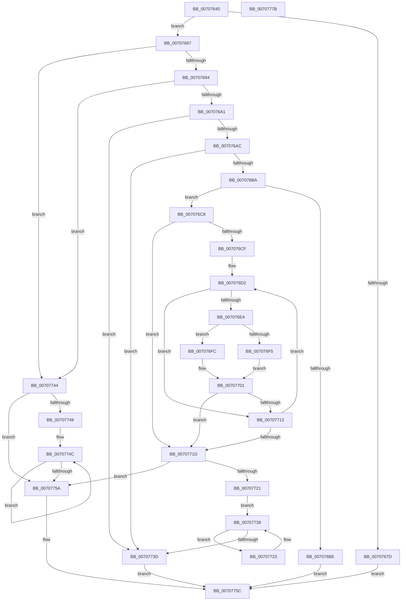

# HalpAllocateMapRegisters

- RVA: `0x00707640`–`0x0070777C` (길이 `316` bytes)
- VA: `0x0000000140707640`
- 실행 섹션: `PAGE`
- PDB 이름 있음: `예`; PDB Function 태그: `아니요`
- unwind 정보 RVA: `0x0005FEF8`
- 디코드: `94`개 명령, `316/316` bytes 표시
- 미해석 바이트: `0` (있으면 어셈블리에 `.byte`로 보존)

> 이 문서는 커널 이미지의 기계어와 PDB 기호를 분석해 생성했습니다. 4번과 5번은 함수 원형과 자료형을 바이너리 사용 방식에서 추정한 C 해석이며 원본 소스 복구 결과는 아닙니다.

## 1. Dependencies

- 직접 호출 지점: **6**; 고유 호출 대상: **5**
- 직접 호출자로 확인된 함수: **0**
- RIP 상대 이미지 참조: **0**

### Outgoing calls
- `0x00707665` → [HalpDmaExtractFromVerifierShadowAdapter](../../text/4B/HalpDmaExtractFromVerifierShadowAdapter_function_004B8DA4.md) (function, `0x004B8DA4`)
- `0x007076D7` → [HalpDmaAllocateMapRegisters](../../text/3D/HalpDmaAllocateMapRegisters_function_003DDA0C.md) (function, `0x003DDA0C`)
- `0x007076F5` → [HalpDmaGrowContiguousMapBuffers](../AD/HalpDmaGrowContiguousMapBuffers_function_00AD6D14.md) (function, `0x00AD6D14`)
- `0x007076FC` → [HalpDmaGrowScatterMapBuffers](../AA/HalpDmaGrowScatterMapBuffers_function_00AA2CF0.md) (function, `0x00AA2CF0`)
- `0x00707706` → [HalpDmaAllocateMapRegisters](../../text/3D/HalpDmaAllocateMapRegisters_function_003DDA0C.md) (function, `0x003DDA0C`)
- `0x00707734` → [IoFreeMapRegistersThunk](../../text/53/IoFreeMapRegistersThunk_function_0053F550.md) (function, `0x0053F550`)

### Direct callers
- 이 함수 시작 RVA로 연결되는 직접 call은 확인되지 않았습니다. 간접 호출은 완전히 역산할 수 없습니다.

### Static image references
- 디코드된 RIP-relative 메모리 참조가 없습니다.

## 2. Other-region calls and transfers

- 다른 실행 섹션으로 향하는 call: **4**
  - `0x00707665` → [HalpDmaExtractFromVerifierShadowAdapter](../../text/4B/HalpDmaExtractFromVerifierShadowAdapter_function_004B8DA4.md) (`PAGE` → `.text`)
  - `0x007076D7` → [HalpDmaAllocateMapRegisters](../../text/3D/HalpDmaAllocateMapRegisters_function_003DDA0C.md) (`PAGE` → `.text`)
  - `0x00707706` → [HalpDmaAllocateMapRegisters](../../text/3D/HalpDmaAllocateMapRegisters_function_003DDA0C.md) (`PAGE` → `.text`)
  - `0x00707734` → [IoFreeMapRegistersThunk](../../text/53/IoFreeMapRegistersThunk_function_0053F550.md) (`PAGE` → `.text`)
- 별도 외부 분기/꼬리 이동을 확인하지 못했습니다.

## 3. Assembly (complete function range)

```asm
00707640  48 8B C4                        mov rax, rsp
00707643  48 89 58 08                     mov qword ptr [rax + 8], rbx
00707647  48 89 68 10                     mov qword ptr [rax + 0x10], rbp
0070764B  48 89 70 18                     mov qword ptr [rax + 0x18], rsi
0070764F  48 89 78 20                     mov qword ptr [rax + 0x20], rdi
00707653  41 54                           push r12
00707655  41 56                           push r14
00707657  41 57                           push r15
00707659  48 83 EC 20                     sub rsp, 0x20
0070765D  4D 8B F1                        mov r14, r9
00707660  41 8B F8                        mov edi, r8d
00707663  8B EA                           mov ebp, edx
00707665  E8 3A 17 DB FF                  call 0x1404b8da4
0070766A  48 8B F0                        mov rsi, rax
0070766D  83 B8 80 01 00 00 FF            cmp dword ptr [rax + 0x180], -1
00707674  4C 8B A0 A0 00 00 00            mov r12, qword ptr [rax + 0xa0]
0070767B  74 0A                           je 0x140707687
0070767D  B8 10 00 00 C0                  mov eax, 0xc0000010
00707682  E9 D5 00 00 00                  jmp 0x14070775c
00707687  8B C5                           mov eax, ebp
00707689  0F AF C7                        imul eax, edi
0070768C  85 C0                           test eax, eax
0070768E  0F 84 B0 00 00 00               je 0x140707744
00707694  80 BE B8 01 00 00 00            cmp byte ptr [rsi + 0x1b8], 0
0070769B  0F 84 A3 00 00 00               je 0x140707744
007076A1  3D 00 08 00 00                  cmp eax, 0x800
007076A6  0F 87 91 00 00 00               ja 0x14070773d
007076AC  8B 86 E8 00 00 00               mov eax, dword ptr [rsi + 0xe8]
007076B2  85 C0                           test eax, eax
007076B4  0F 84 83 00 00 00               je 0x14070773d
007076BA  3B E8                           cmp ebp, eax
007076BC  76 0A                           jbe 0x1407076c8
007076BE  B8 0D 00 00 C0                  mov eax, 0xc000000d
007076C3  E9 94 00 00 00                  jmp 0x14070775c
007076C8  33 DB                           xor ebx, ebx
007076CA  45 85 C0                        test r8d, r8d
007076CD  74 4E                           je 0x14070771d
007076CF  4D 8B FE                        mov r15, r14
007076D2  8B D5                           mov edx, ebp
007076D4  48 8B CE                        mov rcx, rsi
007076D7  E8 30 63 CD FF                  call 0x1403dda0c
007076DC  49 89 07                        mov qword ptr [r15], rax
007076DF  48 85 C0                        test rax, rax
007076E2  75 2F                           jne 0x140707713
007076E4  8D 55 10                        lea edx, [rbp + 0x10]
007076E7  49 8B CC                        mov rcx, r12
007076EA  C1 E2 0C                        shl edx, 0xc
007076ED  38 86 BA 01 00 00               cmp byte ptr [rsi + 0x1ba], al
007076F3  75 07                           jne 0x1407076fc
007076F5  E8 1A F6 3C 00                  call 0x140ad6d14
007076FA  EB 05                           jmp 0x140707701
007076FC  E8 EF B5 39 00                  call 0x140aa2cf0
00707701  8B D5                           mov edx, ebp
00707703  48 8B CE                        mov rcx, rsi
00707706  E8 01 63 CD FF                  call 0x1403dda0c
0070770B  49 89 07                        mov qword ptr [r15], rax
0070770E  48 85 C0                        test rax, rax
00707711  74 0A                           je 0x14070771d
00707713  FF C3                           inc ebx
00707715  49 83 C7 10                     add r15, 0x10
00707719  3B DF                           cmp ebx, edi
0070771B  72 B5                           jb 0x1407076d2
0070771D  3B DF                           cmp ebx, edi
0070771F  74 39                           je 0x14070775a
00707721  EB 16                           jmp 0x140707739
00707723  FF CB                           dec ebx
00707725  44 8B C5                        mov r8d, ebp
00707728  8B D3                           mov edx, ebx
0070772A  48 8B CE                        mov rcx, rsi
0070772D  48 03 D2                        add rdx, rdx
00707730  49 8B 14 D6                     mov rdx, qword ptr [r14 + rdx*8]
00707734  E8 17 7E E3 FF                  call 0x14053f550
00707739  85 DB                           test ebx, ebx
0070773B  75 E6                           jne 0x140707723
0070773D  B8 9A 00 00 C0                  mov eax, 0xc000009a
00707742  EB 18                           jmp 0x14070775c
00707744  45 85 C0                        test r8d, r8d
00707747  74 11                           je 0x14070775a
00707749  48 8B C7                        mov rax, rdi
0070774C  49 83 26 00                     and qword ptr [r14], 0
00707750  4D 8D 76 10                     lea r14, [r14 + 0x10]
00707754  48 83 E8 01                     sub rax, 1
00707758  75 F2                           jne 0x14070774c
0070775A  33 C0                           xor eax, eax
0070775C  48 8B 5C 24 40                  mov rbx, qword ptr [rsp + 0x40]
00707761  48 8B 6C 24 48                  mov rbp, qword ptr [rsp + 0x48]
00707766  48 8B 74 24 50                  mov rsi, qword ptr [rsp + 0x50]
0070776B  48 8B 7C 24 58                  mov rdi, qword ptr [rsp + 0x58]
00707770  48 83 C4 20                     add rsp, 0x20
00707774  41 5F                           pop r15
00707776  41 5E                           pop r14
00707778  41 5C                           pop r12
0070777A  C3                              ret
0070777B  CC                              int3
```

## 4. C-style interpretation (structured pseudocode)

```c
__int64 __fastcall HalpAllocateMapRegisters(__int64 a1, int a2, int a3, __int64 a4)
{
    __int64 result;
    __int64 v_r15;
    __int64 v_rbx;
    __int64 v_rsp;
    unsigned __int64 v_stack_p10;
    unsigned __int64 v_stack_p18;
    unsigned __int64 v_stack_p20;
    unsigned __int64 v_stack_p8;

    *(unsigned __int64 *)(v_rsp + 8) = v_rbx;
    *(unsigned __int64 *)(v_rsp + 16) = v_rbp;
    *(unsigned __int64 *)(v_rsp + 24) = v_rsi;
    *(unsigned __int64 *)(v_rsp + 32) = v_rdi;
    v_rsp = (v_rsp) - (32);
    result = HalpDmaExtractFromVerifierShadowAdapter(a1, a2, a3, a4);
    if ((*(unsigned int *)(result + 384)) == -1) goto loc_00707687;
    goto loc_0070775C;
loc_00707687:
    result = (unsigned int)(((unsigned int)((unsigned int)((unsigned int)(a2)))) * ((unsigned int)((unsigned int)(a3))));
    if ((unsigned int)(result) == 0) goto loc_00707744;
    if ((*(unsigned __int8 *)(result + 440)) == 0) goto loc_00707744;
    if (((unsigned int)(result)) > 0x800ULL) goto loc_0070773D;
    if ((unsigned int)((unsigned int)(*(unsigned int *)(result + 232))) == 0) goto loc_0070773D;
    if (((unsigned int)((unsigned int)(a2))) <= ((unsigned int)((unsigned int)(*(unsigned int *)(result + 232))))) goto loc_007076C8;
    goto loc_0070775C;
loc_007076C8:
    v_rbx = 0;
    if (a3 == 0) goto loc_0070771D;
loc_007076D2:
    result = HalpDmaAllocateMapRegisters(result, (unsigned int)((unsigned int)((unsigned int)(a2))), a3, a4);
    *(unsigned __int64 *)(a4) = result;
    if (result != 0) goto loc_00707713;
    a2 = (unsigned int)(((unsigned int)(a2) + 16) << (12));
    if ((*(unsigned __int8 *)(result + 442)) != ((unsigned __int8)(result))) goto loc_007076FC;
    result = HalpDmaGrowContiguousMapBuffers(*(unsigned __int64 *)(result + 160), a2, a3, a4);
    goto loc_00707701;
loc_007076FC:
    result = HalpDmaGrowScatterMapBuffers(*(unsigned __int64 *)(result + 160), a2, a3, a4);
loc_00707701:
    result = HalpDmaAllocateMapRegisters(result, (unsigned int)((unsigned int)((unsigned int)(a2))), a3, a4);
    *(unsigned __int64 *)(a4) = result;
    if (result == 0) goto loc_0070771D;
loc_00707713:
    v_rbx = (unsigned int)((v_rbx) + 1);
    v_r15 = (a4) + (16);
    if (((unsigned int)(v_rbx)) < ((unsigned int)((unsigned int)(a3)))) goto loc_007076D2;
loc_0070771D:
    if (((unsigned int)(v_rbx)) == ((unsigned int)((unsigned int)(a3)))) goto loc_0070775A;
    goto loc_00707739;
loc_00707723:
    v_rbx = (unsigned int)((v_rbx) - 1);
    a2 = ((unsigned int)((unsigned int)(v_rbx))) + ((unsigned int)((unsigned int)(v_rbx)));
    result = IoFreeMapRegistersThunk(result, *(unsigned __int64 *)(a4 + a2 * 8), (unsigned int)((unsigned int)((unsigned int)(a2))), a4);
loc_00707739:
    if ((unsigned int)(v_rbx) != 0) goto loc_00707723;
loc_0070773D:
    goto loc_0070775C;
loc_00707744:
    if ((unsigned int)((unsigned int)((unsigned int)((unsigned int)(a2)))) == 0) goto loc_0070775A;
loc_0070774C:
    result = ((unsigned int)(a3)) - (1);
    if (condition_is_not_equal) goto loc_0070774C;
loc_0070775A:
    result = 0;
loc_0070775C:
    v_rsp = (v_rsp) + (32);
    return result;
}
```

## 5. (Beta) C Style

```c
int64_t HalpAllocateMapRegisters(int64_t Arg1, int32_t Arg2, int32_t Arg3, void *Arg4)
{
    uint8_t *arg4 = (uint8_t *)Arg4;

    int64_t result;
    int64_t local_r15;
    int64_t local_rbx;
    int64_t local_rsp;
    uint64_t v_stack_p10;
    uint64_t v_stack_p18;
    uint64_t v_stack_p20;
    uint64_t v_stack_p8;

    *(uint64_t *)(local_rsp + 0x8) = local_rbx;
    *(uint64_t *)(local_rsp + 0x10) = local_rbp;
    *(uint64_t *)(local_rsp + 0x18) = local_rsi;
    *(uint64_t *)(local_rsp + 0x20) = local_rdi;
    local_rsp = (local_rsp) - (32);
    result = HalpDmaExtractFromVerifierShadowAdapter(Arg1, Arg2, Arg3, Arg4);
    if ((*(uint32_t *)(result + 0x180)) == -1) goto loc_00707687;
    goto loc_0070775C;
loc_00707687:
    result = (uint32_t)(((uint32_t)((uint32_t)((uint32_t)(Arg2)))) * ((uint32_t)((uint32_t)(Arg3))));
    if ((uint32_t)(result) == 0) goto loc_00707744;
    if ((*(uint8_t *)(result + 0x1B8)) == 0) goto loc_00707744;
    if (((uint32_t)(result)) > 0x800ULL) goto loc_0070773D;
    if ((uint32_t)((uint32_t)(*(uint32_t *)(result + 0xE8))) == 0) goto loc_0070773D;
    if (((uint32_t)((uint32_t)(Arg2))) <= ((uint32_t)((uint32_t)(*(uint32_t *)(result + 0xE8))))) goto loc_007076C8;
    goto loc_0070775C;
loc_007076C8:
    local_rbx = 0;
    if (Arg3 == 0) goto loc_0070771D;
loc_007076D2:
    result = HalpDmaAllocateMapRegisters(result, (uint32_t)((uint32_t)((uint32_t)(Arg2))), Arg3, Arg4);
    *(uint64_t *)(arg4) = result;
    if (result != 0) goto loc_00707713;
    Arg2 = (uint32_t)(((uint32_t)(Arg2) + 16) << (12));
    if ((*(uint8_t *)(result + 0x1BA)) != ((uint8_t)(result))) goto loc_007076FC;
    result = HalpDmaGrowContiguousMapBuffers(*(uint64_t *)(result + 0xA0), Arg2, Arg3, Arg4);
    goto loc_00707701;
loc_007076FC:
    result = HalpDmaGrowScatterMapBuffers(*(uint64_t *)(result + 0xA0), Arg2, Arg3, Arg4);
loc_00707701:
    result = HalpDmaAllocateMapRegisters(result, (uint32_t)((uint32_t)((uint32_t)(Arg2))), Arg3, Arg4);
    *(uint64_t *)(arg4) = result;
    if (result == 0) goto loc_0070771D;
loc_00707713:
    local_rbx = (uint32_t)((local_rbx) + 1);
    local_r15 = (Arg4) + (16);
    if (((uint32_t)(local_rbx)) < ((uint32_t)((uint32_t)(Arg3)))) goto loc_007076D2;
loc_0070771D:
    if (((uint32_t)(local_rbx)) == ((uint32_t)((uint32_t)(Arg3)))) goto loc_0070775A;
    goto loc_00707739;
loc_00707723:
    local_rbx = (uint32_t)((local_rbx) - 1);
    Arg2 = ((uint32_t)((uint32_t)(local_rbx))) + ((uint32_t)((uint32_t)(local_rbx)));
    result = IoFreeMapRegistersThunk(result, *(uint64_t *)(arg4 + Arg2 * 8), (uint32_t)((uint32_t)((uint32_t)(Arg2))), Arg4);
loc_00707739:
    if ((uint32_t)(local_rbx) != 0) goto loc_00707723;
loc_0070773D:
    goto loc_0070775C;
loc_00707744:
    if ((uint32_t)((uint32_t)((uint32_t)((uint32_t)(Arg2)))) == 0) goto loc_0070775A;
loc_0070774C:
    result = ((uint32_t)(Arg3)) - (1);
    if (condition_is_not_equal) goto loc_0070774C;
loc_0070775A:
    result = 0;
loc_0070775C:
    local_rsp = (local_rsp) + (32);
    return result;
}
```

### 관측된 메모리 오프셋

구조체 형식이 확인되지 않은 접근은 인자 기준의 오프셋으로만 기록했습니다.

| 기준 인자 | 오프셋 표현 | 폭 (bit) | 접근 |
|---|---:|---:|---|
| `Arg4` | `+ 0x0` | `64` | `R/W` |
| `Arg4` | `+ 0x0` | `64` | `W` |
| `Arg4` | `+ 0x0 + rdx*8` | `64` | `R` |
| `Arg4` | `+ 0x10` | `64` | `R` |

## 6. Execution-region graph

[열기: 2D/3D 그래프와 함수 탐색 컨트롤 패널](../../../control-panel.html?section=page&rva=0x00707640&view=graph)

- 2D 그래프는 위에서 아래로 흐르고, 3D 그래프는 빈 공간을 드래그해 회전합니다. Shift+드래그는 이동, 휠은 확대·축소, 함수 노드 선택은 대상 보고서 이동입니다.

### Static fallback


