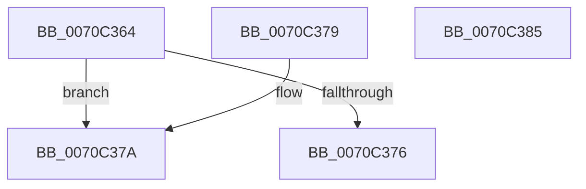

# HalpAuditQueryResults

- RVA: `0x0070C364`–`0x0070C386` (길이 `34` bytes)
- VA: `0x000000014070C364`
- 실행 섹션: `PAGE`
- PDB 이름 있음: `예`; PDB Function 태그: `아니요`
- unwind 정보 RVA: `0x000DB714`
- 디코드: `12`개 명령, `34/34` bytes 표시
- 미해석 바이트: `0` (있으면 어셈블리에 `.byte`로 보존)

> 이 문서는 커널 이미지의 기계어와 PDB 기호를 분석해 생성했습니다. 4번과 5번은 함수 원형과 자료형을 바이너리 사용 방식에서 추정한 C 해석이며 원본 소스 복구 결과는 아닙니다.

## 1. Dependencies

- 직접 호출 지점: **0**; 고유 호출 대상: **0**
- 직접 호출자로 확인된 함수: **1**
- RIP 상대 이미지 참조: **2**

### Outgoing calls
- 직접 디코드된 call 명령이 없습니다.

### Direct callers
- [sub_00B80AC2](../../pagelk/B8/Unknown_function_00B80AC2.md) at `0x00B80BE2`

### Static image references
- `0x0070C364` → RVA `0x00E0A83C` (`.data`; read)
- `0x0070C37A` → RVA `0x00F8FB78` (`.data`; read)

## 2. Other-region calls and transfers

- 다른 실행 섹션으로 향하는 call: **0**
- 별도 외부 분기/꼬리 이동을 확인하지 못했습니다.

## 3. Assembly (complete function range)

```asm
0070C364  8B 05 D2 E4 6F 00               mov eax, dword ptr [rip + 0x6fe4d2]
0070C36A  48 8B D1                        mov rdx, rcx
0070C36D  B9 BB 00 00 C0                  mov ecx, 0xc00000bb
0070C372  3B C1                           cmp eax, ecx
0070C374  75 04                           jne 0x14070c37a
0070C376  8B C1                           mov eax, ecx
0070C378  C3                              ret
0070C379  CC                              int3
0070C37A  48 8B 0D F7 37 88 00            mov rcx, qword ptr [rip + 0x8837f7]
0070C381  48 89 0A                        mov qword ptr [rdx], rcx
0070C384  C3                              ret
0070C385  CC                              int3
```

## 4. C-style interpretation (structured pseudocode)

```c
__int64 __fastcall HalpAuditQueryResults(__int64 a1)
{
    if (((unsigned int)((unsigned int)(*(unsigned int *)(v_rip + 7333074)))) != ((unsigned int)((unsigned int)(0xC00000BBULL)))) goto loc_0070C37A;
    return (unsigned int)((unsigned int)((unsigned int)(0xC00000BBULL)));
loc_0070C37A:
    *(unsigned __int64 *)(a1) = *(unsigned __int64 *)(v_rip + 8927223);
    return (unsigned int)((unsigned int)((unsigned int)(0xC00000BBULL)));
}
```

## 5. (Beta) C Style

```c
int64_t HalpAuditQueryResults(void *Arg1)
{
    uint8_t *arg1 = (uint8_t *)Arg1;

    if (((uint32_t)((uint32_t)(*(uint32_t *)(v_rip + 0x6FE4D2)))) != ((uint32_t)((uint32_t)(0xC00000BBULL)))) goto loc_0070C37A;
    return (uint32_t)((uint32_t)((uint32_t)(0xC00000BBULL)));
loc_0070C37A:
    *(uint64_t *)(arg1) = *(uint64_t *)(v_rip + 0x8837F7);
    return (uint32_t)((uint32_t)((uint32_t)(0xC00000BBULL)));
}
```

### 관측된 메모리 오프셋

구조체 형식이 확인되지 않은 접근은 인자 기준의 오프셋으로만 기록했습니다.

| 기준 인자 | 오프셋 표현 | 폭 (bit) | 접근 |
|---|---:|---:|---|
| `Arg1` | `+ 0x0` | `64` | `W` |

## 6. Execution-region graph

[열기: 2D/3D 그래프와 함수 탐색 컨트롤 패널](../../../control-panel.html?section=page&rva=0x0070C364&view=graph)

- 2D 그래프는 위에서 아래로 흐르고, 3D 그래프는 빈 공간을 드래그해 회전합니다. Shift+드래그는 이동, 휠은 확대·축소, 함수 노드 선택은 대상 보고서 이동입니다.

### Static fallback


