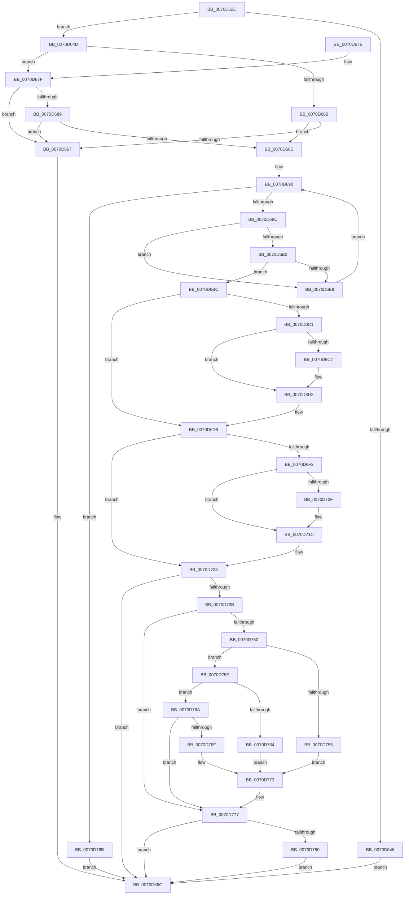

# HalpChannelPowerRequest

- RVA: `0x0070D62C`–`0x0070D795` (길이 `361` bytes)
- VA: `0x000000014070D62C`
- 실행 섹션: `PAGE`
- PDB 이름 있음: `예`; PDB Function 태그: `아니요`
- unwind 정보 RVA: `0x000C4F94`
- 디코드: `102`개 명령, `361/361` bytes 표시
- 미해석 바이트: `0` (있으면 어셈블리에 `.byte`로 보존)

> 이 문서는 커널 이미지의 기계어와 PDB 기호를 분석해 생성했습니다. 4번과 5번은 함수 원형과 자료형을 바이너리 사용 방식에서 추정한 C 해석이며 원본 소스 복구 결과는 아닙니다.

## 1. Dependencies

- 직접 호출 지점: **2**; 고유 호출 대상: **2**
- 직접 호출자로 확인된 함수: **2**
- RIP 상대 이미지 참조: **5**

### Outgoing calls
- `0x0070D6E8` → [HalpStartPccCommand](HalpStartPccCommand_function_0070D8D4.md) (function, `0x0070D8D4`)
- `0x0070D72C` → [guard_dispatch_icall](../../text/6B/guard_dispatch_icall_function_006BAAD0.md) (function, `0x006BAAD0`)

### Direct callers
- [HaliSetSystemInformation](HaliSetSystemInformation_function_0070BF54.md) at `0x0070C012`
- [sub_00B80AC2](../../pagelk/B8/Unknown_function_00B80AC2.md) at `0x00B80C9A`

### Static image references
- `0x0070D690` → RVA `0x00F8F9E0` (`.data`; read)
- `0x0070D69C` → RVA `0x00F8F9D8` (`.data`; read)
- `0x0070D6F3` → RVA `0x00F8FA80` (`.data`; read)
- `0x0070D71C` → RVA `0x00F8FA38` (`.data`; read)
- `0x0070D725` → RVA `0x00F8FA68` (`.data`; read)

## 2. Other-region calls and transfers

- 다른 실행 섹션으로 향하는 call: **1**
  - `0x0070D72C` → [guard_dispatch_icall](../../text/6B/guard_dispatch_icall_function_006BAAD0.md) (`PAGE` → `.text`)
- 별도 외부 분기/꼬리 이동을 확인하지 못했습니다.

## 3. Assembly (complete function range)

```asm
0070D62C  48 89 5C 24 08                  mov qword ptr [rsp + 8], rbx
0070D631  48 89 74 24 10                  mov qword ptr [rsp + 0x10], rsi
0070D636  57                              push rdi
0070D637  48 83 EC 20                     sub rsp, 0x20
0070D63B  49 8B F0                        mov rsi, r8
0070D63E  48 8B D9                        mov rbx, rcx
0070D641  83 FA 18                        cmp edx, 0x18
0070D644  74 07                           je 0x14070d64d
0070D646  B9 04 00 00 C0                  mov ecx, 0xc0000004
0070D64B  EB 1F                           jmp 0x14070d66c
0070D64D  8B 51 04                        mov edx, dword ptr [rcx + 4]
0070D650  44 0F B7 19                     movzx r11d, word ptr [rcx]
0070D654  44 0F B7 51 02                  movzx r10d, word ptr [rcx + 2]
0070D659  44 8B 41 10                     mov r8d, dword ptr [rcx + 0x10]
0070D65D  83 FA 02                        cmp edx, 2
0070D660  75 1D                           jne 0x14070d67f
0070D662  44 3B C2                        cmp r8d, edx
0070D665  72 27                           jb 0x14070d68e
0070D667  B9 10 00 00 C0                  mov ecx, 0xc0000010
0070D66C  48 8B 5C 24 30                  mov rbx, qword ptr [rsp + 0x30]
0070D671  8B C1                           mov eax, ecx
0070D673  48 8B 74 24 38                  mov rsi, qword ptr [rsp + 0x38]
0070D678  48 83 C4 20                     add rsp, 0x20
0070D67C  5F                              pop rdi
0070D67D  C3                              ret
0070D67E  CC                              int3
0070D67F  8D 42 FF                        lea eax, [rdx - 1]
0070D682  A9 FC FF FF FF                  test eax, 0xfffffffc
0070D687  75 DE                           jne 0x14070d667
0070D689  83 FA 02                        cmp edx, 2
0070D68C  74 D9                           je 0x14070d667
0070D68E  33 C9                           xor ecx, ecx
0070D690  3B 0D 4A 23 88 00               cmp ecx, dword ptr [rip + 0x88234a]
0070D696  0F 83 EF 00 00 00               jae 0x14070d78b
0070D69C  4C 8B 0D 35 23 88 00            mov r9, qword ptr [rip + 0x882335]
0070D6A3  8B C1                           mov eax, ecx
0070D6A5  48 03 C0                        add rax, rax
0070D6A8  66 45 39 5C C1 0A               cmp word ptr [r9 + rax*8 + 0xa], r11w
0070D6AE  75 08                           jne 0x14070d6b8
0070D6B0  66 45 39 54 C1 0C               cmp word ptr [r9 + rax*8 + 0xc], r10w
0070D6B6  74 04                           je 0x14070d6bc
0070D6B8  FF C1                           inc ecx
0070D6BA  EB D4                           jmp 0x14070d690
0070D6BC  83 FA 02                        cmp edx, 2
0070D6BF  75 18                           jne 0x14070d6d9
0070D6C1  41 83 F8 01                     cmp r8d, 1
0070D6C5  75 0B                           jne 0x14070d6d2
0070D6C7  8B C1                           mov eax, ecx
0070D6C9  48 03 C0                        add rax, rax
0070D6CC  45 0F B6 44 C1 0F               movzx r8d, byte ptr [r9 + rax*8 + 0xf]
0070D6D2  41 8B C0                        mov eax, r8d
0070D6D5  48 89 43 10                     mov qword ptr [rbx + 0x10], rax
0070D6D9  48 8B 05 F8 22 88 00            mov rax, qword ptr [rip + 0x8822f8]
0070D6E0  48 03 C9                        add rcx, rcx
0070D6E3  0F B7 7C C8 08                  movzx edi, word ptr [rax + rcx*8 + 8]
0070D6E8  E8 E7 01 00 00                  call 0x14070d8d4
0070D6ED  8B C8                           mov ecx, eax
0070D6EF  85 C0                           test eax, eax
0070D6F1  78 40                           js 0x14070d733
0070D6F3  48 8B 05 86 23 88 00            mov rax, qword ptr [rip + 0x882386]
0070D6FA  89 78 0C                        mov dword ptr [rax + 0xc], edi
0070D6FD  48 8B 05 7C 23 88 00            mov rax, qword ptr [rip + 0x88237c]
0070D704  8B 4B 04                        mov ecx, dword ptr [rbx + 4]
0070D707  89 08                           mov dword ptr [rax], ecx
0070D709  83 7B 04 02                     cmp dword ptr [rbx + 4], 2
0070D70D  75 0D                           jne 0x14070d71c
0070D70F  48 8B 05 6A 23 88 00            mov rax, qword ptr [rip + 0x88236a]
0070D716  8B 4B 10                        mov ecx, dword ptr [rbx + 0x10]
0070D719  89 48 08                        mov dword ptr [rax + 8], ecx
0070D71C  48 8B 0D 15 23 88 00            mov rcx, qword ptr [rip + 0x882315]
0070D723  B2 03                           mov dl, 3
0070D725  48 8B 05 3C 23 88 00            mov rax, qword ptr [rip + 0x88233c]
0070D72C  E8 9F D3 FA FF                  call 0x1406baad0
0070D731  8B C8                           mov ecx, eax
0070D733  85 C9                           test ecx, ecx
0070D735  0F 88 31 FF FF FF               js 0x14070d66c
0070D73B  48 8B 15 3E 23 88 00            mov rdx, qword ptr [rip + 0x88233e]
0070D742  8B 42 04                        mov eax, dword ptr [rdx + 4]
0070D745  89 43 08                        mov dword ptr [rbx + 8], eax
0070D748  8B 43 04                        mov eax, dword ptr [rbx + 4]
0070D74B  83 F8 02                        cmp eax, 2
0070D74E  74 27                           je 0x14070d777
0070D750  83 F8 01                        cmp eax, 1
0070D753  75 0A                           jne 0x14070d75f
0070D755  33 C0                           xor eax, eax
0070D757  39 42 08                        cmp dword ptr [rdx + 8], eax
0070D75A  0F 95 C0                        setne al
0070D75D  EB 14                           jmp 0x14070d773
0070D75F  83 F8 03                        cmp eax, 3
0070D762  75 06                           jne 0x14070d76a
0070D764  48 8B 42 18                     mov rax, qword ptr [rdx + 0x18]
0070D768  EB 09                           jmp 0x14070d773
0070D76A  83 F8 04                        cmp eax, 4
0070D76D  75 08                           jne 0x14070d777
0070D76F  48 8B 42 10                     mov rax, qword ptr [rdx + 0x10]
0070D773  48 89 43 10                     mov qword ptr [rbx + 0x10], rax
0070D777  48 85 F6                        test rsi, rsi
0070D77A  0F 84 EC FE FF FF               je 0x14070d66c
0070D780  C7 06 18 00 00 00               mov dword ptr [rsi], 0x18
0070D786  E9 E1 FE FF FF                  jmp 0x14070d66c
0070D78B  B9 25 02 00 C0                  mov ecx, 0xc0000225
0070D790  E9 D7 FE FF FF                  jmp 0x14070d66c
```

## 4. C-style interpretation (structured pseudocode)

```c
__int64 __fastcall HalpChannelPowerRequest(__int64 a1, int a2, __int64 a3)
{
    __int64 result;
    __int64 v_rsp;
    unsigned __int64 v_stack_p10;
    unsigned __int64 v_stack_p8;

    v_stack_p8 = v_rbx;
    v_stack_p10 = v_rsi;
    v_rsp = (v_rsp) - (32);
    if (a2 == 24) goto loc_0070D64D;
    goto loc_0070D66C;
loc_0070D64D:
    if (((unsigned int)((unsigned int)(*(unsigned int *)((unsigned int)(0xC0000004ULL) + 4)))) != 2) goto loc_0070D67F;
    if (((unsigned int)((unsigned int)(*(unsigned int *)((unsigned int)(0xC0000004ULL) + 16)))) < ((unsigned int)((unsigned int)(*(unsigned int *)((unsigned int)(0xC0000004ULL) + 4))))) goto loc_0070D68E;
loc_0070D667:
loc_0070D66C:
    v_rsp = (v_rsp) + (32);
    return (unsigned int)((unsigned int)((unsigned int)(0xC0000010ULL)));
loc_0070D67F:
    if ((((unsigned int)((unsigned int)(*(unsigned int *)((unsigned int)(0xC0000004ULL) + 4)) - 1)) & (0xFFFFFFFCULL)) != 0) goto loc_0070D667;
    if (((unsigned int)((unsigned int)(*(unsigned int *)((unsigned int)(0xC0000004ULL) + 4)))) == 2) goto loc_0070D667;
loc_0070D68E:
    a1 = 0;
loc_0070D690:
    if (0 >= (*(unsigned int *)(v_rip + 8921930))) goto loc_0070D78B;
    result = (0) + (0);
    if ((*(unsigned __int16 *)(*(unsigned __int64 *)(v_rip + 8921909) + result * 8 + 10)) != ((unsigned __int16)(*(unsigned __int16 *)((unsigned int)(0xC0000004ULL))))) goto loc_0070D6B8;
    if ((*(unsigned __int16 *)(*(unsigned __int64 *)(v_rip + 8921909) + result * 8 + 12)) == ((unsigned __int16)(*(unsigned __int16 *)((unsigned int)(0xC0000004ULL) + 2)))) goto loc_0070D6BC;
loc_0070D6B8:
    a1 = (unsigned int)((a1) + 1);
    goto loc_0070D690;
loc_0070D6BC:
    if (((unsigned int)((unsigned int)(*(unsigned int *)((unsigned int)(0xC0000004ULL) + 4)))) != 2) goto loc_0070D6D9;
    if (((unsigned int)((unsigned int)(*(unsigned int *)((unsigned int)(0xC0000004ULL) + 16)))) == 1) {
        result = (unsigned int)(a1);
        result = (result) + (result);
        a3 = *(unsigned __int8 *)(*(unsigned __int64 *)(v_rip + 8921909) + result * 8 + 15);
    }
    *(unsigned __int64 *)(v_stack_p8 + 16) = (unsigned int)((unsigned int)(a3));
loc_0070D6D9:
    a1 = (a1) + (a1);
    result = HalpStartPccCommand(a1, (unsigned int)(*(unsigned int *)((unsigned int)(0xC0000004ULL) + 4)), a3, *(unsigned __int64 *)(v_rip + 8921909));
    if (sign_flag) goto loc_0070D733;
    *(unsigned int *)(*(unsigned __int64 *)(v_rip + 8921990) + 12) = (unsigned int)(*(unsigned __int16 *)(*(unsigned __int64 *)(v_rip + 8921848) + a1 * 8 + 8));
    *(unsigned int *)(*(unsigned __int64 *)(v_rip + 8921980)) = (unsigned int)((unsigned int)(*(unsigned int *)(v_stack_p8 + 4)));
    result = *(unsigned __int64 *)(v_rip + 8921980);
    if ((*(unsigned int *)(v_stack_p8 + 4)) == 2) {
        result = *(unsigned __int64 *)(v_rip + 8921962);
        a1 = *(unsigned int *)(v_stack_p8 + 16);
        *(unsigned int *)(result + 8) = (unsigned int)(a1);
    }
    result = guard_dispatch_icall(*(unsigned __int64 *)(v_rip + 8921877), 3, a3, *(unsigned __int64 *)(v_rip + 8921909));
loc_0070D733:
    if (sign_flag) goto loc_0070D66C;
    *(unsigned int *)(v_stack_p8 + 8) = (unsigned int)((unsigned int)(*(unsigned int *)(*(unsigned __int64 *)(v_rip + 8921918) + 4)));
    if (((unsigned int)((unsigned int)(*(unsigned int *)(v_stack_p8 + 4)))) == 2) goto loc_0070D777;
    if (((unsigned int)((unsigned int)(*(unsigned int *)(v_stack_p8 + 4)))) != 1) goto loc_0070D75F;
    result = 0;
    result = ((*(unsigned int *)(*(unsigned __int64 *)(v_rip + 8921918) + 8)) != 0) ? 1 : 0;
    goto loc_0070D773;
loc_0070D75F:
    if (((unsigned int)(result)) != 3) goto loc_0070D76A;
    goto loc_0070D773;
loc_0070D76A:
    if (((unsigned int)(*(unsigned __int64 *)(*(unsigned __int64 *)(v_rip + 8921918) + 24))) != 4) goto loc_0070D777;
loc_0070D773:
    *(unsigned __int64 *)(v_stack_p8 + 16) = *(unsigned __int64 *)(*(unsigned __int64 *)(v_rip + 8921918) + 16);
loc_0070D777:
    if (v_stack_p10 == 0) goto loc_0070D66C;
    *(unsigned int *)(v_stack_p10) = 24;
    goto loc_0070D66C;
loc_0070D78B:
    goto loc_0070D66C;
}
```

## 5. (Beta) C Style

```c
int64_t HalpChannelPowerRequest(void *Arg1, int32_t Arg2, int64_t Arg3)
{
    uint8_t *arg1 = (uint8_t *)Arg1;

    int64_t result;
    int64_t local_rsp;
    uint64_t v_stack_p10;
    uint64_t v_stack_p8;

    v_stack_p8 = local_rbx;
    v_stack_p10 = local_rsi;
    local_rsp = (local_rsp) - (32);
    if (Arg2 == 24) goto loc_0070D64D;
    goto loc_0070D66C;
loc_0070D64D:
    if (((uint32_t)((uint32_t)(*(uint32_t *)((uint32_t)(0xC0000004ULL) + 0x4)))) != 2) goto loc_0070D67F;
    if (((uint32_t)((uint32_t)(*(uint32_t *)((uint32_t)(0xC0000004ULL) + 0x10)))) < ((uint32_t)((uint32_t)(*(uint32_t *)((uint32_t)(0xC0000004ULL) + 0x4))))) goto loc_0070D68E;
loc_0070D667:
loc_0070D66C:
    local_rsp = (local_rsp) + (32);
    return (uint32_t)((uint32_t)((uint32_t)(0xC0000010ULL)));
loc_0070D67F:
    if ((((uint32_t)((uint32_t)(*(uint32_t *)((uint32_t)(0xC0000004ULL) + 0x4)) - 1)) & (0xFFFFFFFCULL)) != 0) goto loc_0070D667;
    if (((uint32_t)((uint32_t)(*(uint32_t *)((uint32_t)(0xC0000004ULL) + 0x4)))) == 2) goto loc_0070D667;
loc_0070D68E:
    Arg1 = 0;
loc_0070D690:
    if (0 >= (*(uint32_t *)(v_rip + 0x88234A))) goto loc_0070D78B;
    result = (0) + (0);
    if ((*(uint16_t *)(*(uint64_t *)(v_rip + 0x882335) + result * 8 + 0xA)) != ((uint16_t)(*(uint16_t *)((uint32_t)(0xC0000004ULL))))) goto loc_0070D6B8;
    if ((*(uint16_t *)(*(uint64_t *)(v_rip + 0x882335) + result * 8 + 0xC)) == ((uint16_t)(*(uint16_t *)((uint32_t)(0xC0000004ULL) + 0x2)))) goto loc_0070D6BC;
loc_0070D6B8:
    Arg1 = (uint32_t)((Arg1) + 1);
    goto loc_0070D690;
loc_0070D6BC:
    if (((uint32_t)((uint32_t)(*(uint32_t *)((uint32_t)(0xC0000004ULL) + 0x4)))) != 2) goto loc_0070D6D9;
    if (((uint32_t)((uint32_t)(*(uint32_t *)((uint32_t)(0xC0000004ULL) + 0x10)))) == 1) {
        result = (uint32_t)(Arg1);
        result = (result) + (result);
        Arg3 = *(uint8_t *)(*(uint64_t *)(v_rip + 0x882335) + result * 8 + 0xF);
    }
    *(uint64_t *)(v_stack_p8 + 0x10) = (uint32_t)((uint32_t)(Arg3));
loc_0070D6D9:
    Arg1 = (Arg1) + (Arg1);
    result = HalpStartPccCommand(Arg1, (uint32_t)(*(uint32_t *)((uint32_t)(0xC0000004ULL) + 0x4)), Arg3, *(uint64_t *)(v_rip + 0x882335));
    if (sign_flag) goto loc_0070D733;
    *(uint32_t *)(*(uint64_t *)(v_rip + 0x882386) + 0xC) = (uint32_t)(*(uint16_t *)(*(uint64_t *)(v_rip + 0x8822F8) + arg1 * 8 + 0x8));
    *(uint32_t *)(*(uint64_t *)(v_rip + 0x88237C)) = (uint32_t)((uint32_t)(*(uint32_t *)(v_stack_p8 + 0x4)));
    result = *(uint64_t *)(v_rip + 0x88237C);
    if ((*(uint32_t *)(v_stack_p8 + 0x4)) == 2) {
        result = *(uint64_t *)(v_rip + 0x88236A);
        Arg1 = *(uint32_t *)(v_stack_p8 + 0x10);
        *(uint32_t *)(result + 0x8) = (uint32_t)(Arg1);
    }
    result = guard_dispatch_icall(*(uint64_t *)(v_rip + 0x882315), 3, Arg3, *(uint64_t *)(v_rip + 0x882335));
loc_0070D733:
    if (sign_flag) goto loc_0070D66C;
    *(uint32_t *)(v_stack_p8 + 0x8) = (uint32_t)((uint32_t)(*(uint32_t *)(*(uint64_t *)(v_rip + 0x88233E) + 0x4)));
    if (((uint32_t)((uint32_t)(*(uint32_t *)(v_stack_p8 + 0x4)))) == 2) goto loc_0070D777;
    if (((uint32_t)((uint32_t)(*(uint32_t *)(v_stack_p8 + 0x4)))) != 1) goto loc_0070D75F;
    result = 0;
    result = ((*(uint32_t *)(*(uint64_t *)(v_rip + 0x88233E) + 0x8)) != 0) ? 1 : 0;
    goto loc_0070D773;
loc_0070D75F:
    if (((uint32_t)(result)) != 3) goto loc_0070D76A;
    goto loc_0070D773;
loc_0070D76A:
    if (((uint32_t)(*(uint64_t *)(*(uint64_t *)(v_rip + 0x88233E) + 0x18))) != 4) goto loc_0070D777;
loc_0070D773:
    *(uint64_t *)(v_stack_p8 + 0x10) = *(uint64_t *)(*(uint64_t *)(v_rip + 0x88233E) + 0x10);
loc_0070D777:
    if (v_stack_p10 == 0) goto loc_0070D66C;
    *(uint32_t *)(v_stack_p10) = 24;
    goto loc_0070D66C;
loc_0070D78B:
    goto loc_0070D66C;
}
```

### 관측된 메모리 오프셋

구조체 형식이 확인되지 않은 접근은 인자 기준의 오프셋으로만 기록했습니다.

| 기준 인자 | 오프셋 표현 | 폭 (bit) | 접근 |
|---|---:|---:|---|
| `Arg1` | `+ 0x0` | `16` | `R` |
| `Arg1` | `+ 0x2` | `16` | `R` |
| `Arg1` | `+ 0x4` | `32` | `R` |
| `Arg1` | `+ 0x8` | `32` | `W` |
| `Arg1` | `+ 0x10` | `32` | `R` |
| `Arg1` | `+ 0x10` | `64` | `W` |

## 6. Execution-region graph

[열기: 2D/3D 그래프와 함수 탐색 컨트롤 패널](../../../control-panel.html?section=page&rva=0x0070D62C&view=graph)

- 2D 그래프는 위에서 아래로 흐르고, 3D 그래프는 빈 공간을 드래그해 회전합니다. Shift+드래그는 이동, 휠은 확대·축소, 함수 노드 선택은 대상 보고서 이동입니다.

### Static fallback


