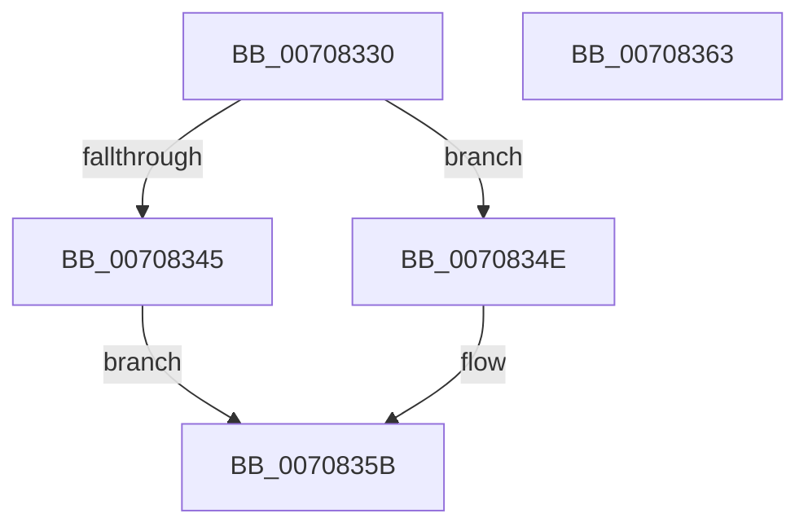

# HalpDispatchWmi

- RVA: `0x00708330`–`0x00708364` (길이 `52` bytes)
- VA: `0x0000000140708330`
- 실행 섹션: `PAGE`
- PDB 이름 있음: `예`; PDB Function 태그: `아니요`
- unwind 정보 RVA: `0x0005CF00`
- 디코드: `18`개 명령, `52/52` bytes 표시
- 미해석 바이트: `0` (있으면 어셈블리에 `.byte`로 보존)

> 이 문서는 커널 이미지의 기계어와 PDB 기호를 분석해 생성했습니다. 4번과 5번은 함수 원형과 자료형을 바이너리 사용 방식에서 추정한 C 해석이며 원본 소스 복구 결과는 아닙니다.

## 1. Dependencies

- 직접 호출 지점: **2**; 고유 호출 대상: **2**
- 직접 호출자로 확인된 함수: **0**
- RIP 상대 이미지 참조: **0**

### Outgoing calls
- `0x00708345` → [HalpPassIrpFromFdoToPdo](../../text/4E/HalpPassIrpFromFdoToPdo_function_004E15F4.md) (function, `0x004E15F4`)
- `0x00708356` → [IofCompleteRequest](../../text/29/IofCompleteRequest_function_0029B5C0.md) (function, `0x0029B5C0`)

### Direct callers
- 이 함수 시작 RVA로 연결되는 직접 call은 확인되지 않았습니다. 간접 호출은 완전히 역산할 수 없습니다.

### Static image references
- 디코드된 RIP-relative 메모리 참조가 없습니다.

## 2. Other-region calls and transfers

- 다른 실행 섹션으로 향하는 call: **2**
  - `0x00708345` → [HalpPassIrpFromFdoToPdo](../../text/4E/HalpPassIrpFromFdoToPdo_function_004E15F4.md) (`PAGE` → `.text`)
  - `0x00708356` → [IofCompleteRequest](../../text/29/IofCompleteRequest_function_0029B5C0.md) (`PAGE` → `.text`)
- 별도 외부 분기/꼬리 이동을 확인하지 못했습니다.

## 3. Assembly (complete function range)

```asm
00708330  40 53                           push rbx
00708332  48 83 EC 20                     sub rsp, 0x20
00708336  48 8B 41 40                     mov rax, qword ptr [rcx + 0x40]
0070833A  4C 8B C2                        mov r8, rdx
0070833D  81 38 C1 00 00 00               cmp dword ptr [rax], 0xc1
00708343  75 09                           jne 0x14070834e
00708345  E8 AA 92 DD FF                  call 0x1404e15f4
0070834A  8B D8                           mov ebx, eax
0070834C  EB 0D                           jmp 0x14070835b
0070834E  8B 5A 30                        mov ebx, dword ptr [rdx + 0x30]
00708351  49 8B C8                        mov rcx, r8
00708354  33 D2                           xor edx, edx
00708356  E8 65 32 B9 FF                  call 0x14029b5c0
0070835B  8B C3                           mov eax, ebx
0070835D  48 83 C4 20                     add rsp, 0x20
00708361  5B                              pop rbx
00708362  C3                              ret
00708363  CC                              int3
```

## 4. C-style interpretation (structured pseudocode)

```c
__int64 __fastcall HalpDispatchWmi(__int64 a1, __int64 a2)
{
    __int64 result;
    __int64 v_rsp;

    v_rsp = (v_rsp) - (32);
    if ((*(unsigned int *)(*(unsigned __int64 *)(a1 + 64))) != 193) goto loc_0070834E;
    result = HalpPassIrpFromFdoToPdo(a1, a2, a2, a4);
    goto loc_0070835B;
loc_0070834E:
    a2 = 0;
    result = IofCompleteRequest(a2, a2, a2, a4);
loc_0070835B:
    v_rsp = (v_rsp) + (32);
    return (unsigned int)((unsigned int)((unsigned int)(*(unsigned int *)(a2 + 48))));
}
```

## 5. (Beta) C Style

```c
int64_t HalpDispatchWmi(void *Arg1, void *Arg2)
{
    uint8_t *arg1 = (uint8_t *)Arg1;
    uint8_t *arg2 = (uint8_t *)Arg2;

    int64_t result;
    int64_t local_rsp;

    local_rsp = (local_rsp) - (32);
    if ((*(uint32_t *)(*(uint64_t *)(arg1 + 0x40))) != 193) goto loc_0070834E;
    result = HalpPassIrpFromFdoToPdo(Arg1, Arg2, Arg2, a4);
    goto loc_0070835B;
loc_0070834E:
    Arg2 = 0;
    result = IofCompleteRequest(Arg2, Arg2, Arg2, a4);
loc_0070835B:
    local_rsp = (local_rsp) + (32);
    return (uint32_t)((uint32_t)((uint32_t)(*(uint32_t *)(arg2 + 0x30))));
}
```

### 관측된 메모리 오프셋

구조체 형식이 확인되지 않은 접근은 인자 기준의 오프셋으로만 기록했습니다.

| 기준 인자 | 오프셋 표현 | 폭 (bit) | 접근 |
|---|---:|---:|---|
| `Arg1` | `+ 0x40` | `64` | `R` |
| `Arg2` | `+ 0x30` | `32` | `R` |

## 6. Execution-region graph

[열기: 2D/3D 그래프와 함수 탐색 컨트롤 패널](../../../control-panel.html?section=page&rva=0x00708330&view=graph)

- 2D 그래프는 위에서 아래로 흐르고, 3D 그래프는 빈 공간을 드래그해 회전합니다. Shift+드래그는 이동, 휠은 확대·축소, 함수 노드 선택은 대상 보고서 이동입니다.

### Static fallback


