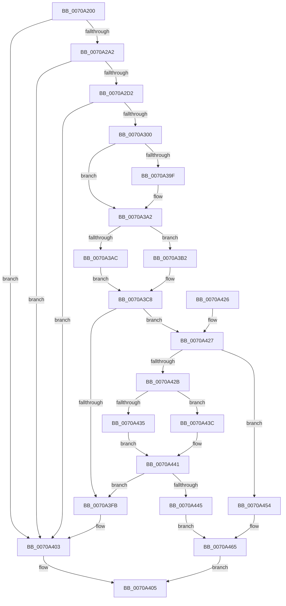

# HalpDmaAllocateChildAdapterV2

- RVA: `0x0070A200`–`0x0070A477` (길이 `631` bytes)
- VA: `0x000000014070A200`
- 실행 섹션: `PAGE`
- PDB 이름 있음: `예`; PDB Function 태그: `아니요`
- unwind 정보 RVA: `0x000C44B8`
- 디코드: `153`개 명령, `631/631` bytes 표시
- 미해석 바이트: `0` (있으면 어셈블리에 `.byte`로 보존)

> 이 문서는 커널 이미지의 기계어와 PDB 기호를 분석해 생성했습니다. 4번과 5번은 함수 원형과 자료형을 바이너리 사용 방식에서 추정한 C 해석이며 원본 소스 복구 결과는 아닙니다.

## 1. Dependencies

- 직접 호출 지점: **9**; 고유 호출 대상: **9**
- 직접 호출자로 확인된 함수: **1**
- RIP 상대 이미지 참조: **4**

### Outgoing calls
- `0x0070A295` → [ObCreateObjectEx](../89/ObCreateObjectEx_function_0089B1E0.md) (function, `0x0089B1E0`)
- `0x0070A2AE` → [memset](../../text/6C/memset_function_006C6C40.md) (function, `0x006C6C40`)
- `0x0070A2C5` → [ObReferenceObjectByPointer](../../text/43/ObReferenceObjectByPointer_function_00438D00.md) (function, `0x00438D00`)
- `0x0070A2F3` → [ObInsertObjectEx](../8B/ObInsertObjectEx_function_008B97A0.md) (function, `0x008B97A0`)
- `0x0070A304` → [ZwClose](../../text/6A/ZwClose_function_006AD2B0.md) (function, `0x006AD2B0`)
- `0x0070A354` → [KeInitializeDeviceQueue](../../text/4B/KeInitializeDeviceQueue_function_004B7F50.md) (function, `0x004B7F50`)
- `0x0070A3FE` → [ObfDereferenceObject](../../text/2F/ObfDereferenceObject_function_002F9350.md) (function, `0x002F9350`)
- `0x0070A435` → [HalpDmaAllocateLocalScatterPool](HalpDmaAllocateLocalScatterPool_function_007091D4.md) (function, `0x007091D4`)
- `0x0070A43C` → [HalpDmaAllocateLocalContiguousPool](HalpDmaAllocateLocalContiguousPool_function_00708EE4.md) (function, `0x00708EE4`)

### Direct callers
- [HalGetAdapterV2](HalGetAdapterV2_function_00709DD8.md) at `0x0070A0C0`

### Static image references
- `0x0070A229` → RVA `0x00FC6D38` (`ALMOSTRO`; read)
- `0x0070A309` → RVA `0x00007670` (`.rdata`; read)
- `0x0070A3CF` → RVA `0x00FC3B20` (`.data`; read)
- `0x0070A3D9` → RVA `0x00FC3A20` (`.data`; read)

## 2. Other-region calls and transfers

- 다른 실행 섹션으로 향하는 call: **5**
  - `0x0070A2AE` → [memset](../../text/6C/memset_function_006C6C40.md) (`PAGE` → `.text`)
  - `0x0070A2C5` → [ObReferenceObjectByPointer](../../text/43/ObReferenceObjectByPointer_function_00438D00.md) (`PAGE` → `.text`)
  - `0x0070A304` → [ZwClose](../../text/6A/ZwClose_function_006AD2B0.md) (`PAGE` → `.text`)
  - `0x0070A354` → [KeInitializeDeviceQueue](../../text/4B/KeInitializeDeviceQueue_function_004B7F50.md) (`PAGE` → `.text`)
  - `0x0070A3FE` → [ObfDereferenceObject](../../text/2F/ObfDereferenceObject_function_002F9350.md) (`PAGE` → `.text`)
- 별도 외부 분기/꼬리 이동을 확인하지 못했습니다.

## 3. Assembly (complete function range)

```asm
0070A200  4C 8B DC                        mov r11, rsp
0070A203  49 89 5B 08                     mov qword ptr [r11 + 8], rbx
0070A207  49 89 73 10                     mov qword ptr [r11 + 0x10], rsi
0070A20B  49 89 7B 18                     mov qword ptr [r11 + 0x18], rdi
0070A20F  55                              push rbp
0070A210  41 54                           push r12
0070A212  41 55                           push r13
0070A214  41 56                           push r14
0070A216  41 57                           push r15
0070A218  49 8D 6B C1                     lea rbp, [r11 - 0x3f]
0070A21C  48 81 EC 90 00 00 00            sub rsp, 0x90
0070A223  45 33 E4                        xor r12d, r12d
0070A226  0F B6 C2                        movzx eax, dl
0070A229  48 8B 15 08 CB 8B 00            mov rdx, qword ptr [rip + 0x8bcb08]
0070A230  45 84 C0                        test r8b, r8b
0070A233  4D 89 63 90                     mov qword ptr [r11 - 0x70], r12
0070A237  45 8A F1                        mov r14b, r9b
0070A23A  45 8A F8                        mov r15b, r8b
0070A23D  4C 89 65 D7                     mov qword ptr [rbp - 0x29], r12
0070A241  8B F9                           mov edi, ecx
0070A243  4C 89 65 DF                     mov qword ptr [rbp - 0x21], r12
0070A247  0F 57 C0                        xorps xmm0, xmm0
0070A24A  48 C7 45 E7 30 00 00 00         mov qword ptr [rbp - 0x19], 0x30
0070A252  45 8D 6C 24 01                  lea r13d, [r12 + 1]
0070A257  48 C7 45 FF 10 02 00 00         mov qword ptr [rbp - 1], 0x210
0070A25F  41 8B F5                        mov esi, r13d
0070A262  4C 89 65 EF                     mov qword ptr [rbp - 0x11], r12
0070A266  0F 44 F0                        cmove esi, eax
0070A269  4C 89 65 F7                     mov qword ptr [rbp - 9], r12
0070A26D  48 8D 45 D7                     lea rax, [rbp - 0x29]
0070A271  BB 88 02 00 00                  mov ebx, 0x288
0070A276  49 89 43 88                     mov qword ptr [r11 - 0x78], rax
0070A27A  4C 8D 45 E7                     lea r8, [rbp - 0x19]
0070A27E  45 89 63 80                     mov dword ptr [r11 - 0x80], r12d
0070A282  45 33 C9                        xor r9d, r9d
0070A285  44 89 64 24 30                  mov dword ptr [rsp + 0x30], r12d
0070A28A  33 C9                           xor ecx, ecx
0070A28C  89 5C 24 28                     mov dword ptr [rsp + 0x28], ebx
0070A290  F3 0F 7F 45 07                  movdqu xmmword ptr [rbp + 7], xmm0
0070A295  E8 46 0F 19 00                  call 0x14089b1e0
0070A29A  85 C0                           test eax, eax
0070A29C  0F 88 61 01 00 00               js 0x14070a403
0070A2A2  44 8B C3                        mov r8d, ebx
0070A2A5  33 D2                           xor edx, edx
0070A2A7  48 8B 5D D7                     mov rbx, qword ptr [rbp - 0x29]
0070A2AB  48 8B CB                        mov rcx, rbx
0070A2AE  E8 8D C9 FB FF                  call 0x1406c6c40
0070A2B3  4C 8B 05 7E CA 8B 00            mov r8, qword ptr [rip + 0x8bca7e]
0070A2BA  45 33 C9                        xor r9d, r9d
0070A2BD  BA 00 00 02 00                  mov edx, 0x20000
0070A2C2  48 8B CB                        mov rcx, rbx
0070A2C5  E8 36 EA D2 FF                  call 0x140438d00
0070A2CA  85 C0                           test eax, eax
0070A2CC  0F 88 31 01 00 00               js 0x14070a403
0070A2D2  48 8D 45 DF                     lea rax, [rbp - 0x21]
0070A2D6  45 33 C9                        xor r9d, r9d
0070A2D9  48 89 44 24 30                  mov qword ptr [rsp + 0x30], rax
0070A2DE  33 D2                           xor edx, edx
0070A2E0  4C 89 64 24 28                  mov qword ptr [rsp + 0x28], r12
0070A2E5  41 B8 00 00 02 00               mov r8d, 0x20000
0070A2EB  48 8B CB                        mov rcx, rbx
0070A2EE  44 89 64 24 20                  mov dword ptr [rsp + 0x20], r12d
0070A2F3  E8 A8 F4 1A 00                  call 0x1408b97a0
0070A2F8  85 C0                           test eax, eax
0070A2FA  0F 88 03 01 00 00               js 0x14070a403
0070A300  48 8B 4D DF                     mov rcx, qword ptr [rbp - 0x21]
0070A304  E8 A7 2F FA FF                  call 0x1406ad2b0
0070A309  48 8D 05 60 D3 8F FF            lea rax, [rip - 0x702ca0]
0070A310  C7 03 01 00 88 02               mov dword ptr [rbx], 0x2880001
0070A316  48 89 43 08                     mov qword ptr [rbx + 8], rax
0070A31A  48 8D 8B B8 00 00 00            lea rcx, [rbx + 0xb8]
0070A321  8A 45 6F                        mov al, byte ptr [rbp + 0x6f]
0070A324  88 83 99 00 00 00               mov byte ptr [rbx + 0x99], al
0070A32A  4C 89 A3 80 00 00 00            mov qword ptr [rbx + 0x80], r12
0070A331  4C 89 A3 88 00 00 00            mov qword ptr [rbx + 0x88], r12
0070A338  C7 43 10 48 44 6D 61            mov dword ptr [rbx + 0x10], 0x616d4448
0070A33F  44 88 A3 98 00 00 00            mov byte ptr [rbx + 0x98], r12b
0070A346  4C 89 A3 40 01 00 00            mov qword ptr [rbx + 0x140], r12
0070A34D  44 88 A3 5A 01 00 00            mov byte ptr [rbx + 0x15a], r12b
0070A354  E8 F7 DB DA FF                  call 0x1404b7f50
0070A359  8A 45 77                        mov al, byte ptr [rbp + 0x77]
0070A35C  41 8A CD                        mov cl, r13b
0070A35F  89 BB E8 00 00 00               mov dword ptr [rbx + 0xe8], edi
0070A365  44 88 B3 BA 01 00 00            mov byte ptr [rbx + 0x1ba], r14b
0070A36C  40 88 B3 C0 01 00 00            mov byte ptr [rbx + 0x1c0], sil
0070A373  44 88 BB C1 01 00 00            mov byte ptr [rbx + 0x1c1], r15b
0070A37A  88 83 BD 01 00 00               mov byte ptr [rbx + 0x1bd], al
0070A380  83 C8 FF                        or eax, 0xffffffff
0070A383  89 83 7C 01 00 00               mov dword ptr [rbx + 0x17c], eax
0070A389  89 83 80 01 00 00               mov dword ptr [rbx + 0x180], eax
0070A38F  C7 83 9C 00 00 00 02 00 00 00   mov dword ptr [rbx + 0x9c], 2
0070A399  44 38 65 67                     cmp byte ptr [rbp + 0x67], r12b
0070A39D  75 03                           jne 0x14070a3a2
0070A39F  41 8A CC                        mov cl, r12b
0070A3A2  88 8B B9 01 00 00               mov byte ptr [rbx + 0x1b9], cl
0070A3A8  85 FF                           test edi, edi
0070A3AA  75 06                           jne 0x14070a3b2
0070A3AC  48 83 C8 FF                     or rax, 0xffffffffffffffff
0070A3B0  EB 16                           jmp 0x14070a3c8
0070A3B2  40 8A C6                        mov al, sil
0070A3B5  F6 D8                           neg al
0070A3B7  49 8B C5                        mov rax, r13
0070A3BA  1B C9                           sbb ecx, ecx
0070A3BC  83 E1 08                        and ecx, 8
0070A3BF  83 C1 18                        add ecx, 0x18
0070A3C2  48 D3 E0                        shl rax, cl
0070A3C5  49 2B C5                        sub rax, r13
0070A3C8  48 89 83 90 00 00 00            mov qword ptr [rbx + 0x90], rax
0070A3CF  48 8D 0D 4A 97 8B 00            lea rcx, [rip + 0x8b974a]
0070A3D6  40 84 F6                        test sil, sil
0070A3D9  48 8D 05 40 96 8B 00            lea rax, [rip + 0x8b9640]
0070A3E0  48 0F 45 C1                     cmovne rax, rcx
0070A3E4  48 89 83 A0 00 00 00            mov qword ptr [rbx + 0xa0], rax
0070A3EB  48 8B 80 90 00 00 00            mov rax, qword ptr [rax + 0x90]
0070A3F2  48 39 83 90 00 00 00            cmp qword ptr [rbx + 0x90], rax
0070A3F9  73 2C                           jae 0x14070a427
0070A3FB  48 8B CB                        mov rcx, rbx
0070A3FE  E8 4D EF BE FF                  call 0x1402f9350
0070A403  33 C0                           xor eax, eax
0070A405  4C 8D 9C 24 90 00 00 00         lea r11, [rsp + 0x90]
0070A40D  49 8B 5B 30                     mov rbx, qword ptr [r11 + 0x30]
0070A411  49 8B 73 38                     mov rsi, qword ptr [r11 + 0x38]
0070A415  49 8B 7B 40                     mov rdi, qword ptr [r11 + 0x40]
0070A419  49 8B E3                        mov rsp, r11
0070A41C  41 5F                           pop r15
0070A41E  41 5E                           pop r14
0070A420  41 5D                           pop r13
0070A422  41 5C                           pop r12
0070A424  5D                              pop rbp
0070A425  C3                              ret
0070A426  CC                              int3
0070A427  85 FF                           test edi, edi
0070A429  74 29                           je 0x14070a454
0070A42B  8B D7                           mov edx, edi
0070A42D  48 8B CB                        mov rcx, rbx
0070A430  45 84 F6                        test r14b, r14b
0070A433  74 07                           je 0x14070a43c
0070A435  E8 9A ED FF FF                  call 0x1407091d4
0070A43A  EB 05                           jmp 0x14070a441
0070A43C  E8 A3 EA FF FF                  call 0x140708ee4
0070A441  85 C0                           test eax, eax
0070A443  78 B6                           js 0x14070a3fb
0070A445  8B 8B E8 00 00 00               mov ecx, dword ptr [rbx + 0xe8]
0070A44B  44 88 A3 59 01 00 00            mov byte ptr [rbx + 0x159], r12b
0070A452  EB 11                           jmp 0x14070a465
0070A454  44 89 A3 E8 00 00 00            mov dword ptr [rbx + 0xe8], r12d
0070A45B  41 8B CC                        mov ecx, r12d
0070A45E  44 88 AB 59 01 00 00            mov byte ptr [rbx + 0x159], r13b
0070A465  48 8B 45 7F                     mov rax, qword ptr [rbp + 0x7f]
0070A469  89 08                           mov dword ptr [rax], ecx
0070A46B  48 8B C3                        mov rax, rbx
0070A46E  4C 89 A3 00 02 00 00            mov qword ptr [rbx + 0x200], r12
0070A475  EB 8E                           jmp 0x14070a405
```

## 4. C-style interpretation (structured pseudocode)

```c
__int64 __fastcall HalpDmaAllocateChildAdapterV2(int a1, unsigned __int8 a2, unsigned __int8 a3, int a4)
{
    __int64 result;
    __int64 v_r12;
    __int64 v_rsi;
    __int64 v_rsp;
    unsigned __int64 v_stack_m28;
    unsigned int v_stack_m88;
    unsigned int v_stack_m90;
    unsigned int v_stack_m98;

    *(unsigned __int64 *)(v_rsp + 8) = v_rbx;
    *(unsigned __int64 *)(v_rsp + 16) = v_rsi;
    *(unsigned __int64 *)(v_rsp + 24) = v_rdi;
    v_rsp = (v_rsp) - (144);
    v_r12 = 0;
    *(unsigned __int64 *)(v_rsp - 112) = 0;
    *(unsigned __int64 *)(v_rsp - 63 - 41) = 0;
    *(unsigned __int64 *)(v_rsp - 63 - 33) = 0;
    *(unsigned __int64 *)(v_rsp - 63 - 25) = 48;
    *(unsigned __int64 *)(v_rsp - 63 - 1) = 528;
    *(unsigned __int64 *)(v_rsp - 63 - 17) = 0;
    v_rsi = (unsigned int)((unsigned int)(v_r12 + 1));
    if (a3 == 0) { v_rsi = a2; }
    *(unsigned __int64 *)(v_rsp - 63 - 9) = 0;
    *(unsigned __int64 *)(v_rsp - 120) = v_rsp - 63 - 41;
    *(unsigned int *)(v_rsp - 128) = 0;
    a4 = 0;
    v_stack_m88 = 0;
    a1 = 0;
    v_stack_m90 = 648;
    *(unsigned __int64 *)(v_rsp - 63 + 7) = v_xmm0;
    result = ObCreateObjectEx(a1, *(unsigned __int64 *)(v_rip + 9161480), v_rsp - 63 - 25, a4);
    if (sign_flag) goto loc_0070A403;
    a2 = 0;
    result = memset(*(unsigned __int64 *)(v_rsp - 63 - 41), a2, 648, a4);
    a4 = 0;
    result = ObReferenceObjectByPointer(*(unsigned __int64 *)(v_rsp - 63 - 41), (unsigned int)(0x20000ULL), *(unsigned __int64 *)(v_rip + 9161342), a4);
    if (sign_flag) goto loc_0070A403;
    a4 = 0;
    v_stack_m88 = v_rsp - 63 - 33;
    a2 = 0;
    v_stack_m90 = 0;
    v_stack_m98 = 0;
    result = ObInsertObjectEx(*(unsigned __int64 *)(v_rsp - 63 - 41), a2, (unsigned int)(0x20000ULL), a4);
    if (sign_flag) goto loc_0070A403;
    result = ZwClose(*(unsigned __int64 *)(v_rsp - 63 - 33), a2, (unsigned int)(0x20000ULL), a4);
    *(unsigned int *)(*(unsigned __int64 *)(v_rsp - 63 - 41)) = 0x2880001ULL;
    *(unsigned __int64 *)(*(unsigned __int64 *)(v_rsp - 63 - 41) + 8) = v_rip - 7351456;
    *(unsigned __int8 *)(*(unsigned __int64 *)(v_rsp - 63 - 41) + 153) = (unsigned __int8)(*(unsigned __int8 *)(v_rsp - 63 + 111));
    *(unsigned __int64 *)(*(unsigned __int64 *)(v_rsp - 63 - 41) + 128) = 0;
    *(unsigned __int64 *)(*(unsigned __int64 *)(v_rsp - 63 - 41) + 136) = 0;
    *(unsigned int *)(*(unsigned __int64 *)(v_rsp - 63 - 41) + 16) = 0x616D4448ULL;
    *(unsigned __int8 *)(*(unsigned __int64 *)(v_rsp - 63 - 41) + 152) = 0;
    *(unsigned __int64 *)(*(unsigned __int64 *)(v_rsp - 63 - 41) + 320) = 0;
    *(unsigned __int8 *)(*(unsigned __int64 *)(v_rsp - 63 - 41) + 346) = 0;
    result = KeInitializeDeviceQueue(*(unsigned __int64 *)(v_rsp - 63 - 41) + 184, a2, (unsigned int)(0x20000ULL), a4);
    *(unsigned int *)(*(unsigned __int64 *)(v_rsp - 63 - 41) + 232) = (unsigned int)((unsigned int)(a1));
    *(unsigned __int8 *)(*(unsigned __int64 *)(v_rsp - 63 - 41) + 442) = (unsigned __int8)((unsigned __int8)(a4));
    *(unsigned __int8 *)(*(unsigned __int64 *)(v_rsp - 63 - 41) + 448) = (unsigned __int8)(v_rsi);
    *(unsigned __int8 *)(*(unsigned __int64 *)(v_rsp - 63 - 41) + 449) = a3;
    *(unsigned __int8 *)(*(unsigned __int64 *)(v_rsp - 63 - 41) + 445) = (unsigned __int8)(*(unsigned __int8 *)(v_rsp - 63 + 119));
    result = (unsigned int)((*(unsigned __int8 *)(v_rsp - 63 + 119)) | (0xFFFFFFFFULL));
    *(unsigned int *)(*(unsigned __int64 *)(v_rsp - 63 - 41) + 380) = (unsigned int)(result);
    *(unsigned int *)(*(unsigned __int64 *)(v_rsp - 63 - 41) + 384) = (unsigned int)(result);
    *(unsigned int *)(*(unsigned __int64 *)(v_rsp - 63 - 41) + 156) = 2;
    if ((*(unsigned __int8 *)(v_rsp - 63 + 103)) == 0) {
        a1 = 0;
    }
    *(unsigned __int8 *)(*(unsigned __int64 *)(v_rsp - 63 - 41) + 441) = (unsigned __int8)(a1);
    if ((unsigned int)((unsigned int)(a1)) != 0) goto loc_0070A3B2;
    result = (result) | (-1);
    goto loc_0070A3C8;
loc_0070A3B2:
    result = (unsigned __int8)(-((unsigned __int8)(v_rsi)));
    a1 = (unsigned int)((a1) & (8));
    a1 = (unsigned int)((a1) + (24));
    result = (v_r12 + 1) << ((unsigned __int8)(a1));
    result = (result) - (v_r12 + 1);
loc_0070A3C8:
    *(unsigned __int64 *)(*(unsigned __int64 *)(v_rsp - 63 - 41) + 144) = result;
    result = v_rip + 9147968;
    if ((unsigned __int8)(v_rsi) != 0) { result = v_rip + 9148234; }
    *(unsigned __int64 *)(*(unsigned __int64 *)(v_rsp - 63 - 41) + 160) = result;
    if ((*(unsigned __int64 *)(*(unsigned __int64 *)(v_rsp - 63 - 41) + 144)) >= (*(unsigned __int64 *)(result + 144))) goto loc_0070A427;
loc_0070A3FB:
    result = ObfDereferenceObject(*(unsigned __int64 *)(v_rsp - 63 - 41), a2, (unsigned int)(0x20000ULL), a4);
loc_0070A403:
    result = 0;
loc_0070A405:
    return result;
loc_0070A427:
    if ((unsigned int)(*(unsigned __int64 *)(v_stack_m28 + 64)) == 0) goto loc_0070A454;
    if ((unsigned __int8)((unsigned __int8)(a4)) == 0) goto loc_0070A43C;
    result = HalpDmaAllocateLocalScatterPool(*(unsigned __int64 *)(v_stack_m28 + 48), (unsigned int)((unsigned int)(*(unsigned __int64 *)(v_stack_m28 + 64))), (unsigned int)(0x20000ULL), a4);
    goto loc_0070A441;
loc_0070A43C:
    result = HalpDmaAllocateLocalContiguousPool(*(unsigned __int64 *)(v_stack_m28 + 48), (unsigned int)((unsigned int)(*(unsigned __int64 *)(v_stack_m28 + 64))), (unsigned int)(0x20000ULL), a4);
loc_0070A441:
    if (sign_flag) goto loc_0070A3FB;
    *(unsigned __int8 *)(*(unsigned __int64 *)(v_stack_m28 + 48) + 345) = 0;
    goto loc_0070A465;
loc_0070A454:
    *(unsigned int *)(*(unsigned __int64 *)(v_stack_m28 + 48) + 232) = 0;
    *(unsigned __int8 *)(*(unsigned __int64 *)(v_stack_m28 + 48) + 345) = (unsigned __int8)(v_r12 + 1);
loc_0070A465:
    *(unsigned int *)(*(unsigned __int64 *)(v_rsp - 63 + 127)) = 0;
    *(unsigned __int64 *)(*(unsigned __int64 *)(v_stack_m28 + 48) + 512) = 0;
    goto loc_0070A405;
}
```

## 5. (Beta) C Style

```c
int64_t HalpDmaAllocateChildAdapterV2(int32_t Arg1, uint8_t Arg2, uint8_t Arg3, int32_t Arg4)
{
    int64_t result;
    int64_t local_r12;
    int64_t local_rsi;
    int64_t local_rsp;
    uint64_t v_stack_m28;
    uint32_t v_stack_m88;
    uint32_t v_stack_m90;
    uint32_t v_stack_m98;

    *(uint64_t *)(local_rsp + 0x8) = local_rbx;
    *(uint64_t *)(local_rsp + 0x10) = local_rsi;
    *(uint64_t *)(local_rsp + 0x18) = local_rdi;
    local_rsp = (local_rsp) - (144);
    local_r12 = 0;
    *(uint64_t *)(local_rsp - 0x70) = 0;
    *(uint64_t *)(local_rsp - 0x3F - 0x29) = 0;
    *(uint64_t *)(local_rsp - 0x3F - 0x21) = 0;
    *(uint64_t *)(local_rsp - 0x3F - 0x19) = 48;
    *(uint64_t *)(local_rsp - 0x3F - 0x1) = 528;
    *(uint64_t *)(local_rsp - 0x3F - 0x11) = 0;
    local_rsi = (uint32_t)((uint32_t)(local_r12 + 1));
    if (Arg3 == 0) { local_rsi = Arg2; }
    *(uint64_t *)(local_rsp - 0x3F - 0x9) = 0;
    *(uint64_t *)(local_rsp - 0x78) = local_rsp - 63 - 41;
    *(uint32_t *)(local_rsp - 0x80) = 0;
    Arg4 = 0;
    v_stack_m88 = 0;
    Arg1 = 0;
    v_stack_m90 = 648;
    *(uint64_t *)(local_rsp - 0x3F + 0x7) = v_xmm0;
    result = ObCreateObjectEx(Arg1, *(uint64_t *)(v_rip + 0x8BCB08), local_rsp - 63 - 25, Arg4);
    if (sign_flag) goto loc_0070A403;
    Arg2 = 0;
    result = memset(*(uint64_t *)(local_rsp - 0x3F - 0x29), Arg2, 648, Arg4);
    Arg4 = 0;
    result = ObReferenceObjectByPointer(*(uint64_t *)(local_rsp - 0x3F - 0x29), (uint32_t)(0x20000ULL), *(uint64_t *)(v_rip + 0x8BCA7E), Arg4);
    if (sign_flag) goto loc_0070A403;
    Arg4 = 0;
    v_stack_m88 = local_rsp - 63 - 33;
    Arg2 = 0;
    v_stack_m90 = 0;
    v_stack_m98 = 0;
    result = ObInsertObjectEx(*(uint64_t *)(local_rsp - 0x3F - 0x29), Arg2, (uint32_t)(0x20000ULL), Arg4);
    if (sign_flag) goto loc_0070A403;
    result = ZwClose(*(uint64_t *)(local_rsp - 0x3F - 0x21), Arg2, (uint32_t)(0x20000ULL), Arg4);
    *(uint32_t *)(*(uint64_t *)(local_rsp - 0x3F - 0x29)) = 0x2880001ULL;
    *(uint64_t *)(*(uint64_t *)(local_rsp - 0x3F - 0x29) + 0x8) = v_rip - 7351456;
    *(uint8_t *)(*(uint64_t *)(local_rsp - 0x3F - 0x29) + 0x99) = (uint8_t)(*(uint8_t *)(local_rsp - 0x3F + 0x6F));
    *(uint64_t *)(*(uint64_t *)(local_rsp - 0x3F - 0x29) + 0x80) = 0;
    *(uint64_t *)(*(uint64_t *)(local_rsp - 0x3F - 0x29) + 0x88) = 0;
    *(uint32_t *)(*(uint64_t *)(local_rsp - 0x3F - 0x29) + 0x10) = 0x616D4448ULL;
    *(uint8_t *)(*(uint64_t *)(local_rsp - 0x3F - 0x29) + 0x98) = 0;
    *(uint64_t *)(*(uint64_t *)(local_rsp - 0x3F - 0x29) + 0x140) = 0;
    *(uint8_t *)(*(uint64_t *)(local_rsp - 0x3F - 0x29) + 0x15A) = 0;
    result = KeInitializeDeviceQueue(*(uint64_t *)(local_rsp - 0x3F - 0x29) + 184, Arg2, (uint32_t)(0x20000ULL), Arg4);
    *(uint32_t *)(*(uint64_t *)(local_rsp - 0x3F - 0x29) + 0xE8) = (uint32_t)((uint32_t)(Arg1));
    *(uint8_t *)(*(uint64_t *)(local_rsp - 0x3F - 0x29) + 0x1BA) = (uint8_t)((uint8_t)(Arg4));
    *(uint8_t *)(*(uint64_t *)(local_rsp - 0x3F - 0x29) + 0x1C0) = (uint8_t)(local_rsi);
    *(uint8_t *)(*(uint64_t *)(local_rsp - 0x3F - 0x29) + 0x1C1) = Arg3;
    *(uint8_t *)(*(uint64_t *)(local_rsp - 0x3F - 0x29) + 0x1BD) = (uint8_t)(*(uint8_t *)(local_rsp - 0x3F + 0x77));
    result = (uint32_t)((*(uint8_t *)(local_rsp - 0x3F + 0x77)) | (0xFFFFFFFFULL));
    *(uint32_t *)(*(uint64_t *)(local_rsp - 0x3F - 0x29) + 0x17C) = (uint32_t)(result);
    *(uint32_t *)(*(uint64_t *)(local_rsp - 0x3F - 0x29) + 0x180) = (uint32_t)(result);
    *(uint32_t *)(*(uint64_t *)(local_rsp - 0x3F - 0x29) + 0x9C) = 2;
    if ((*(uint8_t *)(local_rsp - 0x3F + 0x67)) == 0) {
        Arg1 = 0;
    }
    *(uint8_t *)(*(uint64_t *)(local_rsp - 0x3F - 0x29) + 0x1B9) = (uint8_t)(Arg1);
    if ((uint32_t)((uint32_t)(Arg1)) != 0) goto loc_0070A3B2;
    result = (result) | (-1);
    goto loc_0070A3C8;
loc_0070A3B2:
    result = (uint8_t)(-((uint8_t)(local_rsi)));
    Arg1 = (uint32_t)((Arg1) & (8));
    Arg1 = (uint32_t)((Arg1) + (24));
    result = (local_r12 + 1) << ((uint8_t)(Arg1));
    result = (result) - (local_r12 + 1);
loc_0070A3C8:
    *(uint64_t *)(*(uint64_t *)(local_rsp - 0x3F - 0x29) + 0x90) = result;
    result = v_rip + 9147968;
    if ((uint8_t)(local_rsi) != 0) { result = v_rip + 9148234; }
    *(uint64_t *)(*(uint64_t *)(local_rsp - 0x3F - 0x29) + 0xA0) = result;
    if ((*(uint64_t *)(*(uint64_t *)(local_rsp - 0x3F - 0x29) + 0x90)) >= (*(uint64_t *)(result + 0x90))) goto loc_0070A427;
loc_0070A3FB:
    result = ObfDereferenceObject(*(uint64_t *)(local_rsp - 0x3F - 0x29), Arg2, (uint32_t)(0x20000ULL), Arg4);
loc_0070A403:
    result = 0;
loc_0070A405:
    return result;
loc_0070A427:
    if ((uint32_t)(*(uint64_t *)(v_stack_m28 + 0x40)) == 0) goto loc_0070A454;
    if ((uint8_t)((uint8_t)(Arg4)) == 0) goto loc_0070A43C;
    result = HalpDmaAllocateLocalScatterPool(*(uint64_t *)(v_stack_m28 + 0x30), (uint32_t)((uint32_t)(*(uint64_t *)(v_stack_m28 + 0x40))), (uint32_t)(0x20000ULL), Arg4);
    goto loc_0070A441;
loc_0070A43C:
    result = HalpDmaAllocateLocalContiguousPool(*(uint64_t *)(v_stack_m28 + 0x30), (uint32_t)((uint32_t)(*(uint64_t *)(v_stack_m28 + 0x40))), (uint32_t)(0x20000ULL), Arg4);
loc_0070A441:
    if (sign_flag) goto loc_0070A3FB;
    *(uint8_t *)(*(uint64_t *)(v_stack_m28 + 0x30) + 0x159) = 0;
    goto loc_0070A465;
loc_0070A454:
    *(uint32_t *)(*(uint64_t *)(v_stack_m28 + 0x30) + 0xE8) = 0;
    *(uint8_t *)(*(uint64_t *)(v_stack_m28 + 0x30) + 0x159) = (uint8_t)(local_r12 + 1);
loc_0070A465:
    *(uint32_t *)(*(uint64_t *)(local_rsp - 0x3F + 0x7F)) = 0;
    *(uint64_t *)(*(uint64_t *)(v_stack_m28 + 0x30) + 0x200) = 0;
    goto loc_0070A405;
}
```

## 6. Execution-region graph

[열기: 2D/3D 그래프와 함수 탐색 컨트롤 패널](../../../control-panel.html?section=page&rva=0x0070A200&view=graph)

- 2D 그래프는 위에서 아래로 흐르고, 3D 그래프는 빈 공간을 드래그해 회전합니다. Shift+드래그는 이동, 휠은 확대·축소, 함수 노드 선택은 대상 보고서 이동입니다.

### Static fallback


