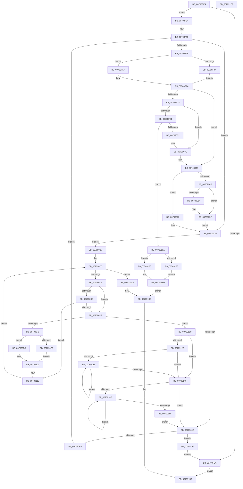

# HalpDmaAllocateLocalContiguousPool

- RVA: `0x00708EE4`–`0x007091CC` (길이 `744` bytes)
- VA: `0x0000000140708EE4`
- 실행 섹션: `PAGE`
- PDB 이름 있음: `예`; PDB Function 태그: `아니요`
- unwind 정보 RVA: `0x000C434C`
- 디코드: `213`개 명령, `744/744` bytes 표시
- 미해석 바이트: `0` (있으면 어셈블리에 `.byte`로 보존)

> 이 문서는 커널 이미지의 기계어와 PDB 기호를 분석해 생성했습니다. 4번과 5번은 함수 원형과 자료형을 바이너리 사용 방식에서 추정한 C 해석이며 원본 소스 복구 결과는 아닙니다.

## 1. Dependencies

- 직접 호출 지점: **19**; 고유 호출 대상: **13**
- 직접 호출자로 확인된 함수: **2**
- RIP 상대 이미지 참조: **0**

### Outgoing calls
- `0x00708F1D` → [HalpMmAllocCtxAlloc](../../text/3E/HalpMmAllocCtxAlloc_function_003E10B8.md) (function, `0x003E10B8`)
- `0x00708F41` → [RtlSetAllBits](../../text/36/RtlSetAllBits_function_00362490.md) (function, `0x00362490`)
- `0x00708F67` → [HalpDmaAllocateContiguousMemory](../../text/3E/HalpDmaAllocateContiguousMemory_function_003EBD0C.md) (function, `0x003EBD0C`)
- `0x00708FAF` → [HalpMmAllocCtxAlloc](../../text/3E/HalpMmAllocCtxAlloc_function_003E10B8.md) (function, `0x003E10B8`)
- `0x00708FD0` → [HalpMmAllocCtxAlloc](../../text/3E/HalpMmAllocCtxAlloc_function_003E10B8.md) (function, `0x003E10B8`)
- `0x00708FF5` → [memset](../../text/6C/memset_function_006C6C40.md) (function, `0x006C6C40`)
- `0x00709023` → [HalpDmaCommitContiguousMapBuffers](../../text/55/HalpDmaCommitContiguousMapBuffers_function_00550A84.md) (function, `0x00550A84`)
- `0x00709039` → [HalpMmAllocCtxFree](../../text/3E/HalpMmAllocCtxFree_function_003E1904.md) (function, `0x003E1904`)
- `0x00709041` → [HalpMmAllocCtxFree](../../text/3E/HalpMmAllocCtxFree_function_003E1904.md) (function, `0x003E1904`)
- `0x0070905A` → [MmUnmapLockedPages](../../text/24/MmUnmapLockedPages_function_00246E60.md) (function, `0x00246E60`)
- `0x00709062` → [MmFreePagesFromMdl](../../text/3F/MmFreePagesFromMdl_function_003F82E0.md) (function, `0x003F82E0`)
- `0x0070906C` → [ExFreePoolWithTag](../../poolcode/B8/ExFreePoolWithTag_function_00B82870.md) (function, `0x00B82870`)
- `0x00709076` → [MmFreeContiguousMemory](../../text/3F/MmFreeContiguousMemory_function_003F6F60.md) (function, `0x003F6F60`)
- `0x00709099` → [HalpDmaAllocateContiguousPagesFromContiguousPool](../../text/3E/HalpDmaAllocateContiguousPagesFromContiguousPool_function_003E024C.md) (function, `0x003E024C`)
- `0x007090E4` → [HalpMmAllocCtxAlloc](../../text/3E/HalpMmAllocCtxAlloc_function_003E10B8.md) (function, `0x003E10B8`)
- `0x00709139` → [HalpMmAllocCtxFree](../../text/3E/HalpMmAllocCtxFree_function_003E1904.md) (function, `0x003E1904`)
- `0x00709158` → [HalpDmaReturnPageToSource](../../text/55/HalpDmaReturnPageToSource_function_0055119C.md) (function, `0x0055119C`)
- `0x0070919A` → [HalpMmAllocCtxFree](../../text/3E/HalpMmAllocCtxFree_function_003E1904.md) (function, `0x003E1904`)
- `0x007091AD` → [RtlClearBits](../../text/3E/RtlClearBits_function_003E1A90.md) (function, `0x003E1A90`)

### Direct callers
- [HalpDmaAllocateChildAdapterV3](HalpDmaAllocateChildAdapterV3_function_007066A0.md) at `0x00706A62`
- [HalpDmaAllocateChildAdapterV2](HalpDmaAllocateChildAdapterV2_function_0070A200.md) at `0x0070A43C`

### Static image references
- 디코드된 RIP-relative 메모리 참조가 없습니다.

## 2. Other-region calls and transfers

- 다른 실행 섹션으로 향하는 call: **19**
  - `0x00708F1D` → [HalpMmAllocCtxAlloc](../../text/3E/HalpMmAllocCtxAlloc_function_003E10B8.md) (`PAGE` → `.text`)
  - `0x00708F41` → [RtlSetAllBits](../../text/36/RtlSetAllBits_function_00362490.md) (`PAGE` → `.text`)
  - `0x00708F67` → [HalpDmaAllocateContiguousMemory](../../text/3E/HalpDmaAllocateContiguousMemory_function_003EBD0C.md) (`PAGE` → `.text`)
  - `0x00708FAF` → [HalpMmAllocCtxAlloc](../../text/3E/HalpMmAllocCtxAlloc_function_003E10B8.md) (`PAGE` → `.text`)
  - `0x00708FD0` → [HalpMmAllocCtxAlloc](../../text/3E/HalpMmAllocCtxAlloc_function_003E10B8.md) (`PAGE` → `.text`)
  - `0x00708FF5` → [memset](../../text/6C/memset_function_006C6C40.md) (`PAGE` → `.text`)
  - `0x00709023` → [HalpDmaCommitContiguousMapBuffers](../../text/55/HalpDmaCommitContiguousMapBuffers_function_00550A84.md) (`PAGE` → `.text`)
  - `0x00709039` → [HalpMmAllocCtxFree](../../text/3E/HalpMmAllocCtxFree_function_003E1904.md) (`PAGE` → `.text`)
  - `0x00709041` → [HalpMmAllocCtxFree](../../text/3E/HalpMmAllocCtxFree_function_003E1904.md) (`PAGE` → `.text`)
  - `0x0070905A` → [MmUnmapLockedPages](../../text/24/MmUnmapLockedPages_function_00246E60.md) (`PAGE` → `.text`)
  - `0x00709062` → [MmFreePagesFromMdl](../../text/3F/MmFreePagesFromMdl_function_003F82E0.md) (`PAGE` → `.text`)
  - `0x0070906C` → [ExFreePoolWithTag](../../poolcode/B8/ExFreePoolWithTag_function_00B82870.md) (`PAGE` → `POOLCODE`)
  - `0x00709076` → [MmFreeContiguousMemory](../../text/3F/MmFreeContiguousMemory_function_003F6F60.md) (`PAGE` → `.text`)
  - `0x00709099` → [HalpDmaAllocateContiguousPagesFromContiguousPool](../../text/3E/HalpDmaAllocateContiguousPagesFromContiguousPool_function_003E024C.md) (`PAGE` → `.text`)
  - `0x007090E4` → [HalpMmAllocCtxAlloc](../../text/3E/HalpMmAllocCtxAlloc_function_003E10B8.md) (`PAGE` → `.text`)
  - `0x00709139` → [HalpMmAllocCtxFree](../../text/3E/HalpMmAllocCtxFree_function_003E1904.md) (`PAGE` → `.text`)
  - `0x00709158` → [HalpDmaReturnPageToSource](../../text/55/HalpDmaReturnPageToSource_function_0055119C.md) (`PAGE` → `.text`)
  - `0x0070919A` → [HalpMmAllocCtxFree](../../text/3E/HalpMmAllocCtxFree_function_003E1904.md) (`PAGE` → `.text`)
  - `0x007091AD` → [RtlClearBits](../../text/3E/RtlClearBits_function_003E1A90.md) (`PAGE` → `.text`)
- 별도 외부 분기/꼬리 이동을 확인하지 못했습니다.

## 3. Assembly (complete function range)

```asm
00708EE4  40 55                           push rbp
00708EE6  53                              push rbx
00708EE7  56                              push rsi
00708EE8  57                              push rdi
00708EE9  41 54                           push r12
00708EEB  41 55                           push r13
00708EED  41 56                           push r14
00708EEF  41 57                           push r15
00708EF1  48 8B EC                        mov rbp, rsp
00708EF4  48 83 EC 48                     sub rsp, 0x48
00708EF8  48 83 65 E8 00                  and qword ptr [rbp - 0x18], 0
00708EFD  8D 72 1F                        lea esi, [rdx + 0x1f]
00708F00  48 83 65 60 00                  and qword ptr [rbp + 0x60], 0
00708F05  44 8B F2                        mov r14d, edx
00708F08  48 83 65 58 00                  and qword ptr [rbp + 0x58], 0
00708F0D  83 E6 E0                        and esi, 0xffffffe0
00708F10  8B D6                           mov edx, esi
00708F12  48 8B F9                        mov rdi, rcx
00708F15  48 C1 EA 03                     shr rdx, 3
00708F19  48 83 C2 10                     add rdx, 0x10
00708F1D  E8 96 81 CD FF                  call 0x1403e10b8
00708F22  48 8B D8                        mov rbx, rax
00708F25  48 85 C0                        test rax, rax
00708F28  75 0A                           jne 0x140708f34
00708F2A  B8 9A 00 00 C0                  mov eax, 0xc000009a
00708F2F  E9 86 02 00 00                  jmp 0x1407091ba
00708F34  89 30                           mov dword ptr [rax], esi
00708F36  48 8B CB                        mov rcx, rbx
00708F39  48 83 C0 10                     add rax, 0x10
00708F3D  48 89 43 08                     mov qword ptr [rbx + 8], rax
00708F41  E8 4A 95 C5 FF                  call 0x140362490
00708F46  48 89 5F 18                     mov qword ptr [rdi + 0x18], rbx
00708F4A  41 BF 01 00 00 00               mov r15d, 1
00708F50  48 8D 45 58                     lea rax, [rbp + 0x58]
00708F54  41 8B D6                        mov edx, r14d
00708F57  4C 8D 4D 60                     lea r9, [rbp + 0x60]
00708F5B  48 89 44 24 20                  mov qword ptr [rsp + 0x20], rax
00708F60  4C 8D 45 E8                     lea r8, [rbp - 0x18]
00708F64  48 8B CF                        mov rcx, rdi
00708F67  E8 A0 2D CE FF                  call 0x1403ebd0c
00708F6C  8B F0                           mov esi, eax
00708F6E  89 75 50                        mov dword ptr [rbp + 0x50], esi
00708F71  85 C0                           test eax, eax
00708F73  0F 84 02 01 00 00               je 0x14070907b
00708F79  80 BF 99 00 00 00 00            cmp byte ptr [rdi + 0x99], 0
00708F80  48 8B 55 60                     mov rdx, qword ptr [rbp + 0x60]
00708F84  48 89 55 F0                     mov qword ptr [rbp - 0x10], rdx
00708F88  75 1D                           jne 0x140708fa7
00708F8A  44 8B E6                        mov r12d, esi
00708F8D  48 8B C2                        mov rax, rdx
00708F90  49 C1 E4 0C                     shl r12, 0xc
00708F94  49 FF CC                        dec r12
00708F97  48 C1 E8 10                     shr rax, 0x10
00708F9B  4C 03 E2                        add r12, rdx
00708F9E  49 C1 EC 10                     shr r12, 0x10
00708FA2  44 2B E0                        sub r12d, eax
00708FA5  EB 03                           jmp 0x140708faa
00708FA7  45 33 E4                        xor r12d, r12d
00708FAA  BA 18 00 00 00                  mov edx, 0x18
00708FAF  E8 04 81 CD FF                  call 0x1403e10b8
00708FB4  48 8B 5D E8                     mov rbx, qword ptr [rbp - 0x18]
00708FB8  4C 8B E8                        mov r13, rax
00708FBB  48 85 C0                        test rax, rax
00708FBE  0F 84 82 00 00 00               je 0x140709046
00708FC4  42 8D 04 26                     lea eax, [rsi + r12]
00708FC8  48 8D 14 C0                     lea rdx, [rax + rax*8]
00708FCC  48 C1 E2 03                     shl rdx, 3
00708FD0  E8 E3 80 CD FF                  call 0x1403e10b8
00708FD5  48 89 45 48                     mov qword ptr [rbp + 0x48], rax
00708FD9  48 8B C8                        mov rcx, rax
00708FDC  48 85 C0                        test rax, rax
00708FDF  74 5D                           je 0x14070903e
00708FE1  49 83 65 00 00                  and qword ptr [r13], 0
00708FE6  4C 8D 04 F6                     lea r8, [rsi + rsi*8]
00708FEA  41 83 65 0C 00                  and dword ptr [r13 + 0xc], 0
00708FEF  33 D2                           xor edx, edx
00708FF1  49 C1 E0 03                     shl r8, 3
00708FF5  E8 46 DC FB FF                  call 0x1406c6c40
00708FFA  48 8B 45 48                     mov rax, qword ptr [rbp + 0x48]
00708FFE  42 8D 0C 26                     lea ecx, [rsi + r12]
00709002  4C 8B 45 F0                     mov r8, qword ptr [rbp - 0x10]
00709006  44 8B CE                        mov r9d, esi
00709009  41 89 4D 08                     mov dword ptr [r13 + 8], ecx
0070900D  48 8B D3                        mov rdx, rbx
00709010  49 89 45 10                     mov qword ptr [r13 + 0x10], rax
00709014  48 8B CF                        mov rcx, rdi
00709017  83 67 48 00                     and dword ptr [rdi + 0x48], 0
0070901B  4C 89 6F 30                     mov qword ptr [rdi + 0x30], r13
0070901F  4C 89 6F 40                     mov qword ptr [rdi + 0x40], r13
00709023  E8 5C 7A E4 FF                  call 0x140550a84
00709028  48 85 C0                        test rax, rax
0070902B  0F 85 39 01 00 00               jne 0x14070916a
00709031  48 8B 57 30                     mov rdx, qword ptr [rdi + 0x30]
00709035  48 8B 52 10                     mov rdx, qword ptr [rdx + 0x10]
00709039  E8 C6 88 CD FF                  call 0x1403e1904
0070903E  49 8B D5                        mov rdx, r13
00709041  E8 BE 88 CD FF                  call 0x1403e1904
00709046  48 8B 75 58                     mov rsi, qword ptr [rbp + 0x58]
0070904A  48 85 F6                        test rsi, rsi
0070904D  74 24                           je 0x140709073
0070904F  48 85 DB                        test rbx, rbx
00709052  74 0B                           je 0x14070905f
00709054  48 8B D6                        mov rdx, rsi
00709057  48 8B CB                        mov rcx, rbx
0070905A  E8 01 DE B3 FF                  call 0x140246e60
0070905F  48 8B CE                        mov rcx, rsi
00709062  E8 79 F2 CE FF                  call 0x1403f82e0
00709067  33 D2                           xor edx, edx
00709069  48 8B CE                        mov rcx, rsi
0070906C  E8 FF 97 47 00                  call 0x140b82870
00709071  EB 08                           jmp 0x14070907b
00709073  48 8B CB                        mov rcx, rbx
00709076  E8 E5 DE CE FF                  call 0x1403f6f60
0070907B  48 8B 97 A0 00 00 00            mov rdx, qword ptr [rdi + 0xa0]
00709082  48 8D 45 50                     lea rax, [rbp + 0x50]
00709086  48 89 44 24 28                  mov qword ptr [rsp + 0x28], rax
0070908B  45 33 C9                        xor r9d, r9d
0070908E  45 8B C6                        mov r8d, r14d
00709091  44 88 7C 24 20                  mov byte ptr [rsp + 0x20], r15b
00709096  48 8B CF                        mov rcx, rdi
00709099  E8 AE 71 CD FF                  call 0x1403e024c
0070909E  48 8B D8                        mov rbx, rax
007090A1  48 85 C0                        test rax, rax
007090A4  75 11                           jne 0x1407090b7
007090A6  45 3B F7                        cmp r14d, r15d
007090A9  0F 86 E7 00 00 00               jbe 0x140709196
007090AF  41 D1 EE                        shr r14d, 1
007090B2  E9 99 FE FF FF                  jmp 0x140708f50
007090B7  8B 75 50                        mov esi, dword ptr [rbp + 0x50]
007090BA  33 C0                           xor eax, eax
007090BC  33 D2                           xor edx, edx
007090BE  45 33 E4                        xor r12d, r12d
007090C1  33 C9                           xor ecx, ecx
007090C3  4C 8B EB                        mov r13, rbx
007090C6  89 45 48                        mov dword ptr [rbp + 0x48], eax
007090C9  3B C6                           cmp eax, esi
007090CB  0F 83 D3 00 00 00               jae 0x1407091a4
007090D1  49 3B DD                        cmp rbx, r13
007090D4  74 09                           je 0x1407090df
007090D6  48 8D 43 B8                     lea rax, [rbx - 0x48]
007090DA  48 3B D0                        cmp rdx, rax
007090DD  74 31                           je 0x140709110
007090DF  BA 18 00 00 00                  mov edx, 0x18
007090E4  E8 CF 7F CD FF                  call 0x1403e10b8
007090E9  48 8B C8                        mov rcx, rax
007090EC  48 85 C0                        test rax, rax
007090EF  74 37                           je 0x140709128
007090F1  4D 85 E4                        test r12, r12
007090F4  75 06                           jne 0x1407090fc
007090F6  48 89 47 30                     mov qword ptr [rdi + 0x30], rax
007090FA  EB 04                           jmp 0x140709100
007090FC  49 89 04 24                     mov qword ptr [r12], rax
00709100  48 83 20 00                     and qword ptr [rax], 0
00709104  4C 8B E0                        mov r12, rax
00709107  48 83 60 08 00                  and qword ptr [rax + 8], 0
0070910C  48 89 58 10                     mov qword ptr [rax + 0x10], rbx
00709110  44 01 79 08                     add dword ptr [rcx + 8], r15d
00709114  48 8B D3                        mov rdx, rbx
00709117  48 83 63 30 F3                  and qword ptr [rbx + 0x30], 0xfffffffffffffff3
0070911C  8B 45 48                        mov eax, dword ptr [rbp + 0x48]
0070911F  48 8B 5B 08                     mov rbx, qword ptr [rbx + 8]
00709123  41 03 C7                        add eax, r15d
00709126  EB 9E                           jmp 0x1407090c6
00709128  4D 85 E4                        test r12, r12
0070912B  74 19                           je 0x140709146
0070912D  48 8B 57 30                     mov rdx, qword ptr [rdi + 0x30]
00709131  48 85 D2                        test rdx, rdx
00709134  74 10                           je 0x140709146
00709136  48 8B 1A                        mov rbx, qword ptr [rdx]
00709139  E8 C6 87 CD FF                  call 0x1403e1904
0070913E  48 8B D3                        mov rdx, rbx
00709141  48 85 DB                        test rbx, rbx
00709144  75 F0                           jne 0x140709136
00709146  85 F6                           test esi, esi
00709148  0F 84 58 FF FF FF               je 0x1407090a6
0070914E  49 8B 5D 08                     mov rbx, qword ptr [r13 + 8]
00709152  49 8B D5                        mov rdx, r13
00709155  48 8B CF                        mov rcx, rdi
00709158  E8 3F 80 E4 FF                  call 0x14055119c
0070915D  4C 8B EB                        mov r13, rbx
00709160  49 2B F7                        sub rsi, r15
00709163  75 E9                           jne 0x14070914e
00709165  E9 3C FF FF FF                  jmp 0x1407090a6
0070916A  48 8B 45 58                     mov rax, qword ptr [rbp + 0x58]
0070916E  48 85 C0                        test rax, rax
00709171  74 10                           je 0x140709183
00709173  48 89 87 48 01 00 00            mov qword ptr [rdi + 0x148], rax
0070917A  48 89 9F 50 01 00 00            mov qword ptr [rdi + 0x150], rbx
00709181  EB 0A                           jmp 0x14070918d
00709183  48 89 9F 48 01 00 00            mov qword ptr [rdi + 0x148], rbx
0070918A  45 32 FF                        xor r15b, r15b
0070918D  44 88 BF 58 01 00 00            mov byte ptr [rdi + 0x158], r15b
00709194  EB 1C                           jmp 0x1407091b2
00709196  48 8B 57 18                     mov rdx, qword ptr [rdi + 0x18]
0070919A  E8 65 87 CD FF                  call 0x1403e1904
0070919F  E9 86 FD FF FF                  jmp 0x140708f2a
007091A4  48 8B 4F 18                     mov rcx, qword ptr [rdi + 0x18]
007091A8  44 8B C6                        mov r8d, esi
007091AB  33 D2                           xor edx, edx
007091AD  E8 DE 88 CD FF                  call 0x1403e1a90
007091B2  89 B7 E8 00 00 00               mov dword ptr [rdi + 0xe8], esi
007091B8  33 C0                           xor eax, eax
007091BA  48 83 C4 48                     add rsp, 0x48
007091BE  41 5F                           pop r15
007091C0  41 5E                           pop r14
007091C2  41 5D                           pop r13
007091C4  41 5C                           pop r12
007091C6  5F                              pop rdi
007091C7  5E                              pop rsi
007091C8  5B                              pop rbx
007091C9  5D                              pop rbp
007091CA  C3                              ret
007091CB  CC                              int3
```

## 4. C-style interpretation (structured pseudocode)

```c
__int64 __fastcall HalpDmaAllocateLocalContiguousPool(__int64 a1, __int64 a2)
{
    __int64 result;
    __int64 v_r12;
    __int64 v_r14;
    __int64 v_r15;
    __int64 v_rsi;
    __int64 v_rsp;
    unsigned __int64 v_stack_m50;
    unsigned __int64 v_stack_m58;
    unsigned __int64 v_stack_m60;
    unsigned __int64 v_stack_m68;
    unsigned int v_stack_p10;
    unsigned __int64 v_stack_p18;
    unsigned __int64 v_stack_p20;
    unsigned __int64 v_stack_p8;

    v_rsp = (v_rsp) - (72);
    v_rsi = (unsigned int)((a2 + 31) & (0xFFFFFFE0ULL));
    a2 = ((unsigned int)((unsigned int)(v_rsi))) >> (3);
    a2 = (a2) + (16);
    result = HalpMmAllocCtxAlloc(a1, a2, a3, a4);
    if (result != 0) goto loc_00708F34;
loc_00708F2A:
    goto loc_007091BA;
loc_00708F34:
    *(unsigned int *)((unsigned int)(0xC000009AULL)) = (unsigned int)(v_rsi);
    result = ((unsigned int)(0xC000009AULL)) + (16);
    *(unsigned __int64 *)(result + 8) = result;
    result = RtlSetAllBits(result, a2, a3, a4);
    *(unsigned __int64 *)(a1 + 24) = result;
loc_00708F50:
    v_stack_m68 = v_stack_p18;
    result = HalpDmaAllocateContiguousMemory(a1, (unsigned int)((unsigned int)((unsigned int)((unsigned int)(a2)))), v_stack_m58, v_stack_p20);
    v_stack_p10 = (unsigned int)((unsigned int)((unsigned int)(result)));
    if ((unsigned int)(result) == 0) goto loc_0070907B;
    v_stack_m50 = v_stack_p20;
    if ((*(unsigned __int8 *)(a1 + 153)) != 0) goto loc_00708FA7;
    v_r12 = ((unsigned int)((unsigned int)((unsigned int)((unsigned int)(result))))) << (12);
    v_r12 = (v_r12) - 1;
    result = (v_stack_p20) >> (16);
    v_r12 = (v_r12) + (v_stack_p20);
    v_r12 = (v_r12) >> (16);
    v_r12 = (unsigned int)((v_r12) - ((unsigned int)(result)));
    goto loc_00708FAA;
loc_00708FA7:
    v_r12 = 0;
loc_00708FAA:
    result = HalpMmAllocCtxAlloc(a1, 24, v_stack_m58, v_stack_p20);
    if (result == 0) goto loc_00709046;
    a2 = ((unsigned int)((unsigned int)(result)) + v_r12 * 1 + (unsigned int)((unsigned int)(result)) + v_r12 * 1 * 8) << (3);
    result = HalpMmAllocCtxAlloc(a1, a2, v_stack_m58, v_stack_p20);
    v_stack_p8 = result;
    if (result == 0) goto loc_0070903E;
    a2 = 0;
    a3 = ((unsigned int)((unsigned int)(result)) + (unsigned int)((unsigned int)(result)) * 8) << (3);
    result = memset(result, a2, a3, v_stack_p20);
    *(unsigned int *)(result + 8) = (unsigned int)((unsigned int)((unsigned int)(result)) + v_r12 * 1);
    *(unsigned __int64 *)(result + 16) = v_stack_p8;
    *(unsigned __int64 *)(a1 + 48) = result;
    *(unsigned __int64 *)(a1 + 64) = result;
    result = HalpDmaCommitContiguousMapBuffers(a1, v_stack_m58, v_stack_m50, (unsigned int)((unsigned int)((unsigned int)((unsigned int)(result)))));
    if (result != 0) goto loc_0070916A;
    result = HalpMmAllocCtxFree(a1, *(unsigned __int64 *)(*(unsigned __int64 *)(a1 + 48) + 16), v_stack_m50, (unsigned int)((unsigned int)((unsigned int)((unsigned int)(result)))));
loc_0070903E:
    result = HalpMmAllocCtxFree(a1, result, v_stack_m50, (unsigned int)((unsigned int)((unsigned int)((unsigned int)(result)))));
loc_00709046:
    if (v_stack_p18 == 0) goto loc_00709073;
    if (v_stack_m58 != 0) {
        a2 = v_stack_p18;
        a1 = v_stack_m58;
        result = MmUnmapLockedPages(a1, a2, v_stack_m50, (unsigned int)((unsigned int)((unsigned int)((unsigned int)(result)))));
    }
    result = MmFreePagesFromMdl(v_stack_p18, a2, v_stack_m50, (unsigned int)((unsigned int)((unsigned int)((unsigned int)(result)))));
    a2 = 0;
    result = ExFreePoolWithTag(v_stack_p18, a2, v_stack_m50, (unsigned int)((unsigned int)((unsigned int)((unsigned int)(result)))));
    goto loc_0070907B;
loc_00709073:
    result = MmFreeContiguousMemory(v_stack_m58, a2, v_stack_m50, (unsigned int)((unsigned int)((unsigned int)((unsigned int)(result)))));
loc_0070907B:
    v_stack_m60 = v_stack_p10;
    a4 = 0;
    v_stack_m68 = 1;
    result = HalpDmaAllocateContiguousPagesFromContiguousPool(a1, *(unsigned __int64 *)(a1 + 160), (unsigned int)((unsigned int)((unsigned int)((unsigned int)(a2)))), a4);
    if (result != 0) goto loc_007090B7;
loc_007090A6:
    if (((unsigned int)((unsigned int)((unsigned int)(a2)))) <= 1) goto loc_00709196;
    v_r14 = (unsigned int)(((unsigned int)((unsigned int)(a2))) >> (1));
    goto loc_00708F50;
loc_007090B7:
    result = 0;
    a2 = 0;
    v_r12 = 0;
    a1 = 0;
loc_007090C6:
    v_stack_p8 = 0;
    if (0 >= ((unsigned int)((unsigned int)(v_stack_p10)))) goto loc_007091A4;
    if (0 == 0) goto loc_007090DF;
    if (0 == (result - 72)) goto loc_00709110;
loc_007090DF:
    result = HalpMmAllocCtxAlloc(a1, 24, (unsigned int)((unsigned int)((unsigned int)((unsigned int)(a2)))), a4);
    if (result == 0) goto loc_00709128;
    if (0 != 0) goto loc_007090FC;
    *(unsigned __int64 *)(a1 + 48) = result;
    goto loc_00709100;
loc_007090FC:
    *(unsigned __int64 *)(v_r12) = result;
loc_00709100:
    *(unsigned __int64 *)(result + 16) = result;
loc_00709110:
    result = (unsigned int)(((unsigned int)(v_stack_p8)) + (1));
    goto loc_007090C6;
loc_00709128:
    if (result == 0) goto loc_00709146;
    if (*(unsigned __int64 *)(a1 + 48) == 0) goto loc_00709146;
loc_00709136:
    result = HalpMmAllocCtxFree(result, *(unsigned __int64 *)(a1 + 48), (unsigned int)((unsigned int)((unsigned int)((unsigned int)(a2)))), a4);
    if (*(unsigned __int64 *)(*(unsigned __int64 *)(a1 + 48)) != 0) goto loc_00709136;
loc_00709146:
    if ((unsigned int)((unsigned int)(v_stack_p10)) == 0) goto loc_007090A6;
loc_0070914E:
    result = HalpDmaReturnPageToSource(0, 0, (unsigned int)((unsigned int)((unsigned int)((unsigned int)(a2)))), a4);
    v_rsi = ((unsigned int)(v_stack_p10)) - (1);
    if (condition_is_not_equal) goto loc_0070914E;
    goto loc_007090A6;
loc_0070916A:
    if (v_stack_p18 == 0) goto loc_00709183;
    *(unsigned __int64 *)(a1 + 328) = v_stack_p18;
    *(unsigned __int64 *)(a1 + 336) = *(unsigned __int64 *)(0 + 8);
    goto loc_0070918D;
loc_00709183:
    *(unsigned __int64 *)(a1 + 328) = *(unsigned __int64 *)(0 + 8);
    v_r15 = 0;
loc_0070918D:
    *(unsigned __int8 *)(a1 + 344) = 0;
    goto loc_007091B2;
loc_00709196:
    result = HalpMmAllocCtxFree(0, *(unsigned __int64 *)(a1 + 24), (unsigned int)((unsigned int)((unsigned int)((unsigned int)(a2)))), a4);
    goto loc_00708F2A;
loc_007091A4:
    a2 = 0;
    result = RtlClearBits(*(unsigned __int64 *)(a1 + 24), a2, (unsigned int)((unsigned int)(v_rsi)), a4);
loc_007091B2:
    *(unsigned int *)(a1 + 232) = (unsigned int)(v_rsi);
    result = 0;
loc_007091BA:
    v_rsp = (v_rsp) + (72);
    return result;
}
```

## 5. (Beta) C Style

```c
int64_t HalpDmaAllocateLocalContiguousPool(void *Arg1, void *Arg2)
{
    uint8_t *arg1 = (uint8_t *)Arg1;
    uint8_t *arg2 = (uint8_t *)Arg2;

    int64_t result;
    int64_t local_r12;
    int64_t local_r14;
    int64_t local_r15;
    int64_t local_rsi;
    int64_t local_rsp;
    uint64_t v_stack_m50;
    uint64_t v_stack_m58;
    uint64_t v_stack_m60;
    uint64_t v_stack_m68;
    uint32_t v_stack_p10;
    uint64_t v_stack_p18;
    uint64_t v_stack_p20;
    uint64_t v_stack_p8;

    local_rsp = (local_rsp) - (72);
    local_rsi = (uint32_t)((Arg2 + 31) & (0xFFFFFFE0ULL));
    Arg2 = ((uint32_t)((uint32_t)(local_rsi))) >> (3);
    Arg2 = (Arg2) + (16);
    result = HalpMmAllocCtxAlloc(Arg1, Arg2, a3, a4);
    if (result != 0) goto loc_00708F34;
loc_00708F2A:
    goto loc_007091BA;
loc_00708F34:
    *(uint32_t *)((uint32_t)(0xC000009AULL)) = (uint32_t)(local_rsi);
    result = ((uint32_t)(0xC000009AULL)) + (16);
    *(uint64_t *)(result + 0x8) = result;
    result = RtlSetAllBits(result, Arg2, a3, a4);
    *(uint64_t *)(arg1 + 0x18) = result;
loc_00708F50:
    v_stack_m68 = v_stack_p18;
    result = HalpDmaAllocateContiguousMemory(Arg1, (uint32_t)((uint32_t)((uint32_t)((uint32_t)(Arg2)))), v_stack_m58, v_stack_p20);
    v_stack_p10 = (uint32_t)((uint32_t)((uint32_t)(result)));
    if ((uint32_t)(result) == 0) goto loc_0070907B;
    v_stack_m50 = v_stack_p20;
    if ((*(uint8_t *)(arg1 + 0x99)) != 0) goto loc_00708FA7;
    local_r12 = ((uint32_t)((uint32_t)((uint32_t)((uint32_t)(result))))) << (12);
    local_r12 = (local_r12) - 1;
    result = (v_stack_p20) >> (16);
    local_r12 = (local_r12) + (v_stack_p20);
    local_r12 = (local_r12) >> (16);
    local_r12 = (uint32_t)((local_r12) - ((uint32_t)(result)));
    goto loc_00708FAA;
loc_00708FA7:
    local_r12 = 0;
loc_00708FAA:
    result = HalpMmAllocCtxAlloc(Arg1, 24, v_stack_m58, v_stack_p20);
    if (result == 0) goto loc_00709046;
    Arg2 = ((uint32_t)((uint32_t)(result)) + local_r12 * 1 + (uint32_t)((uint32_t)(result)) + local_r12 * 1 * 8) << (3);
    result = HalpMmAllocCtxAlloc(Arg1, Arg2, v_stack_m58, v_stack_p20);
    v_stack_p8 = result;
    if (result == 0) goto loc_0070903E;
    Arg2 = 0;
    a3 = ((uint32_t)((uint32_t)(result)) + (uint32_t)((uint32_t)(result)) * 8) << (3);
    result = memset(result, Arg2, a3, v_stack_p20);
    *(uint32_t *)(result + 0x8) = (uint32_t)((uint32_t)((uint32_t)(result)) + local_r12 * 1);
    *(uint64_t *)(result + 0x10) = v_stack_p8;
    *(uint64_t *)(arg1 + 0x30) = result;
    *(uint64_t *)(arg1 + 0x40) = result;
    result = HalpDmaCommitContiguousMapBuffers(Arg1, v_stack_m58, v_stack_m50, (uint32_t)((uint32_t)((uint32_t)((uint32_t)(result)))));
    if (result != 0) goto loc_0070916A;
    result = HalpMmAllocCtxFree(Arg1, *(uint64_t *)(*(uint64_t *)(arg1 + 0x30) + 0x10), v_stack_m50, (uint32_t)((uint32_t)((uint32_t)((uint32_t)(result)))));
loc_0070903E:
    result = HalpMmAllocCtxFree(Arg1, result, v_stack_m50, (uint32_t)((uint32_t)((uint32_t)((uint32_t)(result)))));
loc_00709046:
    if (v_stack_p18 == 0) goto loc_00709073;
    if (v_stack_m58 != 0) {
        Arg2 = v_stack_p18;
        Arg1 = v_stack_m58;
        result = MmUnmapLockedPages(Arg1, Arg2, v_stack_m50, (uint32_t)((uint32_t)((uint32_t)((uint32_t)(result)))));
    }
    result = MmFreePagesFromMdl(v_stack_p18, Arg2, v_stack_m50, (uint32_t)((uint32_t)((uint32_t)((uint32_t)(result)))));
    Arg2 = 0;
    result = ExFreePoolWithTag(v_stack_p18, Arg2, v_stack_m50, (uint32_t)((uint32_t)((uint32_t)((uint32_t)(result)))));
    goto loc_0070907B;
loc_00709073:
    result = MmFreeContiguousMemory(v_stack_m58, Arg2, v_stack_m50, (uint32_t)((uint32_t)((uint32_t)((uint32_t)(result)))));
loc_0070907B:
    v_stack_m60 = v_stack_p10;
    a4 = 0;
    v_stack_m68 = 1;
    result = HalpDmaAllocateContiguousPagesFromContiguousPool(Arg1, *(uint64_t *)(arg1 + 0xA0), (uint32_t)((uint32_t)((uint32_t)((uint32_t)(Arg2)))), a4);
    if (result != 0) goto loc_007090B7;
loc_007090A6:
    if (((uint32_t)((uint32_t)((uint32_t)(Arg2)))) <= 1) goto loc_00709196;
    local_r14 = (uint32_t)(((uint32_t)((uint32_t)(Arg2))) >> (1));
    goto loc_00708F50;
loc_007090B7:
    result = 0;
    Arg2 = 0;
    local_r12 = 0;
    Arg1 = 0;
loc_007090C6:
    v_stack_p8 = 0;
    if (0 >= ((uint32_t)((uint32_t)(v_stack_p10)))) goto loc_007091A4;
    if (0 == 0) goto loc_007090DF;
    if (0 == (result - 72)) goto loc_00709110;
loc_007090DF:
    result = HalpMmAllocCtxAlloc(Arg1, 24, (uint32_t)((uint32_t)((uint32_t)((uint32_t)(Arg2)))), a4);
    if (result == 0) goto loc_00709128;
    if (0 != 0) goto loc_007090FC;
    *(uint64_t *)(arg1 + 0x30) = result;
    goto loc_00709100;
loc_007090FC:
    *(uint64_t *)(local_r12) = result;
loc_00709100:
    *(uint64_t *)(result + 0x10) = result;
loc_00709110:
    result = (uint32_t)(((uint32_t)(v_stack_p8)) + (1));
    goto loc_007090C6;
loc_00709128:
    if (result == 0) goto loc_00709146;
    if (*(uint64_t *)(arg1 + 0x30) == 0) goto loc_00709146;
loc_00709136:
    result = HalpMmAllocCtxFree(result, *(uint64_t *)(arg1 + 0x30), (uint32_t)((uint32_t)((uint32_t)((uint32_t)(Arg2)))), a4);
    if (*(uint64_t *)(*(uint64_t *)(arg1 + 0x30)) != 0) goto loc_00709136;
loc_00709146:
    if ((uint32_t)((uint32_t)(v_stack_p10)) == 0) goto loc_007090A6;
loc_0070914E:
    result = HalpDmaReturnPageToSource(0, 0, (uint32_t)((uint32_t)((uint32_t)((uint32_t)(Arg2)))), a4);
    local_rsi = ((uint32_t)(v_stack_p10)) - (1);
    if (condition_is_not_equal) goto loc_0070914E;
    goto loc_007090A6;
loc_0070916A:
    if (v_stack_p18 == 0) goto loc_00709183;
    *(uint64_t *)(arg1 + 0x148) = v_stack_p18;
    *(uint64_t *)(arg1 + 0x150) = *(uint64_t *)(0 + 0x8);
    goto loc_0070918D;
loc_00709183:
    *(uint64_t *)(arg1 + 0x148) = *(uint64_t *)(0 + 0x8);
    local_r15 = 0;
loc_0070918D:
    *(uint8_t *)(arg1 + 0x158) = 0;
    goto loc_007091B2;
loc_00709196:
    result = HalpMmAllocCtxFree(0, *(uint64_t *)(arg1 + 0x18), (uint32_t)((uint32_t)((uint32_t)((uint32_t)(Arg2)))), a4);
    goto loc_00708F2A;
loc_007091A4:
    Arg2 = 0;
    result = RtlClearBits(*(uint64_t *)(arg1 + 0x18), Arg2, (uint32_t)((uint32_t)(local_rsi)), a4);
loc_007091B2:
    *(uint32_t *)(arg1 + 0xE8) = (uint32_t)(local_rsi);
    result = 0;
loc_007091BA:
    local_rsp = (local_rsp) + (72);
    return result;
}
```

### 관측된 메모리 오프셋

구조체 형식이 확인되지 않은 접근은 인자 기준의 오프셋으로만 기록했습니다.

| 기준 인자 | 오프셋 표현 | 폭 (bit) | 접근 |
|---|---:|---:|---|
| `Arg1` | `+ 0x18` | `64` | `R` |
| `Arg1` | `+ 0x18` | `64` | `W` |
| `Arg1` | `+ 0x30` | `64` | `R` |
| `Arg1` | `+ 0x30` | `64` | `W` |
| `Arg1` | `+ 0x40` | `64` | `W` |
| `Arg1` | `+ 0x48` | `32` | `R/W` |
| `Arg1` | `+ 0x99` | `8` | `R` |
| `Arg1` | `+ 0xA0` | `64` | `R` |
| `Arg1` | `+ 0xE8` | `32` | `W` |
| `Arg1` | `+ 0x148` | `64` | `W` |
| `Arg1` | `+ 0x150` | `64` | `W` |
| `Arg1` | `+ 0x158` | `8` | `W` |
| `Arg2` | `+ 0x1F` | `32` | `R` |

## 6. Execution-region graph

[열기: 2D/3D 그래프와 함수 탐색 컨트롤 패널](../../../control-panel.html?section=page&rva=0x00708EE4&view=graph)

- 2D 그래프는 위에서 아래로 흐르고, 3D 그래프는 빈 공간을 드래그해 회전합니다. Shift+드래그는 이동, 휠은 확대·축소, 함수 노드 선택은 대상 보고서 이동입니다.

### Static fallback


