# HalpDmaAllocateLocalScatterPool

- RVA: `0x007091D4`–`0x00709401` (길이 `557` bytes)
- VA: `0x00000001407091D4`
- 실행 섹션: `PAGE`
- PDB 이름 있음: `예`; PDB Function 태그: `아니요`
- unwind 정보 RVA: `0x000C4330`
- 디코드: `157`개 명령, `557/557` bytes 표시
- 미해석 바이트: `0` (있으면 어셈블리에 `.byte`로 보존)

> 이 문서는 커널 이미지의 기계어와 PDB 기호를 분석해 생성했습니다. 4번과 5번은 함수 원형과 자료형을 바이너리 사용 방식에서 추정한 C 해석이며 원본 소스 복구 결과는 아닙니다.

## 1. Dependencies

- 직접 호출 지점: **14**; 고유 호출 대상: **11**
- 직접 호출자로 확인된 함수: **2**
- RIP 상대 이미지 참조: **0**

### Outgoing calls
- `0x007091FF` → [HalpDmaAllocateScatterMemory](../AA/HalpDmaAllocateScatterMemory_function_00AA2D70.md) (function, `0x00AA2D70`)
- `0x00709219` → [HalpMmAllocCtxAlloc](../../text/3E/HalpMmAllocCtxAlloc_function_003E10B8.md) (function, `0x003E10B8`)
- `0x00709236` → [HalpMmAllocCtxAlloc](../../text/3E/HalpMmAllocCtxAlloc_function_003E10B8.md) (function, `0x003E10B8`)
- `0x00709256` → [memset](../../text/6C/memset_function_006C6C40.md) (function, `0x006C6C40`)
- `0x00709282` → [HalpDmaCommitScatterMapBuffers](../../text/49/HalpDmaCommitScatterMapBuffers_function_0049A9D0.md) (function, `0x0049A9D0`)
- `0x0070929B` → [HalpMmAllocCtxFree](../../text/3E/HalpMmAllocCtxFree_function_003E1904.md) (function, `0x003E1904`)
- `0x007092A3` → [HalpMmAllocCtxFree](../../text/3E/HalpMmAllocCtxFree_function_003E1904.md) (function, `0x003E1904`)
- `0x007092B3` → [MmUnmapLockedPages](../../text/24/MmUnmapLockedPages_function_00246E60.md) (function, `0x00246E60`)
- `0x007092BB` → [MmFreePagesFromMdl](../../text/3F/MmFreePagesFromMdl_function_003F82E0.md) (function, `0x003F82E0`)
- `0x007092C5` → [ExFreePoolWithTag](../../poolcode/B8/ExFreePoolWithTag_function_00B82870.md) (function, `0x00B82870`)
- `0x007092FC` → [HalpDmaAllocateScatterPagesFromScatterPool](../../text/3D/HalpDmaAllocateScatterPagesFromScatterPool_function_003DC3EC.md) (function, `0x003DC3EC`)
- `0x00709343` → [HalpDmaPrependTranslations](../../text/3D/HalpDmaPrependTranslations_function_003DC3C8.md) (function, `0x003DC3C8`)
- `0x00709372` → [HalpDmaAllocateScatterPagesFromContiguousPool](../../text/3D/HalpDmaAllocateScatterPagesFromContiguousPool_function_003DC184.md) (function, `0x003DC184`)
- `0x007093AF` → [HalpDmaPrependTranslations](../../text/3D/HalpDmaPrependTranslations_function_003DC3C8.md) (function, `0x003DC3C8`)

### Direct callers
- [HalpDmaAllocateChildAdapterV3](HalpDmaAllocateChildAdapterV3_function_007066A0.md) at `0x00706A5B`
- [HalpDmaAllocateChildAdapterV2](HalpDmaAllocateChildAdapterV2_function_0070A200.md) at `0x0070A435`

### Static image references
- 디코드된 RIP-relative 메모리 참조가 없습니다.

## 2. Other-region calls and transfers

- 다른 실행 섹션으로 향하는 call: **13**
  - `0x00709219` → [HalpMmAllocCtxAlloc](../../text/3E/HalpMmAllocCtxAlloc_function_003E10B8.md) (`PAGE` → `.text`)
  - `0x00709236` → [HalpMmAllocCtxAlloc](../../text/3E/HalpMmAllocCtxAlloc_function_003E10B8.md) (`PAGE` → `.text`)
  - `0x00709256` → [memset](../../text/6C/memset_function_006C6C40.md) (`PAGE` → `.text`)
  - `0x00709282` → [HalpDmaCommitScatterMapBuffers](../../text/49/HalpDmaCommitScatterMapBuffers_function_0049A9D0.md) (`PAGE` → `.text`)
  - `0x0070929B` → [HalpMmAllocCtxFree](../../text/3E/HalpMmAllocCtxFree_function_003E1904.md) (`PAGE` → `.text`)
  - `0x007092A3` → [HalpMmAllocCtxFree](../../text/3E/HalpMmAllocCtxFree_function_003E1904.md) (`PAGE` → `.text`)
  - `0x007092B3` → [MmUnmapLockedPages](../../text/24/MmUnmapLockedPages_function_00246E60.md) (`PAGE` → `.text`)
  - `0x007092BB` → [MmFreePagesFromMdl](../../text/3F/MmFreePagesFromMdl_function_003F82E0.md) (`PAGE` → `.text`)
  - `0x007092C5` → [ExFreePoolWithTag](../../poolcode/B8/ExFreePoolWithTag_function_00B82870.md) (`PAGE` → `POOLCODE`)
  - `0x007092FC` → [HalpDmaAllocateScatterPagesFromScatterPool](../../text/3D/HalpDmaAllocateScatterPagesFromScatterPool_function_003DC3EC.md) (`PAGE` → `.text`)
  - `0x00709343` → [HalpDmaPrependTranslations](../../text/3D/HalpDmaPrependTranslations_function_003DC3C8.md) (`PAGE` → `.text`)
  - `0x00709372` → [HalpDmaAllocateScatterPagesFromContiguousPool](../../text/3D/HalpDmaAllocateScatterPagesFromContiguousPool_function_003DC184.md) (`PAGE` → `.text`)
  - `0x007093AF` → [HalpDmaPrependTranslations](../../text/3D/HalpDmaPrependTranslations_function_003DC3C8.md) (`PAGE` → `.text`)
- 별도 외부 분기/꼬리 이동을 확인하지 못했습니다.

## 3. Assembly (complete function range)

```asm
007091D4  48 8B C4                        mov rax, rsp
007091D7  48 89 58 18                     mov qword ptr [rax + 0x18], rbx
007091DB  55                              push rbp
007091DC  56                              push rsi
007091DD  57                              push rdi
007091DE  41 54                           push r12
007091E0  41 55                           push r13
007091E2  41 56                           push r14
007091E4  41 57                           push r15
007091E6  48 83 EC 30                     sub rsp, 0x30
007091EA  48 83 60 08 00                  and qword ptr [rax + 8], 0
007091EF  4C 8D 40 08                     lea r8, [rax + 8]
007091F3  83 60 10 00                     and dword ptr [rax + 0x10], 0
007091F7  44 8B F2                        mov r14d, edx
007091FA  48 8B F9                        mov rdi, rcx
007091FD  33 ED                           xor ebp, ebp
007091FF  E8 6C 9B 39 00                  call 0x140aa2d70
00709204  48 8B F0                        mov rsi, rax
00709207  48 85 C0                        test rax, rax
0070920A  0F 84 BF 00 00 00               je 0x1407092cf
00709210  8B 58 28                        mov ebx, dword ptr [rax + 0x28]
00709213  8D 55 18                        lea edx, [rbp + 0x18]
00709216  C1 EB 0C                        shr ebx, 0xc
00709219  E8 9A 7E CD FF                  call 0x1403e10b8
0070921E  4C 8B 7C 24 70                  mov r15, qword ptr [rsp + 0x70]
00709223  4C 8B E0                        mov r12, rax
00709226  48 85 C0                        test rax, rax
00709229  74 7D                           je 0x1407092a8
0070922B  4C 8D 2C DB                     lea r13, [rbx + rbx*8]
0070922F  49 C1 E5 03                     shl r13, 3
00709233  49 8B D5                        mov rdx, r13
00709236  E8 7D 7E CD FF                  call 0x1403e10b8
0070923B  48 8B E8                        mov rbp, rax
0070923E  48 85 C0                        test rax, rax
00709241  74 5D                           je 0x1407092a0
00709243  49 83 24 24 00                  and qword ptr [r12], 0
00709248  4D 8B C5                        mov r8, r13
0070924B  41 83 64 24 0C 00               and dword ptr [r12 + 0xc], 0
00709251  33 D2                           xor edx, edx
00709253  48 8B C8                        mov rcx, rax
00709256  E8 E5 D9 FB FF                  call 0x1406c6c40
0070925B  41 89 5C 24 08                  mov dword ptr [r12 + 8], ebx
00709260  45 33 C9                        xor r9d, r9d
00709263  49 89 6C 24 10                  mov qword ptr [r12 + 0x10], rbp
00709268  45 33 C0                        xor r8d, r8d
0070926B  83 67 58 00                     and dword ptr [rdi + 0x58], 0
0070926F  49 8B D7                        mov rdx, r15
00709272  48 8B CF                        mov rcx, rdi
00709275  4C 89 67 38                     mov qword ptr [rdi + 0x38], r12
00709279  4C 89 67 50                     mov qword ptr [rdi + 0x50], r12
0070927D  48 89 74 24 20                  mov qword ptr [rsp + 0x20], rsi
00709282  E8 49 17 D9 FF                  call 0x14049a9d0
00709287  48 8B E8                        mov rbp, rax
0070928A  48 85 C0                        test rax, rax
0070928D  0F 85 32 01 00 00               jne 0x1407093c5
00709293  48 8B 57 38                     mov rdx, qword ptr [rdi + 0x38]
00709297  48 8B 52 10                     mov rdx, qword ptr [rdx + 0x10]
0070929B  E8 64 86 CD FF                  call 0x1403e1904
007092A0  49 8B D4                        mov rdx, r12
007092A3  E8 5C 86 CD FF                  call 0x1403e1904
007092A8  4D 85 FF                        test r15, r15
007092AB  74 0B                           je 0x1407092b8
007092AD  48 8B D6                        mov rdx, rsi
007092B0  49 8B CF                        mov rcx, r15
007092B3  E8 A8 DB B3 FF                  call 0x140246e60
007092B8  48 8B CE                        mov rcx, rsi
007092BB  E8 20 F0 CE FF                  call 0x1403f82e0
007092C0  33 D2                           xor edx, edx
007092C2  48 8B CE                        mov rcx, rsi
007092C5  E8 A6 95 47 00                  call 0x140b82870
007092CA  48 83 67 38 00                  and qword ptr [rdi + 0x38], 0
007092CF  33 DB                           xor ebx, ebx
007092D1  41 3B DE                        cmp ebx, r14d
007092D4  0F 84 FE 00 00 00               je 0x1407093d8
007092DA  45 8B C6                        mov r8d, r14d
007092DD  48 8D 44 24 78                  lea rax, [rsp + 0x78]
007092E2  48 89 44 24 28                  mov qword ptr [rsp + 0x28], rax
007092E7  48 8D B7 A0 00 00 00            lea rsi, [rdi + 0xa0]
007092EE  48 8B 16                        mov rdx, qword ptr [rsi]
007092F1  44 2B C3                        sub r8d, ebx
007092F4  45 33 C9                        xor r9d, r9d
007092F7  C6 44 24 20 01                  mov byte ptr [rsp + 0x20], 1
007092FC  E8 EB 30 CD FF                  call 0x1403dc3ec
00709301  4C 8B D0                        mov r10, rax
00709304  48 85 C0                        test rax, rax
00709307  74 45                           je 0x14070934e
00709309  44 8B 4C 24 78                  mov r9d, dword ptr [rsp + 0x78]
0070930E  48 8B C8                        mov rcx, rax
00709311  45 85 C9                        test r9d, r9d
00709314  74 24                           je 0x14070933a
00709316  41 8B D1                        mov edx, r9d
00709319  48 8B 41 30                     mov rax, qword ptr [rcx + 0x30]
0070931D  48 83 E0 FB                     and rax, 0xfffffffffffffffb
00709321  48 83 C8 08                     or rax, 8
00709325  48 89 41 30                     mov qword ptr [rcx + 0x30], rax
00709329  48 8B 49 08                     mov rcx, qword ptr [rcx + 8]
0070932D  48 83 EA 01                     sub rdx, 1
00709331  75 E6                           jne 0x140709319
00709333  48 8D B7 A0 00 00 00            lea rsi, [rdi + 0xa0]
0070933A  4C 8B C5                        mov r8, rbp
0070933D  41 8B D1                        mov edx, r9d
00709340  49 8B CA                        mov rcx, r10
00709343  E8 80 30 CD FF                  call 0x1403dc3c8
00709348  48 8B E8                        mov rbp, rax
0070934B  41 03 D9                        add ebx, r9d
0070934E  41 3B DE                        cmp ebx, r14d
00709351  0F 84 81 00 00 00               je 0x1407093d8
00709357  48 8B 16                        mov rdx, qword ptr [rsi]
0070935A  48 8D 44 24 78                  lea rax, [rsp + 0x78]
0070935F  45 8B C6                        mov r8d, r14d
00709362  48 89 44 24 28                  mov qword ptr [rsp + 0x28], rax
00709367  44 2B C3                        sub r8d, ebx
0070936A  C6 44 24 20 01                  mov byte ptr [rsp + 0x20], 1
0070936F  45 33 C9                        xor r9d, r9d
00709372  E8 0D 2E CD FF                  call 0x1403dc184
00709377  48 85 C0                        test rax, rax
0070937A  74 3E                           je 0x1407093ba
0070937C  44 8B 4C 24 78                  mov r9d, dword ptr [rsp + 0x78]
00709381  48 8B D0                        mov rdx, rax
00709384  45 85 C9                        test r9d, r9d
00709387  74 1D                           je 0x1407093a6
00709389  45 8B C1                        mov r8d, r9d
0070938C  48 8B 4A 30                     mov rcx, qword ptr [rdx + 0x30]
00709390  48 83 E1 FB                     and rcx, 0xfffffffffffffffb
00709394  48 83 C9 08                     or rcx, 8
00709398  48 89 4A 30                     mov qword ptr [rdx + 0x30], rcx
0070939C  48 8B 52 08                     mov rdx, qword ptr [rdx + 8]
007093A0  49 83 E8 01                     sub r8, 1
007093A4  75 E6                           jne 0x14070938c
007093A6  4C 8B C5                        mov r8, rbp
007093A9  41 8B D1                        mov edx, r9d
007093AC  48 8B C8                        mov rcx, rax
007093AF  E8 14 30 CD FF                  call 0x1403dc3c8
007093B4  48 8B E8                        mov rbp, rax
007093B7  41 03 D9                        add ebx, r9d
007093BA  85 DB                           test ebx, ebx
007093BC  75 1A                           jne 0x1407093d8
007093BE  B8 9A 00 00 C0                  mov eax, 0xc000009a
007093C3  EB 23                           jmp 0x1407093e8
007093C5  48 89 B7 48 01 00 00            mov qword ptr [rdi + 0x148], rsi
007093CC  4C 89 BF 50 01 00 00            mov qword ptr [rdi + 0x150], r15
007093D3  E9 F9 FE FF FF                  jmp 0x1407092d1
007093D8  44 89 B7 E8 00 00 00            mov dword ptr [rdi + 0xe8], r14d
007093DF  33 C0                           xor eax, eax
007093E1  48 89 6F 20                     mov qword ptr [rdi + 0x20], rbp
007093E5  89 5F 28                        mov dword ptr [rdi + 0x28], ebx
007093E8  48 8B 9C 24 80 00 00 00         mov rbx, qword ptr [rsp + 0x80]
007093F0  48 83 C4 30                     add rsp, 0x30
007093F4  41 5F                           pop r15
007093F6  41 5E                           pop r14
007093F8  41 5D                           pop r13
007093FA  41 5C                           pop r12
007093FC  5F                              pop rdi
007093FD  5E                              pop rsi
007093FE  5D                              pop rbp
007093FF  C3                              ret
00709400  CC                              int3
```

## 4. C-style interpretation (structured pseudocode)

```c
__int64 __fastcall HalpDmaAllocateLocalScatterPool(__int64 a1, int a2, __int64 a3, int a4)
{
    __int64 result;
    __int64 v_r13;
    __int64 v_rbp;
    __int64 v_rbx;
    __int64 v_rsp;
    unsigned __int64 v_stack_m40;
    unsigned __int64 v_stack_m48;
    unsigned __int64 v_stack_p10;
    unsigned __int64 v_stack_p18;
    unsigned __int64 v_stack_p8;

    *(unsigned __int64 *)(v_rsp + 24) = v_rbx;
    v_rsp = (v_rsp) - (48);
    v_rbp = 0;
    result = HalpDmaAllocateScatterMemory(a1, a2, v_rsp + 8, a4);
    if (result == 0) goto loc_007092CF;
    v_rbx = (unsigned int)(((unsigned int)(*(unsigned int *)(result + 40))) >> (12));
    result = HalpMmAllocCtxAlloc(a1, v_rbp + 24, v_rsp + 8, a4);
    if (result == 0) goto loc_007092A8;
    v_r13 = (v_rbx + v_rbx * 8) << (3);
    result = HalpMmAllocCtxAlloc(a1, v_r13, v_rsp + 8, a4);
    if (result == 0) goto loc_007092A0;
    a2 = 0;
    result = memset(result, a2, v_r13, a4);
    *(unsigned int *)(result + 8) = (unsigned int)(v_rbx);
    a4 = 0;
    *(unsigned __int64 *)(result + 16) = result;
    a3 = 0;
    *(unsigned __int64 *)(a1 + 56) = result;
    *(unsigned __int64 *)(a1 + 80) = result;
    v_stack_m48 = result;
    result = HalpDmaCommitScatterMapBuffers(a1, v_stack_p8, a3, a4);
    if (result != 0) goto loc_007093C5;
    result = HalpMmAllocCtxFree(a1, *(unsigned __int64 *)(*(unsigned __int64 *)(a1 + 56) + 16), a3, a4);
loc_007092A0:
    result = HalpMmAllocCtxFree(a1, result, a3, a4);
loc_007092A8:
    if (v_stack_p8 != 0) {
        a2 = result;
        a1 = v_stack_p8;
        result = MmUnmapLockedPages(a1, a2, a3, a4);
    }
    result = MmFreePagesFromMdl(result, a2, a3, a4);
    a2 = 0;
    result = ExFreePoolWithTag(result, a2, a3, a4);
loc_007092CF:
    v_rbx = 0;
loc_007092D1:
    if (0 == ((unsigned int)((unsigned int)(a2)))) goto loc_007093D8;
    v_stack_m40 = v_stack_p10;
    a3 = (unsigned int)(((unsigned int)((unsigned int)((unsigned int)(a2)))) - (0));
    a4 = 0;
    v_stack_m48 = 1;
    result = HalpDmaAllocateScatterPagesFromScatterPool(result, *(unsigned __int64 *)(a1 + 160), a3, a4);
    if (result == 0) goto loc_0070934E;
    if ((unsigned int)((unsigned int)(v_stack_p10)) == 0) goto loc_0070933A;
loc_00709319:
    result = (*(unsigned __int64 *)(result + 48)) & (-5);
    result = (result) | (8);
    *(unsigned __int64 *)(result + 48) = result;
    a2 = ((unsigned int)((unsigned int)((unsigned int)(v_stack_p10)))) - (1);
    if (condition_is_not_equal) goto loc_00709319;
loc_0070933A:
    result = HalpDmaPrependTranslations(result, (unsigned int)((unsigned int)((unsigned int)(v_stack_p10))), result, (unsigned int)(v_stack_p10));
    v_rbx = (unsigned int)((v_rbx) + ((unsigned int)((unsigned int)(v_stack_p10))));
loc_0070934E:
    if (((unsigned int)(v_rbx)) == ((unsigned int)((unsigned int)(a2)))) goto loc_007093D8;
    v_stack_m40 = v_stack_p10;
    a3 = (unsigned int)(((unsigned int)((unsigned int)((unsigned int)(a2)))) - ((unsigned int)(v_rbx)));
    v_stack_m48 = 1;
    a4 = 0;
    result = HalpDmaAllocateScatterPagesFromContiguousPool(result, *(unsigned __int64 *)(a1 + 160), a3, a4);
    if (result == 0) goto loc_007093BA;
    if ((unsigned int)((unsigned int)(v_stack_p10)) == 0) goto loc_007093A6;
loc_0070938C:
    a1 = (*(unsigned __int64 *)(result + 48)) & (-5);
    a1 = (a1) | (8);
    *(unsigned __int64 *)(result + 48) = a1;
    a3 = ((unsigned int)((unsigned int)((unsigned int)(v_stack_p10)))) - (1);
    if (condition_is_not_equal) goto loc_0070938C;
loc_007093A6:
    result = HalpDmaPrependTranslations(result, (unsigned int)((unsigned int)((unsigned int)(v_stack_p10))), result, (unsigned int)(v_stack_p10));
    v_rbx = (unsigned int)((v_rbx) + ((unsigned int)((unsigned int)(v_stack_p10))));
loc_007093BA:
    if ((unsigned int)(v_rbx) != 0) goto loc_007093D8;
    goto loc_007093E8;
loc_007093C5:
    *(unsigned __int64 *)(a1 + 328) = a1 + 160;
    *(unsigned __int64 *)(a1 + 336) = v_stack_p8;
    goto loc_007092D1;
loc_007093D8:
    *(unsigned int *)(a1 + 232) = (unsigned int)((unsigned int)(a2));
    result = 0;
    *(unsigned __int64 *)(a1 + 32) = 0;
    *(unsigned int *)(a1 + 40) = (unsigned int)(v_rbx);
loc_007093E8:
    v_rsp = (v_rsp) + (48);
    return result;
}
```

## 5. (Beta) C Style

```c
int64_t HalpDmaAllocateLocalScatterPool(void *Arg1, int32_t Arg2, int64_t Arg3, int32_t Arg4)
{
    uint8_t *arg1 = (uint8_t *)Arg1;

    int64_t result;
    int64_t local_r13;
    int64_t local_rbp;
    int64_t local_rbx;
    int64_t local_rsp;
    uint64_t v_stack_m40;
    uint64_t v_stack_m48;
    uint64_t v_stack_p10;
    uint64_t v_stack_p18;
    uint64_t v_stack_p8;

    *(uint64_t *)(local_rsp + 0x18) = local_rbx;
    local_rsp = (local_rsp) - (48);
    local_rbp = 0;
    result = HalpDmaAllocateScatterMemory(Arg1, Arg2, local_rsp + 8, Arg4);
    if (result == 0) goto loc_007092CF;
    local_rbx = (uint32_t)(((uint32_t)(*(uint32_t *)(result + 0x28))) >> (12));
    result = HalpMmAllocCtxAlloc(Arg1, local_rbp + 24, local_rsp + 8, Arg4);
    if (result == 0) goto loc_007092A8;
    local_r13 = (local_rbx + local_rbx * 8) << (3);
    result = HalpMmAllocCtxAlloc(Arg1, local_r13, local_rsp + 8, Arg4);
    if (result == 0) goto loc_007092A0;
    Arg2 = 0;
    result = memset(result, Arg2, local_r13, Arg4);
    *(uint32_t *)(result + 0x8) = (uint32_t)(local_rbx);
    Arg4 = 0;
    *(uint64_t *)(result + 0x10) = result;
    Arg3 = 0;
    *(uint64_t *)(arg1 + 0x38) = result;
    *(uint64_t *)(arg1 + 0x50) = result;
    v_stack_m48 = result;
    result = HalpDmaCommitScatterMapBuffers(Arg1, v_stack_p8, Arg3, Arg4);
    if (result != 0) goto loc_007093C5;
    result = HalpMmAllocCtxFree(Arg1, *(uint64_t *)(*(uint64_t *)(arg1 + 0x38) + 0x10), Arg3, Arg4);
loc_007092A0:
    result = HalpMmAllocCtxFree(Arg1, result, Arg3, Arg4);
loc_007092A8:
    if (v_stack_p8 != 0) {
        Arg2 = result;
        Arg1 = v_stack_p8;
        result = MmUnmapLockedPages(Arg1, Arg2, Arg3, Arg4);
    }
    result = MmFreePagesFromMdl(result, Arg2, Arg3, Arg4);
    Arg2 = 0;
    result = ExFreePoolWithTag(result, Arg2, Arg3, Arg4);
loc_007092CF:
    local_rbx = 0;
loc_007092D1:
    if (0 == ((uint32_t)((uint32_t)(Arg2)))) goto loc_007093D8;
    v_stack_m40 = v_stack_p10;
    Arg3 = (uint32_t)(((uint32_t)((uint32_t)((uint32_t)(Arg2)))) - (0));
    Arg4 = 0;
    v_stack_m48 = 1;
    result = HalpDmaAllocateScatterPagesFromScatterPool(result, *(uint64_t *)(arg1 + 0xA0), Arg3, Arg4);
    if (result == 0) goto loc_0070934E;
    if ((uint32_t)((uint32_t)(v_stack_p10)) == 0) goto loc_0070933A;
loc_00709319:
    result = (*(uint64_t *)(result + 0x30)) & (-5);
    result = (result) | (8);
    *(uint64_t *)(result + 0x30) = result;
    Arg2 = ((uint32_t)((uint32_t)((uint32_t)(v_stack_p10)))) - (1);
    if (condition_is_not_equal) goto loc_00709319;
loc_0070933A:
    result = HalpDmaPrependTranslations(result, (uint32_t)((uint32_t)((uint32_t)(v_stack_p10))), result, (uint32_t)(v_stack_p10));
    local_rbx = (uint32_t)((local_rbx) + ((uint32_t)((uint32_t)(v_stack_p10))));
loc_0070934E:
    if (((uint32_t)(local_rbx)) == ((uint32_t)((uint32_t)(Arg2)))) goto loc_007093D8;
    v_stack_m40 = v_stack_p10;
    Arg3 = (uint32_t)(((uint32_t)((uint32_t)((uint32_t)(Arg2)))) - ((uint32_t)(local_rbx)));
    v_stack_m48 = 1;
    Arg4 = 0;
    result = HalpDmaAllocateScatterPagesFromContiguousPool(result, *(uint64_t *)(arg1 + 0xA0), Arg3, Arg4);
    if (result == 0) goto loc_007093BA;
    if ((uint32_t)((uint32_t)(v_stack_p10)) == 0) goto loc_007093A6;
loc_0070938C:
    Arg1 = (*(uint64_t *)(result + 0x30)) & (-5);
    Arg1 = (Arg1) | (8);
    *(void **)(result + 0x30) = Arg1;
    Arg3 = ((uint32_t)((uint32_t)((uint32_t)(v_stack_p10)))) - (1);
    if (condition_is_not_equal) goto loc_0070938C;
loc_007093A6:
    result = HalpDmaPrependTranslations(result, (uint32_t)((uint32_t)((uint32_t)(v_stack_p10))), result, (uint32_t)(v_stack_p10));
    local_rbx = (uint32_t)((local_rbx) + ((uint32_t)((uint32_t)(v_stack_p10))));
loc_007093BA:
    if ((uint32_t)(local_rbx) != 0) goto loc_007093D8;
    goto loc_007093E8;
loc_007093C5:
    *(void **)(arg1 + 0x148) = Arg1 + 160;
    *(uint64_t *)(arg1 + 0x150) = v_stack_p8;
    goto loc_007092D1;
loc_007093D8:
    *(uint32_t *)(arg1 + 0xE8) = (uint32_t)((uint32_t)(Arg2));
    result = 0;
    *(uint64_t *)(arg1 + 0x20) = 0;
    *(uint32_t *)(arg1 + 0x28) = (uint32_t)(local_rbx);
loc_007093E8:
    local_rsp = (local_rsp) + (48);
    return result;
}
```

### 관측된 메모리 오프셋

구조체 형식이 확인되지 않은 접근은 인자 기준의 오프셋으로만 기록했습니다.

| 기준 인자 | 오프셋 표현 | 폭 (bit) | 접근 |
|---|---:|---:|---|
| `Arg1` | `+ 0x0` | `64` | `R` |
| `Arg1` | `+ 0x20` | `64` | `W` |
| `Arg1` | `+ 0x28` | `32` | `W` |
| `Arg1` | `+ 0x38` | `64` | `R` |
| `Arg1` | `+ 0x38` | `64` | `R/W` |
| `Arg1` | `+ 0x38` | `64` | `W` |
| `Arg1` | `+ 0x50` | `64` | `W` |
| `Arg1` | `+ 0x58` | `32` | `R/W` |
| `Arg1` | `+ 0xA0` | `64` | `R` |
| `Arg1` | `+ 0xE8` | `32` | `W` |
| `Arg1` | `+ 0x148` | `64` | `W` |
| `Arg1` | `+ 0x150` | `64` | `W` |

## 6. Execution-region graph

[열기: 2D/3D 그래프와 함수 탐색 컨트롤 패널](../../../control-panel.html?section=page&rva=0x007091D4&view=graph)

- 2D 그래프는 위에서 아래로 흐르고, 3D 그래프는 빈 공간을 드래그해 회전합니다. Shift+드래그는 이동, 휠은 확대·축소, 함수 노드 선택은 대상 보고서 이동입니다.

### Static fallback

```mermaid
flowchart TD
  bb_007091D4[BB_007091D4]
  bb_00709210[BB_00709210]
  bb_0070922B[BB_0070922B]
  bb_00709243[BB_00709243]
  bb_00709293[BB_00709293]
  bb_007092A0[BB_007092A0]
  bb_007092A8[BB_007092A8]
  bb_007092AD[BB_007092AD]
  bb_007092B8[BB_007092B8]
  bb_007092CF[BB_007092CF]
  bb_007092D1[BB_007092D1]
  bb_007092DA[BB_007092DA]
  bb_00709309[BB_00709309]
  bb_00709316[BB_00709316]
  bb_00709319[BB_00709319]
  bb_00709333[BB_00709333]
  bb_0070933A[BB_0070933A]
  bb_0070934E[BB_0070934E]
  bb_00709357[BB_00709357]
  bb_0070937C[BB_0070937C]
  bb_00709389[BB_00709389]
  bb_0070938C[BB_0070938C]
  bb_007093A6[BB_007093A6]
  bb_007093BA[BB_007093BA]
  bb_007093BE[BB_007093BE]
  bb_007093C5[BB_007093C5]
  bb_007093D8[BB_007093D8]
  bb_007093E8[BB_007093E8]
  bb_00709400[BB_00709400]
  bb_007091D4 -->|branch| bb_007092CF
  bb_007091D4 -->|fallthrough| bb_00709210
  bb_00709210 -->|branch| bb_007092A8
  bb_00709210 -->|fallthrough| bb_0070922B
  bb_0070922B -->|branch| bb_007092A0
  bb_0070922B -->|fallthrough| bb_00709243
  bb_00709243 -->|branch| bb_007093C5
  bb_00709243 -->|fallthrough| bb_00709293
  bb_00709293 -->|flow| bb_007092A0
  bb_007092A0 -->|flow| bb_007092A8
  bb_007092A8 -->|branch| bb_007092B8
  bb_007092A8 -->|fallthrough| bb_007092AD
  bb_007092AD -->|flow| bb_007092B8
  bb_007092B8 -->|flow| bb_007092CF
  bb_007092CF -->|flow| bb_007092D1
  bb_007092D1 -->|branch| bb_007093D8
  bb_007092D1 -->|fallthrough| bb_007092DA
  bb_007092DA -->|branch| bb_0070934E
  bb_007092DA -->|fallthrough| bb_00709309
  bb_00709309 -->|branch| bb_0070933A
  bb_00709309 -->|fallthrough| bb_00709316
  bb_00709316 -->|flow| bb_00709319
  bb_00709319 -->|branch| bb_00709319
  bb_00709319 -->|fallthrough| bb_00709333
  bb_00709333 -->|flow| bb_0070933A
  bb_0070933A -->|flow| bb_0070934E
  bb_0070934E -->|branch| bb_007093D8
  bb_0070934E -->|fallthrough| bb_00709357
  bb_00709357 -->|branch| bb_007093BA
  bb_00709357 -->|fallthrough| bb_0070937C
  bb_0070937C -->|branch| bb_007093A6
  bb_0070937C -->|fallthrough| bb_00709389
  bb_00709389 -->|flow| bb_0070938C
  bb_0070938C -->|branch| bb_0070938C
  bb_0070938C -->|fallthrough| bb_007093A6
  bb_007093A6 -->|flow| bb_007093BA
  bb_007093BA -->|branch| bb_007093D8
  bb_007093BA -->|fallthrough| bb_007093BE
  bb_007093BE -->|branch| bb_007093E8
  bb_007093C5 -->|branch| bb_007092D1
  bb_007093D8 -->|flow| bb_007093E8
```


