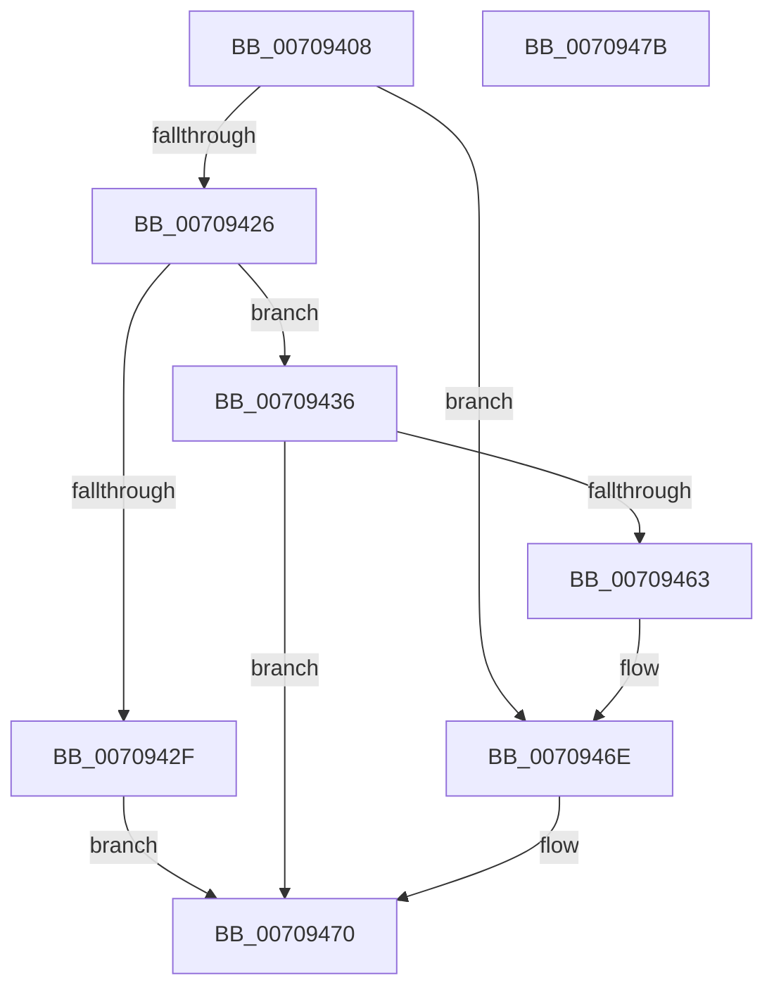

# HalpDmaCvmMakeContiguousVirtualBufferPrivate

- RVA: `0x00709408`–`0x0070947C` (길이 `116` bytes)
- VA: `0x0000000140709408`
- 실행 섹션: `PAGE`
- PDB 이름 있음: `예`; PDB Function 태그: `아니요`
- unwind 정보 RVA: `0x0005CAAC`
- 디코드: `33`개 명령, `116/116` bytes 표시
- 미해석 바이트: `0` (있으면 어셈블리에 `.byte`로 보존)

> 이 문서는 커널 이미지의 기계어와 PDB 기호를 분석해 생성했습니다. 4번과 5번은 함수 원형과 자료형을 바이너리 사용 방식에서 추정한 C 해석이며 원본 소스 복구 결과는 아닙니다.

## 1. Dependencies

- 직접 호출 지점: **3**; 고유 호출 대상: **3**
- 직접 호출자로 확인된 함수: **1**
- RIP 상대 이미지 참조: **2**

### Outgoing calls
- `0x00709418` → [MmGetPhysicalAddress](../../text/23/MmGetPhysicalAddress_function_0023A500.md) (function, `0x0023A500`)
- `0x0070945A` → [HalpDmaCvmSetPageShareability](HalpDmaCvmSetPageShareability_function_0070973C.md) (function, `0x0070973C`)
- `0x00709469` → [MmUnmapIoSpace](../../text/3F/MmUnmapIoSpace_function_003F78F0.md) (function, `0x003F78F0`)

### Direct callers
- [HalFreeCommonBufferV3](../../text/55/HalFreeCommonBufferV3_function_00551A70.md) at `0x00551B14`

### Static image references
- `0x0070941D` → RVA `0x00FC18A1` (`.data`; read)
- `0x00709426` → RVA `0x00FC18A8` (`.data`; read)

## 2. Other-region calls and transfers

- 다른 실행 섹션으로 향하는 call: **2**
  - `0x00709418` → [MmGetPhysicalAddress](../../text/23/MmGetPhysicalAddress_function_0023A500.md) (`PAGE` → `.text`)
  - `0x00709469` → [MmUnmapIoSpace](../../text/3F/MmUnmapIoSpace_function_003F78F0.md) (`PAGE` → `.text`)
- 별도 외부 분기/꼬리 이동을 확인하지 못했습니다.

## 3. Assembly (complete function range)

```asm
00709408  48 89 5C 24 08                  mov qword ptr [rsp + 8], rbx
0070940D  57                              push rdi
0070940E  48 83 EC 20                     sub rsp, 0x20
00709412  48 8B DA                        mov rbx, rdx
00709415  48 8B F9                        mov rdi, rcx
00709418  E8 E3 10 B3 FF                  call 0x14023a500
0070941D  80 3D 7D 84 8B 00 00            cmp byte ptr [rip + 0x8b847d], 0
00709424  75 48                           jne 0x14070946e
00709426  48 85 05 7B 84 8B 00            test qword ptr [rip + 0x8b847b], rax
0070942D  75 07                           jne 0x140709436
0070942F  B8 EF 00 00 C0                  mov eax, 0xc00000ef
00709434  EB 3A                           jmp 0x140709470
00709436  BA 00 00 00 00                  mov edx, 0
0070943B  4C 8D 4C 24 40                  lea r9, [rsp + 0x40]
00709440  48 F7 C3 FF 0F 00 00            test rbx, 0xfff
00709447  48 8B CB                        mov rcx, rbx
0070944A  0F 95 C2                        setne dl
0070944D  48 C1 E9 0C                     shr rcx, 0xc
00709451  48 03 D1                        add rdx, rcx
00709454  45 33 C0                        xor r8d, r8d
00709457  48 8B C8                        mov rcx, rax
0070945A  E8 DD 02 00 00                  call 0x14070973c
0070945F  85 C0                           test eax, eax
00709461  78 0D                           js 0x140709470
00709463  48 8B D3                        mov rdx, rbx
00709466  48 8B CF                        mov rcx, rdi
00709469  E8 82 E4 CE FF                  call 0x1403f78f0
0070946E  33 C0                           xor eax, eax
00709470  48 8B 5C 24 30                  mov rbx, qword ptr [rsp + 0x30]
00709475  48 83 C4 20                     add rsp, 0x20
00709479  5F                              pop rdi
0070947A  C3                              ret
0070947B  CC                              int3
```

## 4. C-style interpretation (structured pseudocode)

```c
__int64 __fastcall HalpDmaCvmMakeContiguousVirtualBufferPrivate(__int64 a1, __int64 a2, int a3)
{
    __int64 result;
    __int64 v_rsp;
    unsigned __int64 v_stack_p18;
    unsigned __int64 v_stack_p8;

    v_stack_p8 = v_rbx;
    v_rsp = (v_rsp) - (32);
    result = MmGetPhysicalAddress(a1, a2, a3, a4);
    if ((*(unsigned __int8 *)(v_rip + 9143421)) != 0) goto loc_0070946E;
    if (((*(unsigned __int64 *)(v_rip + 9143419)) & (result)) != 0) goto loc_00709436;
    goto loc_00709470;
loc_00709436:
    a2 = (((a2) & (0xFFFULL)) != 0) ? 1 : 0;
    a1 = (a2) >> (12);
    a2 = (a2) + (a1);
    a3 = 0;
    result = HalpDmaCvmSetPageShareability((unsigned int)(0xC00000EFULL), a2, a3, v_stack_p18);
    if (sign_flag) goto loc_00709470;
    result = MmUnmapIoSpace(a1, a2, a3, v_stack_p18);
loc_0070946E:
    result = 0;
loc_00709470:
    v_rsp = (v_rsp) + (32);
    return result;
}
```

## 5. (Beta) C Style

```c
int64_t HalpDmaCvmMakeContiguousVirtualBufferPrivate(int64_t Arg1, int64_t Arg2, int32_t Arg3)
{
    int64_t result;
    int64_t local_rsp;
    uint64_t v_stack_p18;
    uint64_t v_stack_p8;

    v_stack_p8 = local_rbx;
    local_rsp = (local_rsp) - (32);
    result = MmGetPhysicalAddress(Arg1, Arg2, Arg3, a4);
    if ((*(uint8_t *)(v_rip + 0x8B847D)) != 0) goto loc_0070946E;
    if (((*(uint64_t *)(v_rip + 0x8B847B)) & (result)) != 0) goto loc_00709436;
    goto loc_00709470;
loc_00709436:
    Arg2 = (((Arg2) & (0xFFFULL)) != 0) ? 1 : 0;
    Arg1 = (Arg2) >> (12);
    Arg2 = (Arg2) + (Arg1);
    Arg3 = 0;
    result = HalpDmaCvmSetPageShareability((uint32_t)(0xC00000EFULL), Arg2, Arg3, v_stack_p18);
    if (sign_flag) goto loc_00709470;
    result = MmUnmapIoSpace(Arg1, Arg2, Arg3, v_stack_p18);
loc_0070946E:
    result = 0;
loc_00709470:
    local_rsp = (local_rsp) + (32);
    return result;
}
```

## 6. Execution-region graph

[열기: 2D/3D 그래프와 함수 탐색 컨트롤 패널](../../../control-panel.html?section=page&rva=0x00709408&view=graph)

- 2D 그래프는 위에서 아래로 흐르고, 3D 그래프는 빈 공간을 드래그해 회전합니다. Shift+드래그는 이동, 휠은 확대·축소, 함수 노드 선택은 대상 보고서 이동입니다.

### Static fallback


