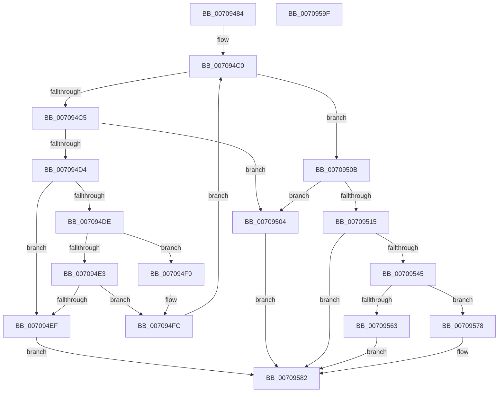

# HalpDmaCvmMakeContiguousVirtualBufferShared

- RVA: `0x00709484`–`0x007095A0` (길이 `284` bytes)
- VA: `0x0000000140709484`
- 실행 섹션: `PAGE`
- PDB 이름 있음: `예`; PDB Function 태그: `아니요`
- unwind 정보 RVA: `0x000B0E24`
- 디코드: `86`개 명령, `284/284` bytes 표시
- 미해석 바이트: `0` (있으면 어셈블리에 `.byte`로 보존)

> 이 문서는 커널 이미지의 기계어와 PDB 기호를 분석해 생성했습니다. 4번과 5번은 함수 원형과 자료형을 바이너리 사용 방식에서 추정한 C 해석이며 원본 소스 복구 결과는 아닙니다.

## 1. Dependencies

- 직접 호출 지점: **4**; 고유 호출 대상: **3**
- 직접 호출자로 확인된 함수: **1**
- RIP 상대 이미지 참조: **0**

### Outgoing calls
- `0x007094D4` → [MmGetPhysicalAddress](../../text/23/MmGetPhysicalAddress_function_0023A500.md) (function, `0x0023A500`)
- `0x0070953C` → [HalpDmaCvmSetPageShareability](HalpDmaCvmSetPageShareability_function_0070973C.md) (function, `0x0070973C`)
- `0x00709556` → [MmMapIoSpaceEx](../../text/32/MmMapIoSpaceEx_function_00327830.md) (function, `0x00327830`)
- `0x00709571` → [HalpDmaCvmSetPageShareability](HalpDmaCvmSetPageShareability_function_0070973C.md) (function, `0x0070973C`)

### Direct callers
- [HalpAllocateDomainCommonBufferInternal](../../text/3E/HalpAllocateDomainCommonBufferInternal_function_003E8B64.md) at `0x003E8D47`

### Static image references
- 디코드된 RIP-relative 메모리 참조가 없습니다.

## 2. Other-region calls and transfers

- 다른 실행 섹션으로 향하는 call: **2**
  - `0x007094D4` → [MmGetPhysicalAddress](../../text/23/MmGetPhysicalAddress_function_0023A500.md) (`PAGE` → `.text`)
  - `0x00709556` → [MmMapIoSpaceEx](../../text/32/MmMapIoSpaceEx_function_00327830.md) (`PAGE` → `.text`)
- 별도 외부 분기/꼬리 이동을 확인하지 못했습니다.

## 3. Assembly (complete function range)

```asm
00709484  48 89 5C 24 08                  mov qword ptr [rsp + 8], rbx
00709489  48 89 6C 24 18                  mov qword ptr [rsp + 0x18], rbp
0070948E  48 89 74 24 20                  mov qword ptr [rsp + 0x20], rsi
00709493  57                              push rdi
00709494  41 54                           push r12
00709496  41 55                           push r13
00709498  41 56                           push r14
0070949A  41 57                           push r15
0070949C  48 83 EC 20                     sub rsp, 0x20
007094A0  4C 8D BA FF 0F 00 00            lea r15, [rdx + 0xfff]
007094A7  33 DB                           xor ebx, ebx
007094A9  49 C1 EF 0C                     shr r15, 0xc
007094AD  33 FF                           xor edi, edi
007094AF  33 F6                           xor esi, esi
007094B1  45 8B FF                        mov r15d, r15d
007094B4  4D 8B E1                        mov r12, r9
007094B7  4D 8B E8                        mov r13, r8
007094BA  48 8B EA                        mov rbp, rdx
007094BD  4C 8B F1                        mov r14, rcx
007094C0  49 3B FF                        cmp rdi, r15
007094C3  73 46                           jae 0x14070950b
007094C5  48 8B CF                        mov rcx, rdi
007094C8  48 C1 E1 0C                     shl rcx, 0xc
007094CC  49 03 CE                        add rcx, r14
007094CF  49 3B CE                        cmp rcx, r14
007094D2  72 30                           jb 0x140709504
007094D4  E8 27 10 B3 FF                  call 0x14023a500
007094D9  48 85 C0                        test rax, rax
007094DC  74 11                           je 0x1407094ef
007094DE  48 85 FF                        test rdi, rdi
007094E1  74 16                           je 0x1407094f9
007094E3  48 8D 8E 00 10 00 00            lea rcx, [rsi + 0x1000]
007094EA  48 3B C8                        cmp rcx, rax
007094ED  74 0D                           je 0x1407094fc
007094EF  B8 EF 00 00 C0                  mov eax, 0xc00000ef
007094F4  E9 89 00 00 00                  jmp 0x140709582
007094F9  48 8B D8                        mov rbx, rax
007094FC  48 FF C7                        inc rdi
007094FF  48 8B F0                        mov rsi, rax
00709502  EB BC                           jmp 0x1407094c0
00709504  B8 F0 00 00 C0                  mov eax, 0xc00000f0
00709509  EB 77                           jmp 0x140709582
0070950B  48 89 5C 24 58                  mov qword ptr [rsp + 0x58], rbx
00709510  48 85 DB                        test rbx, rbx
00709513  74 EF                           je 0x140709504
00709515  B9 00 00 00 00                  mov ecx, 0
0070951A  4C 8D 4C 24 58                  lea r9, [rsp + 0x58]
0070951F  48 F7 C5 FF 0F 00 00            test rbp, 0xfff
00709526  48 8B FD                        mov rdi, rbp
00709529  41 B0 01                        mov r8b, 1
0070952C  0F 95 C1                        setne cl
0070952F  48 C1 EF 0C                     shr rdi, 0xc
00709533  48 03 F9                        add rdi, rcx
00709536  48 8B CB                        mov rcx, rbx
00709539  48 8B D7                        mov rdx, rdi
0070953C  E8 FB 01 00 00                  call 0x14070973c
00709541  85 C0                           test eax, eax
00709543  78 3D                           js 0x140709582
00709545  48 8B 5C 24 58                  mov rbx, qword ptr [rsp + 0x58]
0070954A  41 B8 04 00 00 00               mov r8d, 4
00709550  48 8B CB                        mov rcx, rbx
00709553  48 8B D5                        mov rdx, rbp
00709556  E8 D5 E2 C1 FF                  call 0x140327830
0070955B  48 8B C8                        mov rcx, rax
0070955E  48 85 C0                        test rax, rax
00709561  75 15                           jne 0x140709578
00709563  4C 8D 4C 24 58                  lea r9, [rsp + 0x58]
00709568  45 33 C0                        xor r8d, r8d
0070956B  48 8B D7                        mov rdx, rdi
0070956E  48 8B CB                        mov rcx, rbx
00709571  E8 C6 01 00 00                  call 0x14070973c
00709576  EB 0A                           jmp 0x140709582
00709578  33 C0                           xor eax, eax
0070957A  49 89 4D 00                     mov qword ptr [r13], rcx
0070957E  49 89 1C 24                     mov qword ptr [r12], rbx
00709582  48 8B 5C 24 50                  mov rbx, qword ptr [rsp + 0x50]
00709587  48 8B 6C 24 60                  mov rbp, qword ptr [rsp + 0x60]
0070958C  48 8B 74 24 68                  mov rsi, qword ptr [rsp + 0x68]
00709591  48 83 C4 20                     add rsp, 0x20
00709595  41 5F                           pop r15
00709597  41 5E                           pop r14
00709599  41 5D                           pop r13
0070959B  41 5C                           pop r12
0070959D  5F                              pop rdi
0070959E  C3                              ret
0070959F  CC                              int3
```

## 4. C-style interpretation (structured pseudocode)

```c
__int64 __fastcall HalpDmaCvmMakeContiguousVirtualBufferShared(__int64 a1, __int64 a2, __int64 a3, __int64 a4)
{
    __int64 result;
    __int64 v_r15;
    __int64 v_rbx;
    __int64 v_rdi;
    __int64 v_rsi;
    __int64 v_rsp;
    unsigned __int64 v_stack_p10;
    unsigned __int64 v_stack_p18;
    unsigned __int64 v_stack_p20;
    unsigned __int64 v_stack_p8;

    v_stack_p8 = v_rbx;
    v_stack_p18 = v_rbp;
    v_stack_p20 = v_rsi;
    v_rsp = (v_rsp) - (32);
    v_rbx = 0;
    v_r15 = (a2 + 4095) >> (12);
    v_rdi = 0;
    v_rsi = 0;
loc_007094C0:
    if (0 >= ((unsigned int)((unsigned int)(v_r15)))) goto loc_0070950B;
    a1 = (0) << (12);
    a1 = (a1) + (a1);
    if (a1 < a1) goto loc_00709504;
    result = MmGetPhysicalAddress(a1, a2, a3, a4);
    if (result == 0) goto loc_007094EF;
    if (0 == 0) goto loc_007094F9;
    if ((v_rsi + 4096) == result) goto loc_007094FC;
loc_007094EF:
    goto loc_00709582;
loc_007094F9:
loc_007094FC:
    v_rdi = (v_rdi) + 1;
    goto loc_007094C0;
loc_00709504:
    goto loc_00709582;
loc_0070950B:
    v_stack_p10 = (unsigned int)(0xC00000EFULL);
    if ((unsigned int)(0xC00000EFULL) == 0) goto loc_00709504;
    a1 = (((a2) & (0xFFFULL)) != 0) ? 1 : 0;
    v_rdi = (a2) >> (12);
    v_rdi = (v_rdi) + (a1);
    result = HalpDmaCvmSetPageShareability((unsigned int)(0xC00000EFULL), v_rdi, 1, v_stack_p10);
    if (sign_flag) goto loc_00709582;
    result = MmMapIoSpaceEx(v_stack_p10, a2, 4, v_stack_p10);
    if (result != 0) goto loc_00709578;
    a3 = 0;
    result = HalpDmaCvmSetPageShareability(v_stack_p10, v_rdi, a3, v_stack_p10);
    goto loc_00709582;
loc_00709578:
    result = 0;
    *(unsigned __int64 *)(a3) = v_stack_p10;
    *(unsigned __int64 *)(a4) = v_stack_p10;
loc_00709582:
    v_rsp = (v_rsp) + (32);
    return result;
}
```

## 5. (Beta) C Style

```c
int64_t HalpDmaCvmMakeContiguousVirtualBufferShared(int64_t Arg1, void *Arg2, void *Arg3, void *Arg4)
{
    uint8_t *arg2 = (uint8_t *)Arg2;
    uint8_t *arg3 = (uint8_t *)Arg3;
    uint8_t *arg4 = (uint8_t *)Arg4;

    int64_t result;
    int64_t local_r15;
    int64_t local_rbx;
    int64_t local_rdi;
    int64_t local_rsi;
    int64_t local_rsp;
    uint64_t v_stack_p10;
    uint64_t v_stack_p18;
    uint64_t v_stack_p20;
    uint64_t v_stack_p8;

    v_stack_p8 = local_rbx;
    v_stack_p18 = local_rbp;
    v_stack_p20 = local_rsi;
    local_rsp = (local_rsp) - (32);
    local_rbx = 0;
    local_r15 = (Arg2 + 4095) >> (12);
    local_rdi = 0;
    local_rsi = 0;
loc_007094C0:
    if (0 >= ((uint32_t)((uint32_t)(local_r15)))) goto loc_0070950B;
    Arg1 = (0) << (12);
    Arg1 = (Arg1) + (Arg1);
    if (Arg1 < Arg1) goto loc_00709504;
    result = MmGetPhysicalAddress(Arg1, Arg2, Arg3, Arg4);
    if (result == 0) goto loc_007094EF;
    if (0 == 0) goto loc_007094F9;
    if ((local_rsi + 4096) == result) goto loc_007094FC;
loc_007094EF:
    goto loc_00709582;
loc_007094F9:
loc_007094FC:
    local_rdi = (local_rdi) + 1;
    goto loc_007094C0;
loc_00709504:
    goto loc_00709582;
loc_0070950B:
    v_stack_p10 = (uint32_t)(0xC00000EFULL);
    if ((uint32_t)(0xC00000EFULL) == 0) goto loc_00709504;
    Arg1 = (((Arg2) & (0xFFFULL)) != 0) ? 1 : 0;
    local_rdi = (Arg2) >> (12);
    local_rdi = (local_rdi) + (Arg1);
    result = HalpDmaCvmSetPageShareability((uint32_t)(0xC00000EFULL), local_rdi, 1, v_stack_p10);
    if (sign_flag) goto loc_00709582;
    result = MmMapIoSpaceEx(v_stack_p10, Arg2, 4, v_stack_p10);
    if (result != 0) goto loc_00709578;
    Arg3 = 0;
    result = HalpDmaCvmSetPageShareability(v_stack_p10, local_rdi, Arg3, v_stack_p10);
    goto loc_00709582;
loc_00709578:
    result = 0;
    *(uint64_t *)(arg3) = v_stack_p10;
    *(uint64_t *)(arg4) = v_stack_p10;
loc_00709582:
    local_rsp = (local_rsp) + (32);
    return result;
}
```

### 관측된 메모리 오프셋

구조체 형식이 확인되지 않은 접근은 인자 기준의 오프셋으로만 기록했습니다.

| 기준 인자 | 오프셋 표현 | 폭 (bit) | 접근 |
|---|---:|---:|---|
| `Arg2` | `+ 0xFFF` | `64` | `R` |
| `Arg3` | `+ 0x0` | `64` | `W` |
| `Arg4` | `+ 0x0` | `64` | `W` |

## 6. Execution-region graph

[열기: 2D/3D 그래프와 함수 탐색 컨트롤 패널](../../../control-panel.html?section=page&rva=0x00709484&view=graph)

- 2D 그래프는 위에서 아래로 흐르고, 3D 그래프는 빈 공간을 드래그해 회전합니다. Shift+드래그는 이동, 휠은 확대·축소, 함수 노드 선택은 대상 보고서 이동입니다.

### Static fallback


