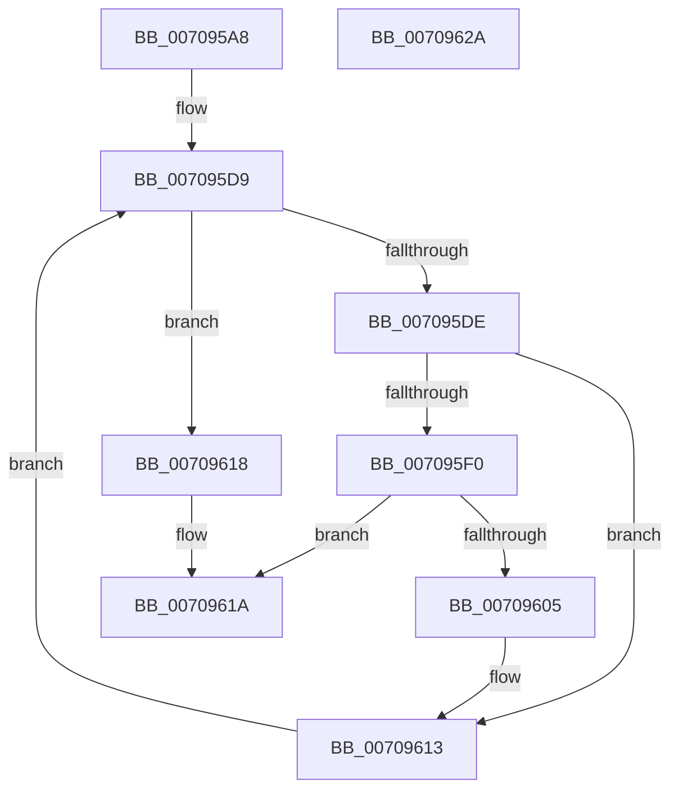

# HalpDmaCvmMakeMdlDevicePrivate

- RVA: `0x007095A8`–`0x0070962B` (길이 `131` bytes)
- VA: `0x00000001407095A8`
- 실행 섹션: `PAGE`
- PDB 이름 있음: `예`; PDB Function 태그: `아니요`
- unwind 정보 RVA: `0x0005FD94`
- 디코드: `37`개 명령, `131/131` bytes 표시
- 미해석 바이트: `0` (있으면 어셈블리에 `.byte`로 보존)

> 이 문서는 커널 이미지의 기계어와 PDB 기호를 분석해 생성했습니다. 4번과 5번은 함수 원형과 자료형을 바이너리 사용 방식에서 추정한 C 해석이며 원본 소스 복구 결과는 아닙니다.

## 1. Dependencies

- 직접 호출 지점: **1**; 고유 호출 대상: **1**
- 직접 호출자로 확인된 함수: **1**
- RIP 상대 이미지 참조: **1**

### Outgoing calls
- `0x007095FC` → [HalpDmaCvmSetPageShareability](HalpDmaCvmSetPageShareability_function_0070973C.md) (function, `0x0070973C`)

### Direct callers
- [HalpDmaFreeChildAdapter](../../text/55/HalpDmaFreeChildAdapter_function_00550E30.md) at `0x00550F8F`
- [HalpDmaFreeChildAdapter](../../text/55/HalpDmaFreeChildAdapter_function_00550E30.md) at `0x00551065`

### Static image references
- `0x007095E7` → RVA `0x00FC18A8` (`.data`; read)

## 2. Other-region calls and transfers

- 다른 실행 섹션으로 향하는 call: **0**
- 별도 외부 분기/꼬리 이동을 확인하지 못했습니다.

## 3. Assembly (complete function range)

```asm
007095A8  48 89 5C 24 10                  mov qword ptr [rsp + 0x10], rbx
007095AD  48 89 74 24 18                  mov qword ptr [rsp + 0x18], rsi
007095B2  57                              push rdi
007095B3  48 83 EC 20                     sub rsp, 0x20
007095B7  8B 51 28                        mov edx, dword ptr [rcx + 0x28]
007095BA  B8 00 00 00 00                  mov eax, 0
007095BF  48 83 64 24 30 00               and qword ptr [rsp + 0x30], 0
007095C5  48 8B F9                        mov rdi, rcx
007095C8  F7 C2 FF 0F 00 00               test edx, 0xfff
007095CE  0F 95 C0                        setne al
007095D1  C1 EA 0C                        shr edx, 0xc
007095D4  33 DB                           xor ebx, ebx
007095D6  8D 34 02                        lea esi, [rdx + rax]
007095D9  48 3B DE                        cmp rbx, rsi
007095DC  73 3A                           jae 0x140709618
007095DE  48 8B 4C DF 30                  mov rcx, qword ptr [rdi + rbx*8 + 0x30]
007095E3  48 C1 E1 0C                     shl rcx, 0xc
007095E7  48 85 0D BA 82 8B 00            test qword ptr [rip + 0x8b82ba], rcx
007095EE  74 23                           je 0x140709613
007095F0  45 33 C0                        xor r8d, r8d
007095F3  4C 8D 4C 24 30                  lea r9, [rsp + 0x30]
007095F8  41 8D 50 01                     lea edx, [r8 + 1]
007095FC  E8 3B 01 00 00                  call 0x14070973c
00709601  85 C0                           test eax, eax
00709603  78 15                           js 0x14070961a
00709605  48 8B 44 24 30                  mov rax, qword ptr [rsp + 0x30]
0070960A  48 C1 F8 0C                     sar rax, 0xc
0070960E  48 89 44 DF 30                  mov qword ptr [rdi + rbx*8 + 0x30], rax
00709613  48 FF C3                        inc rbx
00709616  EB C1                           jmp 0x1407095d9
00709618  33 C0                           xor eax, eax
0070961A  48 8B 5C 24 38                  mov rbx, qword ptr [rsp + 0x38]
0070961F  48 8B 74 24 40                  mov rsi, qword ptr [rsp + 0x40]
00709624  48 83 C4 20                     add rsp, 0x20
00709628  5F                              pop rdi
00709629  C3                              ret
0070962A  CC                              int3
```

## 4. C-style interpretation (structured pseudocode)

```c
__int64 __fastcall HalpDmaCvmMakeMdlDevicePrivate(__int64 a1, __int64 a2, int a3)
{
    __int64 result;
    __int64 v_rbx;
    __int64 v_rsp;
    unsigned __int64 v_stack_p10;
    unsigned __int64 v_stack_p18;
    unsigned __int64 v_stack_p8;

    v_stack_p10 = v_rbx;
    v_stack_p18 = v_rsi;
    v_rsp = (v_rsp) - (32);
    result = ((((unsigned int)((unsigned int)(*(unsigned int *)(a1 + 40)))) & (0xFFFULL)) != 0) ? 1 : 0;
    a2 = (unsigned int)(((unsigned int)(*(unsigned int *)(a1 + 40))) >> (12));
    v_rbx = 0;
loc_007095D9:
    if (0 >= (a2 + result * 1)) goto loc_00709618;
    a1 = (*(unsigned __int64 *)(a1 + v_rbx * 8 + 48)) << (12);
    if (((*(unsigned __int64 *)(v_rip + 9142970)) & (a1)) == 0) goto loc_00709613;
    a3 = 0;
    result = HalpDmaCvmSetPageShareability(a1, a3 + 1, a3, v_stack_p8);
    if (sign_flag) goto loc_0070961A;
    result = (v_stack_p8) >> (12);
    *(unsigned __int64 *)(a1 + v_rbx * 8 + 48) = result;
loc_00709613:
    v_rbx = (v_rbx) + 1;
    goto loc_007095D9;
loc_00709618:
    result = 0;
loc_0070961A:
    v_rsp = (v_rsp) + (32);
    return result;
}
```

## 5. (Beta) C Style

```c
int64_t HalpDmaCvmMakeMdlDevicePrivate(void *Arg1, int64_t Arg2, int32_t Arg3)
{
    uint8_t *arg1 = (uint8_t *)Arg1;

    int64_t result;
    int64_t local_rbx;
    int64_t local_rsp;
    uint64_t v_stack_p10;
    uint64_t v_stack_p18;
    uint64_t v_stack_p8;

    v_stack_p10 = local_rbx;
    v_stack_p18 = local_rsi;
    local_rsp = (local_rsp) - (32);
    result = ((((uint32_t)((uint32_t)(*(uint32_t *)(arg1 + 0x28)))) & (0xFFFULL)) != 0) ? 1 : 0;
    Arg2 = (uint32_t)(((uint32_t)(*(uint32_t *)(arg1 + 0x28))) >> (12));
    local_rbx = 0;
loc_007095D9:
    if (0 >= (Arg2 + result * 1)) goto loc_00709618;
    Arg1 = (*(uint64_t *)(arg1 + local_rbx * 8 + 0x30)) << (12);
    if (((*(uint64_t *)(v_rip + 0x8B82BA)) & (Arg1)) == 0) goto loc_00709613;
    Arg3 = 0;
    result = HalpDmaCvmSetPageShareability(Arg1, Arg3 + 1, Arg3, v_stack_p8);
    if (sign_flag) goto loc_0070961A;
    result = (v_stack_p8) >> (12);
    *(uint64_t *)(arg1 + local_rbx * 8 + 0x30) = result;
loc_00709613:
    local_rbx = (local_rbx) + 1;
    goto loc_007095D9;
loc_00709618:
    result = 0;
loc_0070961A:
    local_rsp = (local_rsp) + (32);
    return result;
}
```

### 관측된 메모리 오프셋

구조체 형식이 확인되지 않은 접근은 인자 기준의 오프셋으로만 기록했습니다.

| 기준 인자 | 오프셋 표현 | 폭 (bit) | 접근 |
|---|---:|---:|---|
| `Arg1` | `+ 0x28` | `32` | `R` |
| `Arg1` | `+ 0x30 + rbx*8` | `64` | `R` |
| `Arg1` | `+ 0x30 + rbx*8` | `64` | `W` |

## 6. Execution-region graph

[열기: 2D/3D 그래프와 함수 탐색 컨트롤 패널](../../../control-panel.html?section=page&rva=0x007095A8&view=graph)

- 2D 그래프는 위에서 아래로 흐르고, 3D 그래프는 빈 공간을 드래그해 회전합니다. Shift+드래그는 이동, 휠은 확대·축소, 함수 노드 선택은 대상 보고서 이동입니다.

### Static fallback


