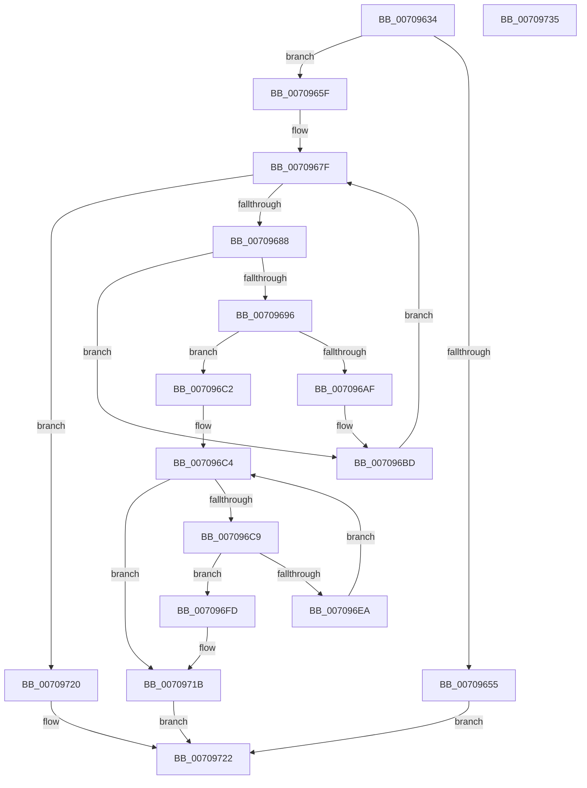

# HalpDmaCvmMakeMdlDeviceShared

- RVA: `0x00709634`–`0x00709736` (길이 `258` bytes)
- VA: `0x0000000140709634`
- 실행 섹션: `PAGE`
- PDB 이름 있음: `예`; PDB Function 태그: `아니요`
- unwind 정보 RVA: `0x000B8D7C`
- 디코드: `73`개 명령, `258/258` bytes 표시
- 미해석 바이트: `0` (있으면 어셈블리에 `.byte`로 보존)

> 이 문서는 커널 이미지의 기계어와 PDB 기호를 분석해 생성했습니다. 4번과 5번은 함수 원형과 자료형을 바이너리 사용 방식에서 추정한 C 해석이며 원본 소스 복구 결과는 아닙니다.

## 1. Dependencies

- 직접 호출 지점: **3**; 고유 호출 대상: **2**
- 직접 호출자로 확인된 함수: **1**
- RIP 상대 이미지 참조: **1**

### Outgoing calls
- `0x007096A3` → [HalpDmaCvmSetPageShareability](HalpDmaCvmSetPageShareability_function_0070973C.md) (function, `0x0070973C`)
- `0x007096E1` → [HalpDmaCvmSetPageShareability](HalpDmaCvmSetPageShareability_function_0070973C.md) (function, `0x0070973C`)
- `0x00709715` → [KeBugCheckEx](../../text/4F/KeBugCheckEx_function_004FD660.md) (function, `0x004FD660`)

### Direct callers
- [HalpDmaAllocateScatterMemory](../AA/HalpDmaAllocateScatterMemory_function_00AA2D70.md) at `0x00AA2DE0`

### Static image references
- `0x00709667` → RVA `0x00FC18A8` (`.data`; read)

## 2. Other-region calls and transfers

- 다른 실행 섹션으로 향하는 call: **1**
  - `0x00709715` → [KeBugCheckEx](../../text/4F/KeBugCheckEx_function_004FD660.md) (`PAGE` → `.text`)
- 별도 외부 분기/꼬리 이동을 확인하지 못했습니다.

## 3. Assembly (complete function range)

```asm
00709634  48 89 5C 24 10                  mov qword ptr [rsp + 0x10], rbx
00709639  48 89 6C 24 18                  mov qword ptr [rsp + 0x18], rbp
0070963E  56                              push rsi
0070963F  57                              push rdi
00709640  41 56                           push r14
00709642  48 83 EC 30                     sub rsp, 0x30
00709646  48 83 64 24 50 00               and qword ptr [rsp + 0x50], 0
0070964C  48 8B F1                        mov rsi, rcx
0070964F  48 83 39 00                     cmp qword ptr [rcx], 0
00709653  74 0A                           je 0x14070965f
00709655  B8 02 00 00 C0                  mov eax, 0xc0000002
0070965A  E9 C3 00 00 00                  jmp 0x140709722
0070965F  8B 49 28                        mov ecx, dword ptr [rcx + 0x28]
00709662  B8 00 00 00 00                  mov eax, 0
00709667  48 8B 2D 3A 82 8B 00            mov rbp, qword ptr [rip + 0x8b823a]
0070966E  F7 C1 FF 0F 00 00               test ecx, 0xfff
00709674  0F 95 C0                        setne al
00709677  C1 E9 0C                        shr ecx, 0xc
0070967A  33 FF                           xor edi, edi
0070967C  8D 1C 01                        lea ebx, [rcx + rax]
0070967F  48 3B FB                        cmp rdi, rbx
00709682  0F 83 98 00 00 00               jae 0x140709720
00709688  48 8B 4C FE 30                  mov rcx, qword ptr [rsi + rdi*8 + 0x30]
0070968D  48 C1 E1 0C                     shl rcx, 0xc
00709691  48 85 E9                        test rcx, rbp
00709694  75 27                           jne 0x1407096bd
00709696  4C 8D 4C 24 50                  lea r9, [rsp + 0x50]
0070969B  41 B0 01                        mov r8b, 1
0070969E  BA 01 00 00 00                  mov edx, 1
007096A3  E8 94 00 00 00                  call 0x14070973c
007096A8  44 8B F0                        mov r14d, eax
007096AB  85 C0                           test eax, eax
007096AD  78 13                           js 0x1407096c2
007096AF  48 8B 44 24 50                  mov rax, qword ptr [rsp + 0x50]
007096B4  48 C1 F8 0C                     sar rax, 0xc
007096B8  48 89 44 FE 30                  mov qword ptr [rsi + rdi*8 + 0x30], rax
007096BD  48 FF C7                        inc rdi
007096C0  EB BD                           jmp 0x14070967f
007096C2  33 ED                           xor ebp, ebp
007096C4  48 3B EF                        cmp rbp, rdi
007096C7  73 52                           jae 0x14070971b
007096C9  48 8B 5C EE 30                  mov rbx, qword ptr [rsi + rbp*8 + 0x30]
007096CE  4C 8D 4C 24 50                  lea r9, [rsp + 0x50]
007096D3  45 33 C0                        xor r8d, r8d
007096D6  48 C1 E3 0C                     shl rbx, 0xc
007096DA  48 8B CB                        mov rcx, rbx
007096DD  41 8D 50 01                     lea edx, [r8 + 1]
007096E1  E8 56 00 00 00                  call 0x14070973c
007096E6  85 C0                           test eax, eax
007096E8  78 13                           js 0x1407096fd
007096EA  48 8B 44 24 50                  mov rax, qword ptr [rsp + 0x50]
007096EF  48 C1 F8 0C                     sar rax, 0xc
007096F3  48 89 44 EE 30                  mov qword ptr [rsi + rbp*8 + 0x30], rax
007096F8  48 FF C5                        inc rbp
007096FB  EB C7                           jmp 0x1407096c4
007096FD  4C 63 C8                        movsxd r9, eax
00709700  BA 00 10 00 00                  mov edx, 0x1000
00709705  B9 AC 00 00 00                  mov ecx, 0xac
0070970A  48 89 5C 24 20                  mov qword ptr [rsp + 0x20], rbx
0070970F  41 B8 08 EF 00 00               mov r8d, 0xef08
00709715  E8 46 3F DF FF                  call 0x1404fd660
0070971A  CC                              int3
0070971B  41 8B C6                        mov eax, r14d
0070971E  EB 02                           jmp 0x140709722
00709720  33 C0                           xor eax, eax
00709722  48 8B 5C 24 58                  mov rbx, qword ptr [rsp + 0x58]
00709727  48 8B 6C 24 60                  mov rbp, qword ptr [rsp + 0x60]
0070972C  48 83 C4 30                     add rsp, 0x30
00709730  41 5E                           pop r14
00709732  5F                              pop rdi
00709733  5E                              pop rsi
00709734  C3                              ret
00709735  CC                              int3
```

## 4. C-style interpretation (structured pseudocode)

```c
__int64 __fastcall HalpDmaCvmMakeMdlDeviceShared(__int64 a1)
{
    __int64 result;
    __int64 v_rbp;
    __int64 v_rbx;
    __int64 v_rdi;
    __int64 v_rsp;
    unsigned __int64 v_stack_m28;
    unsigned __int64 v_stack_p10;
    unsigned __int64 v_stack_p18;
    unsigned __int64 v_stack_p8;

    v_stack_p10 = v_rbx;
    v_stack_p18 = v_rbp;
    v_rsp = (v_rsp) - (48);
    if ((*(unsigned __int64 *)(a1)) == 0) goto loc_0070965F;
    goto loc_00709722;
loc_0070965F:
    result = ((((unsigned int)((unsigned int)(*(unsigned int *)(a1 + 40)))) & (0xFFFULL)) != 0) ? 1 : 0;
    a1 = (unsigned int)(((unsigned int)(*(unsigned int *)(a1 + 40))) >> (12));
    v_rdi = 0;
loc_0070967F:
    if (0 >= (a1 + result * 1)) goto loc_00709720;
    a1 = (*(unsigned __int64 *)(a1 + v_rdi * 8 + 48)) << (12);
    if (((a1) & (*(unsigned __int64 *)(v_rip + 9142842))) != 0) goto loc_007096BD;
    result = HalpDmaCvmSetPageShareability(a1, 1, 1, v_stack_p8);
    if (sign_flag) goto loc_007096C2;
    result = (v_stack_p8) >> (12);
    *(unsigned __int64 *)(a1 + v_rdi * 8 + 48) = result;
loc_007096BD:
    v_rdi = (v_rdi) + 1;
    goto loc_0070967F;
loc_007096C2:
    v_rbp = 0;
loc_007096C4:
    if (0 >= v_rdi) goto loc_0070971B;
    a3 = 0;
    v_rbx = (*(unsigned __int64 *)(a1 + v_rbp * 8 + 48)) << (12);
    result = HalpDmaCvmSetPageShareability(v_rbx, a3 + 1, a3, v_stack_p8);
    if (sign_flag) goto loc_007096FD;
    result = (v_stack_p8) >> (12);
    *(unsigned __int64 *)(a1 + v_rbp * 8 + 48) = result;
    v_rbp = (v_rbp) + 1;
    goto loc_007096C4;
loc_007096FD:
    v_stack_m28 = v_rbx;
    result = KeBugCheckEx(172, (unsigned int)(0x1000ULL), (unsigned int)(0xEF08ULL), (int)((unsigned int)(result)));
loc_0070971B:
    goto loc_00709722;
loc_00709720:
    result = 0;
loc_00709722:
    v_rsp = (v_rsp) + (48);
    return result;
}
```

## 5. (Beta) C Style

```c
int64_t HalpDmaCvmMakeMdlDeviceShared(void *Arg1)
{
    uint8_t *arg1 = (uint8_t *)Arg1;

    int64_t result;
    int64_t local_rbp;
    int64_t local_rbx;
    int64_t local_rdi;
    int64_t local_rsp;
    uint64_t v_stack_m28;
    uint64_t v_stack_p10;
    uint64_t v_stack_p18;
    uint64_t v_stack_p8;

    v_stack_p10 = local_rbx;
    v_stack_p18 = local_rbp;
    local_rsp = (local_rsp) - (48);
    if ((*(uint64_t *)(arg1)) == 0) goto loc_0070965F;
    goto loc_00709722;
loc_0070965F:
    result = ((((uint32_t)((uint32_t)(*(uint32_t *)(arg1 + 0x28)))) & (0xFFFULL)) != 0) ? 1 : 0;
    Arg1 = (uint32_t)(((uint32_t)(*(uint32_t *)(arg1 + 0x28))) >> (12));
    local_rdi = 0;
loc_0070967F:
    if (0 >= (Arg1 + result * 1)) goto loc_00709720;
    Arg1 = (*(uint64_t *)(arg1 + local_rdi * 8 + 0x30)) << (12);
    if (((Arg1) & (*(uint64_t *)(v_rip + 0x8B823A))) != 0) goto loc_007096BD;
    result = HalpDmaCvmSetPageShareability(Arg1, 1, 1, v_stack_p8);
    if (sign_flag) goto loc_007096C2;
    result = (v_stack_p8) >> (12);
    *(uint64_t *)(arg1 + local_rdi * 8 + 0x30) = result;
loc_007096BD:
    local_rdi = (local_rdi) + 1;
    goto loc_0070967F;
loc_007096C2:
    local_rbp = 0;
loc_007096C4:
    if (0 >= local_rdi) goto loc_0070971B;
    a3 = 0;
    local_rbx = (*(uint64_t *)(arg1 + local_rbp * 8 + 0x30)) << (12);
    result = HalpDmaCvmSetPageShareability(local_rbx, a3 + 1, a3, v_stack_p8);
    if (sign_flag) goto loc_007096FD;
    result = (v_stack_p8) >> (12);
    *(uint64_t *)(arg1 + local_rbp * 8 + 0x30) = result;
    local_rbp = (local_rbp) + 1;
    goto loc_007096C4;
loc_007096FD:
    v_stack_m28 = local_rbx;
    result = KeBugCheckEx(172, (uint32_t)(0x1000ULL), (uint32_t)(0xEF08ULL), (int32_t)((uint32_t)(result)));
loc_0070971B:
    goto loc_00709722;
loc_00709720:
    result = 0;
loc_00709722:
    local_rsp = (local_rsp) + (48);
    return result;
}
```

### 관측된 메모리 오프셋

구조체 형식이 확인되지 않은 접근은 인자 기준의 오프셋으로만 기록했습니다.

| 기준 인자 | 오프셋 표현 | 폭 (bit) | 접근 |
|---|---:|---:|---|
| `Arg1` | `+ 0x0` | `64` | `R` |
| `Arg1` | `+ 0x28` | `32` | `R` |
| `Arg1` | `+ 0x30 + rbp*8` | `64` | `R` |
| `Arg1` | `+ 0x30 + rbp*8` | `64` | `W` |
| `Arg1` | `+ 0x30 + rdi*8` | `64` | `R` |
| `Arg1` | `+ 0x30 + rdi*8` | `64` | `W` |

## 6. Execution-region graph

[열기: 2D/3D 그래프와 함수 탐색 컨트롤 패널](../../../control-panel.html?section=page&rva=0x00709634&view=graph)

- 2D 그래프는 위에서 아래로 흐르고, 3D 그래프는 빈 공간을 드래그해 회전합니다. Shift+드래그는 이동, 휠은 확대·축소, 함수 노드 선택은 대상 보고서 이동입니다.

### Static fallback


