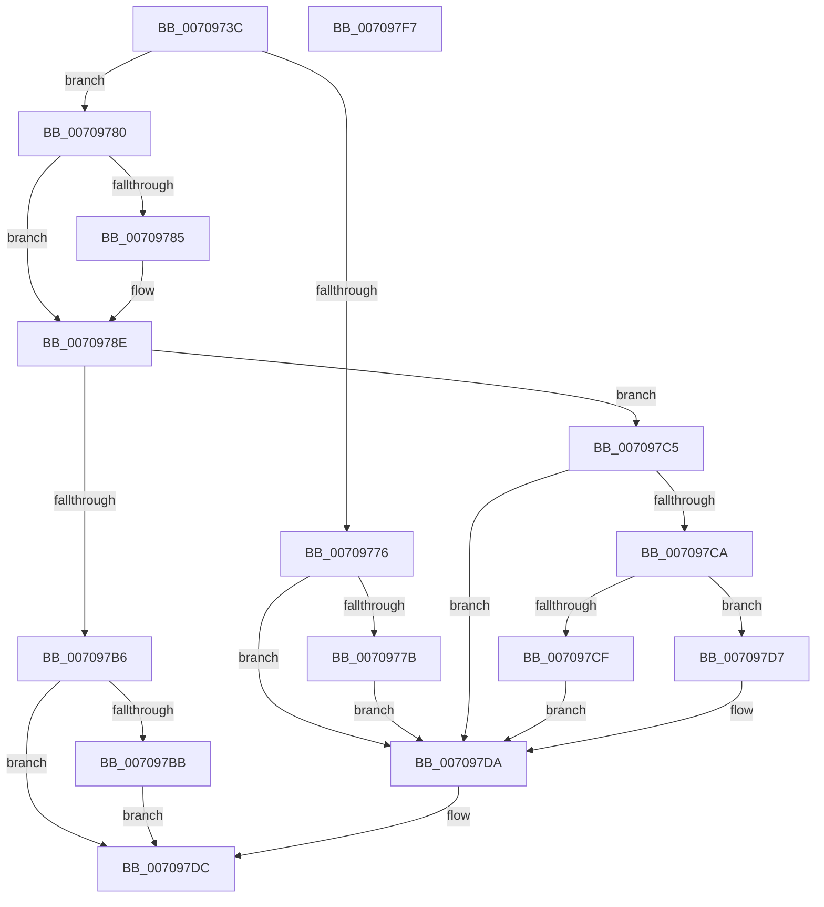

# HalpDmaCvmSetPageShareability

- RVA: `0x0070973C`–`0x007097F8` (길이 `188` bytes)
- VA: `0x000000014070973C`
- 실행 섹션: `PAGE`
- PDB 이름 있음: `예`; PDB Function 태그: `아니요`
- unwind 정보 RVA: `0x00060130`
- 디코드: `57`개 명령, `188/188` bytes 표시
- 미해석 바이트: `0` (있으면 어셈블리에 `.byte`로 보존)

> 이 문서는 커널 이미지의 기계어와 PDB 기호를 분석해 생성했습니다. 4번과 5번은 함수 원형과 자료형을 바이너리 사용 방식에서 추정한 C 해석이며 원본 소스 복구 결과는 아닙니다.

## 1. Dependencies

- 직접 호출 지점: **2**; 고유 호출 대상: **2**
- 직접 호출자로 확인된 함수: **6**
- RIP 상대 이미지 참조: **3**

### Outgoing calls
- `0x007097AD` → [guard_dispatch_icall](../../text/6B/guard_dispatch_icall_function_006BAAD0.md) (function, `0x006BAAD0`)
- `0x007097BE` → [HalpDmaCvmHandleUnrecoverableFrames](../../text/55/HalpDmaCvmHandleUnrecoverableFrames_function_00550CEC.md) (function, `0x00550CEC`)

### Direct callers
- [HalpDmaAllocateMapRegisterFrame](../../text/55/HalpDmaAllocateMapRegisterFrame_function_005506BC.md) at `0x00550753`
- [HalpDmaAllocateMapRegisterFrame](../../text/55/HalpDmaAllocateMapRegisterFrame_function_005506BC.md) at `0x00550784`
- [HalpDmaFreeMapRegisterFrame](../../text/55/HalpDmaFreeMapRegisterFrame_function_005510D4.md) at `0x00551131`
- [HalpDmaCvmMakeContiguousVirtualBufferPrivate](HalpDmaCvmMakeContiguousVirtualBufferPrivate_function_00709408.md) at `0x0070945A`
- [HalpDmaCvmMakeContiguousVirtualBufferShared](HalpDmaCvmMakeContiguousVirtualBufferShared_function_00709484.md) at `0x0070953C`
- [HalpDmaCvmMakeContiguousVirtualBufferShared](HalpDmaCvmMakeContiguousVirtualBufferShared_function_00709484.md) at `0x00709571`
- [HalpDmaCvmMakeMdlDevicePrivate](HalpDmaCvmMakeMdlDevicePrivate_function_007095A8.md) at `0x007095FC`
- [HalpDmaCvmMakeMdlDeviceShared](HalpDmaCvmMakeMdlDeviceShared_function_00709634.md) at `0x007096A3`
- [HalpDmaCvmMakeMdlDeviceShared](HalpDmaCvmMakeMdlDeviceShared_function_00709634.md) at `0x007096E1`

### Static image references
- `0x0070975D` → RVA `0x00FC18A1` (`.data`; read)
- `0x00709767` → RVA `0x00FC18A8` (`.data`; read)
- `0x0070979B` → RVA `0x00FC1EC8` (`.data`; read)

## 2. Other-region calls and transfers

- 다른 실행 섹션으로 향하는 call: **2**
  - `0x007097AD` → [guard_dispatch_icall](../../text/6B/guard_dispatch_icall_function_006BAAD0.md) (`PAGE` → `.text`)
  - `0x007097BE` → [HalpDmaCvmHandleUnrecoverableFrames](../../text/55/HalpDmaCvmHandleUnrecoverableFrames_function_00550CEC.md) (`PAGE` → `.text`)
- 별도 외부 분기/꼬리 이동을 확인하지 못했습니다.

## 3. Assembly (complete function range)

```asm
0070973C  48 8B C4                        mov rax, rsp
0070973F  48 89 58 08                     mov qword ptr [rax + 8], rbx
00709743  48 89 68 10                     mov qword ptr [rax + 0x10], rbp
00709747  48 89 70 18                     mov qword ptr [rax + 0x18], rsi
0070974B  48 89 78 20                     mov qword ptr [rax + 0x20], rdi
0070974F  41 56                           push r14
00709751  48 83 EC 40                     sub rsp, 0x40
00709755  48 83 60 E8 00                  and qword ptr [rax - 0x18], 0
0070975A  49 8B F9                        mov rdi, r9
0070975D  80 3D 3D 81 8B 00 00            cmp byte ptr [rip + 0x8b813d], 0
00709764  41 8A E8                        mov bpl, r8b
00709767  48 8B 35 3A 81 8B 00            mov rsi, qword ptr [rip + 0x8b813a]
0070976E  4C 8B F2                        mov r14, rdx
00709771  48 8B D9                        mov rbx, rcx
00709774  74 0A                           je 0x140709780
00709776  4D 85 C9                        test r9, r9
00709779  74 5F                           je 0x1407097da
0070977B  49 89 09                        mov qword ptr [r9], rcx
0070977E  EB 5A                           jmp 0x1407097da
00709780  40 84 ED                        test bpl, bpl
00709783  75 09                           jne 0x14070978e
00709785  48 8B C6                        mov rax, rsi
00709788  48 F7 D0                        not rax
0070978B  48 23 D8                        and rbx, rax
0070978E  40 8A C5                        mov al, bpl
00709791  4C 8D 4C 24 30                  lea r9, [rsp + 0x30]
00709796  F6 D8                           neg al
00709798  48 8B CB                        mov rcx, rbx
0070979B  48 8B 05 26 87 8B 00            mov rax, qword ptr [rip + 0x8b8726]
007097A2  45 1B C0                        sbb r8d, r8d
007097A5  48 C1 F9 0C                     sar rcx, 0xc
007097A9  41 83 E0 03                     and r8d, 3
007097AD  E8 1E 13 FB FF                  call 0x1406baad0
007097B2  85 C0                           test eax, eax
007097B4  79 0F                           jns 0x1407097c5
007097B6  40 84 ED                        test bpl, bpl
007097B9  75 21                           jne 0x1407097dc
007097BB  45 8B C6                        mov r8d, r14d
007097BE  E8 29 75 E4 FF                  call 0x140550cec
007097C3  EB 17                           jmp 0x1407097dc
007097C5  48 85 FF                        test rdi, rdi
007097C8  74 10                           je 0x1407097da
007097CA  40 84 ED                        test bpl, bpl
007097CD  74 08                           je 0x1407097d7
007097CF  48 0B F3                        or rsi, rbx
007097D2  48 89 37                        mov qword ptr [rdi], rsi
007097D5  EB 03                           jmp 0x1407097da
007097D7  48 89 1F                        mov qword ptr [rdi], rbx
007097DA  33 C0                           xor eax, eax
007097DC  48 8B 5C 24 50                  mov rbx, qword ptr [rsp + 0x50]
007097E1  48 8B 6C 24 58                  mov rbp, qword ptr [rsp + 0x58]
007097E6  48 8B 74 24 60                  mov rsi, qword ptr [rsp + 0x60]
007097EB  48 8B 7C 24 68                  mov rdi, qword ptr [rsp + 0x68]
007097F0  48 83 C4 40                     add rsp, 0x40
007097F4  41 5E                           pop r14
007097F6  C3                              ret
007097F7  CC                              int3
```

## 4. C-style interpretation (structured pseudocode)

```c
__int64 __fastcall HalpDmaCvmSetPageShareability(__int64 a1, __int64 a2, int a3, __int64 a4)
{
    __int64 result;
    __int64 v_rbx;
    __int64 v_rsi;
    __int64 v_rsp;
    unsigned __int64 v_stack_m18;
    unsigned __int64 v_stack_p10;
    unsigned __int64 v_stack_p18;
    unsigned __int64 v_stack_p20;
    unsigned __int64 v_stack_p8;

    *(unsigned __int64 *)(v_rsp + 8) = v_rbx;
    *(unsigned __int64 *)(v_rsp + 16) = v_rbp;
    *(unsigned __int64 *)(v_rsp + 24) = v_rsi;
    *(unsigned __int64 *)(v_rsp + 32) = v_rdi;
    v_rsp = (v_rsp) - (64);
    if ((*(unsigned __int8 *)(v_rip + 9142589)) == 0) goto loc_00709780;
    if (a4 == 0) goto loc_007097DA;
    *(unsigned __int64 *)(a4) = a1;
    goto loc_007097DA;
loc_00709780:
    result = v_rsp;
    v_rbx = a1;
    if ((unsigned __int8)((unsigned __int8)(a3)) == 0) {
        result = *(unsigned __int64 *)(v_rip + 9142586);
        result = ~(result);
        v_rbx = (a1) & (result);
    }
    result = (unsigned __int8)(-((unsigned __int8)((unsigned __int8)(a3))));
    a1 = (v_rbx) >> (12);
    a3 = (unsigned int)((a3) & (3));
    result = guard_dispatch_icall(a1, a2, a3, v_stack_m18);
    if (!sign_flag) goto loc_007097C5;
    if ((unsigned __int8)((unsigned __int8)(a3)) != 0) goto loc_007097DC;
    result = HalpDmaCvmHandleUnrecoverableFrames(a1, a2, (unsigned int)((unsigned int)(a2)), v_stack_m18);
    goto loc_007097DC;
loc_007097C5:
    if (a4 == 0) goto loc_007097DA;
    if ((unsigned __int8)((unsigned __int8)(a3)) == 0) goto loc_007097D7;
    v_rsi = (*(unsigned __int64 *)(v_rip + 9142586)) | (v_rbx);
    *(unsigned __int64 *)(a4) = v_rsi;
    goto loc_007097DA;
loc_007097D7:
    *(unsigned __int64 *)(a4) = v_rbx;
loc_007097DA:
    result = 0;
loc_007097DC:
    v_rsp = (v_rsp) + (64);
    return result;
}
```

## 5. (Beta) C Style

```c
int64_t HalpDmaCvmSetPageShareability(int64_t Arg1, int64_t Arg2, int32_t Arg3, int64_t Arg4)
{
    int64_t result;
    int64_t local_rbx;
    int64_t local_rsi;
    int64_t local_rsp;
    uint64_t v_stack_m18;
    uint64_t v_stack_p10;
    uint64_t v_stack_p18;
    uint64_t v_stack_p20;
    uint64_t v_stack_p8;

    *(uint64_t *)(local_rsp + 0x8) = local_rbx;
    *(uint64_t *)(local_rsp + 0x10) = local_rbp;
    *(uint64_t *)(local_rsp + 0x18) = local_rsi;
    *(uint64_t *)(local_rsp + 0x20) = local_rdi;
    local_rsp = (local_rsp) - (64);
    if ((*(uint8_t *)(v_rip + 0x8B813D)) == 0) goto loc_00709780;
    if (Arg4 == 0) goto loc_007097DA;
    *(uint64_t *)(Arg4) = Arg1;
    goto loc_007097DA;
loc_00709780:
    result = local_rsp;
    local_rbx = Arg1;
    if ((uint8_t)((uint8_t)(Arg3)) == 0) {
        result = *(uint64_t *)(v_rip + 0x8B813A);
        result = ~(result);
        local_rbx = (Arg1) & (result);
    }
    result = (uint8_t)(-((uint8_t)((uint8_t)(Arg3))));
    Arg1 = (local_rbx) >> (12);
    Arg3 = (uint32_t)((Arg3) & (3));
    result = guard_dispatch_icall(Arg1, Arg2, Arg3, v_stack_m18);
    if (!sign_flag) goto loc_007097C5;
    if ((uint8_t)((uint8_t)(Arg3)) != 0) goto loc_007097DC;
    result = HalpDmaCvmHandleUnrecoverableFrames(Arg1, Arg2, (uint32_t)((uint32_t)(Arg2)), v_stack_m18);
    goto loc_007097DC;
loc_007097C5:
    if (Arg4 == 0) goto loc_007097DA;
    if ((uint8_t)((uint8_t)(Arg3)) == 0) goto loc_007097D7;
    local_rsi = (*(uint64_t *)(v_rip + 0x8B813A)) | (local_rbx);
    *(uint64_t *)(Arg4) = local_rsi;
    goto loc_007097DA;
loc_007097D7:
    *(uint64_t *)(Arg4) = local_rbx;
loc_007097DA:
    result = 0;
loc_007097DC:
    local_rsp = (local_rsp) + (64);
    return result;
}
```

## 6. Execution-region graph

[열기: 2D/3D 그래프와 함수 탐색 컨트롤 패널](../../../control-panel.html?section=page&rva=0x0070973C&view=graph)

- 2D 그래프는 위에서 아래로 흐르고, 3D 그래프는 빈 공간을 드래그해 회전합니다. Shift+드래그는 이동, 휠은 확대·축소, 함수 노드 선택은 대상 보고서 이동입니다.

### Static fallback


