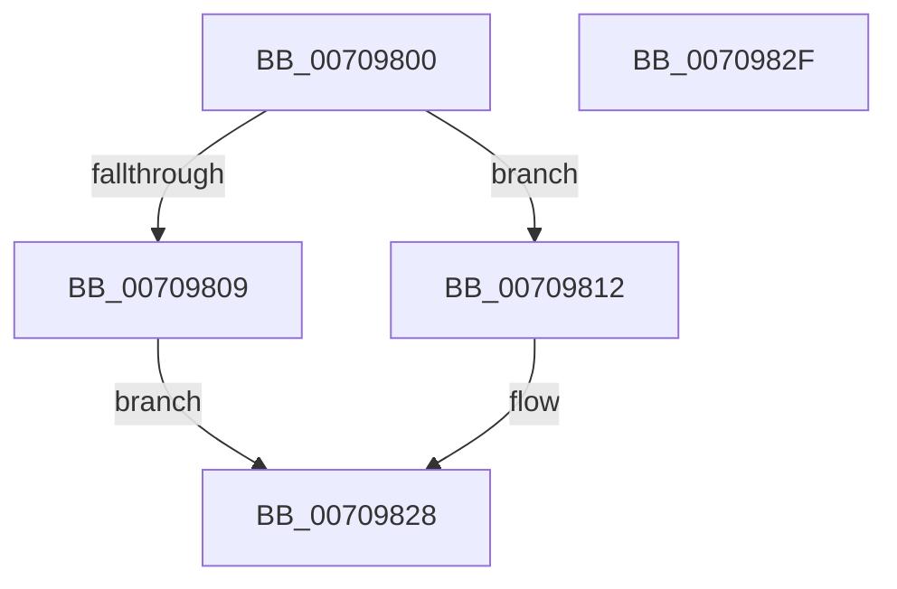

# HalpDmaGetRemappingInformation

- RVA: `0x00709800`–`0x00709830` (길이 `48` bytes)
- VA: `0x0000000140709800`
- 실행 섹션: `PAGE`
- PDB 이름 있음: `예`; PDB Function 태그: `아니요`
- unwind 정보 RVA: `0x0005C788`
- 디코드: `17`개 명령, `48/48` bytes 표시
- 미해석 바이트: `0` (있으면 어셈블리에 `.byte`로 보존)

> 이 문서는 커널 이미지의 기계어와 PDB 기호를 분석해 생성했습니다. 4번과 5번은 함수 원형과 자료형을 바이너리 사용 방식에서 추정한 C 해석이며 원본 소스 복구 결과는 아닙니다.

## 1. Dependencies

- 직접 호출 지점: **1**; 고유 호출 대상: **1**
- 직접 호출자로 확인된 함수: **1**
- RIP 상대 이미지 참조: **0**

### Outgoing calls
- `0x00709812` → [HalpIommuGetSecurityPolicy](../../text/4F/HalpIommuGetSecurityPolicy_function_004FC720.md) (function, `0x004FC720`)

### Direct callers
- [HaliQuerySystemInformation](../../pagelk/B7/HaliQuerySystemInformation_function_00B7A990.md) at `0x00B7AC52`

### Static image references
- 디코드된 RIP-relative 메모리 참조가 없습니다.

## 2. Other-region calls and transfers

- 다른 실행 섹션으로 향하는 call: **1**
  - `0x00709812` → [HalpIommuGetSecurityPolicy](../../text/4F/HalpIommuGetSecurityPolicy_function_004FC720.md) (`PAGE` → `.text`)
- 별도 외부 분기/꼬리 이동을 확인하지 못했습니다.

## 3. Assembly (complete function range)

```asm
00709800  48 83 EC 28                     sub rsp, 0x28
00709804  83 F9 01                        cmp ecx, 1
00709807  73 09                           jae 0x140709812
00709809  B8 23 00 00 C0                  mov eax, 0xc0000023
0070980E  33 C9                           xor ecx, ecx
00709810  EB 16                           jmp 0x140709828
00709812  E8 09 2F DF FF                  call 0x1404fc720
00709817  33 C9                           xor ecx, ecx
00709819  85 C0                           test eax, eax
0070981B  0F 95 C0                        setne al
0070981E  41 88 00                        mov byte ptr [r8], al
00709821  8B C1                           mov eax, ecx
00709823  B9 01 00 00 00                  mov ecx, 1
00709828  89 0A                           mov dword ptr [rdx], ecx
0070982A  48 83 C4 28                     add rsp, 0x28
0070982E  C3                              ret
0070982F  CC                              int3
```

## 4. C-style interpretation (structured pseudocode)

```c
__int64 __fastcall HalpDmaGetRemappingInformation(int a1, __int64 a2, __int64 a3)
{
    __int64 result;
    __int64 v_rsp;

    v_rsp = (v_rsp) - (40);
    if (a1 >= 1) goto loc_00709812;
    a1 = 0;
    goto loc_00709828;
loc_00709812:
    result = HalpIommuGetSecurityPolicy(a1, a2, a3, a4);
    a1 = 0;
    result = ((unsigned int)(result) != 0) ? 1 : 0;
    *(unsigned __int8 *)(a3) = (unsigned __int8)(result);
loc_00709828:
    *(unsigned int *)(a2) = 1;
    v_rsp = (v_rsp) + (40);
    return 0;
}
```

## 5. (Beta) C Style

```c
int64_t HalpDmaGetRemappingInformation(int32_t Arg1, int64_t Arg2, int64_t Arg3)
{
    int64_t result;
    int64_t local_rsp;

    local_rsp = (local_rsp) - (40);
    if (Arg1 >= 1) goto loc_00709812;
    Arg1 = 0;
    goto loc_00709828;
loc_00709812:
    result = HalpIommuGetSecurityPolicy(Arg1, Arg2, Arg3, a4);
    Arg1 = 0;
    result = ((uint32_t)(result) != 0) ? 1 : 0;
    *(uint8_t *)(Arg3) = (uint8_t)(result);
loc_00709828:
    *(uint32_t *)(Arg2) = 1;
    local_rsp = (local_rsp) + (40);
    return 0;
}
```

## 6. Execution-region graph

[열기: 2D/3D 그래프와 함수 탐색 컨트롤 패널](../../../control-panel.html?section=page&rva=0x00709800&view=graph)

- 2D 그래프는 위에서 아래로 흐르고, 3D 그래프는 빈 공간을 드래그해 회전합니다. Shift+드래그는 이동, 휠은 확대·축소, 함수 노드 선택은 대상 보고서 이동입니다.

### Static fallback


