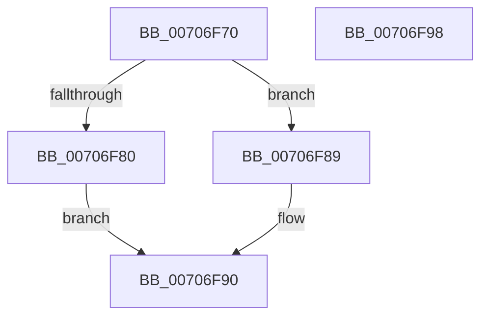

# HalpDmaLinkDeviceObjectByToken

- RVA: `0x00706F70`–`0x00706F99` (길이 `41` bytes)
- VA: `0x0000000140706F70`
- 실행 섹션: `PAGE`
- PDB 이름 있음: `예`; PDB Function 태그: `아니요`
- unwind 정보 RVA: `0x0005CF00`
- 디코드: `16`개 명령, `41/41` bytes 표시
- 미해석 바이트: `0` (있으면 어셈블리에 `.byte`로 보존)

> 이 문서는 커널 이미지의 기계어와 PDB 기호를 분석해 생성했습니다. 4번과 5번은 함수 원형과 자료형을 바이너리 사용 방식에서 추정한 C 해석이며 원본 소스 복구 결과는 아닙니다.

## 1. Dependencies

- 직접 호출 지점: **2**; 고유 호출 대상: **2**
- 직접 호출자로 확인된 함수: **0**
- RIP 상대 이미지 참조: **0**

### Outgoing calls
- `0x00706F82` → [HalpDmaFindDeviceObjectByToken](../../text/53/HalpDmaFindDeviceObjectByToken_function_0053FD28.md) (function, `0x0053FD28`)
- `0x00706F89` → [HalpDmaInsertDeviceObjectByToken](../../text/53/HalpDmaInsertDeviceObjectByToken_function_0053FEAC.md) (function, `0x0053FEAC`)

### Direct callers
- 이 함수 시작 RVA로 연결되는 직접 call은 확인되지 않았습니다. 간접 호출은 완전히 역산할 수 없습니다.

### Static image references
- 디코드된 RIP-relative 메모리 참조가 없습니다.

## 2. Other-region calls and transfers

- 다른 실행 섹션으로 향하는 call: **2**
  - `0x00706F82` → [HalpDmaFindDeviceObjectByToken](../../text/53/HalpDmaFindDeviceObjectByToken_function_0053FD28.md) (`PAGE` → `.text`)
  - `0x00706F89` → [HalpDmaInsertDeviceObjectByToken](../../text/53/HalpDmaInsertDeviceObjectByToken_function_0053FEAC.md) (`PAGE` → `.text`)
- 별도 외부 분기/꼬리 이동을 확인하지 못했습니다.

## 3. Assembly (complete function range)

```asm
00706F70  40 53                           push rbx
00706F72  48 83 EC 20                     sub rsp, 0x20
00706F76  33 DB                           xor ebx, ebx
00706F78  45 33 C0                        xor r8d, r8d
00706F7B  48 85 D2                        test rdx, rdx
00706F7E  75 09                           jne 0x140706f89
00706F80  B2 01                           mov dl, 1
00706F82  E8 A1 8D E3 FF                  call 0x14053fd28
00706F87  EB 07                           jmp 0x140706f90
00706F89  E8 1E 8F E3 FF                  call 0x14053feac
00706F8E  8B D8                           mov ebx, eax
00706F90  8B C3                           mov eax, ebx
00706F92  48 83 C4 20                     add rsp, 0x20
00706F96  5B                              pop rbx
00706F97  C3                              ret
00706F98  CC                              int3
```

## 4. C-style interpretation (structured pseudocode)

```c
__int64 __fastcall HalpDmaLinkDeviceObjectByToken(__int64 a1, __int64 a2, int a3)
{
    __int64 result;
    __int64 v_rbx;
    __int64 v_rsp;

    v_rsp = (v_rsp) - (32);
    v_rbx = 0;
    a3 = 0;
    if (a2 != 0) goto loc_00706F89;
    result = HalpDmaFindDeviceObjectByToken(a1, 1, a3, a4);
    goto loc_00706F90;
loc_00706F89:
    result = HalpDmaInsertDeviceObjectByToken(a1, 1, a3, a4);
loc_00706F90:
    v_rsp = (v_rsp) + (32);
    return (unsigned int)((unsigned int)((unsigned int)((unsigned int)(result))));
}
```

## 5. (Beta) C Style

```c
int64_t HalpDmaLinkDeviceObjectByToken(int64_t Arg1, int64_t Arg2, int32_t Arg3)
{
    int64_t result;
    int64_t local_rbx;
    int64_t local_rsp;

    local_rsp = (local_rsp) - (32);
    local_rbx = 0;
    Arg3 = 0;
    if (Arg2 != 0) goto loc_00706F89;
    result = HalpDmaFindDeviceObjectByToken(Arg1, 1, Arg3, a4);
    goto loc_00706F90;
loc_00706F89:
    result = HalpDmaInsertDeviceObjectByToken(Arg1, 1, Arg3, a4);
loc_00706F90:
    local_rsp = (local_rsp) + (32);
    return (uint32_t)((uint32_t)((uint32_t)((uint32_t)(result))));
}
```

## 6. Execution-region graph

[열기: 2D/3D 그래프와 함수 탐색 컨트롤 패널](../../../control-panel.html?section=page&rva=0x00706F70&view=graph)

- 2D 그래프는 위에서 아래로 흐르고, 3D 그래프는 빈 공간을 드래그해 회전합니다. Shift+드래그는 이동, 휠은 확대·축소, 함수 노드 선택은 대상 보고서 이동입니다.

### Static fallback


