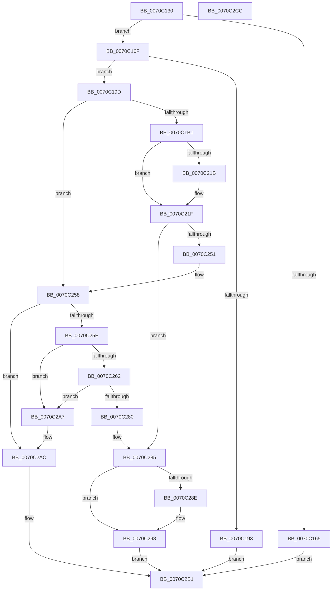

# HalpDpReplaceBegin

- RVA: `0x0070C130`–`0x0070C2CD` (길이 `413` bytes)
- VA: `0x000000014070C130`
- 실행 섹션: `PAGE`
- PDB 이름 있음: `예`; PDB Function 태그: `아니요`
- unwind 정보 RVA: `0x000BDE04`
- 디코드: `115`개 명령, `413/413` bytes 표시
- 미해석 바이트: `0` (있으면 어셈블리에 `.byte`로 보존)

> 이 문서는 커널 이미지의 기계어와 PDB 기호를 분석해 생성했습니다. 4번과 5번은 함수 원형과 자료형을 바이너리 사용 방식에서 추정한 C 해석이며 원본 소스 복구 결과는 아닙니다.

## 1. Dependencies

- 직접 호출 지점: **10**; 고유 호출 대상: **6**
- 직접 호출자로 확인된 함수: **0**
- RIP 상대 이미지 참조: **0**

### Outgoing calls
- `0x0070C186` → [ExAllocatePool2](../../poolcode/B8/ExAllocatePool2_function_00B820F0.md) (function, `0x00B820F0`)
- `0x0070C1E4` → [memcpy](../../text/6C/memcpy_function_006C6840.md) (function, `0x006C6840`)
- `0x0070C1F8` → [memcpy](../../text/6C/memcpy_function_006C6840.md) (function, `0x006C6840`)
- `0x0070C203` → [HalpDpSortApicList](HalpDpSortApicList_function_0070C318.md) (function, `0x0070C318`)
- `0x0070C20E` → [HalpDpSortApicList](HalpDpSortApicList_function_0070C318.md) (function, `0x0070C318`)
- `0x0070C246` → [HalpInterruptDpReplaceBegin](../../text/56/HalpInterruptDpReplaceBegin_function_005631CC.md) (function, `0x005631CC`)
- `0x0070C272` → [ExAllocatePool2](../../poolcode/B8/ExAllocatePool2_function_00B820F0.md) (function, `0x00B820F0`)
- `0x0070C293` → [ExFreePoolWithTag](../../poolcode/B8/ExFreePoolWithTag_function_00B82870.md) (function, `0x00B82870`)
- `0x0070C2A0` → [ExFreePoolWithTag](../../poolcode/B8/ExFreePoolWithTag_function_00B82870.md) (function, `0x00B82870`)
- `0x0070C2A7` → [HalpBuildResumeStructures](../../pagelk/B5/HalpBuildResumeStructures_function_00B5D0F0.md) (function, `0x00B5D0F0`)

### Direct callers
- 이 함수 시작 RVA로 연결되는 직접 call은 확인되지 않았습니다. 간접 호출은 완전히 역산할 수 없습니다.

### Static image references
- 디코드된 RIP-relative 메모리 참조가 없습니다.

## 2. Other-region calls and transfers

- 다른 실행 섹션으로 향하는 call: **8**
  - `0x0070C186` → [ExAllocatePool2](../../poolcode/B8/ExAllocatePool2_function_00B820F0.md) (`PAGE` → `POOLCODE`)
  - `0x0070C1E4` → [memcpy](../../text/6C/memcpy_function_006C6840.md) (`PAGE` → `.text`)
  - `0x0070C1F8` → [memcpy](../../text/6C/memcpy_function_006C6840.md) (`PAGE` → `.text`)
  - `0x0070C246` → [HalpInterruptDpReplaceBegin](../../text/56/HalpInterruptDpReplaceBegin_function_005631CC.md) (`PAGE` → `.text`)
  - `0x0070C272` → [ExAllocatePool2](../../poolcode/B8/ExAllocatePool2_function_00B820F0.md) (`PAGE` → `POOLCODE`)
  - `0x0070C293` → [ExFreePoolWithTag](../../poolcode/B8/ExFreePoolWithTag_function_00B82870.md) (`PAGE` → `POOLCODE`)
  - `0x0070C2A0` → [ExFreePoolWithTag](../../poolcode/B8/ExFreePoolWithTag_function_00B82870.md) (`PAGE` → `POOLCODE`)
  - `0x0070C2A7` → [HalpBuildResumeStructures](../../pagelk/B5/HalpBuildResumeStructures_function_00B5D0F0.md) (`PAGE` → `PAGELK`)
- 별도 외부 분기/꼬리 이동을 확인하지 못했습니다.

## 3. Assembly (complete function range)

```asm
0070C130  48 8B C4                        mov rax, rsp
0070C133  48 89 58 10                     mov qword ptr [rax + 0x10], rbx
0070C137  48 89 68 18                     mov qword ptr [rax + 0x18], rbp
0070C13B  48 89 70 20                     mov qword ptr [rax + 0x20], rsi
0070C13F  57                              push rdi
0070C140  41 56                           push r14
0070C142  41 57                           push r15
0070C144  48 83 EC 40                     sub rsp, 0x40
0070C148  33 DB                           xor ebx, ebx
0070C14A  4C 8B FA                        mov r15, rdx
0070C14D  89 58 08                        mov dword ptr [rax + 8], ebx
0070C150  4C 8B F1                        mov r14, rcx
0070C153  48 8B 41 10                     mov rax, qword ptr [rcx + 0x10]
0070C157  8B 68 10                        mov ebp, dword ptr [rax + 0x10]
0070C15A  48 8B 41 08                     mov rax, qword ptr [rcx + 8]
0070C15E  8B 70 10                        mov esi, dword ptr [rax + 0x10]
0070C161  3B EE                           cmp ebp, esi
0070C163  73 0A                           jae 0x14070c16f
0070C165  BB 0D 00 00 C0                  mov ebx, 0xc000000d
0070C16A  E9 42 01 00 00                  jmp 0x14070c2b1
0070C16F  8D 14 75 20 00 00 00            lea edx, [rsi*2 + 0x20]
0070C176  B9 40 00 00 00                  mov ecx, 0x40
0070C17B  03 D5                           add edx, ebp
0070C17D  41 B8 48 61 6C 43               mov r8d, 0x436c6148
0070C183  C1 E2 02                        shl edx, 2
0070C186  E8 65 5F 47 00                  call 0x140b820f0
0070C18B  48 8B F8                        mov rdi, rax
0070C18E  48 85 C0                        test rax, rax
0070C191  75 0A                           jne 0x14070c19d
0070C193  BB 9A 00 00 C0                  mov ebx, 0xc000009a
0070C198  E9 14 01 00 00                  jmp 0x14070c2b1
0070C19D  89 30                           mov dword ptr [rax], esi
0070C19F  41 8B 06                        mov eax, dword ptr [r14]
0070C1A2  D1 E8                           shr eax, 1
0070C1A4  24 01                           and al, 1
0070C1A6  88 47 2D                        mov byte ptr [rdi + 0x2d], al
0070C1A9  85 F6                           test esi, esi
0070C1AB  0F 84 A7 00 00 00               je 0x14070c258
0070C1B1  48 8D 8F 80 00 00 00            lea rcx, [rdi + 0x80]
0070C1B8  4C 8D 04 B5 00 00 00 00         lea r8, [rsi*4]
0070C1C0  48 89 4F 08                     mov qword ptr [rdi + 8], rcx
0070C1C4  49 8D 14 08                     lea rdx, [r8 + rcx]
0070C1C8  48 89 57 10                     mov qword ptr [rdi + 0x10], rdx
0070C1CC  48 8D 1C AD 00 00 00 00         lea rbx, [rbp*4]
0070C1D4  48 8D 04 1A                     lea rax, [rdx + rbx]
0070C1D8  48 89 47 18                     mov qword ptr [rdi + 0x18], rax
0070C1DC  49 8B 56 08                     mov rdx, qword ptr [r14 + 8]
0070C1E0  48 83 C2 14                     add rdx, 0x14
0070C1E4  E8 57 A6 FB FF                  call 0x1406c6840
0070C1E9  49 8B 56 10                     mov rdx, qword ptr [r14 + 0x10]
0070C1ED  4C 8B C3                        mov r8, rbx
0070C1F0  48 8B 4F 10                     mov rcx, qword ptr [rdi + 0x10]
0070C1F4  48 83 C2 14                     add rdx, 0x14
0070C1F8  E8 43 A6 FB FF                  call 0x1406c6840
0070C1FD  48 8B 4F 08                     mov rcx, qword ptr [rdi + 8]
0070C201  8B D6                           mov edx, esi
0070C203  E8 10 01 00 00                  call 0x14070c318
0070C208  48 8B 4F 10                     mov rcx, qword ptr [rdi + 0x10]
0070C20C  8B D5                           mov edx, ebp
0070C20E  E8 05 01 00 00                  call 0x14070c318
0070C213  41 8B 0E                        mov ecx, dword ptr [r14]
0070C216  F6 C1 01                        test cl, 1
0070C219  74 04                           je 0x14070c21f
0070C21B  C6 47 2C 01                     mov byte ptr [rdi + 0x2c], 1
0070C21F  44 8B 0F                        mov r9d, dword ptr [rdi]
0070C222  48 8D 44 24 60                  lea rax, [rsp + 0x60]
0070C227  4C 8B 47 18                     mov r8, qword ptr [rdi + 0x18]
0070C22B  48 8B 57 10                     mov rdx, qword ptr [rdi + 0x10]
0070C22F  48 8B 4F 08                     mov rcx, qword ptr [rdi + 8]
0070C233  48 89 44 24 30                  mov qword ptr [rsp + 0x30], rax
0070C238  8A 47 2D                        mov al, byte ptr [rdi + 0x2d]
0070C23B  88 44 24 28                     mov byte ptr [rsp + 0x28], al
0070C23F  8A 47 2C                        mov al, byte ptr [rdi + 0x2c]
0070C242  88 44 24 20                     mov byte ptr [rsp + 0x20], al
0070C246  E8 81 6F E5 FF                  call 0x1405631cc
0070C24B  8B D8                           mov ebx, eax
0070C24D  85 C0                           test eax, eax
0070C24F  78 34                           js 0x14070c285
0070C251  8B 5C 24 60                     mov ebx, dword ptr [rsp + 0x60]
0070C255  89 5F 28                        mov dword ptr [rdi + 0x28], ebx
0070C258  80 7F 2D 00                     cmp byte ptr [rdi + 0x2d], 0
0070C25C  74 4E                           je 0x14070c2ac
0070C25E  85 F6                           test esi, esi
0070C260  74 45                           je 0x14070c2a7
0070C262  0F AF F3                        imul esi, ebx
0070C265  B9 40 00 00 00                  mov ecx, 0x40
0070C26A  41 B8 48 61 6C 43               mov r8d, 0x436c6148
0070C270  8B D6                           mov edx, esi
0070C272  E8 79 5E 47 00                  call 0x140b820f0
0070C277  48 89 47 20                     mov qword ptr [rdi + 0x20], rax
0070C27B  48 85 C0                        test rax, rax
0070C27E  75 27                           jne 0x14070c2a7
0070C280  BB 9A 00 00 C0                  mov ebx, 0xc000009a
0070C285  48 8B 4F 20                     mov rcx, qword ptr [rdi + 0x20]
0070C289  48 85 C9                        test rcx, rcx
0070C28C  74 0A                           je 0x14070c298
0070C28E  BA 48 61 6C 43                  mov edx, 0x436c6148
0070C293  E8 D8 65 47 00                  call 0x140b82870
0070C298  BA 48 61 6C 43                  mov edx, 0x436c6148
0070C29D  48 8B CF                        mov rcx, rdi
0070C2A0  E8 CB 65 47 00                  call 0x140b82870
0070C2A5  EB 0A                           jmp 0x14070c2b1
0070C2A7  E8 44 0E 45 00                  call 0x140b5d0f0
0070C2AC  49 89 3F                        mov qword ptr [r15], rdi
0070C2AF  33 DB                           xor ebx, ebx
0070C2B1  48 8B 6C 24 70                  mov rbp, qword ptr [rsp + 0x70]
0070C2B6  8B C3                           mov eax, ebx
0070C2B8  48 8B 5C 24 68                  mov rbx, qword ptr [rsp + 0x68]
0070C2BD  48 8B 74 24 78                  mov rsi, qword ptr [rsp + 0x78]
0070C2C2  48 83 C4 40                     add rsp, 0x40
0070C2C6  41 5F                           pop r15
0070C2C8  41 5E                           pop r14
0070C2CA  5F                              pop rdi
0070C2CB  C3                              ret
0070C2CC  CC                              int3
```

## 4. C-style interpretation (structured pseudocode)

```c
__int64 __fastcall HalpDpReplaceBegin(__int64 a1, __int64 a2)
{
    __int64 result;
    __int64 v_rbx;
    __int64 v_rsi;
    __int64 v_rsp;
    unsigned __int64 v_stack_m28;
    unsigned __int8 v_stack_m30;
    unsigned __int8 v_stack_m38;
    unsigned __int64 v_stack_p10;
    unsigned __int64 v_stack_p18;
    unsigned __int64 v_stack_p20;
    unsigned __int64 v_stack_p8;

    *(unsigned __int64 *)(v_rsp + 16) = v_rbx;
    *(unsigned __int64 *)(v_rsp + 24) = v_rbp;
    *(unsigned __int64 *)(v_rsp + 32) = v_rsi;
    v_rsp = (v_rsp) - (64);
    v_rbx = 0;
    *(unsigned int *)(v_rsp + 8) = 0;
    if (((unsigned int)((unsigned int)(*(unsigned int *)(*(unsigned __int64 *)(a1 + 16) + 16)))) >= ((unsigned int)((unsigned int)(*(unsigned int *)(*(unsigned __int64 *)(a1 + 8) + 16))))) goto loc_0070C16F;
    goto loc_0070C2B1;
loc_0070C16F:
    a2 = (unsigned int)(((unsigned int)(*(unsigned int *)(*(unsigned __int64 *)(a1 + 8) + 16)) * 2 + 32) + ((unsigned int)((unsigned int)(*(unsigned int *)(*(unsigned __int64 *)(a1 + 16) + 16)))));
    a2 = (unsigned int)((a2) << (2));
    result = ExAllocatePool2(64, a2, (unsigned int)(0x436C6148ULL), a4);
    if (result != 0) goto loc_0070C19D;
    goto loc_0070C2B1;
loc_0070C19D:
    *(unsigned int *)(result) = (unsigned int)((unsigned int)(*(unsigned int *)(*(unsigned __int64 *)(a1 + 8) + 16)));
    result = (unsigned int)(((unsigned int)(*(unsigned int *)(a1))) >> (1));
    result = (unsigned __int8)((result) & (1));
    *(unsigned __int8 *)(result + 45) = (unsigned __int8)(result);
    if ((unsigned int)((unsigned int)(*(unsigned int *)(*(unsigned __int64 *)(a1 + 8) + 16))) == 0) goto loc_0070C258;
    *(unsigned __int64 *)(result + 8) = result + 128;
    *(unsigned __int64 *)(result + 16) = (unsigned int)(*(unsigned int *)(*(unsigned __int64 *)(a1 + 8) + 16)) * 4 + result + 128 * 1;
    *(unsigned __int64 *)(result + 24) = (unsigned int)(*(unsigned int *)(*(unsigned __int64 *)(a1 + 8) + 16)) * 4 + result + 128 * 1 + (unsigned int)(*(unsigned int *)(*(unsigned __int64 *)(a1 + 16) + 16)) * 4 * 1;
    a2 = (*(unsigned __int64 *)(a1 + 8)) + (20);
    result = memcpy(result + 128, a2, (unsigned int)(*(unsigned int *)(*(unsigned __int64 *)(a1 + 8) + 16)) * 4, a4);
    a2 = (*(unsigned __int64 *)(a1 + 16)) + (20);
    result = memcpy(*(unsigned __int64 *)(result + 16), a2, (unsigned int)(*(unsigned int *)(*(unsigned __int64 *)(a1 + 16) + 16)) * 4, a4);
    result = HalpDpSortApicList(*(unsigned __int64 *)(result + 8), (unsigned int)((unsigned int)((unsigned int)(*(unsigned int *)(*(unsigned __int64 *)(a1 + 8) + 16)))), (unsigned int)(*(unsigned int *)(*(unsigned __int64 *)(a1 + 16) + 16)) * 4, a4);
    result = HalpDpSortApicList(*(unsigned __int64 *)(result + 16), (unsigned int)((unsigned int)((unsigned int)(*(unsigned int *)(*(unsigned __int64 *)(a1 + 16) + 16)))), (unsigned int)(*(unsigned int *)(*(unsigned __int64 *)(a1 + 16) + 16)) * 4, a4);
    if ((((unsigned __int8)((unsigned int)(*(unsigned int *)(a1)))) & (1)) != 0) {
        *(unsigned __int8 *)(result + 44) = 1;
    }
    v_stack_m28 = v_stack_p8;
    v_stack_m30 = (unsigned __int8)(*(unsigned __int8 *)(result + 45));
    v_stack_m38 = (unsigned __int8)(*(unsigned __int8 *)(result + 44));
    result = HalpInterruptDpReplaceBegin(*(unsigned __int64 *)(result + 8), *(unsigned __int64 *)(result + 16), *(unsigned __int64 *)(result + 24), (unsigned int)(*(unsigned int *)(result)));
    if (sign_flag) goto loc_0070C285;
    *(unsigned int *)(result + 40) = (unsigned int)((unsigned int)(v_stack_p8));
loc_0070C258:
    if ((*(unsigned __int8 *)(result + 45)) == 0) goto loc_0070C2AC;
    if ((unsigned int)((unsigned int)(*(unsigned int *)(*(unsigned __int64 *)(a1 + 8) + 16))) == 0) goto loc_0070C2A7;
    v_rsi = (unsigned int)(((unsigned int)(*(unsigned int *)(*(unsigned __int64 *)(a1 + 8) + 16))) * ((unsigned int)((unsigned int)(v_stack_p8))));
    result = ExAllocatePool2(64, (unsigned int)((unsigned int)(v_rsi)), (unsigned int)(0x436C6148ULL), (unsigned int)(*(unsigned int *)(result)));
    *(unsigned __int64 *)(result + 32) = result;
    if (result != 0) goto loc_0070C2A7;
loc_0070C285:
    if (*(unsigned __int64 *)(result + 32) != 0) {
        a2 = 0x436C6148ULL;
        result = ExFreePoolWithTag(*(unsigned __int64 *)(result + 32), a2, (unsigned int)(0x436C6148ULL), (unsigned int)(*(unsigned int *)(result)));
    }
    result = ExFreePoolWithTag(result, (unsigned int)(0x436C6148ULL), (unsigned int)(0x436C6148ULL), (unsigned int)(*(unsigned int *)(result)));
    goto loc_0070C2B1;
loc_0070C2A7:
    result = HalpBuildResumeStructures(result, (unsigned int)(0x436C6148ULL), (unsigned int)(0x436C6148ULL), (unsigned int)(*(unsigned int *)(result)));
loc_0070C2AC:
    *(unsigned __int64 *)(a2) = result;
    v_rbx = 0;
loc_0070C2B1:
    v_rsp = (v_rsp) + (64);
    return 0;
}
```

## 5. (Beta) C Style

```c
int64_t HalpDpReplaceBegin(void *Arg1, void *Arg2)
{
    uint8_t *arg1 = (uint8_t *)Arg1;
    uint8_t *arg2 = (uint8_t *)Arg2;

    int64_t result;
    int64_t local_rbx;
    int64_t local_rsi;
    int64_t local_rsp;
    uint64_t v_stack_m28;
    uint8_t v_stack_m30;
    uint8_t v_stack_m38;
    uint64_t v_stack_p10;
    uint64_t v_stack_p18;
    uint64_t v_stack_p20;
    uint64_t v_stack_p8;

    *(uint64_t *)(local_rsp + 0x10) = local_rbx;
    *(uint64_t *)(local_rsp + 0x18) = local_rbp;
    *(uint64_t *)(local_rsp + 0x20) = local_rsi;
    local_rsp = (local_rsp) - (64);
    local_rbx = 0;
    *(uint32_t *)(local_rsp + 0x8) = 0;
    if (((uint32_t)((uint32_t)(*(uint32_t *)(*(uint64_t *)(arg1 + 0x10) + 0x10)))) >= ((uint32_t)((uint32_t)(*(uint32_t *)(*(uint64_t *)(arg1 + 0x8) + 0x10))))) goto loc_0070C16F;
    goto loc_0070C2B1;
loc_0070C16F:
    Arg2 = (uint32_t)(((uint32_t)(*(uint32_t *)(*(uint64_t *)(arg1 + 0x8) + 0x10)) * 2 + 32) + ((uint32_t)((uint32_t)(*(uint32_t *)(*(uint64_t *)(arg1 + 0x10) + 0x10)))));
    Arg2 = (uint32_t)((Arg2) << (2));
    result = ExAllocatePool2(64, Arg2, (uint32_t)(0x436C6148ULL), a4);
    if (result != 0) goto loc_0070C19D;
    goto loc_0070C2B1;
loc_0070C19D:
    *(uint32_t *)(result) = (uint32_t)((uint32_t)(*(uint32_t *)(*(uint64_t *)(arg1 + 0x8) + 0x10)));
    result = (uint32_t)(((uint32_t)(*(uint32_t *)(arg1))) >> (1));
    result = (uint8_t)((result) & (1));
    *(uint8_t *)(result + 0x2D) = (uint8_t)(result);
    if ((uint32_t)((uint32_t)(*(uint32_t *)(*(uint64_t *)(arg1 + 0x8) + 0x10))) == 0) goto loc_0070C258;
    *(uint64_t *)(result + 0x8) = result + 128;
    *(uint64_t *)(result + 0x10) = (uint32_t)(*(uint32_t *)(*(uint64_t *)(arg1 + 0x8) + 0x10)) * 4 + result + 128 * 1;
    *(uint64_t *)(result + 0x18) = (uint32_t)(*(uint32_t *)(*(uint64_t *)(arg1 + 0x8) + 0x10)) * 4 + result + 128 * 1 + (uint32_t)(*(uint32_t *)(*(uint64_t *)(arg1 + 0x10) + 0x10)) * 4 * 1;
    Arg2 = (*(uint64_t *)(arg1 + 0x8)) + (20);
    result = memcpy(result + 128, Arg2, (uint32_t)(*(uint32_t *)(*(uint64_t *)(arg1 + 0x8) + 0x10)) * 4, a4);
    Arg2 = (*(uint64_t *)(arg1 + 0x10)) + (20);
    result = memcpy(*(uint64_t *)(result + 0x10), Arg2, (uint32_t)(*(uint32_t *)(*(uint64_t *)(arg1 + 0x10) + 0x10)) * 4, a4);
    result = HalpDpSortApicList(*(uint64_t *)(result + 0x8), (uint32_t)((uint32_t)((uint32_t)(*(uint32_t *)(*(uint64_t *)(arg1 + 0x8) + 0x10)))), (uint32_t)(*(uint32_t *)(*(uint64_t *)(arg1 + 0x10) + 0x10)) * 4, a4);
    result = HalpDpSortApicList(*(uint64_t *)(result + 0x10), (uint32_t)((uint32_t)((uint32_t)(*(uint32_t *)(*(uint64_t *)(arg1 + 0x10) + 0x10)))), (uint32_t)(*(uint32_t *)(*(uint64_t *)(arg1 + 0x10) + 0x10)) * 4, a4);
    if ((((uint8_t)((uint32_t)(*(uint32_t *)(arg1)))) & (1)) != 0) {
        *(uint8_t *)(result + 0x2C) = 1;
    }
    v_stack_m28 = v_stack_p8;
    v_stack_m30 = (uint8_t)(*(uint8_t *)(result + 0x2D));
    v_stack_m38 = (uint8_t)(*(uint8_t *)(result + 0x2C));
    result = HalpInterruptDpReplaceBegin(*(uint64_t *)(result + 0x8), *(uint64_t *)(result + 0x10), *(uint64_t *)(result + 0x18), (uint32_t)(*(uint32_t *)(result)));
    if (sign_flag) goto loc_0070C285;
    *(uint32_t *)(result + 0x28) = (uint32_t)((uint32_t)(v_stack_p8));
loc_0070C258:
    if ((*(uint8_t *)(result + 0x2D)) == 0) goto loc_0070C2AC;
    if ((uint32_t)((uint32_t)(*(uint32_t *)(*(uint64_t *)(arg1 + 0x8) + 0x10))) == 0) goto loc_0070C2A7;
    local_rsi = (uint32_t)(((uint32_t)(*(uint32_t *)(*(uint64_t *)(arg1 + 0x8) + 0x10))) * ((uint32_t)((uint32_t)(v_stack_p8))));
    result = ExAllocatePool2(64, (uint32_t)((uint32_t)(local_rsi)), (uint32_t)(0x436C6148ULL), (uint32_t)(*(uint32_t *)(result)));
    *(uint64_t *)(result + 0x20) = result;
    if (result != 0) goto loc_0070C2A7;
loc_0070C285:
    if (*(uint64_t *)(result + 0x20) != 0) {
        Arg2 = 0x436C6148ULL;
        result = ExFreePoolWithTag(*(uint64_t *)(result + 0x20), Arg2, (uint32_t)(0x436C6148ULL), (uint32_t)(*(uint32_t *)(result)));
    }
    result = ExFreePoolWithTag(result, (uint32_t)(0x436C6148ULL), (uint32_t)(0x436C6148ULL), (uint32_t)(*(uint32_t *)(result)));
    goto loc_0070C2B1;
loc_0070C2A7:
    result = HalpBuildResumeStructures(result, (uint32_t)(0x436C6148ULL), (uint32_t)(0x436C6148ULL), (uint32_t)(*(uint32_t *)(result)));
loc_0070C2AC:
    *(uint64_t *)(arg2) = result;
    local_rbx = 0;
loc_0070C2B1:
    local_rsp = (local_rsp) + (64);
    return 0;
}
```

### 관측된 메모리 오프셋

구조체 형식이 확인되지 않은 접근은 인자 기준의 오프셋으로만 기록했습니다.

| 기준 인자 | 오프셋 표현 | 폭 (bit) | 접근 |
|---|---:|---:|---|
| `Arg1` | `+ 0x0` | `32` | `R` |
| `Arg1` | `+ 0x8` | `64` | `R` |
| `Arg1` | `+ 0x10` | `64` | `R` |
| `Arg2` | `+ 0x0` | `64` | `W` |

## 6. Execution-region graph

[열기: 2D/3D 그래프와 함수 탐색 컨트롤 패널](../../../control-panel.html?section=page&rva=0x0070C130&view=graph)

- 2D 그래프는 위에서 아래로 흐르고, 3D 그래프는 빈 공간을 드래그해 회전합니다. Shift+드래그는 이동, 휠은 확대·축소, 함수 노드 선택은 대상 보고서 이동입니다.

### Static fallback


