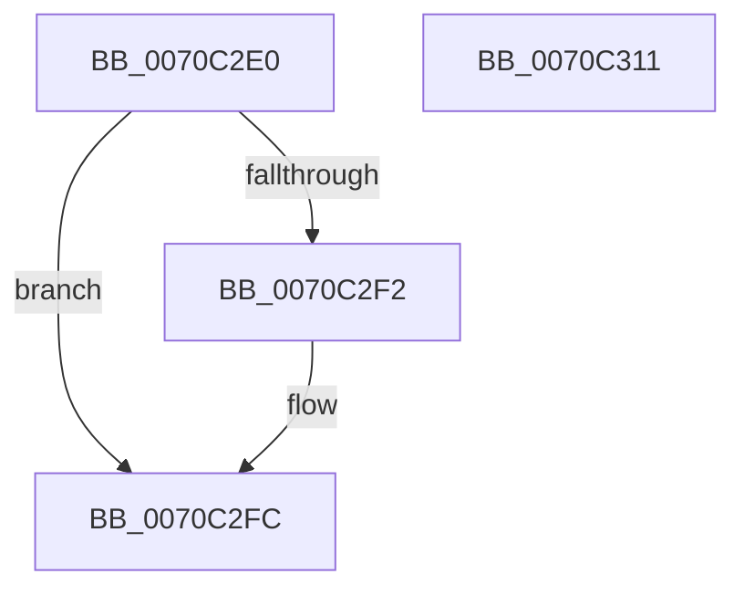

# HalpDpReplaceEnd

- RVA: `0x0070C2E0`–`0x0070C312` (길이 `50` bytes)
- VA: `0x000000014070C2E0`
- 실행 섹션: `PAGE`
- PDB 이름 있음: `예`; PDB Function 태그: `아니요`
- unwind 정보 RVA: `0x0005CF00`
- 디코드: `16`개 명령, `50/50` bytes 표시
- 미해석 바이트: `0` (있으면 어셈블리에 `.byte`로 보존)

> 이 문서는 커널 이미지의 기계어와 PDB 기호를 분석해 생성했습니다. 4번과 5번은 함수 원형과 자료형을 바이너리 사용 방식에서 추정한 C 해석이며 원본 소스 복구 결과는 아닙니다.

## 1. Dependencies

- 직접 호출 지점: **2**; 고유 호출 대상: **1**
- 직접 호출자로 확인된 함수: **0**
- RIP 상대 이미지 참조: **0**

### Outgoing calls
- `0x0070C2F7` → [ExFreePoolWithTag](../../poolcode/B8/ExFreePoolWithTag_function_00B82870.md) (function, `0x00B82870`)
- `0x0070C304` → [ExFreePoolWithTag](../../poolcode/B8/ExFreePoolWithTag_function_00B82870.md) (function, `0x00B82870`)

### Direct callers
- 이 함수 시작 RVA로 연결되는 직접 call은 확인되지 않았습니다. 간접 호출은 완전히 역산할 수 없습니다.

### Static image references
- 디코드된 RIP-relative 메모리 참조가 없습니다.

## 2. Other-region calls and transfers

- 다른 실행 섹션으로 향하는 call: **2**
  - `0x0070C2F7` → [ExFreePoolWithTag](../../poolcode/B8/ExFreePoolWithTag_function_00B82870.md) (`PAGE` → `POOLCODE`)
  - `0x0070C304` → [ExFreePoolWithTag](../../poolcode/B8/ExFreePoolWithTag_function_00B82870.md) (`PAGE` → `POOLCODE`)
- 별도 외부 분기/꼬리 이동을 확인하지 못했습니다.

## 3. Assembly (complete function range)

```asm
0070C2E0  40 53                           push rbx
0070C2E2  48 83 EC 20                     sub rsp, 0x20
0070C2E6  48 8B D9                        mov rbx, rcx
0070C2E9  48 8B 49 20                     mov rcx, qword ptr [rcx + 0x20]
0070C2ED  48 85 C9                        test rcx, rcx
0070C2F0  74 0A                           je 0x14070c2fc
0070C2F2  BA 48 61 6C 43                  mov edx, 0x436c6148
0070C2F7  E8 74 65 47 00                  call 0x140b82870
0070C2FC  BA 48 61 6C 43                  mov edx, 0x436c6148
0070C301  48 8B CB                        mov rcx, rbx
0070C304  E8 67 65 47 00                  call 0x140b82870
0070C309  33 C0                           xor eax, eax
0070C30B  48 83 C4 20                     add rsp, 0x20
0070C30F  5B                              pop rbx
0070C310  C3                              ret
0070C311  CC                              int3
```

## 4. C-style interpretation (structured pseudocode)

```c
__int64 __fastcall HalpDpReplaceEnd(__int64 a1)
{
    __int64 result;
    __int64 v_rsp;

    v_rsp = (v_rsp) - (32);
    if (*(unsigned __int64 *)(a1 + 32) != 0) {
        a2 = 0x436C6148ULL;
        result = ExFreePoolWithTag(*(unsigned __int64 *)(a1 + 32), a2, a3, a4);
    }
    result = ExFreePoolWithTag(a1, (unsigned int)(0x436C6148ULL), a3, a4);
    result = 0;
    v_rsp = (v_rsp) + (32);
    return result;
}
```

## 5. (Beta) C Style

```c
int64_t HalpDpReplaceEnd(void *Arg1)
{
    uint8_t *arg1 = (uint8_t *)Arg1;

    int64_t result;
    int64_t local_rsp;

    local_rsp = (local_rsp) - (32);
    if (*(uint64_t *)(arg1 + 0x20) != 0) {
        a2 = 0x436C6148ULL;
        result = ExFreePoolWithTag(*(uint64_t *)(arg1 + 0x20), a2, a3, a4);
    }
    result = ExFreePoolWithTag(Arg1, (uint32_t)(0x436C6148ULL), a3, a4);
    result = 0;
    local_rsp = (local_rsp) + (32);
    return result;
}
```

### 관측된 메모리 오프셋

구조체 형식이 확인되지 않은 접근은 인자 기준의 오프셋으로만 기록했습니다.

| 기준 인자 | 오프셋 표현 | 폭 (bit) | 접근 |
|---|---:|---:|---|
| `Arg1` | `+ 0x20` | `64` | `R` |

## 6. Execution-region graph

[열기: 2D/3D 그래프와 함수 탐색 컨트롤 패널](../../../control-panel.html?section=page&rva=0x0070C2E0&view=graph)

- 2D 그래프는 위에서 아래로 흐르고, 3D 그래프는 빈 공간을 드래그해 회전합니다. Shift+드래그는 이동, 휠은 확대·축소, 함수 노드 선택은 대상 보고서 이동입니다.

### Static fallback


