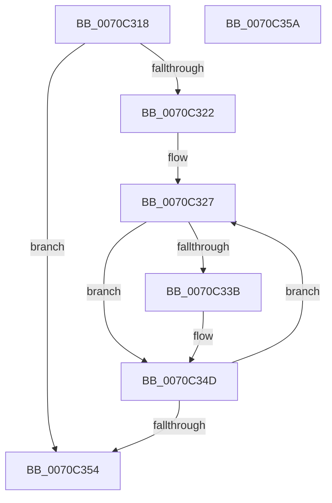

# HalpDpSortApicList

- RVA: `0x0070C318`–`0x0070C35B` (길이 `67` bytes)
- VA: `0x000000014070C318`
- 실행 섹션: `PAGE`
- PDB 이름 있음: `예`; PDB Function 태그: `아니요`
- unwind 정보 RVA: `0x00071750`
- 디코드: `22`개 명령, `67/67` bytes 표시
- 미해석 바이트: `0` (있으면 어셈블리에 `.byte`로 보존)

> 이 문서는 커널 이미지의 기계어와 PDB 기호를 분석해 생성했습니다. 4번과 5번은 함수 원형과 자료형을 바이너리 사용 방식에서 추정한 C 해석이며 원본 소스 복구 결과는 아닙니다.

## 1. Dependencies

- 직접 호출 지점: **0**; 고유 호출 대상: **0**
- 직접 호출자로 확인된 함수: **1**
- RIP 상대 이미지 참조: **0**

### Outgoing calls
- 직접 디코드된 call 명령이 없습니다.

### Direct callers
- [HalpDpReplaceBegin](HalpDpReplaceBegin_function_0070C130.md) at `0x0070C203`
- [HalpDpReplaceBegin](HalpDpReplaceBegin_function_0070C130.md) at `0x0070C20E`

### Static image references
- 디코드된 RIP-relative 메모리 참조가 없습니다.

## 2. Other-region calls and transfers

- 다른 실행 섹션으로 향하는 call: **0**
- 별도 외부 분기/꼬리 이동을 확인하지 못했습니다.

## 3. Assembly (complete function range)

```asm
0070C318  48 89 5C 24 08                  mov qword ptr [rsp + 8], rbx
0070C31D  83 FA 02                        cmp edx, 2
0070C320  72 32                           jb 0x14070c354
0070C322  45 33 C0                        xor r8d, r8d
0070C325  FF CA                           dec edx
0070C327  45 8B D0                        mov r10d, r8d
0070C32A  41 8D 40 01                     lea eax, [r8 + 1]
0070C32E  44 8B 1C 81                     mov r11d, dword ptr [rcx + rax*4]
0070C332  42 8B 1C 91                     mov ebx, dword ptr [rcx + r10*4]
0070C336  44 3B DB                        cmp r11d, ebx
0070C339  73 12                           jae 0x14070c34d
0070C33B  89 1C 81                        mov dword ptr [rcx + rax*4], ebx
0070C33E  45 85 C0                        test r8d, r8d
0070C341  41 8D 40 FF                     lea eax, [r8 - 1]
0070C345  46 89 1C 91                     mov dword ptr [rcx + r10*4], r11d
0070C349  41 0F 44 C0                     cmove eax, r8d
0070C34D  44 8B C0                        mov r8d, eax
0070C350  3B C2                           cmp eax, edx
0070C352  72 D3                           jb 0x14070c327
0070C354  48 8B 5C 24 08                  mov rbx, qword ptr [rsp + 8]
0070C359  C3                              ret
0070C35A  CC                              int3
```

## 4. C-style interpretation (structured pseudocode)

```c
__int64 __fastcall HalpDpSortApicList(__int64 a1, int a2, int a3)
{
    __int64 result;
    unsigned __int64 v_stack_p8;

    v_stack_p8 = v_rbx;
    if (a2 < 2) goto loc_0070C354;
    a3 = 0;
    a2 = (unsigned int)((a2) - 1);
loc_0070C327:
    result = a3 + 1;
    if (((unsigned int)((unsigned int)(*(unsigned int *)(a1 + a3 + 1 * 4)))) < ((unsigned int)((unsigned int)(*(unsigned int *)(a1 + 0 * 4))))) {
        *(unsigned int *)(a1 + a3 + 1 * 4) = (unsigned int)((unsigned int)(*(unsigned int *)(a1 + 0 * 4)));
        result = a3 - 1;
        *(unsigned int *)(a1 + 0 * 4) = (unsigned int)((unsigned int)(*(unsigned int *)(a1 + a3 + 1 * 4)));
        if (0 == 0) { result = 0; }
    }
    if (((unsigned int)(result)) < a2) goto loc_0070C327;
loc_0070C354:
    return result;
}
```

## 5. (Beta) C Style

```c
int64_t HalpDpSortApicList(void *Arg1, int32_t Arg2, int32_t Arg3)
{
    uint8_t *arg1 = (uint8_t *)Arg1;

    int64_t result;
    uint64_t v_stack_p8;

    v_stack_p8 = local_rbx;
    if (Arg2 < 2) goto loc_0070C354;
    Arg3 = 0;
    Arg2 = (uint32_t)((Arg2) - 1);
loc_0070C327:
    result = Arg3 + 1;
    if (((uint32_t)((uint32_t)(*(uint32_t *)(arg1 + Arg3 + 0x1 * 4)))) < ((uint32_t)((uint32_t)(*(uint32_t *)(arg1 + 0x0 * 4))))) {
        *(uint32_t *)(arg1 + Arg3 + 0x1 * 4) = (uint32_t)((uint32_t)(*(uint32_t *)(arg1 + 0x0 * 4)));
        result = Arg3 - 1;
        *(uint32_t *)(arg1 + 0x0 * 4) = (uint32_t)((uint32_t)(*(uint32_t *)(arg1 + Arg3 + 0x1 * 4)));
        if (0 == 0) { result = 0; }
    }
    if (((uint32_t)(result)) < Arg2) goto loc_0070C327;
loc_0070C354:
    return result;
}
```

### 관측된 메모리 오프셋

구조체 형식이 확인되지 않은 접근은 인자 기준의 오프셋으로만 기록했습니다.

| 기준 인자 | 오프셋 표현 | 폭 (bit) | 접근 |
|---|---:|---:|---|
| `Arg1` | `+ 0x0 + r10*4` | `32` | `R` |
| `Arg1` | `+ 0x0 + r10*4` | `32` | `W` |
| `Arg1` | `+ 0x0 + rax*4` | `32` | `R` |
| `Arg1` | `+ 0x0 + rax*4` | `32` | `W` |

## 6. Execution-region graph

[열기: 2D/3D 그래프와 함수 탐색 컨트롤 패널](../../../control-panel.html?section=page&rva=0x0070C318&view=graph)

- 2D 그래프는 위에서 아래로 흐르고, 3D 그래프는 빈 공간을 드래그해 회전합니다. Shift+드래그는 이동, 휠은 확대·축소, 함수 노드 선택은 대상 보고서 이동입니다.

### Static fallback


