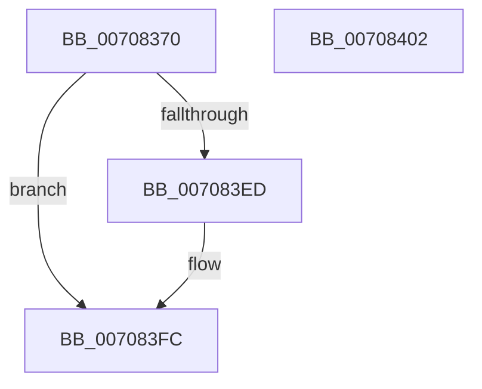

# HalpDriverEntry

- RVA: `0x00708370`–`0x00708403` (길이 `147` bytes)
- VA: `0x0000000140708370`
- 실행 섹션: `PAGE`
- PDB 이름 있음: `예`; PDB Function 태그: `아니요`
- unwind 정보 RVA: `0x0007F554`
- 디코드: `35`개 명령, `147/147` bytes 표시
- 미해석 바이트: `0` (있으면 어셈블리에 `.byte`로 보존)

> 이 문서는 커널 이미지의 기계어와 PDB 기호를 분석해 생성했습니다. 4번과 5번은 함수 원형과 자료형을 바이너리 사용 방식에서 추정한 C 해석이며 원본 소스 복구 결과는 아닙니다.

## 1. Dependencies

- 직접 호출 지점: **2**; 고유 호출 대상: **2**
- 직접 호출자로 확인된 함수: **0**
- RIP 상대 이미지 참조: **5**

### Outgoing calls
- `0x007083E4` → [IoReportDetectedDevice](../72/IoReportDetectedDevice_function_00725CD0.md) (function, `0x00725CD0`)
- `0x007083F5` → [HalpAddDevice](HalpAddDevice_function_00708060.md) (function, `0x00708060`)

### Direct callers
- 이 함수 시작 RVA로 연결되는 직접 call은 확인되지 않았습니다. 간접 호출은 완전히 역산할 수 없습니다.

### Static image references
- `0x00708388` → RVA `0x00FC1C18` (`.data`; write)
- `0x00708392` → RVA `0x00708060` (`HalpAddDevice`; read)
- `0x007083A0` → RVA `0x00A912C0` (`HalpDispatchPnp`; read)
- `0x007083B1` → RVA `0x00B7C0A0` (`HalpDispatchPower`; read)
- `0x007083BF` → RVA `0x00708330` (`HalpDispatchWmi`; read)

## 2. Other-region calls and transfers

- 다른 실행 섹션으로 향하는 call: **0**
- 별도 외부 분기/꼬리 이동을 확인하지 못했습니다.

## 3. Assembly (complete function range)

```asm
00708370  4C 8B DC                        mov r11, rsp
00708373  53                              push rbx
00708374  48 83 EC 40                     sub rsp, 0x40
00708378  48 8B 41 30                     mov rax, qword ptr [rcx + 0x30]
0070837C  48 8B D9                        mov rbx, rcx
0070837F  49 83 63 08 00                  and qword ptr [r11 + 8], 0
00708384  41 83 C8 FF                     or r8d, 0xffffffff
00708388  48 89 0D 89 98 8B 00            mov qword ptr [rip + 0x8b9889], rcx
0070838F  45 8B C8                        mov r9d, r8d
00708392  48 8D 0D C7 FC FF FF            lea rcx, [rip - 0x339]
00708399  83 CA FF                        or edx, 0xffffffff
0070839C  48 89 48 08                     mov qword ptr [rax + 8], rcx
007083A0  48 8D 05 19 8F 38 00            lea rax, [rip + 0x388f19]
007083A7  48 89 83 48 01 00 00            mov qword ptr [rbx + 0x148], rax
007083AE  48 8B CB                        mov rcx, rbx
007083B1  48 8D 05 E8 3C 47 00            lea rax, [rip + 0x473ce8]
007083B8  48 89 83 20 01 00 00            mov qword ptr [rbx + 0x120], rax
007083BF  48 8D 05 6A FF FF FF            lea rax, [rip - 0x96]
007083C6  48 89 83 28 01 00 00            mov qword ptr [rbx + 0x128], rax
007083CD  49 8D 43 08                     lea rax, [r11 + 8]
007083D1  49 89 43 F0                     mov qword ptr [r11 - 0x10], rax
007083D5  C6 44 24 30 00                  mov byte ptr [rsp + 0x30], 0
007083DA  49 83 63 E0 00                  and qword ptr [r11 - 0x20], 0
007083DF  49 83 63 D8 00                  and qword ptr [r11 - 0x28], 0
007083E4  E8 E7 D8 01 00                  call 0x140725cd0
007083E9  85 C0                           test eax, eax
007083EB  78 0F                           js 0x1407083fc
007083ED  48 8B 54 24 50                  mov rdx, qword ptr [rsp + 0x50]
007083F2  48 8B CB                        mov rcx, rbx
007083F5  E8 66 FC FF FF                  call 0x140708060
007083FA  33 C0                           xor eax, eax
007083FC  48 83 C4 40                     add rsp, 0x40
00708400  5B                              pop rbx
00708401  C3                              ret
00708402  CC                              int3
```

## 4. C-style interpretation (structured pseudocode)

```c
__int64 __fastcall HalpDriverEntry(__int64 a1, int a2, int a3)
{
    __int64 result;
    __int64 v_rsp;
    unsigned __int8 v_stack_m18;
    unsigned __int64 v_stack_p8;

    v_rsp = (v_rsp) - (64);
    a3 = (unsigned int)((a3) | (0xFFFFFFFFULL));
    *(unsigned __int64 *)(v_rip + 9148553) = a1;
    a2 = (unsigned int)((a2) | (0xFFFFFFFFULL));
    *(unsigned __int64 *)(*(unsigned __int64 *)(a1 + 48) + 8) = v_rip - 825;
    *(unsigned __int64 *)(a1 + 328) = v_rip + 3706649;
    *(unsigned __int64 *)(a1 + 288) = v_rip + 4668648;
    *(unsigned __int64 *)(a1 + 296) = v_rip - 150;
    *(unsigned __int64 *)(v_rsp - 16) = v_rsp + 8;
    v_stack_m18 = 0;
    result = IoReportDetectedDevice(a1, a2, a3, (unsigned int)(a3));
    if (!(sign_flag)) {
        a2 = v_stack_p8;
        a1 = a1;
        result = HalpAddDevice(a1, a2, a3, (unsigned int)(a3));
        result = 0;
    }
    v_rsp = (v_rsp) + (64);
    return result;
}
```

## 5. (Beta) C Style

```c
int64_t HalpDriverEntry(void *Arg1, int32_t Arg2, int32_t Arg3)
{
    uint8_t *arg1 = (uint8_t *)Arg1;

    int64_t result;
    int64_t local_rsp;
    uint8_t v_stack_m18;
    uint64_t v_stack_p8;

    local_rsp = (local_rsp) - (64);
    Arg3 = (uint32_t)((Arg3) | (0xFFFFFFFFULL));
    *(void **)(v_rip + 0x8B9889) = Arg1;
    Arg2 = (uint32_t)((Arg2) | (0xFFFFFFFFULL));
    *(uint64_t *)(*(uint64_t *)(arg1 + 0x30) + 0x8) = v_rip - 825;
    *(uint64_t *)(arg1 + 0x148) = v_rip + 3706649;
    *(uint64_t *)(arg1 + 0x120) = v_rip + 4668648;
    *(uint64_t *)(arg1 + 0x128) = v_rip - 150;
    *(uint64_t *)(local_rsp - 0x10) = local_rsp + 8;
    v_stack_m18 = 0;
    result = IoReportDetectedDevice(Arg1, Arg2, Arg3, (uint32_t)(Arg3));
    if (!(sign_flag)) {
        Arg2 = v_stack_p8;
        Arg1 = Arg1;
        result = HalpAddDevice(Arg1, Arg2, Arg3, (uint32_t)(Arg3));
        result = 0;
    }
    local_rsp = (local_rsp) + (64);
    return result;
}
```

### 관측된 메모리 오프셋

구조체 형식이 확인되지 않은 접근은 인자 기준의 오프셋으로만 기록했습니다.

| 기준 인자 | 오프셋 표현 | 폭 (bit) | 접근 |
|---|---:|---:|---|
| `Arg1` | `+ 0x30` | `64` | `R` |
| `Arg1` | `+ 0x120` | `64` | `W` |
| `Arg1` | `+ 0x128` | `64` | `W` |
| `Arg1` | `+ 0x148` | `64` | `W` |

## 6. Execution-region graph

[열기: 2D/3D 그래프와 함수 탐색 컨트롤 패널](../../../control-panel.html?section=page&rva=0x00708370&view=graph)

- 2D 그래프는 위에서 아래로 흐르고, 3D 그래프는 빈 공간을 드래그해 회전합니다. Shift+드래그는 이동, 휠은 확대·축소, 함수 노드 선택은 대상 보고서 이동입니다.

### Static fallback


