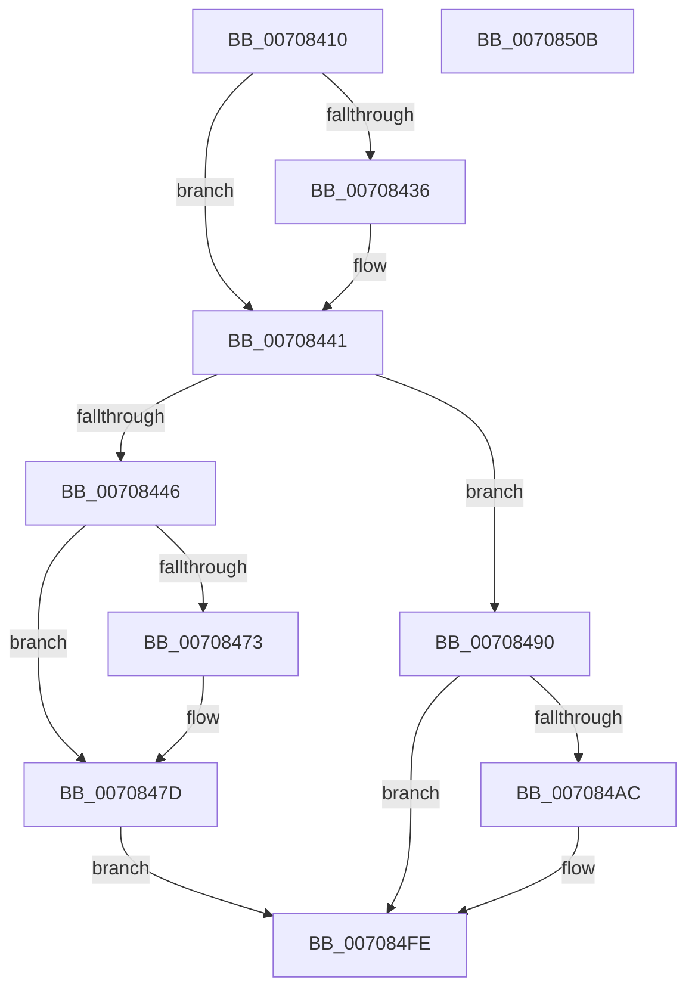

# HalpDynamicDeviceInterfaceNotification

- RVA: `0x00708410`–`0x0070850C` (길이 `252` bytes)
- VA: `0x0000000140708410`
- 실행 섹션: `PAGE`
- PDB 이름 있음: `예`; PDB Function 태그: `아니요`
- unwind 정보 RVA: `0x00097BC4`
- 디코드: `62`개 명령, `252/252` bytes 표시
- 미해석 바이트: `0` (있으면 어셈블리에 `.byte`로 보존)

> 이 문서는 커널 이미지의 기계어와 PDB 기호를 분석해 생성했습니다. 4번과 5번은 함수 원형과 자료형을 바이너리 사용 방식에서 추정한 C 해석이며 원본 소스 복구 결과는 아닙니다.

## 1. Dependencies

- 직접 호출 지점: **8**; 고유 호출 대상: **5**
- 직접 호출자로 확인된 함수: **0**
- RIP 상대 이미지 참조: **4**

### Outgoing calls
- `0x0070845B` → [KeWaitForSingleObject](../../text/20/KeWaitForSingleObject_function_0020E6B0.md) (function, `0x0020E6B0`)
- `0x00708473` → [ObfDereferenceObject](../../text/2F/ObfDereferenceObject_function_002F9350.md) (function, `0x002F9350`)
- `0x00708489` → [KeSetEvent](../../text/33/KeSetEvent_function_0033F310.md) (function, `0x0033F310`)
- `0x007084A3` → [IoGetDeviceObjectPointer](../95/IoGetDeviceObjectPointer_function_00953220.md) (function, `0x00953220`)
- `0x007084C3` → [KeWaitForSingleObject](../../text/20/KeWaitForSingleObject_function_0020E6B0.md) (function, `0x0020E6B0`)
- `0x007084E7` → [KeSetEvent](../../text/33/KeSetEvent_function_0033F310.md) (function, `0x0033F310`)
- `0x007084EF` → [ObfReferenceObject](../../text/20/ObfReferenceObject_function_0020FA20.md) (function, `0x0020FA20`)
- `0x007084F9` → [ObfDereferenceObject](../../text/2F/ObfDereferenceObject_function_002F9350.md) (function, `0x002F9350`)

### Direct callers
- 이 함수 시작 RVA로 연결되는 직접 call은 확인되지 않았습니다. 간접 호출은 완전히 역산할 수 없습니다.

### Static image references
- `0x0070842D` → RVA `0x000122D8` (`.rdata`; read)
- `0x0070843A` → RVA `0x000122E0` (`.rdata`; read)
- `0x00708451` → RVA `0x00FC1C00` (`.data`; read)
- `0x00708463` → RVA `0x00E10378` (`.data`; read)

## 2. Other-region calls and transfers

- 다른 실행 섹션으로 향하는 call: **7**
  - `0x0070845B` → [KeWaitForSingleObject](../../text/20/KeWaitForSingleObject_function_0020E6B0.md) (`PAGE` → `.text`)
  - `0x00708473` → [ObfDereferenceObject](../../text/2F/ObfDereferenceObject_function_002F9350.md) (`PAGE` → `.text`)
  - `0x00708489` → [KeSetEvent](../../text/33/KeSetEvent_function_0033F310.md) (`PAGE` → `.text`)
  - `0x007084C3` → [KeWaitForSingleObject](../../text/20/KeWaitForSingleObject_function_0020E6B0.md) (`PAGE` → `.text`)
  - `0x007084E7` → [KeSetEvent](../../text/33/KeSetEvent_function_0033F310.md) (`PAGE` → `.text`)
  - `0x007084EF` → [ObfReferenceObject](../../text/20/ObfReferenceObject_function_0020FA20.md) (`PAGE` → `.text`)
  - `0x007084F9` → [ObfDereferenceObject](../../text/2F/ObfDereferenceObject_function_002F9350.md) (`PAGE` → `.text`)
- 별도 외부 분기/꼬리 이동을 확인하지 못했습니다.

## 3. Assembly (complete function range)

```asm
00708410  48 89 5C 24 18                  mov qword ptr [rsp + 0x18], rbx
00708415  57                              push rdi
00708416  48 83 EC 30                     sub rsp, 0x30
0070841A  48 83 64 24 40 00               and qword ptr [rsp + 0x40], 0
00708420  48 8B DA                        mov rbx, rdx
00708423  48 83 64 24 48 00               and qword ptr [rsp + 0x48], 0
00708429  48 8B 41 04                     mov rax, qword ptr [rcx + 4]
0070842D  48 2B 05 A4 9E 90 FF            sub rax, qword ptr [rip - 0x6f615c]
00708434  75 0B                           jne 0x140708441
00708436  48 8B 41 0C                     mov rax, qword ptr [rcx + 0xc]
0070843A  48 2B 05 9F 9E 90 FF            sub rax, qword ptr [rip - 0x6f6161]
00708441  48 85 C0                        test rax, rax
00708444  75 4A                           jne 0x140708490
00708446  48 21 44 24 20                  and qword ptr [rsp + 0x20], rax
0070844B  8D 50 07                        lea edx, [rax + 7]
0070844E  45 33 C9                        xor r9d, r9d
00708451  48 8D 0D A8 97 8B 00            lea rcx, [rip + 0x8b97a8]
00708458  45 33 C0                        xor r8d, r8d
0070845B  E8 50 62 B0 FF                  call 0x14020e6b0
00708460  48 63 DB                        movsxd rbx, ebx
00708463  48 8D 3D 0E 7F 70 00            lea rdi, [rip + 0x707f0e]
0070846A  48 8B 0C DF                     mov rcx, qword ptr [rdi + rbx*8]
0070846E  48 85 C9                        test rcx, rcx
00708471  74 0A                           je 0x14070847d
00708473  E8 D8 0E BF FF                  call 0x1402f9350
00708478  48 83 24 DF 00                  and qword ptr [rdi + rbx*8], 0
0070847D  45 33 C0                        xor r8d, r8d
00708480  48 8D 0D 79 97 8B 00            lea rcx, [rip + 0x8b9779]
00708487  33 D2                           xor edx, edx
00708489  E8 82 6E C3 FF                  call 0x14033f310
0070848E  EB 6E                           jmp 0x1407084fe
00708490  48 8B 49 28                     mov rcx, qword ptr [rcx + 0x28]
00708494  4C 8D 4C 24 40                  lea r9, [rsp + 0x40]
00708499  4C 8D 44 24 48                  lea r8, [rsp + 0x48]
0070849E  BA 03 00 10 00                  mov edx, 0x100003
007084A3  E8 78 AD 24 00                  call 0x140953220
007084A8  85 C0                           test eax, eax
007084AA  78 52                           js 0x1407084fe
007084AC  48 83 64 24 20 00               and qword ptr [rsp + 0x20], 0
007084B2  48 8D 0D 47 97 8B 00            lea rcx, [rip + 0x8b9747]
007084B9  45 33 C9                        xor r9d, r9d
007084BC  45 33 C0                        xor r8d, r8d
007084BF  41 8D 51 07                     lea edx, [r9 + 7]
007084C3  E8 E8 61 B0 FF                  call 0x14020e6b0
007084C8  48 63 C3                        movsxd rax, ebx
007084CB  48 8D 3D A6 7E 70 00            lea rdi, [rip + 0x707ea6]
007084D2  48 8B 5C 24 40                  mov rbx, qword ptr [rsp + 0x40]
007084D7  48 8D 0D 22 97 8B 00            lea rcx, [rip + 0x8b9722]
007084DE  45 33 C0                        xor r8d, r8d
007084E1  33 D2                           xor edx, edx
007084E3  48 89 1C C7                     mov qword ptr [rdi + rax*8], rbx
007084E7  E8 24 6E C3 FF                  call 0x14033f310
007084EC  48 8B CB                        mov rcx, rbx
007084EF  E8 2C 75 B0 FF                  call 0x14020fa20
007084F4  48 8B 4C 24 48                  mov rcx, qword ptr [rsp + 0x48]
007084F9  E8 52 0E BF FF                  call 0x1402f9350
007084FE  48 8B 5C 24 50                  mov rbx, qword ptr [rsp + 0x50]
00708503  33 C0                           xor eax, eax
00708505  48 83 C4 30                     add rsp, 0x30
00708509  5F                              pop rdi
0070850A  C3                              ret
0070850B  CC                              int3
```

## 4. C-style interpretation (structured pseudocode)

```c
__int64 __fastcall HalpDynamicDeviceInterfaceNotification(__int64 a1, __int64 a2, int a3, int a4)
{
    __int64 result;
    __int64 v_rbx;
    __int64 v_rdi;
    __int64 v_rsp;
    unsigned __int64 v_stack_m18;
    unsigned __int64 v_stack_p10;
    unsigned __int64 v_stack_p18;
    unsigned __int64 v_stack_p8;

    v_stack_p18 = v_rbx;
    v_rsp = (v_rsp) - (48);
    result = (*(unsigned __int64 *)(a1 + 4)) - (*(unsigned __int64 *)(v_rip - 7299420));
    if (!(condition_is_not_equal)) {
        result = *(unsigned __int64 *)(a1 + 12);
        result = (result) - (*(unsigned __int64 *)(v_rip - 7299425));
    }
    if (result != 0) goto loc_00708490;
    a4 = 0;
    a3 = 0;
    result = KeWaitForSingleObject(v_rip + 9148328, result + 7, a3, a4);
    if (*(unsigned __int64 *)(v_rip + 7372558 + (int)((unsigned int)(a2)) * 8) != 0) {
        result = ObfDereferenceObject(*(unsigned __int64 *)(v_rip + 7372558 + (int)((unsigned int)(a2)) * 8), result + 7, a3, a4);
    }
    a3 = 0;
    a2 = 0;
    result = KeSetEvent(v_rip + 9148281, a2, a3, a4);
    goto loc_007084FE;
loc_00708490:
    result = IoGetDeviceObjectPointer(*(unsigned __int64 *)(v_rip + 9148281 + 40), (unsigned int)(0x100003ULL), v_stack_p10, v_stack_p8);
    v_rbx = (int)((unsigned int)(a2));
    v_rdi = v_rip + 7372558;
    if (!(sign_flag)) {
        a1 = v_rip + 9148231;
        a4 = 0;
        a3 = 0;
        a2 = a4 + 7;
        result = KeWaitForSingleObject(a1, a2, a3, a4);
        result = (int)((unsigned int)((int)((unsigned int)(a2))));
        v_rdi = v_rip + 7372454;
        v_rbx = v_stack_p8;
        a1 = v_rip + 9148194;
        a3 = 0;
        a2 = 0;
        *(unsigned __int64 *)(v_rdi + result * 8) = v_rbx;
        result = KeSetEvent(a1, a2, a3, a4);
        a1 = v_rbx;
        result = ObfReferenceObject(a1, a2, a3, a4);
        a1 = v_stack_p10;
        result = ObfDereferenceObject(a1, a2, a3, a4);
    }
    result = 0;
    v_rsp = (v_rsp) + (48);
    return result;
}
```

## 5. (Beta) C Style

```c
int64_t HalpDynamicDeviceInterfaceNotification(void *Arg1, int64_t Arg2, int32_t Arg3, int32_t Arg4)
{
    uint8_t *arg1 = (uint8_t *)Arg1;

    int64_t result;
    int64_t local_rbx;
    int64_t local_rdi;
    int64_t local_rsp;
    uint64_t v_stack_m18;
    uint64_t v_stack_p10;
    uint64_t v_stack_p18;
    uint64_t v_stack_p8;

    v_stack_p18 = local_rbx;
    local_rsp = (local_rsp) - (48);
    result = (*(uint64_t *)(arg1 + 0x4)) - (*(uint64_t *)(v_rip - 0x6F615C));
    if (!(condition_is_not_equal)) {
        result = *(uint64_t *)(arg1 + 0xC);
        result = (result) - (*(uint64_t *)(v_rip - 0x6F6161));
    }
    if (result != 0) goto loc_00708490;
    Arg4 = 0;
    Arg3 = 0;
    result = KeWaitForSingleObject(v_rip + 9148328, result + 7, Arg3, Arg4);
    if (*(uint64_t *)(v_rip + 0x707F0E + (int32_t)((uint32_t)(Arg2)) * 8) != 0) {
        result = ObfDereferenceObject(*(uint64_t *)(v_rip + 0x707F0E + (int32_t)((uint32_t)(Arg2)) * 8), result + 7, Arg3, Arg4);
    }
    Arg3 = 0;
    Arg2 = 0;
    result = KeSetEvent(v_rip + 9148281, Arg2, Arg3, Arg4);
    goto loc_007084FE;
loc_00708490:
    result = IoGetDeviceObjectPointer(*(uint64_t *)(v_rip + 0x8B9779 + 0x28), (uint32_t)(0x100003ULL), v_stack_p10, v_stack_p8);
    local_rbx = (int32_t)((uint32_t)(Arg2));
    local_rdi = v_rip + 7372558;
    if (!(sign_flag)) {
        Arg1 = v_rip + 9148231;
        Arg4 = 0;
        Arg3 = 0;
        Arg2 = Arg4 + 7;
        result = KeWaitForSingleObject(Arg1, Arg2, Arg3, Arg4);
        result = (int32_t)((uint32_t)((int32_t)((uint32_t)(Arg2))));
        local_rdi = v_rip + 7372454;
        local_rbx = v_stack_p8;
        Arg1 = v_rip + 9148194;
        Arg3 = 0;
        Arg2 = 0;
        *(uint64_t *)(local_rdi + result * 8) = local_rbx;
        result = KeSetEvent(Arg1, Arg2, Arg3, Arg4);
        Arg1 = local_rbx;
        result = ObfReferenceObject(Arg1, Arg2, Arg3, Arg4);
        Arg1 = v_stack_p10;
        result = ObfDereferenceObject(Arg1, Arg2, Arg3, Arg4);
    }
    result = 0;
    local_rsp = (local_rsp) + (48);
    return result;
}
```

### 관측된 메모리 오프셋

구조체 형식이 확인되지 않은 접근은 인자 기준의 오프셋으로만 기록했습니다.

| 기준 인자 | 오프셋 표현 | 폭 (bit) | 접근 |
|---|---:|---:|---|
| `Arg1` | `+ 0x4` | `64` | `R` |
| `Arg1` | `+ 0xC` | `64` | `R` |
| `Arg1` | `+ 0x28` | `64` | `R` |

## 6. Execution-region graph

[열기: 2D/3D 그래프와 함수 탐색 컨트롤 패널](../../../control-panel.html?section=page&rva=0x00708410&view=graph)

- 2D 그래프는 위에서 아래로 흐르고, 3D 그래프는 빈 공간을 드래그해 회전합니다. Shift+드래그는 이동, 휠은 확대·축소, 함수 노드 선택은 대상 보고서 이동입니다.

### Static fallback


