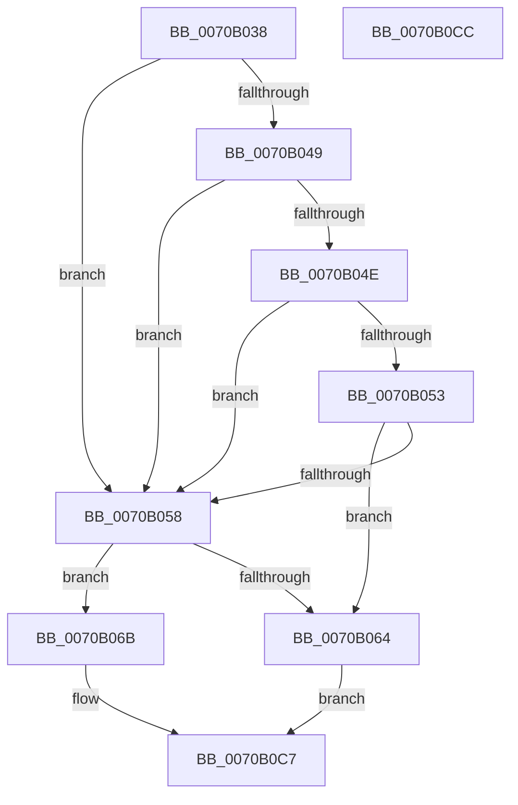

# HalpGetAcpiStaticNumaTopology

- RVA: `0x0070B038`–`0x0070B0CD` (길이 `149` bytes)
- VA: `0x000000014070B038`
- 실행 섹션: `PAGE`
- PDB 이름 있음: `예`; PDB Function 태그: `아니요`
- unwind 정보 RVA: `0x0005C788`
- 디코드: `38`개 명령, `149/149` bytes 표시
- 미해석 바이트: `0` (있으면 어셈블리에 `.byte`로 보존)

> 이 문서는 커널 이미지의 기계어와 PDB 기호를 분석해 생성했습니다. 4번과 5번은 함수 원형과 자료형을 바이너리 사용 방식에서 추정한 C 해석이며 원본 소스 복구 결과는 아닙니다.

## 1. Dependencies

- 직접 호출 지점: **1**; 고유 호출 대상: **1**
- 직접 호출자로 확인된 함수: **1**
- RIP 상대 이미지 참조: **8**

### Outgoing calls
- `0x0070B03F` → [HalpInterruptModel](../../text/4A/HalpInterruptModel_function_004ACA38.md) (function, `0x004ACA38`)

### Direct callers
- [sub_00B80AC2](../../pagelk/B8/Unknown_function_00B80AC2.md) at `0x00B80B17`

### Static image references
- `0x0070B058` → RVA `0x00F90658` (`.data`; read)
- `0x0070B073` → RVA `0x00559690` (`HalpNumaQueryProcessorNode`; read)
- `0x0070B07E` → RVA `0x00559790` (`HalpNumaQueryProximityNode`; read)
- `0x0070B089` → RVA `0x00559750` (`HalpNumaQueryProximityId`; read)
- `0x0070B094` → RVA `0x00559620` (`HalpNumaQueryNodeCapacity`; read)
- `0x0070B09F` → RVA `0x00559650` (`HalpNumaQueryNodeDistance`; read)
- `0x0070B0AA` → RVA `0x00F90618` (`.data`; read)
- `0x0070B0B4` → RVA `0x00558EC0` (`HalpNumaAddRangeProximity`; read)

## 2. Other-region calls and transfers

- 다른 실행 섹션으로 향하는 call: **1**
  - `0x0070B03F` → [HalpInterruptModel](../../text/4A/HalpInterruptModel_function_004ACA38.md) (`PAGE` → `.text`)
- 별도 외부 분기/꼬리 이동을 확인하지 못했습니다.

## 3. Assembly (complete function range)

```asm
0070B038  48 83 EC 28                     sub rsp, 0x28
0070B03C  4C 8B C1                        mov r8, rcx
0070B03F  E8 F4 19 DA FF                  call 0x1404aca38
0070B044  83 E8 01                        sub eax, 1
0070B047  74 0F                           je 0x14070b058
0070B049  83 E8 01                        sub eax, 1
0070B04C  74 0A                           je 0x14070b058
0070B04E  83 E8 01                        sub eax, 1
0070B051  74 05                           je 0x14070b058
0070B053  83 F8 01                        cmp eax, 1
0070B056  75 0C                           jne 0x14070b064
0070B058  48 8B 05 F9 55 88 00            mov rax, qword ptr [rip + 0x8855f9]
0070B05F  48 85 C0                        test rax, rax
0070B062  75 07                           jne 0x14070b06b
0070B064  B8 48 01 00 C0                  mov eax, 0xc0000148
0070B069  EB 5C                           jmp 0x14070b0c7
0070B06B  0F B7 40 38                     movzx eax, word ptr [rax + 0x38]
0070B06F  66 41 89 00                     mov word ptr [r8], ax
0070B073  48 8D 05 16 E6 E4 FF            lea rax, [rip - 0x1b19ea]
0070B07A  49 89 40 08                     mov qword ptr [r8 + 8], rax
0070B07E  48 8D 05 0B E7 E4 FF            lea rax, [rip - 0x1b18f5]
0070B085  49 89 40 18                     mov qword ptr [r8 + 0x18], rax
0070B089  48 8D 05 C0 E6 E4 FF            lea rax, [rip - 0x1b1940]
0070B090  49 89 40 28                     mov qword ptr [r8 + 0x28], rax
0070B094  48 8D 05 85 E5 E4 FF            lea rax, [rip - 0x1b1a7b]
0070B09B  49 89 40 30                     mov qword ptr [r8 + 0x30], rax
0070B09F  48 8D 05 AA E5 E4 FF            lea rax, [rip - 0x1b1a56]
0070B0A6  49 89 40 38                     mov qword ptr [r8 + 0x38], rax
0070B0AA  48 8B 05 67 55 88 00            mov rax, qword ptr [rip + 0x885567]
0070B0B1  48 F7 D8                        neg rax
0070B0B4  48 8D 05 05 DE E4 FF            lea rax, [rip - 0x1b21fb]
0070B0BB  48 1B C9                        sbb rcx, rcx
0070B0BE  48 23 C8                        and rcx, rax
0070B0C1  49 89 48 20                     mov qword ptr [r8 + 0x20], rcx
0070B0C5  33 C0                           xor eax, eax
0070B0C7  48 83 C4 28                     add rsp, 0x28
0070B0CB  C3                              ret
0070B0CC  CC                              int3
```

## 4. C-style interpretation (structured pseudocode)

```c
__int64 __fastcall HalpGetAcpiStaticNumaTopology(__int64 a1)
{
    __int64 result;
    __int64 v_rsp;

    v_rsp = (v_rsp) - (40);
    result = HalpInterruptModel(a1, a2, a1, a4);
    result = (unsigned int)((result) - (1));
    if (condition_is_equal) goto loc_0070B058;
    result = (unsigned int)((result) - (1));
    if (condition_is_equal) goto loc_0070B058;
    result = (unsigned int)((result) - (1));
    if (condition_is_equal) goto loc_0070B058;
    if (((unsigned int)(result)) != 1) goto loc_0070B064;
loc_0070B058:
    if (*(unsigned __int64 *)(v_rip + 8934905) != 0) goto loc_0070B06B;
loc_0070B064:
    goto loc_0070B0C7;
loc_0070B06B:
    *(unsigned __int16 *)(a1) = (unsigned __int16)(*(unsigned __int16 *)((unsigned int)(0xC0000148ULL) + 56));
    *(unsigned __int64 *)(a1 + 8) = v_rip - 1776106;
    *(unsigned __int64 *)(a1 + 24) = v_rip - 1775861;
    *(unsigned __int64 *)(a1 + 40) = v_rip - 1775936;
    *(unsigned __int64 *)(a1 + 48) = v_rip - 1776251;
    *(unsigned __int64 *)(a1 + 56) = v_rip - 1776214;
    result = -(*(unsigned __int64 *)(v_rip + 8934759));
    a1 = (a1) & (v_rip - 1778171);
    *(unsigned __int64 *)(a1 + 32) = a1;
    result = 0;
loc_0070B0C7:
    v_rsp = (v_rsp) + (40);
    return result;
}
```

## 5. (Beta) C Style

```c
int64_t HalpGetAcpiStaticNumaTopology(int64_t Arg1)
{
    int64_t result;
    int64_t local_rsp;

    local_rsp = (local_rsp) - (40);
    result = HalpInterruptModel(Arg1, a2, Arg1, a4);
    result = (uint32_t)((result) - (1));
    if (condition_is_equal) goto loc_0070B058;
    result = (uint32_t)((result) - (1));
    if (condition_is_equal) goto loc_0070B058;
    result = (uint32_t)((result) - (1));
    if (condition_is_equal) goto loc_0070B058;
    if (((uint32_t)(result)) != 1) goto loc_0070B064;
loc_0070B058:
    if (*(uint64_t *)(v_rip + 0x8855F9) != 0) goto loc_0070B06B;
loc_0070B064:
    goto loc_0070B0C7;
loc_0070B06B:
    *(uint16_t *)(Arg1) = (uint16_t)(*(uint16_t *)((uint32_t)(0xC0000148ULL) + 0x38));
    *(uint64_t *)(Arg1 + 0x8) = v_rip - 1776106;
    *(uint64_t *)(Arg1 + 0x18) = v_rip - 1775861;
    *(uint64_t *)(Arg1 + 0x28) = v_rip - 1775936;
    *(uint64_t *)(Arg1 + 0x30) = v_rip - 1776251;
    *(uint64_t *)(Arg1 + 0x38) = v_rip - 1776214;
    result = -(*(uint64_t *)(v_rip + 0x885567));
    Arg1 = (Arg1) & (v_rip - 1778171);
    *(uint64_t *)(Arg1 + 0x20) = Arg1;
    result = 0;
loc_0070B0C7:
    local_rsp = (local_rsp) + (40);
    return result;
}
```

## 6. Execution-region graph

[열기: 2D/3D 그래프와 함수 탐색 컨트롤 패널](../../../control-panel.html?section=page&rva=0x0070B038&view=graph)

- 2D 그래프는 위에서 아래로 흐르고, 3D 그래프는 빈 공간을 드래그해 회전합니다. Shift+드래그는 이동, 휠은 확대·축소, 함수 노드 선택은 대상 보고서 이동입니다.

### Static fallback


