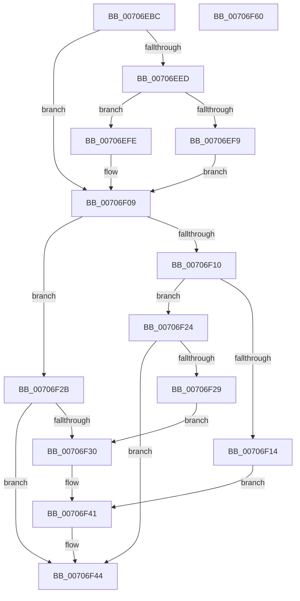

# HalpGetAdapter

- RVA: `0x00706EBC`–`0x00706F61` (길이 `165` bytes)
- VA: `0x0000000140706EBC`
- 실행 섹션: `PAGE`
- PDB 이름 있음: `예`; PDB Function 태그: `아니요`
- unwind 정보 RVA: `0x00060300`
- 디코드: `56`개 명령, `165/165` bytes 표시
- 미해석 바이트: `0` (있으면 어셈블리에 `.byte`로 보존)

> 이 문서는 커널 이미지의 기계어와 PDB 기호를 분석해 생성했습니다. 4번과 5번은 함수 원형과 자료형을 바이너리 사용 방식에서 추정한 C 해석이며 원본 소스 복구 결과는 아닙니다.

## 1. Dependencies

- 직접 호출 지점: **4**; 고유 호출 대상: **4**
- 직접 호출자로 확인된 함수: **2**
- RIP 상대 이미지 참조: **0**

### Outgoing calls
- `0x00706EF0` → [HalpAreDriversDmarCompatible](../../text/53/HalpAreDriversDmarCompatible_function_0053F3E0.md) (function, `0x0053F3E0`)
- `0x00706EFE` → [HalpIsHybridPassthroughCapable](../../text/53/HalpIsHybridPassthroughCapable_function_0053F4C0.md) (function, `0x0053F4C0`)
- `0x00706F1D` → [HalGetAdapterV2](HalGetAdapterV2_function_00709DD8.md) (function, `0x00709DD8`)
- `0x00706F3C` → [HalGetAdapterV3](HalGetAdapterV3_function_00709838.md) (function, `0x00709838`)

### Direct callers
- [HalPnpGetDmaAdapter](../../text/54/HalPnpGetDmaAdapter_function_00543CC0.md) at `0x00543CEC`
- [HalGetAdapter](HalGetAdapter_function_00706EA0.md) at `0x00706EA9`

### Static image references
- 디코드된 RIP-relative 메모리 참조가 없습니다.

## 2. Other-region calls and transfers

- 다른 실행 섹션으로 향하는 call: **2**
  - `0x00706EF0` → [HalpAreDriversDmarCompatible](../../text/53/HalpAreDriversDmarCompatible_function_0053F3E0.md) (`PAGE` → `.text`)
  - `0x00706EFE` → [HalpIsHybridPassthroughCapable](../../text/53/HalpIsHybridPassthroughCapable_function_0053F4C0.md) (`PAGE` → `.text`)
- 별도 외부 분기/꼬리 이동을 확인하지 못했습니다.

## 3. Assembly (complete function range)

```asm
00706EBC  48 89 5C 24 08                  mov qword ptr [rsp + 8], rbx
00706EC1  48 89 6C 24 10                  mov qword ptr [rsp + 0x10], rbp
00706EC6  48 89 74 24 18                  mov qword ptr [rsp + 0x18], rsi
00706ECB  57                              push rdi
00706ECC  41 56                           push r14
00706ECE  41 57                           push r15
00706ED0  48 83 EC 20                     sub rsp, 0x20
00706ED4  33 DB                           xor ebx, ebx
00706ED6  4D 8B F0                        mov r14, r8
00706ED9  41 89 18                        mov dword ptr [r8], ebx
00706EDC  48 8B EA                        mov rbp, rdx
00706EDF  48 8B F1                        mov rsi, rcx
00706EE2  8B FB                           mov edi, ebx
00706EE4  44 8D 7B 02                     lea r15d, [rbx + 2]
00706EE8  48 85 D2                        test rdx, rdx
00706EEB  74 1C                           je 0x140706f09
00706EED  48 8B CA                        mov rcx, rdx
00706EF0  E8 EB 84 E3 FF                  call 0x14053f3e0
00706EF5  84 C0                           test al, al
00706EF7  74 05                           je 0x140706efe
00706EF9  8D 7B 03                        lea edi, [rbx + 3]
00706EFC  EB 0B                           jmp 0x140706f09
00706EFE  E8 BD 85 E3 FF                  call 0x14053f4c0
00706F03  84 C0                           test al, al
00706F05  41 0F 45 FF                     cmovne edi, r15d
00706F09  8B 06                           mov eax, dword ptr [rsi]
00706F0B  41 3B C7                        cmp eax, r15d
00706F0E  77 1B                           ja 0x140706f2b
00706F10  85 FF                           test edi, edi
00706F12  75 10                           jne 0x140706f24
00706F14  4D 8B C6                        mov r8, r14
00706F17  48 8B D5                        mov rdx, rbp
00706F1A  48 8B CE                        mov rcx, rsi
00706F1D  E8 B6 2E 00 00                  call 0x140709dd8
00706F22  EB 1D                           jmp 0x140706f41
00706F24  38 5E 04                        cmp byte ptr [rsi + 4], bl
00706F27  74 1B                           je 0x140706f44
00706F29  EB 05                           jmp 0x140706f30
00706F2B  83 F8 03                        cmp eax, 3
00706F2E  75 14                           jne 0x140706f44
00706F30  4D 8B CE                        mov r9, r14
00706F33  44 8B C7                        mov r8d, edi
00706F36  48 8B D5                        mov rdx, rbp
00706F39  48 8B CE                        mov rcx, rsi
00706F3C  E8 F7 28 00 00                  call 0x140709838
00706F41  48 8B D8                        mov rbx, rax
00706F44  48 8B 6C 24 48                  mov rbp, qword ptr [rsp + 0x48]
00706F49  48 8B C3                        mov rax, rbx
00706F4C  48 8B 5C 24 40                  mov rbx, qword ptr [rsp + 0x40]
00706F51  48 8B 74 24 50                  mov rsi, qword ptr [rsp + 0x50]
00706F56  48 83 C4 20                     add rsp, 0x20
00706F5A  41 5F                           pop r15
00706F5C  41 5E                           pop r14
00706F5E  5F                              pop rdi
00706F5F  C3                              ret
00706F60  CC                              int3
```

## 4. C-style interpretation (structured pseudocode)

```c
__int64 __fastcall HalpGetAdapter(__int64 a1, __int64 a2, __int64 a3)
{
    __int64 result;
    __int64 v_rbx;
    __int64 v_rdi;
    __int64 v_rsp;
    unsigned __int64 v_stack_p10;
    unsigned __int64 v_stack_p18;
    unsigned __int64 v_stack_p8;

    v_stack_p8 = v_rbx;
    v_stack_p10 = v_rbp;
    v_stack_p18 = v_rsi;
    v_rsp = (v_rsp) - (32);
    v_rbx = 0;
    *(unsigned int *)(a3) = 0;
    if (a2 == 0) goto loc_00706F09;
    result = HalpAreDriversDmarCompatible(a2, a2, a3, a4);
    if ((unsigned __int8)(result) == 0) goto loc_00706EFE;
    goto loc_00706F09;
loc_00706EFE:
    result = HalpIsHybridPassthroughCapable(a2, a2, a3, a4);
    v_rdi = v_rbx + 3;
    if ((unsigned __int8)(result) != 0) { v_rdi = (unsigned int)(v_rbx + 2); }
loc_00706F09:
    if (((unsigned int)((unsigned int)(*(unsigned int *)(a1)))) > ((unsigned int)(v_rbx + 2))) goto loc_00706F2B;
    if ((unsigned int)(v_rdi) != 0) goto loc_00706F24;
    result = HalGetAdapterV2(a1, a2, a3, a4);
    goto loc_00706F41;
loc_00706F24:
    if ((*(unsigned __int8 *)(a1 + 4)) == 0) goto loc_00706F44;
    goto loc_00706F30;
loc_00706F2B:
    if (((unsigned int)(result)) != 3) goto loc_00706F44;
loc_00706F30:
    result = HalGetAdapterV3(a1, a2, (unsigned int)((unsigned int)(v_rdi)), a3);
loc_00706F41:
loc_00706F44:
    v_rsp = (v_rsp) + (32);
    return result;
}
```

## 5. (Beta) C Style

```c
int64_t HalpGetAdapter(void *Arg1, int64_t Arg2, void *Arg3)
{
    uint8_t *arg1 = (uint8_t *)Arg1;
    uint8_t *arg3 = (uint8_t *)Arg3;

    int64_t result;
    int64_t local_rbx;
    int64_t local_rdi;
    int64_t local_rsp;
    uint64_t v_stack_p10;
    uint64_t v_stack_p18;
    uint64_t v_stack_p8;

    v_stack_p8 = local_rbx;
    v_stack_p10 = local_rbp;
    v_stack_p18 = local_rsi;
    local_rsp = (local_rsp) - (32);
    local_rbx = 0;
    *(uint32_t *)(arg3) = 0;
    if (Arg2 == 0) goto loc_00706F09;
    result = HalpAreDriversDmarCompatible(Arg2, Arg2, Arg3, a4);
    if ((uint8_t)(result) == 0) goto loc_00706EFE;
    goto loc_00706F09;
loc_00706EFE:
    result = HalpIsHybridPassthroughCapable(Arg2, Arg2, Arg3, a4);
    local_rdi = local_rbx + 3;
    if ((uint8_t)(result) != 0) { local_rdi = (uint32_t)(local_rbx + 2); }
loc_00706F09:
    if (((uint32_t)((uint32_t)(*(uint32_t *)(arg1)))) > ((uint32_t)(local_rbx + 2))) goto loc_00706F2B;
    if ((uint32_t)(local_rdi) != 0) goto loc_00706F24;
    result = HalGetAdapterV2(Arg1, Arg2, Arg3, a4);
    goto loc_00706F41;
loc_00706F24:
    if ((*(uint8_t *)(arg1 + 0x4)) == 0) goto loc_00706F44;
    goto loc_00706F30;
loc_00706F2B:
    if (((uint32_t)(result)) != 3) goto loc_00706F44;
loc_00706F30:
    result = HalGetAdapterV3(Arg1, Arg2, (uint32_t)((uint32_t)(local_rdi)), Arg3);
loc_00706F41:
loc_00706F44:
    local_rsp = (local_rsp) + (32);
    return result;
}
```

### 관측된 메모리 오프셋

구조체 형식이 확인되지 않은 접근은 인자 기준의 오프셋으로만 기록했습니다.

| 기준 인자 | 오프셋 표현 | 폭 (bit) | 접근 |
|---|---:|---:|---|
| `Arg1` | `+ 0x0` | `32` | `R` |
| `Arg1` | `+ 0x4` | `8` | `R` |
| `Arg3` | `+ 0x0` | `32` | `W` |

## 6. Execution-region graph

[열기: 2D/3D 그래프와 함수 탐색 컨트롤 패널](../../../control-panel.html?section=page&rva=0x00706EBC&view=graph)

- 2D 그래프는 위에서 아래로 흐르고, 3D 그래프는 빈 공간을 드래그해 회전합니다. Shift+드래그는 이동, 휠은 확대·축소, 함수 노드 선택은 대상 보고서 이동입니다.

### Static fallback


