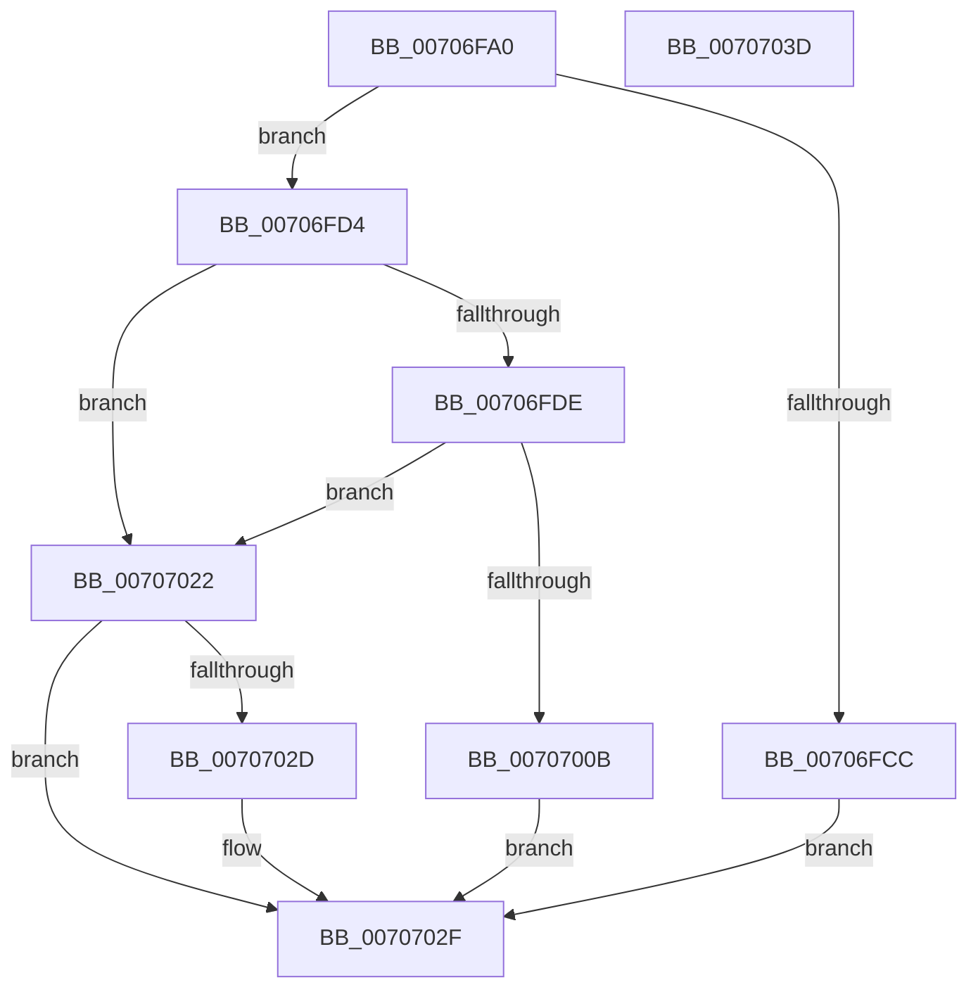

# HalpGetCacheCoherency

- RVA: `0x00706FA0`–`0x0070703E` (길이 `158` bytes)
- VA: `0x0000000140706FA0`
- 실행 섹션: `PAGE`
- PDB 이름 있음: `예`; PDB Function 태그: `아니요`
- unwind 정보 RVA: `0x000BA0F0`
- 디코드: `46`개 명령, `158/158` bytes 표시
- 미해석 바이트: `0` (있으면 어셈블리에 `.byte`로 보존)

> 이 문서는 커널 이미지의 기계어와 PDB 기호를 분석해 생성했습니다. 4번과 5번은 함수 원형과 자료형을 바이너리 사용 방식에서 추정한 C 해석이며 원본 소스 복구 결과는 아닙니다.

## 1. Dependencies

- 직접 호출 지점: **3**; 고유 호출 대상: **3**
- 직접 호출자로 확인된 함수: **2**
- RIP 상대 이미지 참조: **1**

### Outgoing calls
- `0x00707002` → [IoQueryInterface](../72/IoQueryInterface_function_00729930.md) (function, `0x00729930`)
- `0x0070701B` → [guard_dispatch_icall](../../text/6B/guard_dispatch_icall_function_006BAAD0.md) (function, `0x006BAAD0`)
- `0x00707024` → [KeSystemFullyCacheCoherent](../../text/5B/KeSystemFullyCacheCoherent_function_005BE100.md) (function, `0x005BE100`)

### Direct callers
- [HalGetAdapterV3](HalGetAdapterV3_function_00709838.md) at `0x007099C5`
- [HalGetAdapterV2](HalGetAdapterV2_function_00709DD8.md) at `0x00709EAC`

### Static image references
- `0x00706FF1` → RVA `0x0001E9C8` (`.rdata`; read)

## 2. Other-region calls and transfers

- 다른 실행 섹션으로 향하는 call: **2**
  - `0x0070701B` → [guard_dispatch_icall](../../text/6B/guard_dispatch_icall_function_006BAAD0.md) (`PAGE` → `.text`)
  - `0x00707024` → [KeSystemFullyCacheCoherent](../../text/5B/KeSystemFullyCacheCoherent_function_005BE100.md) (`PAGE` → `.text`)
- 별도 외부 분기/꼬리 이동을 확인하지 못했습니다.

## 3. Assembly (complete function range)

```asm
00706FA0  48 89 5C 24 08                  mov qword ptr [rsp + 8], rbx
00706FA5  57                              push rdi
00706FA6  48 83 EC 70                     sub rsp, 0x70
00706FAA  0F 57 C0                        xorps xmm0, xmm0
00706FAD  48 8B C2                        mov rax, rdx
00706FB0  33 D2                           xor edx, edx
00706FB2  49 8B F8                        mov rdi, r8
00706FB5  48 89 54 24 60                  mov qword ptr [rsp + 0x60], rdx
00706FBA  41 88 10                        mov byte ptr [r8], dl
00706FBD  0F 11 44 24 40                  movups xmmword ptr [rsp + 0x40], xmm0
00706FC2  0F 11 44 24 50                  movups xmmword ptr [rsp + 0x50], xmm0
00706FC7  48 85 C9                        test rcx, rcx
00706FCA  74 08                           je 0x140706fd4
00706FCC  8A 41 48                        mov al, byte ptr [rcx + 0x48]
00706FCF  41 88 00                        mov byte ptr [r8], al
00706FD2  EB 5B                           jmp 0x14070702f
00706FD4  BB 01 00 00 00                  mov ebx, 1
00706FD9  48 85 C0                        test rax, rax
00706FDC  74 44                           je 0x140707022
00706FDE  48 8D 4C 24 40                  lea rcx, [rsp + 0x40]
00706FE3  48 89 4C 24 30                  mov qword ptr [rsp + 0x30], rcx
00706FE8  44 8D 4B 27                     lea r9d, [rbx + 0x27]
00706FEC  48 21 54 24 28                  and qword ptr [rsp + 0x28], rdx
00706FF1  4C 8D 05 D0 79 91 FF            lea r8, [rip - 0x6e8630]
00706FF8  8B D3                           mov edx, ebx
00706FFA  66 89 5C 24 20                  mov word ptr [rsp + 0x20], bx
00706FFF  48 8B C8                        mov rcx, rax
00707002  E8 29 29 02 00                  call 0x140729930
00707007  85 C0                           test eax, eax
00707009  78 17                           js 0x140707022
0070700B  8A 44 24 60                     mov al, byte ptr [rsp + 0x60]
0070700F  48 8B 4C 24 48                  mov rcx, qword ptr [rsp + 0x48]
00707014  88 07                           mov byte ptr [rdi], al
00707016  48 8B 44 24 58                  mov rax, qword ptr [rsp + 0x58]
0070701B  E8 B0 3A FB FF                  call 0x1406baad0
00707020  EB 0D                           jmp 0x14070702f
00707022  88 1F                           mov byte ptr [rdi], bl
00707024  E8 D7 70 EB FF                  call 0x1405be100
00707029  84 C0                           test al, al
0070702B  75 02                           jne 0x14070702f
0070702D  88 07                           mov byte ptr [rdi], al
0070702F  48 8B 9C 24 80 00 00 00         mov rbx, qword ptr [rsp + 0x80]
00707037  48 83 C4 70                     add rsp, 0x70
0070703B  5F                              pop rdi
0070703C  C3                              ret
0070703D  CC                              int3
```

## 4. C-style interpretation (structured pseudocode)

```c
__int64 __fastcall HalpGetCacheCoherency(__int64 a1, __int64 a2, __int64 a3)
{
    __int64 result;
    __int64 v_rsp;
    unsigned __int64 v_stack_m18;
    unsigned __int64 v_stack_m20;
    unsigned __int64 v_stack_m28;
    unsigned __int64 v_stack_m30;
    unsigned __int64 v_stack_m38;
    unsigned __int64 v_stack_m48;
    unsigned __int64 v_stack_m50;
    unsigned __int16 v_stack_m58;
    unsigned __int64 v_stack_p8;

    v_stack_p8 = v_rbx;
    v_rsp = (v_rsp) - (112);
    a2 = 0;
    v_stack_m18 = 0;
    *(unsigned __int8 *)(a3) = 0;
    v_stack_m38 = v_xmm0;
    v_stack_m28 = v_xmm0;
    if (a1 == 0) goto loc_00706FD4;
    *(unsigned __int8 *)(a3) = (unsigned __int8)(*(unsigned __int8 *)(a1 + 72));
    goto loc_0070702F;
loc_00706FD4:
    if (*(unsigned __int8 *)(a1 + 72) == 0) goto loc_00707022;
    v_stack_m48 = v_stack_m38;
    v_stack_m58 = 1;
    result = IoQueryInterface(*(unsigned __int8 *)(a1 + 72), 1, v_rip - 7243312, 1 + 39);
    if (sign_flag) goto loc_00707022;
    *(unsigned __int8 *)(a3) = (unsigned __int8)(v_stack_m18);
    result = guard_dispatch_icall(v_stack_m30, 1, v_rip - 7243312, 1 + 39);
    goto loc_0070702F;
loc_00707022:
    *(unsigned __int8 *)(a3) = 1;
    result = KeSystemFullyCacheCoherent(v_stack_m30, 1, v_rip - 7243312, 1 + 39);
    if ((unsigned __int8)(result) == 0) {
        *(unsigned __int8 *)(a3) = (unsigned __int8)(result);
    }
    v_rsp = (v_rsp) + (112);
    return result;
}
```

## 5. (Beta) C Style

```c
int64_t HalpGetCacheCoherency(int64_t Arg1, int64_t Arg2, void *Arg3)
{
    uint8_t *arg3 = (uint8_t *)Arg3;

    int64_t result;
    int64_t local_rsp;
    uint64_t v_stack_m18;
    uint64_t v_stack_m20;
    uint64_t v_stack_m28;
    uint64_t v_stack_m30;
    uint64_t v_stack_m38;
    uint64_t v_stack_m48;
    uint64_t v_stack_m50;
    uint16_t v_stack_m58;
    uint64_t v_stack_p8;

    v_stack_p8 = local_rbx;
    local_rsp = (local_rsp) - (112);
    Arg2 = 0;
    v_stack_m18 = 0;
    *(uint8_t *)(arg3) = 0;
    v_stack_m38 = v_xmm0;
    v_stack_m28 = v_xmm0;
    if (Arg1 == 0) goto loc_00706FD4;
    *(uint8_t *)(arg3) = (uint8_t)(*(uint8_t *)(Arg1 + 0x48));
    goto loc_0070702F;
loc_00706FD4:
    if (*(uint8_t *)(Arg1 + 0x48) == 0) goto loc_00707022;
    v_stack_m48 = v_stack_m38;
    v_stack_m58 = 1;
    result = IoQueryInterface(*(uint8_t *)(Arg1 + 0x48), 1, v_rip - 7243312, 1 + 39);
    if (sign_flag) goto loc_00707022;
    *(uint8_t *)(arg3) = (uint8_t)(v_stack_m18);
    result = guard_dispatch_icall(v_stack_m30, 1, v_rip - 7243312, 1 + 39);
    goto loc_0070702F;
loc_00707022:
    *(uint8_t *)(arg3) = 1;
    result = KeSystemFullyCacheCoherent(v_stack_m30, 1, v_rip - 7243312, 1 + 39);
    if ((uint8_t)(result) == 0) {
        *(uint8_t *)(arg3) = (uint8_t)(result);
    }
    local_rsp = (local_rsp) + (112);
    return result;
}
```

### 관측된 메모리 오프셋

구조체 형식이 확인되지 않은 접근은 인자 기준의 오프셋으로만 기록했습니다.

| 기준 인자 | 오프셋 표현 | 폭 (bit) | 접근 |
|---|---:|---:|---|
| `Arg3` | `+ 0x0` | `8` | `W` |

## 6. Execution-region graph

[열기: 2D/3D 그래프와 함수 탐색 컨트롤 패널](../../../control-panel.html?section=page&rva=0x00706FA0&view=graph)

- 2D 그래프는 위에서 아래로 흐르고, 3D 그래프는 빈 공간을 드래그해 회전합니다. Shift+드래그는 이동, 휠은 확대·축소, 함수 노드 선택은 대상 보고서 이동입니다.

### Static fallback


