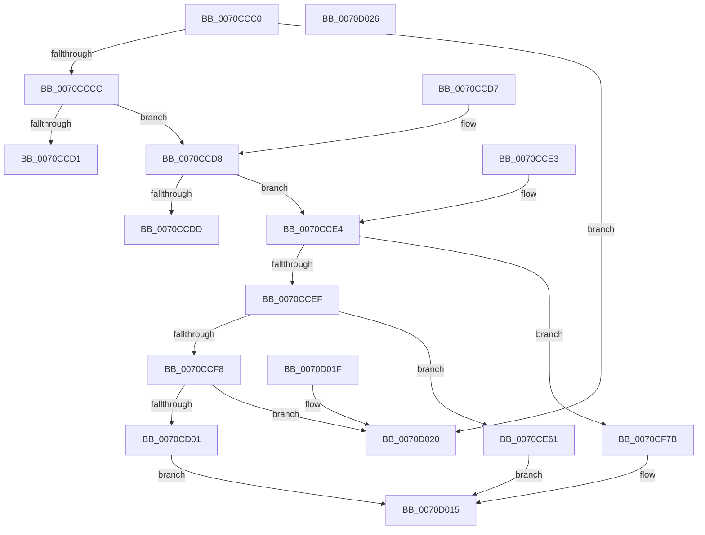

# HalpGetIommuInterfaceEx

- RVA: `0x0070CCC0`–`0x0070D027` (길이 `871` bytes)
- VA: `0x000000014070CCC0`
- 실행 섹션: `PAGE`
- PDB 이름 있음: `예`; PDB Function 태그: `아니요`
- unwind 정보 RVA: `0x000DB714`
- 디코드: `163`개 명령, `871/871` bytes 표시
- 미해석 바이트: `0` (있으면 어셈블리에 `.byte`로 보존)

> 이 문서는 커널 이미지의 기계어와 PDB 기호를 분석해 생성했습니다. 4번과 5번은 함수 원형과 자료형을 바이너리 사용 방식에서 추정한 C 해석이며 원본 소스 복구 결과는 아닙니다.

## 1. Dependencies

- 직접 호출 지점: **0**; 고유 호출 대상: **0**
- 직접 호출자로 확인된 함수: **0**
- RIP 상대 이미지 참조: **34**

### Outgoing calls
- 직접 디코드된 call 명령이 없습니다.

### Direct callers
- 이 함수 시작 RVA로 연결되는 직접 call은 확인되지 않았습니다. 간접 호출은 완전히 역산할 수 없습니다.

### Static image references
- `0x0070CD07` → RVA `0x0070D3A0` (`IommuDomainCreateEx`; read)
- `0x0070CD12` → RVA `0x0070D3C0` (`IommuDomainDelete`; read)
- `0x0070CD1D` → RVA `0x00567B60` (`IommuDomainAttachDeviceEx`; read)
- `0x0070CD28` → RVA `0x00567E80` (`IommuDomainDetachDeviceEx`; read)
- `0x0070CD33` → RVA `0x00567F20` (`IommuFlushDomain`; read)
- `0x0070CD3E` → RVA `0x0070D410` (`IommuFlushDomainVaList`; read)
- `0x0070CD49` → RVA `0x004E1110` (`DefaultAddProfileSource`; read)
- `0x0070CD54` → RVA `0x003074B0` (`IommuMapLogicalRangeEx`; read)
- `0x0070CD5F` → RVA `0x00306EC0` (`IommuUnmapLogicalRange`; read)
- `0x0070CD6A` → RVA `0x00307C10` (`IommuMapIdentityRangeEx`; read)
- `0x0070CD75` → RVA `0x00306F80` (`IommuUnmapIdentityRangeEx`; read)
- `0x0070CD80` → RVA `0x004FC600` (`BvgaSetVirtualFrameBuffer`; read)
- `0x0070CD8B` → RVA `0x0070D320` (`IommuDomainConfigure`; read)
- `0x0070CD96` → RVA `0x00567940` (`IommuDeviceQueryDomainTypes`; read)
- `0x0070CDA1` → RVA `0x00568200` (`IommuRegisterInterfaceStateChangeCallback`; read)
- `0x0070CDAF` → RVA `0x00568730` (`IommuUnregisterInterfaceStateChangeCallback`; read)
- `0x0070CDBD` → RVA `0x00568400` (`IommuReserveLogicalAddressRange`; read)
- `0x0070CDCB` → RVA `0x00567F80` (`IommuFreeReservedLogicalAddressRange`; read)
- `0x0070CDD9` → RVA `0x005680F0` (`IommuMapReservedLogicalRange`; read)
- `0x0070CDE7` → RVA `0x005686C0` (`IommuUnmapReservedLogicalRange`; read)
- `0x0070CDF5` → RVA `0x0070D030` (`IommuDeviceCreate`; read)
- `0x0070CE03` → RVA `0x0070D0D0` (`IommuDeviceDelete`; read)
- `0x0070CE11` → RVA `0x0070D450` (`IommuPasidDeviceCreate`; read)
- `0x0070CE1F` → RVA `0x0070D500` (`IommuPasidDeviceDelete`; read)
- `0x0070CE2D` → RVA `0x0070D2C0` (`IommuDomainAttachPasidDevice`; read)
- `0x0070CE3B` → RVA `0x0070D3E0` (`IommuDomainDetachPasidDevice`; read)
- `0x0070CE49` → RVA `0x0070D270` (`IommuDeviceQueryInformation`; read)
- `0x0070CF81` → RVA `0x0070D370` (`IommuDomainCreate`; read)
- `0x0070CF97` → RVA `0x00567960` (`IommuDomainAttachDevice`; read)
- `0x0070CFA2` → RVA `0x00567D40` (`IommuDomainDetachDevice`; read)
- `0x0070CFCE` → RVA `0x00568070` (`IommuMapLogicalRange`; read)
- `0x0070CFE4` → RVA `0x00568000` (`IommuMapIdentityRange`; read)
- `0x0070CFEF` → RVA `0x00568660` (`IommuUnmapIdentityRange`; read)
- `0x0070CFFA` → RVA `0x00568540` (`IommuSetDeviceFaultReporting`; read)

## 2. Other-region calls and transfers

- 다른 실행 섹션으로 향하는 call: **0**
- 별도 외부 분기/꼬리 이동을 확인하지 못했습니다.

## 3. Assembly (complete function range)

```asm
0070CCC0  8D 41 FF                        lea eax, [rcx - 1]
0070CCC3  83 F8 02                        cmp eax, 2
0070CCC6  0F 87 54 03 00 00               ja 0x14070d020
0070CCCC  4D 85 C0                        test r8, r8
0070CCCF  75 07                           jne 0x14070ccd8
0070CCD1  B8 F0 00 00 C0                  mov eax, 0xc00000f0
0070CCD6  C3                              ret
0070CCD7  CC                              int3
0070CCD8  48 85 D2                        test rdx, rdx
0070CCDB  74 07                           je 0x14070cce4
0070CCDD  B8 F1 00 00 C0                  mov eax, 0xc00000f1
0070CCE2  C3                              ret
0070CCE3  CC                              int3
0070CCE4  8B C1                           mov eax, ecx
0070CCE6  83 E8 01                        sub eax, 1
0070CCE9  0F 84 8C 02 00 00               je 0x14070cf7b
0070CCEF  83 E8 01                        sub eax, 1
0070CCF2  0F 84 69 01 00 00               je 0x14070ce61
0070CCF8  83 F8 01                        cmp eax, 1
0070CCFB  0F 85 1F 03 00 00               jne 0x14070d020
0070CD01  33 C0                           xor eax, eax
0070CD03  41 89 40 0C                     mov dword ptr [r8 + 0xc], eax
0070CD07  48 8D 05 92 06 00 00            lea rax, [rip + 0x692]
0070CD0E  49 89 40 10                     mov qword ptr [r8 + 0x10], rax
0070CD12  48 8D 05 A7 06 00 00            lea rax, [rip + 0x6a7]
0070CD19  49 89 40 18                     mov qword ptr [r8 + 0x18], rax
0070CD1D  48 8D 05 3C AE E5 FF            lea rax, [rip - 0x1a51c4]
0070CD24  49 89 40 20                     mov qword ptr [r8 + 0x20], rax
0070CD28  48 8D 05 51 B1 E5 FF            lea rax, [rip - 0x1a4eaf]
0070CD2F  49 89 40 28                     mov qword ptr [r8 + 0x28], rax
0070CD33  48 8D 05 E6 B1 E5 FF            lea rax, [rip - 0x1a4e1a]
0070CD3A  49 89 40 30                     mov qword ptr [r8 + 0x30], rax
0070CD3E  48 8D 05 CB 06 00 00            lea rax, [rip + 0x6cb]
0070CD45  49 89 40 38                     mov qword ptr [r8 + 0x38], rax
0070CD49  48 8D 05 C0 43 DD FF            lea rax, [rip - 0x22bc40]
0070CD50  49 89 40 40                     mov qword ptr [r8 + 0x40], rax
0070CD54  48 8D 05 55 A7 BF FF            lea rax, [rip - 0x4058ab]
0070CD5B  49 89 40 48                     mov qword ptr [r8 + 0x48], rax
0070CD5F  48 8D 05 5A A1 BF FF            lea rax, [rip - 0x405ea6]
0070CD66  49 89 40 50                     mov qword ptr [r8 + 0x50], rax
0070CD6A  48 8D 05 9F AE BF FF            lea rax, [rip - 0x405161]
0070CD71  49 89 40 58                     mov qword ptr [r8 + 0x58], rax
0070CD75  48 8D 05 04 A2 BF FF            lea rax, [rip - 0x405dfc]
0070CD7C  49 89 40 60                     mov qword ptr [r8 + 0x60], rax
0070CD80  48 8D 05 79 F8 DE FF            lea rax, [rip - 0x210787]
0070CD87  49 89 40 68                     mov qword ptr [r8 + 0x68], rax
0070CD8B  48 8D 05 8E 05 00 00            lea rax, [rip + 0x58e]
0070CD92  49 89 40 70                     mov qword ptr [r8 + 0x70], rax
0070CD96  48 8D 05 A3 AB E5 FF            lea rax, [rip - 0x1a545d]
0070CD9D  49 89 40 78                     mov qword ptr [r8 + 0x78], rax
0070CDA1  48 8D 05 58 B4 E5 FF            lea rax, [rip - 0x1a4ba8]
0070CDA8  49 89 80 80 00 00 00            mov qword ptr [r8 + 0x80], rax
0070CDAF  48 8D 05 7A B9 E5 FF            lea rax, [rip - 0x1a4686]
0070CDB6  49 89 80 88 00 00 00            mov qword ptr [r8 + 0x88], rax
0070CDBD  48 8D 05 3C B6 E5 FF            lea rax, [rip - 0x1a49c4]
0070CDC4  49 89 80 90 00 00 00            mov qword ptr [r8 + 0x90], rax
0070CDCB  48 8D 05 AE B1 E5 FF            lea rax, [rip - 0x1a4e52]
0070CDD2  49 89 80 98 00 00 00            mov qword ptr [r8 + 0x98], rax
0070CDD9  48 8D 05 10 B3 E5 FF            lea rax, [rip - 0x1a4cf0]
0070CDE0  49 89 80 A0 00 00 00            mov qword ptr [r8 + 0xa0], rax
0070CDE7  48 8D 05 D2 B8 E5 FF            lea rax, [rip - 0x1a472e]
0070CDEE  49 89 80 A8 00 00 00            mov qword ptr [r8 + 0xa8], rax
0070CDF5  48 8D 05 34 02 00 00            lea rax, [rip + 0x234]
0070CDFC  49 89 80 B0 00 00 00            mov qword ptr [r8 + 0xb0], rax
0070CE03  48 8D 05 C6 02 00 00            lea rax, [rip + 0x2c6]
0070CE0A  49 89 80 B8 00 00 00            mov qword ptr [r8 + 0xb8], rax
0070CE11  48 8D 05 38 06 00 00            lea rax, [rip + 0x638]
0070CE18  49 89 80 C0 00 00 00            mov qword ptr [r8 + 0xc0], rax
0070CE1F  48 8D 05 DA 06 00 00            lea rax, [rip + 0x6da]
0070CE26  49 89 80 C8 00 00 00            mov qword ptr [r8 + 0xc8], rax
0070CE2D  48 8D 05 8C 04 00 00            lea rax, [rip + 0x48c]
0070CE34  49 89 80 D0 00 00 00            mov qword ptr [r8 + 0xd0], rax
0070CE3B  48 8D 05 9E 05 00 00            lea rax, [rip + 0x59e]
0070CE42  49 89 80 D8 00 00 00            mov qword ptr [r8 + 0xd8], rax
0070CE49  48 8D 05 20 04 00 00            lea rax, [rip + 0x420]
0070CE50  49 89 80 E0 00 00 00            mov qword ptr [r8 + 0xe0], rax
0070CE57  B8 E8 00 00 00                  mov eax, 0xe8
0070CE5C  E9 B4 01 00 00                  jmp 0x14070d015
0070CE61  33 C0                           xor eax, eax
0070CE63  41 89 40 0C                     mov dword ptr [r8 + 0xc], eax
0070CE67  48 8D 05 32 05 00 00            lea rax, [rip + 0x532]
0070CE6E  49 89 40 10                     mov qword ptr [r8 + 0x10], rax
0070CE72  48 8D 05 47 05 00 00            lea rax, [rip + 0x547]
0070CE79  49 89 40 18                     mov qword ptr [r8 + 0x18], rax
0070CE7D  48 8D 05 DC AC E5 FF            lea rax, [rip - 0x1a5324]
0070CE84  49 89 40 20                     mov qword ptr [r8 + 0x20], rax
0070CE88  48 8D 05 F1 AF E5 FF            lea rax, [rip - 0x1a500f]
0070CE8F  49 89 40 28                     mov qword ptr [r8 + 0x28], rax
0070CE93  48 8D 05 86 B0 E5 FF            lea rax, [rip - 0x1a4f7a]
0070CE9A  49 89 40 30                     mov qword ptr [r8 + 0x30], rax
0070CE9E  48 8D 05 6B 05 00 00            lea rax, [rip + 0x56b]
0070CEA5  49 89 40 38                     mov qword ptr [r8 + 0x38], rax
0070CEA9  48 8D 05 60 42 DD FF            lea rax, [rip - 0x22bda0]
0070CEB0  49 89 40 40                     mov qword ptr [r8 + 0x40], rax
0070CEB4  48 8D 05 F5 A5 BF FF            lea rax, [rip - 0x405a0b]
0070CEBB  49 89 40 48                     mov qword ptr [r8 + 0x48], rax
0070CEBF  48 8D 05 FA 9F BF FF            lea rax, [rip - 0x406006]
0070CEC6  49 89 40 50                     mov qword ptr [r8 + 0x50], rax
0070CECA  48 8D 05 3F AD BF FF            lea rax, [rip - 0x4052c1]
0070CED1  49 89 40 58                     mov qword ptr [r8 + 0x58], rax
0070CED5  48 8D 05 A4 A0 BF FF            lea rax, [rip - 0x405f5c]
0070CEDC  49 89 40 60                     mov qword ptr [r8 + 0x60], rax
0070CEE0  48 8D 05 19 F7 DE FF            lea rax, [rip - 0x2108e7]
0070CEE7  49 89 40 68                     mov qword ptr [r8 + 0x68], rax
0070CEEB  48 8D 05 2E 04 00 00            lea rax, [rip + 0x42e]
0070CEF2  49 89 40 70                     mov qword ptr [r8 + 0x70], rax
0070CEF6  48 8D 05 43 AA E5 FF            lea rax, [rip - 0x1a55bd]
0070CEFD  49 89 40 78                     mov qword ptr [r8 + 0x78], rax
0070CF01  48 8D 05 F8 B2 E5 FF            lea rax, [rip - 0x1a4d08]
0070CF08  49 89 80 80 00 00 00            mov qword ptr [r8 + 0x80], rax
0070CF0F  48 8D 05 1A B8 E5 FF            lea rax, [rip - 0x1a47e6]
0070CF16  49 89 80 88 00 00 00            mov qword ptr [r8 + 0x88], rax
0070CF1D  48 8D 05 DC B4 E5 FF            lea rax, [rip - 0x1a4b24]
0070CF24  49 89 80 90 00 00 00            mov qword ptr [r8 + 0x90], rax
0070CF2B  48 8D 05 4E B0 E5 FF            lea rax, [rip - 0x1a4fb2]
0070CF32  49 89 80 98 00 00 00            mov qword ptr [r8 + 0x98], rax
0070CF39  48 8D 05 B0 B1 E5 FF            lea rax, [rip - 0x1a4e50]
0070CF40  49 89 80 A0 00 00 00            mov qword ptr [r8 + 0xa0], rax
0070CF47  48 8D 05 72 B7 E5 FF            lea rax, [rip - 0x1a488e]
0070CF4E  49 89 80 A8 00 00 00            mov qword ptr [r8 + 0xa8], rax
0070CF55  48 8D 05 D4 00 00 00            lea rax, [rip + 0xd4]
0070CF5C  49 89 80 B0 00 00 00            mov qword ptr [r8 + 0xb0], rax
0070CF63  48 8D 05 66 01 00 00            lea rax, [rip + 0x166]
0070CF6A  49 89 80 B8 00 00 00            mov qword ptr [r8 + 0xb8], rax
0070CF71  B8 C0 00 00 00                  mov eax, 0xc0
0070CF76  E9 9A 00 00 00                  jmp 0x14070d015
0070CF7B  33 C0                           xor eax, eax
0070CF7D  41 89 40 0C                     mov dword ptr [r8 + 0xc], eax
0070CF81  48 8D 05 E8 03 00 00            lea rax, [rip + 0x3e8]
0070CF88  49 89 40 10                     mov qword ptr [r8 + 0x10], rax
0070CF8C  48 8D 05 2D 04 00 00            lea rax, [rip + 0x42d]
0070CF93  49 89 40 18                     mov qword ptr [r8 + 0x18], rax
0070CF97  48 8D 05 C2 A9 E5 FF            lea rax, [rip - 0x1a563e]
0070CF9E  49 89 40 20                     mov qword ptr [r8 + 0x20], rax
0070CFA2  48 8D 05 97 AD E5 FF            lea rax, [rip - 0x1a5269]
0070CFA9  49 89 40 28                     mov qword ptr [r8 + 0x28], rax
0070CFAD  48 8D 05 6C AF E5 FF            lea rax, [rip - 0x1a5094]
0070CFB4  49 89 40 30                     mov qword ptr [r8 + 0x30], rax
0070CFB8  48 8D 05 51 04 00 00            lea rax, [rip + 0x451]
0070CFBF  49 89 40 38                     mov qword ptr [r8 + 0x38], rax
0070CFC3  48 8D 05 46 41 DD FF            lea rax, [rip - 0x22beba]
0070CFCA  49 89 40 40                     mov qword ptr [r8 + 0x40], rax
0070CFCE  48 8D 05 9B B0 E5 FF            lea rax, [rip - 0x1a4f65]
0070CFD5  49 89 40 48                     mov qword ptr [r8 + 0x48], rax
0070CFD9  48 8D 05 E0 9E BF FF            lea rax, [rip - 0x406120]
0070CFE0  49 89 40 50                     mov qword ptr [r8 + 0x50], rax
0070CFE4  48 8D 05 15 B0 E5 FF            lea rax, [rip - 0x1a4feb]
0070CFEB  49 89 40 58                     mov qword ptr [r8 + 0x58], rax
0070CFEF  48 8D 05 6A B6 E5 FF            lea rax, [rip - 0x1a4996]
0070CFF6  49 89 40 60                     mov qword ptr [r8 + 0x60], rax
0070CFFA  48 8D 05 3F B5 E5 FF            lea rax, [rip - 0x1a4ac1]
0070D001  49 89 40 68                     mov qword ptr [r8 + 0x68], rax
0070D005  48 8D 05 14 03 00 00            lea rax, [rip + 0x314]
0070D00C  49 89 40 70                     mov qword ptr [r8 + 0x70], rax
0070D010  B8 78 00 00 00                  mov eax, 0x78
0070D015  49 89 00                        mov qword ptr [r8], rax
0070D018  33 C0                           xor eax, eax
0070D01A  41 89 48 08                     mov dword ptr [r8 + 8], ecx
0070D01E  C3                              ret
0070D01F  CC                              int3
0070D020  B8 EF 00 00 C0                  mov eax, 0xc00000ef
0070D025  C3                              ret
0070D026  CC                              int3
```

## 4. C-style interpretation (structured pseudocode)

```c
__int64 __fastcall HalpGetIommuInterfaceEx(__int64 a1, __int64 a2, __int64 a3)
{
    __int64 result;

    if (((unsigned int)(a1 - 1)) > 2) goto loc_0070D020;
    if (a3 != 0) goto loc_0070CCD8;
    return (unsigned int)(0xC00000F0ULL);
loc_0070CCD8:
    if (a2 == 0) goto loc_0070CCE4;
    return (unsigned int)(0xC00000F1ULL);
loc_0070CCE4:
    result = (unsigned int)(((unsigned int)((unsigned int)(a1))) - (1));
    if (condition_is_equal) goto loc_0070CF7B;
    result = (unsigned int)((result) - (1));
    if (condition_is_equal) goto loc_0070CE61;
    if (((unsigned int)(result)) != 1) goto loc_0070D020;
    result = 0;
    *(unsigned int *)(a3 + 12) = 0;
    *(unsigned __int64 *)(a3 + 16) = v_rip + 1682;
    *(unsigned __int64 *)(a3 + 24) = v_rip + 1703;
    *(unsigned __int64 *)(a3 + 32) = v_rip - 1724868;
    *(unsigned __int64 *)(a3 + 40) = v_rip - 1724079;
    *(unsigned __int64 *)(a3 + 48) = v_rip - 1723930;
    *(unsigned __int64 *)(a3 + 56) = v_rip + 1739;
    *(unsigned __int64 *)(a3 + 64) = v_rip - 2276416;
    *(unsigned __int64 *)(a3 + 72) = v_rip - 4217003;
    *(unsigned __int64 *)(a3 + 80) = v_rip - 4218534;
    *(unsigned __int64 *)(a3 + 88) = v_rip - 4215137;
    *(unsigned __int64 *)(a3 + 96) = v_rip - 4218364;
    *(unsigned __int64 *)(a3 + 104) = v_rip - 2164615;
    *(unsigned __int64 *)(a3 + 112) = v_rip + 1422;
    *(unsigned __int64 *)(a3 + 120) = v_rip - 1725533;
    *(unsigned __int64 *)(a3 + 128) = v_rip - 1723304;
    *(unsigned __int64 *)(a3 + 136) = v_rip - 1721990;
    *(unsigned __int64 *)(a3 + 144) = v_rip - 1722820;
    *(unsigned __int64 *)(a3 + 152) = v_rip - 1723986;
    *(unsigned __int64 *)(a3 + 160) = v_rip - 1723632;
    *(unsigned __int64 *)(a3 + 168) = v_rip - 1722158;
    *(unsigned __int64 *)(a3 + 176) = v_rip + 564;
    *(unsigned __int64 *)(a3 + 184) = v_rip + 710;
    *(unsigned __int64 *)(a3 + 192) = v_rip + 1592;
    *(unsigned __int64 *)(a3 + 200) = v_rip + 1754;
    *(unsigned __int64 *)(a3 + 208) = v_rip + 1164;
    *(unsigned __int64 *)(a3 + 216) = v_rip + 1438;
    *(unsigned __int64 *)(a3 + 224) = v_rip + 1056;
    goto loc_0070D015;
loc_0070CE61:
    result = 0;
    *(unsigned int *)(a3 + 12) = 0;
    *(unsigned __int64 *)(a3 + 16) = v_rip + 1330;
    *(unsigned __int64 *)(a3 + 24) = v_rip + 1351;
    *(unsigned __int64 *)(a3 + 32) = v_rip - 1725220;
    *(unsigned __int64 *)(a3 + 40) = v_rip - 1724431;
    *(unsigned __int64 *)(a3 + 48) = v_rip - 1724282;
    *(unsigned __int64 *)(a3 + 56) = v_rip + 1387;
    *(unsigned __int64 *)(a3 + 64) = v_rip - 2276768;
    *(unsigned __int64 *)(a3 + 72) = v_rip - 4217355;
    *(unsigned __int64 *)(a3 + 80) = v_rip - 4218886;
    *(unsigned __int64 *)(a3 + 88) = v_rip - 4215489;
    *(unsigned __int64 *)(a3 + 96) = v_rip - 4218716;
    *(unsigned __int64 *)(a3 + 104) = v_rip - 2164967;
    *(unsigned __int64 *)(a3 + 112) = v_rip + 1070;
    *(unsigned __int64 *)(a3 + 120) = v_rip - 1725885;
    *(unsigned __int64 *)(a3 + 128) = v_rip - 1723656;
    *(unsigned __int64 *)(a3 + 136) = v_rip - 1722342;
    *(unsigned __int64 *)(a3 + 144) = v_rip - 1723172;
    *(unsigned __int64 *)(a3 + 152) = v_rip - 1724338;
    *(unsigned __int64 *)(a3 + 160) = v_rip - 1723984;
    *(unsigned __int64 *)(a3 + 168) = v_rip - 1722510;
    *(unsigned __int64 *)(a3 + 176) = v_rip + 212;
    *(unsigned __int64 *)(a3 + 184) = v_rip + 358;
    goto loc_0070D015;
loc_0070CF7B:
    result = 0;
    *(unsigned int *)(a3 + 12) = 0;
    *(unsigned __int64 *)(a3 + 16) = v_rip + 1000;
    *(unsigned __int64 *)(a3 + 24) = v_rip + 1069;
    *(unsigned __int64 *)(a3 + 32) = v_rip - 1726014;
    *(unsigned __int64 *)(a3 + 40) = v_rip - 1725033;
    *(unsigned __int64 *)(a3 + 48) = v_rip - 1724564;
    *(unsigned __int64 *)(a3 + 56) = v_rip + 1105;
    *(unsigned __int64 *)(a3 + 64) = v_rip - 2277050;
    *(unsigned __int64 *)(a3 + 72) = v_rip - 1724261;
    *(unsigned __int64 *)(a3 + 80) = v_rip - 4219168;
    *(unsigned __int64 *)(a3 + 88) = v_rip - 1724395;
    *(unsigned __int64 *)(a3 + 96) = v_rip - 1722774;
    *(unsigned __int64 *)(a3 + 104) = v_rip - 1723073;
    *(unsigned __int64 *)(a3 + 112) = v_rip + 788;
loc_0070D015:
    *(unsigned __int64 *)(a3) = 120;
    result = 0;
    *(unsigned int *)(a3 + 8) = (unsigned int)(a1);
    return result;
loc_0070D020:
    return (unsigned int)(0xC00000EFULL);
}
```

## 5. (Beta) C Style

```c
int64_t HalpGetIommuInterfaceEx(void *Arg1, int64_t Arg2, int64_t Arg3)
{
    uint8_t *arg1 = (uint8_t *)Arg1;

    int64_t result;

    if (((uint32_t)(Arg1 - 1)) > 2) goto loc_0070D020;
    if (Arg3 != 0) goto loc_0070CCD8;
    return (uint32_t)(0xC00000F0ULL);
loc_0070CCD8:
    if (Arg2 == 0) goto loc_0070CCE4;
    return (uint32_t)(0xC00000F1ULL);
loc_0070CCE4:
    result = (uint32_t)(((uint32_t)((uint32_t)(Arg1))) - (1));
    if (condition_is_equal) goto loc_0070CF7B;
    result = (uint32_t)((result) - (1));
    if (condition_is_equal) goto loc_0070CE61;
    if (((uint32_t)(result)) != 1) goto loc_0070D020;
    result = 0;
    *(uint32_t *)(Arg3 + 0xC) = 0;
    *(uint64_t *)(Arg3 + 0x10) = v_rip + 1682;
    *(uint64_t *)(Arg3 + 0x18) = v_rip + 1703;
    *(uint64_t *)(Arg3 + 0x20) = v_rip - 1724868;
    *(uint64_t *)(Arg3 + 0x28) = v_rip - 1724079;
    *(uint64_t *)(Arg3 + 0x30) = v_rip - 1723930;
    *(uint64_t *)(Arg3 + 0x38) = v_rip + 1739;
    *(uint64_t *)(Arg3 + 0x40) = v_rip - 2276416;
    *(uint64_t *)(Arg3 + 0x48) = v_rip - 4217003;
    *(uint64_t *)(Arg3 + 0x50) = v_rip - 4218534;
    *(uint64_t *)(Arg3 + 0x58) = v_rip - 4215137;
    *(uint64_t *)(Arg3 + 0x60) = v_rip - 4218364;
    *(uint64_t *)(Arg3 + 0x68) = v_rip - 2164615;
    *(uint64_t *)(Arg3 + 0x70) = v_rip + 1422;
    *(uint64_t *)(Arg3 + 0x78) = v_rip - 1725533;
    *(uint64_t *)(Arg3 + 0x80) = v_rip - 1723304;
    *(uint64_t *)(Arg3 + 0x88) = v_rip - 1721990;
    *(uint64_t *)(Arg3 + 0x90) = v_rip - 1722820;
    *(uint64_t *)(Arg3 + 0x98) = v_rip - 1723986;
    *(uint64_t *)(Arg3 + 0xA0) = v_rip - 1723632;
    *(uint64_t *)(Arg3 + 0xA8) = v_rip - 1722158;
    *(uint64_t *)(Arg3 + 0xB0) = v_rip + 564;
    *(uint64_t *)(Arg3 + 0xB8) = v_rip + 710;
    *(uint64_t *)(Arg3 + 0xC0) = v_rip + 1592;
    *(uint64_t *)(Arg3 + 0xC8) = v_rip + 1754;
    *(uint64_t *)(Arg3 + 0xD0) = v_rip + 1164;
    *(uint64_t *)(Arg3 + 0xD8) = v_rip + 1438;
    *(uint64_t *)(Arg3 + 0xE0) = v_rip + 1056;
    goto loc_0070D015;
loc_0070CE61:
    result = 0;
    *(uint32_t *)(Arg3 + 0xC) = 0;
    *(uint64_t *)(Arg3 + 0x10) = v_rip + 1330;
    *(uint64_t *)(Arg3 + 0x18) = v_rip + 1351;
    *(uint64_t *)(Arg3 + 0x20) = v_rip - 1725220;
    *(uint64_t *)(Arg3 + 0x28) = v_rip - 1724431;
    *(uint64_t *)(Arg3 + 0x30) = v_rip - 1724282;
    *(uint64_t *)(Arg3 + 0x38) = v_rip + 1387;
    *(uint64_t *)(Arg3 + 0x40) = v_rip - 2276768;
    *(uint64_t *)(Arg3 + 0x48) = v_rip - 4217355;
    *(uint64_t *)(Arg3 + 0x50) = v_rip - 4218886;
    *(uint64_t *)(Arg3 + 0x58) = v_rip - 4215489;
    *(uint64_t *)(Arg3 + 0x60) = v_rip - 4218716;
    *(uint64_t *)(Arg3 + 0x68) = v_rip - 2164967;
    *(uint64_t *)(Arg3 + 0x70) = v_rip + 1070;
    *(uint64_t *)(Arg3 + 0x78) = v_rip - 1725885;
    *(uint64_t *)(Arg3 + 0x80) = v_rip - 1723656;
    *(uint64_t *)(Arg3 + 0x88) = v_rip - 1722342;
    *(uint64_t *)(Arg3 + 0x90) = v_rip - 1723172;
    *(uint64_t *)(Arg3 + 0x98) = v_rip - 1724338;
    *(uint64_t *)(Arg3 + 0xA0) = v_rip - 1723984;
    *(uint64_t *)(Arg3 + 0xA8) = v_rip - 1722510;
    *(uint64_t *)(Arg3 + 0xB0) = v_rip + 212;
    *(uint64_t *)(Arg3 + 0xB8) = v_rip + 358;
    goto loc_0070D015;
loc_0070CF7B:
    result = 0;
    *(uint32_t *)(Arg3 + 0xC) = 0;
    *(uint64_t *)(Arg3 + 0x10) = v_rip + 1000;
    *(uint64_t *)(Arg3 + 0x18) = v_rip + 1069;
    *(uint64_t *)(Arg3 + 0x20) = v_rip - 1726014;
    *(uint64_t *)(Arg3 + 0x28) = v_rip - 1725033;
    *(uint64_t *)(Arg3 + 0x30) = v_rip - 1724564;
    *(uint64_t *)(Arg3 + 0x38) = v_rip + 1105;
    *(uint64_t *)(Arg3 + 0x40) = v_rip - 2277050;
    *(uint64_t *)(Arg3 + 0x48) = v_rip - 1724261;
    *(uint64_t *)(Arg3 + 0x50) = v_rip - 4219168;
    *(uint64_t *)(Arg3 + 0x58) = v_rip - 1724395;
    *(uint64_t *)(Arg3 + 0x60) = v_rip - 1722774;
    *(uint64_t *)(Arg3 + 0x68) = v_rip - 1723073;
    *(uint64_t *)(Arg3 + 0x70) = v_rip + 788;
loc_0070D015:
    *(uint64_t *)(Arg3) = 120;
    result = 0;
    *(uint32_t *)(Arg3 + 0x8) = (uint32_t)(Arg1);
    return result;
loc_0070D020:
    return (uint32_t)(0xC00000EFULL);
}
```

### 관측된 메모리 오프셋

구조체 형식이 확인되지 않은 접근은 인자 기준의 오프셋으로만 기록했습니다.

| 기준 인자 | 오프셋 표현 | 폭 (bit) | 접근 |
|---|---:|---:|---|
| `Arg1` | `- 0x1` | `32` | `R` |

## 6. Execution-region graph

[열기: 2D/3D 그래프와 함수 탐색 컨트롤 패널](../../../control-panel.html?section=page&rva=0x0070CCC0&view=graph)

- 2D 그래프는 위에서 아래로 흐르고, 3D 그래프는 빈 공간을 드래그해 회전합니다. Shift+드래그는 이동, 휠은 확대·축소, 함수 노드 선택은 대상 보고서 이동입니다.

### Static fallback


