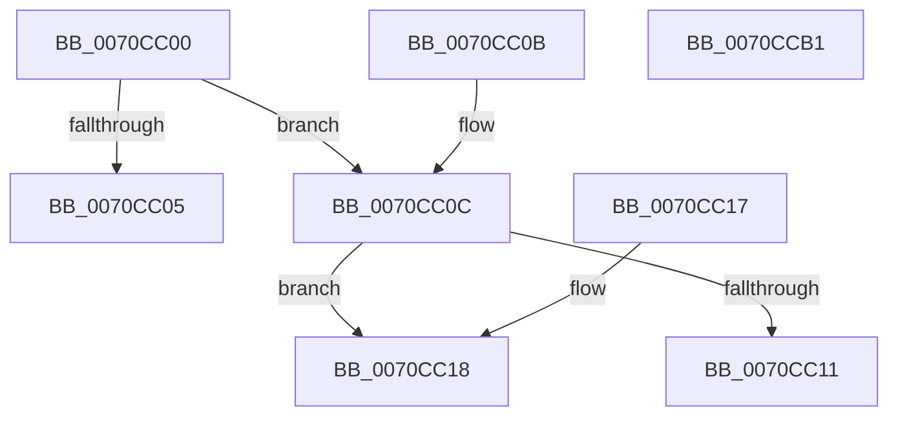

# HalpGetIommuInterface

- RVA: `0x0070CC00`–`0x0070CCB2` (길이 `178` bytes)
- VA: `0x000000014070CC00`
- 실행 섹션: `PAGE`
- PDB 이름 있음: `예`; PDB Function 태그: `아니요`
- unwind 정보 RVA: `0x000DB714`
- 디코드: `40`개 명령, `178/178` bytes 표시
- 미해석 바이트: `0` (있으면 어셈블리에 `.byte`로 보존)

> 이 문서는 커널 이미지의 기계어와 PDB 기호를 분석해 생성했습니다. 4번과 5번은 함수 원형과 자료형을 바이너리 사용 방식에서 추정한 C 해석이며 원본 소스 복구 결과는 아닙니다.

## 1. Dependencies

- 직접 호출 지점: **0**; 고유 호출 대상: **0**
- 직접 호출자로 확인된 함수: **0**
- RIP 상대 이미지 참조: **13**

### Outgoing calls
- 직접 디코드된 call 명령이 없습니다.

### Direct callers
- 이 함수 시작 RVA로 연결되는 직접 call은 확인되지 않았습니다. 간접 호출은 완전히 역산할 수 없습니다.

### Static image references
- `0x0070CC18` → RVA `0x0070D370` (`IommuDomainCreate`; read)
- `0x0070CC2A` → RVA `0x0070D3C0` (`IommuDomainDelete`; read)
- `0x0070CC35` → RVA `0x00567960` (`IommuDomainAttachDevice`; read)
- `0x0070CC40` → RVA `0x00567D40` (`IommuDomainDetachDevice`; read)
- `0x0070CC4B` → RVA `0x00568540` (`IommuSetDeviceFaultReporting`; read)
- `0x0070CC56` → RVA `0x0070D320` (`IommuDomainConfigure`; read)
- `0x0070CC61` → RVA `0x00567F20` (`IommuFlushDomain`; read)
- `0x0070CC6C` → RVA `0x0070D410` (`IommuFlushDomainVaList`; read)
- `0x0070CC77` → RVA `0x004E1110` (`DefaultAddProfileSource`; read)
- `0x0070CC82` → RVA `0x00568070` (`IommuMapLogicalRange`; read)
- `0x0070CC8D` → RVA `0x00306EC0` (`IommuUnmapLogicalRange`; read)
- `0x0070CC98` → RVA `0x00568000` (`IommuMapIdentityRange`; read)
- `0x0070CCA3` → RVA `0x00568660` (`IommuUnmapIdentityRange`; read)

## 2. Other-region calls and transfers

- 다른 실행 섹션으로 향하는 call: **0**
- 별도 외부 분기/꼬리 이동을 확인하지 못했습니다.

## 3. Assembly (complete function range)

```asm
0070CC00  83 F9 01                        cmp ecx, 1
0070CC03  74 07                           je 0x14070cc0c
0070CC05  B8 EF 00 00 C0                  mov eax, 0xc00000ef
0070CC0A  C3                              ret
0070CC0B  CC                              int3
0070CC0C  48 85 D2                        test rdx, rdx
0070CC0F  75 07                           jne 0x14070cc18
0070CC11  B8 F0 00 00 C0                  mov eax, 0xc00000f0
0070CC16  C3                              ret
0070CC17  CC                              int3
0070CC18  48 8D 05 51 07 00 00            lea rax, [rip + 0x751]
0070CC1F  48 C7 02 01 00 00 00            mov qword ptr [rdx], 1
0070CC26  48 89 42 08                     mov qword ptr [rdx + 8], rax
0070CC2A  48 8D 05 8F 07 00 00            lea rax, [rip + 0x78f]
0070CC31  48 89 42 10                     mov qword ptr [rdx + 0x10], rax
0070CC35  48 8D 05 24 AD E5 FF            lea rax, [rip - 0x1a52dc]
0070CC3C  48 89 42 18                     mov qword ptr [rdx + 0x18], rax
0070CC40  48 8D 05 F9 B0 E5 FF            lea rax, [rip - 0x1a4f07]
0070CC47  48 89 42 20                     mov qword ptr [rdx + 0x20], rax
0070CC4B  48 8D 05 EE B8 E5 FF            lea rax, [rip - 0x1a4712]
0070CC52  48 89 42 60                     mov qword ptr [rdx + 0x60], rax
0070CC56  48 8D 05 C3 06 00 00            lea rax, [rip + 0x6c3]
0070CC5D  48 89 42 68                     mov qword ptr [rdx + 0x68], rax
0070CC61  48 8D 05 B8 B2 E5 FF            lea rax, [rip - 0x1a4d48]
0070CC68  48 89 42 28                     mov qword ptr [rdx + 0x28], rax
0070CC6C  48 8D 05 9D 07 00 00            lea rax, [rip + 0x79d]
0070CC73  48 89 42 30                     mov qword ptr [rdx + 0x30], rax
0070CC77  48 8D 05 92 44 DD FF            lea rax, [rip - 0x22bb6e]
0070CC7E  48 89 42 38                     mov qword ptr [rdx + 0x38], rax
0070CC82  48 8D 05 E7 B3 E5 FF            lea rax, [rip - 0x1a4c19]
0070CC89  48 89 42 40                     mov qword ptr [rdx + 0x40], rax
0070CC8D  48 8D 05 2C A2 BF FF            lea rax, [rip - 0x405dd4]
0070CC94  48 89 42 48                     mov qword ptr [rdx + 0x48], rax
0070CC98  48 8D 05 61 B3 E5 FF            lea rax, [rip - 0x1a4c9f]
0070CC9F  48 89 42 50                     mov qword ptr [rdx + 0x50], rax
0070CCA3  48 8D 05 B6 B9 E5 FF            lea rax, [rip - 0x1a464a]
0070CCAA  48 89 42 58                     mov qword ptr [rdx + 0x58], rax
0070CCAE  33 C0                           xor eax, eax
0070CCB0  C3                              ret
0070CCB1  CC                              int3
```

## 4. C-style interpretation (structured pseudocode)

```c
__int64 __fastcall HalpGetIommuInterface(int a1, __int64 a2)
{
    __int64 result;

    if (a1 == 1) goto loc_0070CC0C;
    return (unsigned int)(0xC00000EFULL);
loc_0070CC0C:
    if (a2 != 0) goto loc_0070CC18;
    return (unsigned int)(0xC00000F0ULL);
loc_0070CC18:
    *(unsigned __int64 *)(a2) = 1;
    *(unsigned __int64 *)(a2 + 8) = v_rip + 1873;
    *(unsigned __int64 *)(a2 + 16) = v_rip + 1935;
    *(unsigned __int64 *)(a2 + 24) = v_rip - 1725148;
    *(unsigned __int64 *)(a2 + 32) = v_rip - 1724167;
    *(unsigned __int64 *)(a2 + 96) = v_rip - 1722130;
    *(unsigned __int64 *)(a2 + 104) = v_rip + 1731;
    *(unsigned __int64 *)(a2 + 40) = v_rip - 1723720;
    *(unsigned __int64 *)(a2 + 48) = v_rip + 1949;
    *(unsigned __int64 *)(a2 + 56) = v_rip - 2276206;
    *(unsigned __int64 *)(a2 + 64) = v_rip - 1723417;
    *(unsigned __int64 *)(a2 + 72) = v_rip - 4218324;
    *(unsigned __int64 *)(a2 + 80) = v_rip - 1723551;
    *(unsigned __int64 *)(a2 + 88) = v_rip - 1721930;
    result = 0;
    return result;
}
```

## 5. (Beta) C Style

```c
int64_t HalpGetIommuInterface(int32_t Arg1, int64_t Arg2)
{
    int64_t result;

    if (Arg1 == 1) goto loc_0070CC0C;
    return (uint32_t)(0xC00000EFULL);
loc_0070CC0C:
    if (Arg2 != 0) goto loc_0070CC18;
    return (uint32_t)(0xC00000F0ULL);
loc_0070CC18:
    *(uint64_t *)(Arg2) = 1;
    *(uint64_t *)(Arg2 + 0x8) = v_rip + 1873;
    *(uint64_t *)(Arg2 + 0x10) = v_rip + 1935;
    *(uint64_t *)(Arg2 + 0x18) = v_rip - 1725148;
    *(uint64_t *)(Arg2 + 0x20) = v_rip - 1724167;
    *(uint64_t *)(Arg2 + 0x60) = v_rip - 1722130;
    *(uint64_t *)(Arg2 + 0x68) = v_rip + 1731;
    *(uint64_t *)(Arg2 + 0x28) = v_rip - 1723720;
    *(uint64_t *)(Arg2 + 0x30) = v_rip + 1949;
    *(uint64_t *)(Arg2 + 0x38) = v_rip - 2276206;
    *(uint64_t *)(Arg2 + 0x40) = v_rip - 1723417;
    *(uint64_t *)(Arg2 + 0x48) = v_rip - 4218324;
    *(uint64_t *)(Arg2 + 0x50) = v_rip - 1723551;
    *(uint64_t *)(Arg2 + 0x58) = v_rip - 1721930;
    result = 0;
    return result;
}
```

## 6. Execution-region graph

[열기: 2D/3D 그래프와 함수 탐색 컨트롤 패널](../../../control-panel.html?section=page&rva=0x0070CC00&view=graph)

- 2D 그래프는 위에서 아래로 흐르고, 3D 그래프는 빈 공간을 드래그해 회전합니다. Shift+드래그는 이동, 휠은 확대·축소, 함수 노드 선택은 대상 보고서 이동입니다.

### Static fallback


