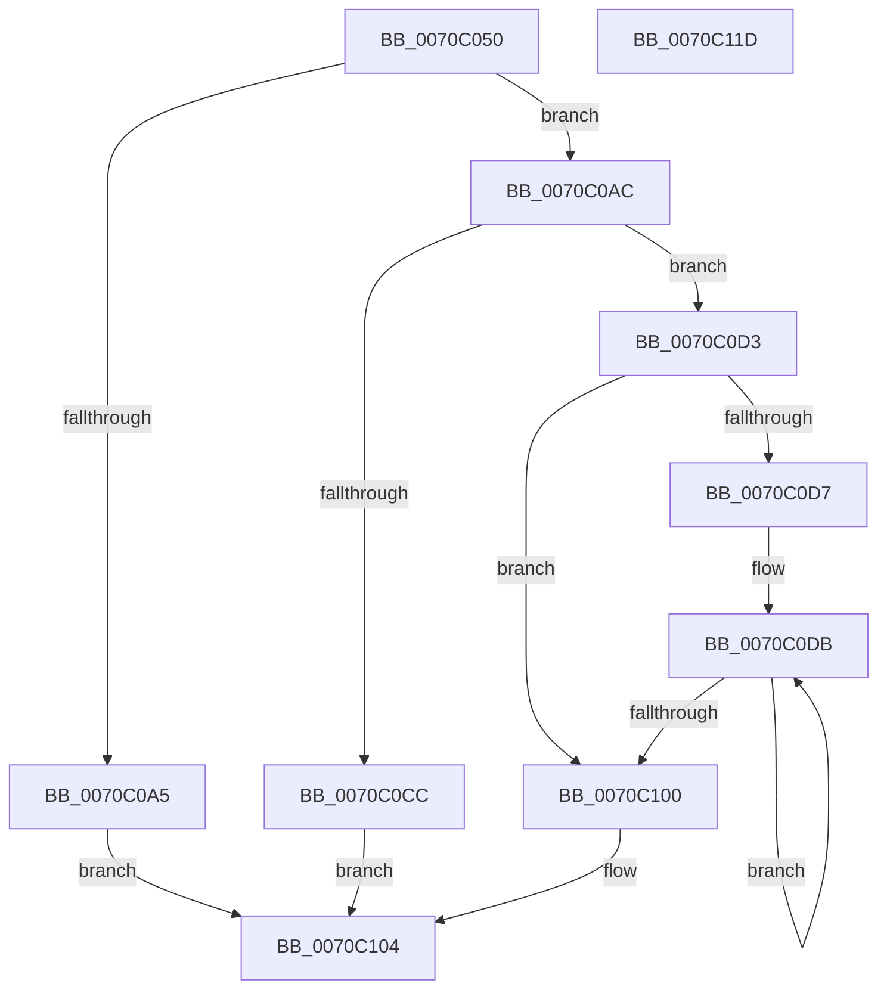

# HalpGetProcessorBrandString

- RVA: `0x0070C050`–`0x0070C11E` (길이 `206` bytes)
- VA: `0x000000014070C050`
- 실행 섹션: `PAGE`
- PDB 이름 있음: `예`; PDB Function 태그: `아니요`
- unwind 정보 RVA: `0x000BCA90`
- 디코드: `65`개 명령, `206/206` bytes 표시
- 미해석 바이트: `0` (있으면 어셈블리에 `.byte`로 보존)

> 이 문서는 커널 이미지의 기계어와 PDB 기호를 분석해 생성했습니다. 4번과 5번은 함수 원형과 자료형을 바이너리 사용 방식에서 추정한 C 해석이며 원본 소스 복구 결과는 아닙니다.

## 1. Dependencies

- 직접 호출 지점: **2**; 고유 호출 대상: **1**
- 직접 호출자로 확인된 함수: **1**
- RIP 상대 이미지 참조: **0**

### Outgoing calls
- `0x0070C093` → [HalpCpuID](../../text/4A/HalpCpuID_function_004A3C80.md) (function, `0x004A3C80`)
- `0x0070C0F1` → [HalpCpuID](../../text/4A/HalpCpuID_function_004A3C80.md) (function, `0x004A3C80`)

### Direct callers
- [HaliQuerySystemInformation](../../pagelk/B7/HaliQuerySystemInformation_function_00B7A990.md) at `0x00B7AB85`

### Static image references
- 디코드된 RIP-relative 메모리 참조가 없습니다.

## 2. Other-region calls and transfers

- 다른 실행 섹션으로 향하는 call: **2**
  - `0x0070C093` → [HalpCpuID](../../text/4A/HalpCpuID_function_004A3C80.md) (`PAGE` → `.text`)
  - `0x0070C0F1` → [HalpCpuID](../../text/4A/HalpCpuID_function_004A3C80.md) (`PAGE` → `.text`)
- 별도 외부 분기/꼬리 이동을 확인하지 못했습니다.

## 3. Assembly (complete function range)

```asm
0070C050  4C 8B DC                        mov r11, rsp
0070C053  49 89 5B 08                     mov qword ptr [r11 + 8], rbx
0070C057  49 89 6B 10                     mov qword ptr [r11 + 0x10], rbp
0070C05B  56                              push rsi
0070C05C  57                              push rdi
0070C05D  41 54                           push r12
0070C05F  41 56                           push r14
0070C061  41 57                           push r15
0070C063  48 83 EC 40                     sub rsp, 0x40
0070C067  49 8B F8                        mov rdi, r8
0070C06A  49 8D 43 20                     lea rax, [r11 + 0x20]
0070C06E  4C 8B FA                        mov r15, rdx
0070C071  49 89 43 B8                     mov qword ptr [r11 - 0x48], rax
0070C075  44 8B E1                        mov r12d, ecx
0070C078  4D 8D 43 20                     lea r8, [r11 + 0x20]
0070C07C  33 DB                           xor ebx, ebx
0070C07E  49 8D 53 C8                     lea rdx, [r11 - 0x38]
0070C082  B9 00 00 00 80                  mov ecx, 0x80000000
0070C087  89 5C 24 30                     mov dword ptr [rsp + 0x30], ebx
0070C08B  4D 8D 4B 20                     lea r9, [r11 + 0x20]
0070C08F  41 89 5B 20                     mov dword ptr [r11 + 0x20], ebx
0070C093  E8 E8 7B D9 FF                  call 0x1404a3c80
0070C098  8B 6C 24 30                     mov ebp, dword ptr [rsp + 0x30]
0070C09C  BE 02 00 00 80                  mov esi, 0x80000002
0070C0A1  3B EE                           cmp ebp, esi
0070C0A3  73 07                           jae 0x14070c0ac
0070C0A5  BB BB 00 00 C0                  mov ebx, 0xc00000bb
0070C0AA  EB 58                           jmp 0x14070c104
0070C0AC  B8 04 00 00 80                  mov eax, 0x80000004
0070C0B1  3B E8                           cmp ebp, eax
0070C0B3  0F 47 E8                        cmova ebp, eax
0070C0B6  44 8D B5 FF FF FF 7F            lea r14d, [rbp + 0x7fffffff]
0070C0BD  41 C1 E6 04                     shl r14d, 4
0070C0C1  41 8D 46 01                     lea eax, [r14 + 1]
0070C0C5  89 07                           mov dword ptr [rdi], eax
0070C0C7  44 3B E0                        cmp r12d, eax
0070C0CA  73 07                           jae 0x14070c0d3
0070C0CC  BB 04 00 00 C0                  mov ebx, 0xc0000004
0070C0D1  EB 31                           jmp 0x14070c104
0070C0D3  3B EE                           cmp ebp, esi
0070C0D5  72 29                           jb 0x14070c100
0070C0D7  49 8D 7F 08                     lea rdi, [r15 + 8]
0070C0DB  48 8D 47 04                     lea rax, [rdi + 4]
0070C0DF  4C 8B CF                        mov r9, rdi
0070C0E2  4C 8D 47 FC                     lea r8, [rdi - 4]
0070C0E6  48 89 44 24 20                  mov qword ptr [rsp + 0x20], rax
0070C0EB  48 8D 57 F8                     lea rdx, [rdi - 8]
0070C0EF  8B CE                           mov ecx, esi
0070C0F1  E8 8A 7B D9 FF                  call 0x1404a3c80
0070C0F6  48 83 C7 10                     add rdi, 0x10
0070C0FA  FF C6                           inc esi
0070C0FC  3B F5                           cmp esi, ebp
0070C0FE  76 DB                           jbe 0x14070c0db
0070C100  43 88 1C 3E                     mov byte ptr [r14 + r15], bl
0070C104  48 8B 6C 24 78                  mov rbp, qword ptr [rsp + 0x78]
0070C109  8B C3                           mov eax, ebx
0070C10B  48 8B 5C 24 70                  mov rbx, qword ptr [rsp + 0x70]
0070C110  48 83 C4 40                     add rsp, 0x40
0070C114  41 5F                           pop r15
0070C116  41 5E                           pop r14
0070C118  41 5C                           pop r12
0070C11A  5F                              pop rdi
0070C11B  5E                              pop rsi
0070C11C  C3                              ret
0070C11D  CC                              int3
```

## 4. C-style interpretation (structured pseudocode)

```c
__int64 __fastcall HalpGetProcessorBrandString(int a1, __int64 a2, __int64 a3)
{
    __int64 result;
    __int64 v_r14;
    __int64 v_rbp;
    __int64 v_rbx;
    __int64 v_rdi;
    __int64 v_rsi;
    __int64 v_rsp;
    unsigned int v_stack_m38;
    unsigned __int64 v_stack_m48;
    unsigned __int64 v_stack_p10;
    unsigned __int64 v_stack_p8;

    *(unsigned __int64 *)(v_rsp + 8) = v_rbx;
    *(unsigned __int64 *)(v_rsp + 16) = v_rbp;
    v_rsp = (v_rsp) - (64);
    *(unsigned __int64 *)(v_rsp - 72) = v_rsp + 32;
    v_rbx = 0;
    v_stack_m38 = 0;
    *(unsigned int *)(v_rsp + 32) = 0;
    result = HalpCpuID((unsigned int)(0x80000000ULL), v_rsp - 56, v_rsp + 32, v_rsp + 32);
    if (((unsigned int)((unsigned int)(v_stack_m38))) >= ((unsigned int)((unsigned int)(0x80000002ULL)))) goto loc_0070C0AC;
    goto loc_0070C104;
loc_0070C0AC:
    v_rbp = (unsigned int)(v_stack_m38);
    if (((unsigned int)((unsigned int)(v_stack_m38))) > ((unsigned int)((unsigned int)(0x80000004ULL)))) { v_rbp = (unsigned int)((unsigned int)(0x80000004ULL)); }
    v_r14 = (unsigned int)((v_rbp + 2147483647) << (4));
    *(unsigned int *)(a3) = (unsigned int)(v_r14 + 1);
    if (((unsigned int)((unsigned int)(a1))) >= ((unsigned int)(v_r14 + 1))) goto loc_0070C0D3;
    goto loc_0070C104;
loc_0070C0D3:
    if (((unsigned int)(v_rbp)) < ((unsigned int)((unsigned int)(0x80000002ULL)))) goto loc_0070C100;
loc_0070C0DB:
    v_stack_m48 = a2 + 8 + 4;
    result = HalpCpuID((unsigned int)((unsigned int)((unsigned int)(0x80000002ULL))), a2 + 8 - 8, a2 + 8 - 4, a2 + 8);
    v_rdi = (a2 + 8) + (16);
    v_rsi = (unsigned int)(((unsigned int)(0x80000002ULL)) + 1);
    if (((unsigned int)(v_rsi)) <= ((unsigned int)(v_rbp))) goto loc_0070C0DB;
loc_0070C100:
    *(unsigned __int8 *)(v_r14 + a2 * 1) = (unsigned __int8)((unsigned int)(0xC0000004ULL));
loc_0070C104:
    v_rsp = (v_rsp) + (64);
    return (unsigned int)((unsigned int)((unsigned int)(0xC0000004ULL)));
}
```

## 5. (Beta) C Style

```c
int64_t HalpGetProcessorBrandString(int32_t Arg1, void *Arg2, void *Arg3)
{
    uint8_t *arg2 = (uint8_t *)Arg2;
    uint8_t *arg3 = (uint8_t *)Arg3;

    int64_t result;
    int64_t local_r14;
    int64_t local_rbp;
    int64_t local_rbx;
    int64_t local_rdi;
    int64_t local_rsi;
    int64_t local_rsp;
    uint32_t v_stack_m38;
    uint64_t v_stack_m48;
    uint64_t v_stack_p10;
    uint64_t v_stack_p8;

    *(uint64_t *)(local_rsp + 0x8) = local_rbx;
    *(uint64_t *)(local_rsp + 0x10) = local_rbp;
    local_rsp = (local_rsp) - (64);
    *(uint64_t *)(local_rsp - 0x48) = local_rsp + 32;
    local_rbx = 0;
    v_stack_m38 = 0;
    *(uint32_t *)(local_rsp + 0x20) = 0;
    result = HalpCpuID((uint32_t)(0x80000000ULL), local_rsp - 56, local_rsp + 32, local_rsp + 32);
    if (((uint32_t)((uint32_t)(v_stack_m38))) >= ((uint32_t)((uint32_t)(0x80000002ULL)))) goto loc_0070C0AC;
    goto loc_0070C104;
loc_0070C0AC:
    local_rbp = (uint32_t)(v_stack_m38);
    if (((uint32_t)((uint32_t)(v_stack_m38))) > ((uint32_t)((uint32_t)(0x80000004ULL)))) { local_rbp = (uint32_t)((uint32_t)(0x80000004ULL)); }
    local_r14 = (uint32_t)((local_rbp + 2147483647) << (4));
    *(uint32_t *)(arg3) = (uint32_t)(local_r14 + 1);
    if (((uint32_t)((uint32_t)(Arg1))) >= ((uint32_t)(local_r14 + 1))) goto loc_0070C0D3;
    goto loc_0070C104;
loc_0070C0D3:
    if (((uint32_t)(local_rbp)) < ((uint32_t)((uint32_t)(0x80000002ULL)))) goto loc_0070C100;
loc_0070C0DB:
    v_stack_m48 = Arg2 + 8 + 4;
    result = HalpCpuID((uint32_t)((uint32_t)((uint32_t)(0x80000002ULL))), Arg2 + 8 - 8, Arg2 + 8 - 4, Arg2 + 8);
    local_rdi = (Arg2 + 8) + (16);
    local_rsi = (uint32_t)(((uint32_t)(0x80000002ULL)) + 1);
    if (((uint32_t)(local_rsi)) <= ((uint32_t)(local_rbp))) goto loc_0070C0DB;
loc_0070C100:
    *(uint8_t *)(local_r14 + arg2 * 1) = (uint8_t)((uint32_t)(0xC0000004ULL));
loc_0070C104:
    local_rsp = (local_rsp) + (64);
    return (uint32_t)((uint32_t)((uint32_t)(0xC0000004ULL)));
}
```

### 관측된 메모리 오프셋

구조체 형식이 확인되지 않은 접근은 인자 기준의 오프셋으로만 기록했습니다.

| 기준 인자 | 오프셋 표현 | 폭 (bit) | 접근 |
|---|---:|---:|---|
| `Arg2` | `- 0x8` | `64` | `R` |
| `Arg2` | `- 0x4` | `64` | `R` |
| `Arg2` | `+ 0x4` | `64` | `R` |
| `Arg2` | `+ 0x8` | `64` | `R` |
| `Arg3` | `+ 0x0` | `32` | `W` |

## 6. Execution-region graph

[열기: 2D/3D 그래프와 함수 탐색 컨트롤 패널](../../../control-panel.html?section=page&rva=0x0070C050&view=graph)

- 2D 그래프는 위에서 아래로 흐르고, 3D 그래프는 빈 공간을 드래그해 회전합니다. Shift+드래그는 이동, 휠은 확대·축소, 함수 노드 선택은 대상 보고서 이동입니다.

### Static fallback


