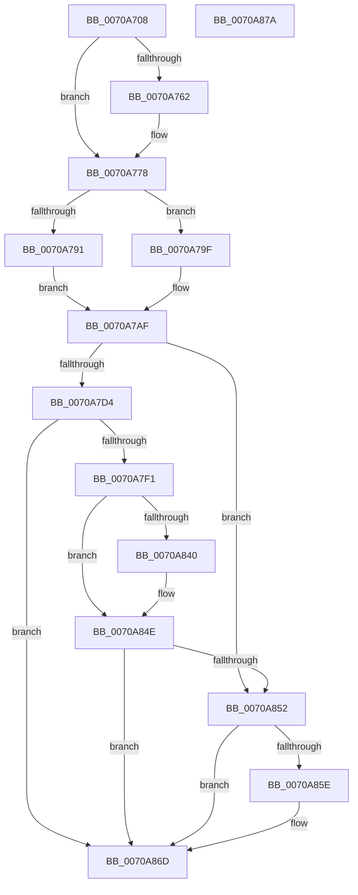

# HalpInitializeInterruptRemappingBspLate

- RVA: `0x0070A708`–`0x0070A87B` (길이 `371` bytes)
- VA: `0x000000014070A708`
- 실행 섹션: `PAGE`
- PDB 이름 있음: `예`; PDB Function 태그: `아니요`
- unwind 정보 RVA: `0x000C4600`
- 디코드: `88`개 명령, `371/371` bytes 표시
- 미해석 바이트: `0` (있으면 어셈블리에 `.byte`로 보존)

> 이 문서는 커널 이미지의 기계어와 PDB 기호를 분석해 생성했습니다. 4번과 5번은 함수 원형과 자료형을 바이너리 사용 방식에서 추정한 C 해석이며 원본 소스 복구 결과는 아닙니다.

## 1. Dependencies

- 직접 호출 지점: **5**; 고유 호출 대상: **5**
- 직접 호출자로 확인된 함수: **1**
- RIP 상대 이미지 참조: **23**

### Outgoing calls
- `0x0070A738` → [KeInitializeEvent](../../text/40/KeInitializeEvent_function_0040DD10.md) (function, `0x0040DD10`)
- `0x0070A7C9` → [HalpIrtExtendRemappingRange](HalpIrtExtendRemappingRange_function_0070AD40.md) (function, `0x0070AD40`)
- `0x0070A7E1` → [RtlSetBits](../../text/3E/RtlSetBits_function_003E1610.md) (function, `0x003E1610`)
- `0x0070A835` → [HalpIrtAllocateDeviceAperture](HalpIrtAllocateDeviceAperture_function_0070A884.md) (function, `0x0070A884`)
- `0x0070A860` → [ExFreePoolWithTag](../../poolcode/B8/ExFreePoolWithTag_function_00B82870.md) (function, `0x00B82870`)

### Direct callers
- [HalpInitializeInterruptsBspLate](../../text/54/HalpInitializeInterruptsBspLate_function_00543D70.md) at `0x00543D87`

### Static image references
- `0x0070A712` → RVA `0x00F90988` (`.data`; read/write)
- `0x0070A71A` → RVA `0x00F90998` (`.data`; read)
- `0x0070A721` → RVA `0x00F90990` (`.data`; read/write)
- `0x0070A72F` → RVA `0x00F90980` (`.data`; write)
- `0x0070A749` → RVA `0x00F90960` (`.data`; read/write)
- `0x0070A753` → RVA `0x00F90964` (`.data`; write)
- `0x0070A76A` → RVA `0x00F90960` (`.data`; write)
- `0x0070A778` → RVA `0x00F90970` (`.data`; read)
- `0x0070A785` → RVA `0x00F90744` (`.data`; write)
- `0x0070A791` → RVA `0x00F90968` (`.data`; write)
- `0x0070A7B6` → RVA `0x00F90720` (`.data`; write)
- `0x0070A7C3` → RVA `0x00F90740` (`.data`; write)
- `0x0070A7D6` → RVA `0x00F90760` (`.data`; read)
- `0x0070A7E6` → RVA `0x00F90960` (`.data`; read)
- `0x0070A7F6` → RVA `0x00F90710` (`.data`; read)
- `0x0070A7FD` → RVA `0x00F90718` (`.data`; write)
- `0x0070A807` → RVA `0x00F90710` (`.data`; write)
- `0x0070A811` → RVA `0x00F90730` (`.data`; read)
- `0x0070A81B` → RVA `0x00F90738` (`.data`; write)
- `0x0070A824` → RVA `0x00F90730` (`.data`; write)
- `0x0070A847` → RVA `0x00F90978` (`.data`; write)
- `0x0070A852` → RVA `0x00F90768` (`.data`; read)
- `0x0070A865` → RVA `0x00F90768` (`.data`; read/write)

## 2. Other-region calls and transfers

- 다른 실행 섹션으로 향하는 call: **3**
  - `0x0070A738` → [KeInitializeEvent](../../text/40/KeInitializeEvent_function_0040DD10.md) (`PAGE` → `.text`)
  - `0x0070A7E1` → [RtlSetBits](../../text/3E/RtlSetBits_function_003E1610.md) (`PAGE` → `.text`)
  - `0x0070A860` → [ExFreePoolWithTag](../../poolcode/B8/ExFreePoolWithTag_function_00B82870.md) (`PAGE` → `POOLCODE`)
- 별도 외부 분기/꼬리 이동을 확인하지 못했습니다.

## 3. Assembly (complete function range)

```asm
0070A708  48 89 5C 24 10                  mov qword ptr [rsp + 0x10], rbx
0070A70D  56                              push rsi
0070A70E  48 83 EC 30                     sub rsp, 0x30
0070A712  48 83 25 6E 62 88 00 00         and qword ptr [rip + 0x88626e], 0
0070A71A  48 8D 0D 77 62 88 00            lea rcx, [rip + 0x886277]
0070A721  83 25 68 62 88 00 00            and dword ptr [rip + 0x886268], 0
0070A728  BE 01 00 00 00                  mov esi, 1
0070A72D  8B D6                           mov edx, esi
0070A72F  89 35 4B 62 88 00               mov dword ptr [rip + 0x88624b], esi
0070A735  45 33 C0                        xor r8d, r8d
0070A738  E8 D3 35 D0 FF                  call 0x14040dd10
0070A73D  65 48 8B 04 25 20 00 00 00      mov rax, qword ptr gs:[0x20]
0070A746  45 33 C9                        xor r9d, r9d
0070A749  83 25 10 62 88 00 00            and dword ptr [rip + 0x886210], 0
0070A750  44 8B C6                        mov r8d, esi
0070A753  89 35 0B 62 88 00               mov dword ptr [rip + 0x88620b], esi
0070A759  40 38 B0 8D 00 00 00            cmp byte ptr [rax + 0x8d], sil
0070A760  75 16                           jne 0x14070a778
0070A762  44 8D 4E 0E                     lea r9d, [rsi + 0xe]
0070A766  44 8D 46 1F                     lea r8d, [rsi + 0x1f]
0070A76A  44 89 0D EF 61 88 00            mov dword ptr [rip + 0x8861ef], r9d
0070A771  44 89 05 EC 61 88 00            mov dword ptr [rip + 0x8861ec], r8d
0070A778  8B 0D F2 61 88 00               mov ecx, dword ptr [rip + 0x8861f2]
0070A77E  33 D2                           xor edx, edx
0070A780  8B C1                           mov eax, ecx
0070A782  41 F7 F0                        div r8d
0070A785  89 05 B9 5F 88 00               mov dword ptr [rip + 0x885fb9], eax
0070A78B  41 F6 C1 04                     test r9b, 4
0070A78F  75 0E                           jne 0x14070a79f
0070A791  89 0D D1 61 88 00               mov dword ptr [rip + 0x8861d1], ecx
0070A797  44 8B C1                        mov r8d, ecx
0070A79A  44 8B C9                        mov r9d, ecx
0070A79D  EB 10                           jmp 0x14070a7af
0070A79F  41 B8 00 02 00 00               mov r8d, 0x200
0070A7A5  44 89 05 BC 61 88 00            mov dword ptr [rip + 0x8861bc], r8d
0070A7AC  45 8B C8                        mov r9d, r8d
0070A7AF  33 D2                           xor edx, edx
0070A7B1  41 F7 F0                        div r8d
0070A7B4  33 D2                           xor edx, edx
0070A7B6  89 05 64 5F 88 00               mov dword ptr [rip + 0x885f64], eax
0070A7BC  8B C1                           mov eax, ecx
0070A7BE  41 F7 F1                        div r9d
0070A7C1  33 C9                           xor ecx, ecx
0070A7C3  89 05 77 5F 88 00               mov dword ptr [rip + 0x885f77], eax
0070A7C9  E8 72 05 00 00                  call 0x14070ad40
0070A7CE  8B D8                           mov ebx, eax
0070A7D0  85 C0                           test eax, eax
0070A7D2  78 7E                           js 0x14070a852
0070A7D4  33 D2                           xor edx, edx
0070A7D6  48 8D 0D 83 5F 88 00            lea rcx, [rip + 0x885f83]
0070A7DD  44 8D 42 08                     lea r8d, [rdx + 8]
0070A7E1  E8 2A 6E CD FF                  call 0x1403e1610
0070A7E6  8B 0D 74 61 88 00               mov ecx, dword ptr [rip + 0x886174]
0070A7EC  F6 C1 04                        test cl, 4
0070A7EF  74 7C                           je 0x14070a86d
0070A7F1  83 64 24 40 00                  and dword ptr [rsp + 0x40], 0
0070A7F6  48 8D 05 13 5F 88 00            lea rax, [rip + 0x885f13]
0070A7FD  48 89 05 14 5F 88 00            mov qword ptr [rip + 0x885f14], rax
0070A804  83 C9 FF                        or ecx, 0xffffffff
0070A807  48 89 05 02 5F 88 00            mov qword ptr [rip + 0x885f02], rax
0070A80E  45 33 C9                        xor r9d, r9d
0070A811  48 8D 05 18 5F 88 00            lea rax, [rip + 0x885f18]
0070A818  44 8B C6                        mov r8d, esi
0070A81B  48 89 05 16 5F 88 00            mov qword ptr [rip + 0x885f16], rax
0070A822  8B D1                           mov edx, ecx
0070A824  48 89 05 05 5F 88 00            mov qword ptr [rip + 0x885f05], rax
0070A82B  48 8D 44 24 40                  lea rax, [rsp + 0x40]
0070A830  48 89 44 24 20                  mov qword ptr [rsp + 0x20], rax
0070A835  E8 4A 00 00 00                  call 0x14070a884
0070A83A  8B D8                           mov ebx, eax
0070A83C  85 C0                           test eax, eax
0070A83E  78 0E                           js 0x14070a84e
0070A840  48 8B 05 C9 5E 88 00            mov rax, qword ptr [rip + 0x885ec9]
0070A847  48 89 05 2A 61 88 00            mov qword ptr [rip + 0x88612a], rax
0070A84E  85 DB                           test ebx, ebx
0070A850  79 1B                           jns 0x14070a86d
0070A852  48 8B 0D 0F 5F 88 00            mov rcx, qword ptr [rip + 0x885f0f]
0070A859  48 85 C9                        test rcx, rcx
0070A85C  74 0F                           je 0x14070a86d
0070A85E  33 D2                           xor edx, edx
0070A860  E8 0B 80 47 00                  call 0x140b82870
0070A865  48 83 25 FB 5E 88 00 00         and qword ptr [rip + 0x885efb], 0
0070A86D  8B C3                           mov eax, ebx
0070A86F  48 8B 5C 24 48                  mov rbx, qword ptr [rsp + 0x48]
0070A874  48 83 C4 30                     add rsp, 0x30
0070A878  5E                              pop rsi
0070A879  C3                              ret
0070A87A  CC                              int3
```

## 4. C-style interpretation (structured pseudocode)

```c
__int64 __fastcall HalpInitializeInterruptRemappingBspLate(__int64 a1, __int64 a2, int a3, int a4)
{
    __int64 result;
    __int64 v_rsp;
    unsigned __int64 v_stack_m18;
    unsigned __int64 v_stack_p10;
    unsigned int v_stack_p8;

    v_stack_p10 = v_rbx;
    v_rsp = (v_rsp) - (48);
    *(unsigned int *)(v_rip + 8938059) = 1;
    a3 = 0;
    result = KeInitializeEvent(v_rip + 8938103, 1, a3, a4);
    a4 = 0;
    *(unsigned int *)(v_rip + 8937995) = 1;
    if ((*(unsigned __int8 *)(*(unsigned __int64 *)(gs_base + (0 + 32)) + 141)) == 1) {
        a4 = 1 + 14;
        a3 = 1 + 31;
        *(unsigned int *)(v_rip + 8937967) = a4;
        *(unsigned int *)(v_rip + 8937964) = a3;
    }
    a2 = 0;
    *(unsigned int *)(v_rip + 8937401) = (unsigned int)((unsigned int)((unsigned int)((unsigned int)(*(unsigned int *)(v_rip + 8937970)))));
    if ((((unsigned __int8)(a4)) & (4)) != 0) goto loc_0070A79F;
    *(unsigned int *)(v_rip + 8937937) = (unsigned int)((unsigned int)(*(unsigned int *)(v_rip + 8937970)));
    goto loc_0070A7AF;
loc_0070A79F:
    *(unsigned int *)(v_rip + 8937916) = 512;
loc_0070A7AF:
    a2 = 0;
    a2 = 0;
    *(unsigned int *)(v_rip + 8937316) = (unsigned int)((unsigned int)((unsigned int)((unsigned int)(*(unsigned int *)(v_rip + 8937970)))));
    a1 = 0;
    *(unsigned int *)(v_rip + 8937335) = (unsigned int)((unsigned int)((unsigned int)((unsigned int)(*(unsigned int *)(v_rip + 8937970)))));
    result = HalpIrtExtendRemappingRange(a1, a2, 512, 512);
    if (sign_flag) goto loc_0070A852;
    a2 = 0;
    result = RtlSetBits(v_rip + 8937347, a2, a2 + 8, 512);
    if ((((unsigned __int8)((unsigned int)(*(unsigned int *)(v_rip + 8937844)))) & (4)) == 0) goto loc_0070A86D;
    *(unsigned __int64 *)(v_rip + 8937236) = v_rip + 8937235;
    a1 = (unsigned int)(((unsigned int)(*(unsigned int *)(v_rip + 8937844))) | (0xFFFFFFFFULL));
    *(unsigned __int64 *)(v_rip + 8937218) = v_rip + 8937235;
    a4 = 0;
    *(unsigned __int64 *)(v_rip + 8937238) = v_rip + 8937240;
    *(unsigned __int64 *)(v_rip + 8937221) = v_rip + 8937240;
    v_stack_m18 = v_stack_p8;
    result = HalpIrtAllocateDeviceAperture(a1, (unsigned int)((unsigned int)(a1)), 1, a4);
    if (!(sign_flag)) {
        result = *(unsigned __int64 *)(v_rip + 8937161);
        *(unsigned __int64 *)(v_rip + 8937770) = result;
    }
    if (!sign_flag) goto loc_0070A86D;
loc_0070A852:
    if (*(unsigned __int64 *)(v_rip + 8937231) != 0) {
        a2 = 0;
        result = ExFreePoolWithTag(*(unsigned __int64 *)(v_rip + 8937231), a2, 1, a4);
    }
    v_rsp = (v_rsp) + (48);
    return (unsigned int)((unsigned int)((unsigned int)((unsigned int)(result))));
}
```

## 5. (Beta) C Style

```c
int64_t HalpInitializeInterruptRemappingBspLate(int64_t Arg1, int64_t Arg2, int32_t Arg3, int32_t Arg4)
{
    int64_t result;
    int64_t local_rsp;
    uint64_t v_stack_m18;
    uint64_t v_stack_p10;
    uint32_t v_stack_p8;

    v_stack_p10 = local_rbx;
    local_rsp = (local_rsp) - (48);
    *(uint32_t *)(v_rip + 0x88624B) = 1;
    Arg3 = 0;
    result = KeInitializeEvent(v_rip + 8938103, 1, Arg3, Arg4);
    Arg4 = 0;
    *(uint32_t *)(v_rip + 0x88620B) = 1;
    if ((*(uint8_t *)(*(uint64_t *)(gs_base + (0 + 0x20)) + 0x8D)) == 1) {
        Arg4 = 1 + 14;
        Arg3 = 1 + 31;
        *(uint32_t *)(v_rip + 0x8861EF) = Arg4;
        *(uint32_t *)(v_rip + 0x8861EC) = Arg3;
    }
    Arg2 = 0;
    *(uint32_t *)(v_rip + 0x885FB9) = (uint32_t)((uint32_t)((uint32_t)((uint32_t)(*(uint32_t *)(v_rip + 0x8861F2)))));
    if ((((uint8_t)(Arg4)) & (4)) != 0) goto loc_0070A79F;
    *(uint32_t *)(v_rip + 0x8861D1) = (uint32_t)((uint32_t)(*(uint32_t *)(v_rip + 0x8861F2)));
    goto loc_0070A7AF;
loc_0070A79F:
    *(uint32_t *)(v_rip + 0x8861BC) = 512;
loc_0070A7AF:
    Arg2 = 0;
    Arg2 = 0;
    *(uint32_t *)(v_rip + 0x885F64) = (uint32_t)((uint32_t)((uint32_t)((uint32_t)(*(uint32_t *)(v_rip + 0x8861F2)))));
    Arg1 = 0;
    *(uint32_t *)(v_rip + 0x885F77) = (uint32_t)((uint32_t)((uint32_t)((uint32_t)(*(uint32_t *)(v_rip + 0x8861F2)))));
    result = HalpIrtExtendRemappingRange(Arg1, Arg2, 512, 512);
    if (sign_flag) goto loc_0070A852;
    Arg2 = 0;
    result = RtlSetBits(v_rip + 8937347, Arg2, Arg2 + 8, 512);
    if ((((uint8_t)((uint32_t)(*(uint32_t *)(v_rip + 0x886174)))) & (4)) == 0) goto loc_0070A86D;
    *(uint64_t *)(v_rip + 0x885F14) = v_rip + 8937235;
    Arg1 = (uint32_t)(((uint32_t)(*(uint32_t *)(v_rip + 0x886174))) | (0xFFFFFFFFULL));
    *(uint64_t *)(v_rip + 0x885F02) = v_rip + 8937235;
    Arg4 = 0;
    *(uint64_t *)(v_rip + 0x885F16) = v_rip + 8937240;
    *(uint64_t *)(v_rip + 0x885F05) = v_rip + 8937240;
    v_stack_m18 = v_stack_p8;
    result = HalpIrtAllocateDeviceAperture(Arg1, (uint32_t)((uint32_t)(Arg1)), 1, Arg4);
    if (!(sign_flag)) {
        result = *(uint64_t *)(v_rip + 0x885EC9);
        *(uint64_t *)(v_rip + 0x88612A) = result;
    }
    if (!sign_flag) goto loc_0070A86D;
loc_0070A852:
    if (*(uint64_t *)(v_rip + 0x885F0F) != 0) {
        Arg2 = 0;
        result = ExFreePoolWithTag(*(uint64_t *)(v_rip + 0x885F0F), Arg2, 1, Arg4);
    }
    local_rsp = (local_rsp) + (48);
    return (uint32_t)((uint32_t)((uint32_t)((uint32_t)(result))));
}
```

## 6. Execution-region graph

[열기: 2D/3D 그래프와 함수 탐색 컨트롤 패널](../../../control-panel.html?section=page&rva=0x0070A708&view=graph)

- 2D 그래프는 위에서 아래로 흐르고, 3D 그래프는 빈 공간을 드래그해 회전합니다. Shift+드래그는 이동, 휠은 확대·축소, 함수 노드 선택은 대상 보고서 이동입니다.

### Static fallback


