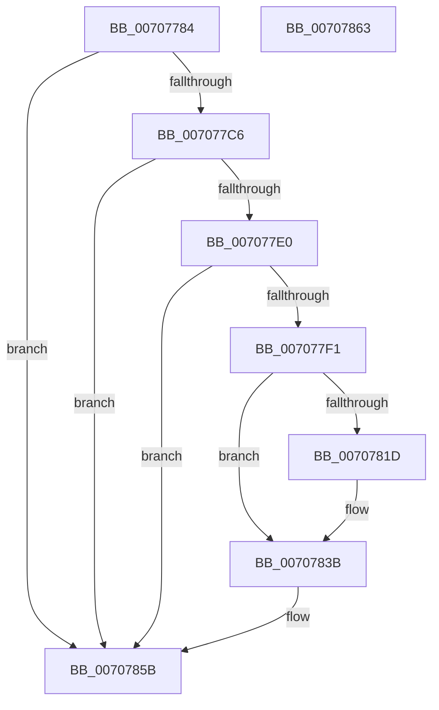

# HalpInterruptGetIrtInfo

- RVA: `0x00707784`–`0x00707864` (길이 `224` bytes)
- VA: `0x0000000140707784`
- 실행 섹션: `PAGE`
- PDB 이름 있음: `예`; PDB Function 태그: `아니요`
- unwind 정보 RVA: `0x00064C80`
- 디코드: `62`개 명령, `224/224` bytes 표시
- 미해석 바이트: `0` (있으면 어셈블리에 `.byte`로 보존)

> 이 문서는 커널 이미지의 기계어와 PDB 기호를 분석해 생성했습니다. 4번과 5번은 함수 원형과 자료형을 바이너리 사용 방식에서 추정한 C 해석이며 원본 소스 복구 결과는 아닙니다.

## 1. Dependencies

- 직접 호출 지점: **8**; 고유 호출 대상: **3**
- 직접 호출자로 확인된 함수: **2**
- RIP 상대 이미지 참조: **2**

### Outgoing calls
- `0x007077A7` → [HalQueryMaximumProcessorCount](../../text/4A/HalQueryMaximumProcessorCount_function_004AC9A0.md) (function, `0x004AC9A0`)
- `0x007077B9` → [HalpIsMicrosoftCompatibleHvLoaded](../../text/4A/HalpIsMicrosoftCompatibleHvLoaded_function_004AFAAC.md) (function, `0x004AFAAC`)
- `0x007077D0` → [HalpHvCpuid](../../text/54/HalpHvCpuid_function_0054C010.md) (function, `0x0054C010`)
- `0x007077E5` → [HalpHvCpuid](../../text/54/HalpHvCpuid_function_0054C010.md) (function, `0x0054C010`)
- `0x007077FB` → [HalpHvCpuid](../../text/54/HalpHvCpuid_function_0054C010.md) (function, `0x0054C010`)
- `0x00707800` → [HalQueryMaximumProcessorCount](../../text/4A/HalQueryMaximumProcessorCount_function_004AC9A0.md) (function, `0x004AC9A0`)
- `0x0070781D` → [HalQueryMaximumProcessorCount](../../text/4A/HalQueryMaximumProcessorCount_function_004AC9A0.md) (function, `0x004AC9A0`)
- `0x0070783B` → [HalQueryMaximumProcessorCount](../../text/4A/HalQueryMaximumProcessorCount_function_004AC9A0.md) (function, `0x004AC9A0`)

### Direct callers
- [HalpQueryAcpiResourceRequirements](HalpQueryAcpiResourceRequirements_function_0070BE28.md) at `0x0070BE78`
- [sub_00B80AC2](../../pagelk/B8/Unknown_function_00B80AC2.md) at `0x00B80BC0`

### Static image references
- `0x0070778A` → RVA `0x00F901F0` (`.data`; read)
- `0x0070780E` → RVA `0x00E0A774` (`.data`; read)

## 2. Other-region calls and transfers

- 다른 실행 섹션으로 향하는 call: **8**
  - `0x007077A7` → [HalQueryMaximumProcessorCount](../../text/4A/HalQueryMaximumProcessorCount_function_004AC9A0.md) (`PAGE` → `.text`)
  - `0x007077B9` → [HalpIsMicrosoftCompatibleHvLoaded](../../text/4A/HalpIsMicrosoftCompatibleHvLoaded_function_004AFAAC.md) (`PAGE` → `.text`)
  - `0x007077D0` → [HalpHvCpuid](../../text/54/HalpHvCpuid_function_0054C010.md) (`PAGE` → `.text`)
  - `0x007077E5` → [HalpHvCpuid](../../text/54/HalpHvCpuid_function_0054C010.md) (`PAGE` → `.text`)
  - `0x007077FB` → [HalpHvCpuid](../../text/54/HalpHvCpuid_function_0054C010.md) (`PAGE` → `.text`)
  - `0x00707800` → [HalQueryMaximumProcessorCount](../../text/4A/HalQueryMaximumProcessorCount_function_004AC9A0.md) (`PAGE` → `.text`)
  - `0x0070781D` → [HalQueryMaximumProcessorCount](../../text/4A/HalQueryMaximumProcessorCount_function_004AC9A0.md) (`PAGE` → `.text`)
  - `0x0070783B` → [HalQueryMaximumProcessorCount](../../text/4A/HalQueryMaximumProcessorCount_function_004AC9A0.md) (`PAGE` → `.text`)
- 별도 외부 분기/꼬리 이동을 확인하지 못했습니다.

## 3. Assembly (complete function range)

```asm
00707784  40 53                           push rbx
00707786  48 83 EC 30                     sub rsp, 0x30
0070778A  8B 05 60 8A 88 00               mov eax, dword ptr [rip + 0x888a60]
00707790  48 8B D9                        mov rbx, rcx
00707793  85 C0                           test eax, eax
00707795  B9 01 00 00 00                  mov ecx, 1
0070779A  0F 57 C0                        xorps xmm0, xmm0
0070779D  0F 44 C1                        cmove eax, ecx
007077A0  89 03                           mov dword ptr [rbx], eax
007077A2  0F 11 44 24 20                  movups xmmword ptr [rsp + 0x20], xmm0
007077A7  E8 F4 51 DA FF                  call 0x1404ac9a0
007077AC  83 63 08 00                     and dword ptr [rbx + 8], 0
007077B0  69 C8 96 00 00 00               imul ecx, eax, 0x96
007077B6  89 4B 04                        mov dword ptr [rbx + 4], ecx
007077B9  E8 EE 82 DA FF                  call 0x1404afaac
007077BE  84 C0                           test al, al
007077C0  0F 84 95 00 00 00               je 0x14070785b
007077C6  48 8D 54 24 20                  lea rdx, [rsp + 0x20]
007077CB  B9 00 00 00 40                  mov ecx, 0x40000000
007077D0  E8 3B 48 E4 FF                  call 0x14054c010
007077D5  B9 06 00 00 40                  mov ecx, 0x40000006
007077DA  39 4C 24 20                     cmp dword ptr [rsp + 0x20], ecx
007077DE  72 7B                           jb 0x14070785b
007077E0  48 8D 54 24 20                  lea rdx, [rsp + 0x20]
007077E5  E8 26 48 E4 FF                  call 0x14054c010
007077EA  F6 44 24 20 20                  test byte ptr [rsp + 0x20], 0x20
007077EF  74 6A                           je 0x14070785b
007077F1  48 8D 54 24 20                  lea rdx, [rsp + 0x20]
007077F6  B9 05 00 00 40                  mov ecx, 0x40000005
007077FB  E8 10 48 E4 FF                  call 0x14054c010
00707800  E8 9B 51 DA FF                  call 0x1404ac9a0
00707805  8B C8                           mov ecx, eax
00707807  33 D2                           xor edx, edx
00707809  8B 43 04                        mov eax, dword ptr [rbx + 4]
0070780C  F7 F1                           div ecx
0070780E  8B 0D 60 2F 70 00               mov ecx, dword ptr [rip + 0x702f60]
00707814  0F AF C8                        imul ecx, eax
00707817  39 4C 24 28                     cmp dword ptr [rsp + 0x28], ecx
0070781B  73 1E                           jae 0x14070783b
0070781D  E8 7E 51 DA FF                  call 0x1404ac9a0
00707822  8B 0D 4C 2F 70 00               mov ecx, dword ptr [rip + 0x702f4c]
00707828  44 8B C0                        mov r8d, eax
0070782B  8B 44 24 28                     mov eax, dword ptr [rsp + 0x28]
0070782F  33 D2                           xor edx, edx
00707831  F7 F1                           div ecx
00707833  44 0F AF C0                     imul r8d, eax
00707837  44 89 43 04                     mov dword ptr [rbx + 4], r8d
0070783B  E8 60 51 DA FF                  call 0x1404ac9a0
00707840  8B C8                           mov ecx, eax
00707842  33 D2                           xor edx, edx
00707844  8B 43 04                        mov eax, dword ptr [rbx + 4]
00707847  F7 F1                           div ecx
00707849  8B 0D 25 2F 70 00               mov ecx, dword ptr [rip + 0x702f25]
0070784F  0F AF C8                        imul ecx, eax
00707852  8B 44 24 28                     mov eax, dword ptr [rsp + 0x28]
00707856  2B C1                           sub eax, ecx
00707858  89 43 08                        mov dword ptr [rbx + 8], eax
0070785B  33 C0                           xor eax, eax
0070785D  48 83 C4 30                     add rsp, 0x30
00707861  5B                              pop rbx
00707862  C3                              ret
00707863  CC                              int3
```

## 4. C-style interpretation (structured pseudocode)

```c
__int64 __fastcall HalpInterruptGetIrtInfo(__int64 a1)
{
    __int64 result;
    __int64 v_rsp;
    unsigned int v_stack_m10;
    unsigned __int64 v_stack_m18;

    v_rsp = (v_rsp) - (48);
    result = (unsigned int)(*(unsigned int *)(v_rip + 8948320));
    if ((unsigned int)((unsigned int)(*(unsigned int *)(v_rip + 8948320))) == 0) { result = 1; }
    *(unsigned int *)(a1) = (unsigned int)(result);
    v_stack_m18 = v_xmm0;
    result = HalQueryMaximumProcessorCount(1, a2, a3, a4);
    a1 = (unsigned int)((1) * ((unsigned int)(result)));
    *(unsigned int *)(a1 + 4) = (unsigned int)(a1);
    result = HalpIsMicrosoftCompatibleHvLoaded(a1, a2, a3, a4);
    if ((unsigned __int8)(result) == 0) goto loc_0070785B;
    result = HalpHvCpuid((unsigned int)(0x40000000ULL), v_stack_m18, a3, a4);
    if (v_stack_m18 < ((unsigned int)((unsigned int)(0x40000006ULL)))) goto loc_0070785B;
    result = HalpHvCpuid((unsigned int)(0x40000006ULL), v_stack_m18, a3, a4);
    if (((v_stack_m18) & (32)) == 0) goto loc_0070785B;
    result = HalpHvCpuid((unsigned int)(0x40000005ULL), v_stack_m18, a3, a4);
    result = HalQueryMaximumProcessorCount((unsigned int)(0x40000005ULL), v_stack_m18, a3, a4);
    a2 = 0;
    a1 = (unsigned int)(((unsigned int)(*(unsigned int *)(v_rip + 7352160))) * ((unsigned int)((unsigned int)(*(unsigned int *)(a1 + 4)))));
    result = (unsigned int)(*(unsigned int *)(a1 + 4));
    if (v_stack_m10 < ((unsigned int)(a1))) {
        result = HalQueryMaximumProcessorCount(a1, a2, a3, a4);
        a1 = *(unsigned int *)(v_rip + 7352140);
        a3 = (unsigned int)(result);
        result = v_stack_m10;
        a2 = 0;
        a3 = (unsigned int)((a3) * ((unsigned int)(result)));
        *(unsigned int *)(a1 + 4) = (unsigned int)(a3);
    }
    result = HalQueryMaximumProcessorCount(a1, a2, a3, a4);
    a2 = 0;
    a1 = (unsigned int)(((unsigned int)(*(unsigned int *)(v_rip + 7352101))) * ((unsigned int)((unsigned int)(*(unsigned int *)(a1 + 4)))));
    result = (unsigned int)(((unsigned int)(v_stack_m10)) - ((unsigned int)(a1)));
    *(unsigned int *)(a1 + 8) = (unsigned int)(result);
loc_0070785B:
    result = 0;
    v_rsp = (v_rsp) + (48);
    return result;
}
```

## 5. (Beta) C Style

```c
int64_t HalpInterruptGetIrtInfo(void *Arg1)
{
    uint8_t *arg1 = (uint8_t *)Arg1;

    int64_t result;
    int64_t local_rsp;
    uint32_t v_stack_m10;
    uint64_t v_stack_m18;

    local_rsp = (local_rsp) - (48);
    result = (uint32_t)(*(uint32_t *)(v_rip + 0x888A60));
    if ((uint32_t)((uint32_t)(*(uint32_t *)(v_rip + 0x888A60))) == 0) { result = 1; }
    *(uint32_t *)(arg1) = (uint32_t)(result);
    v_stack_m18 = v_xmm0;
    result = HalQueryMaximumProcessorCount(1, a2, a3, a4);
    Arg1 = (uint32_t)((1) * ((uint32_t)(result)));
    *(uint32_t *)(arg1 + 0x4) = (uint32_t)(Arg1);
    result = HalpIsMicrosoftCompatibleHvLoaded(Arg1, a2, a3, a4);
    if ((uint8_t)(result) == 0) goto loc_0070785B;
    result = HalpHvCpuid((uint32_t)(0x40000000ULL), v_stack_m18, a3, a4);
    if (v_stack_m18 < ((uint32_t)((uint32_t)(0x40000006ULL)))) goto loc_0070785B;
    result = HalpHvCpuid((uint32_t)(0x40000006ULL), v_stack_m18, a3, a4);
    if (((v_stack_m18) & (32)) == 0) goto loc_0070785B;
    result = HalpHvCpuid((uint32_t)(0x40000005ULL), v_stack_m18, a3, a4);
    result = HalQueryMaximumProcessorCount((uint32_t)(0x40000005ULL), v_stack_m18, a3, a4);
    a2 = 0;
    Arg1 = (uint32_t)(((uint32_t)(*(uint32_t *)(v_rip + 0x702F60))) * ((uint32_t)((uint32_t)(*(uint32_t *)(arg1 + 0x4)))));
    result = (uint32_t)(*(uint32_t *)(arg1 + 0x4));
    if (v_stack_m10 < ((uint32_t)(Arg1))) {
        result = HalQueryMaximumProcessorCount(Arg1, a2, a3, a4);
        Arg1 = *(uint32_t *)(v_rip + 0x702F4C);
        a3 = (uint32_t)(result);
        result = v_stack_m10;
        a2 = 0;
        a3 = (uint32_t)((a3) * ((uint32_t)(result)));
        *(uint32_t *)(arg1 + 0x4) = (uint32_t)(a3);
    }
    result = HalQueryMaximumProcessorCount(Arg1, a2, a3, a4);
    a2 = 0;
    Arg1 = (uint32_t)(((uint32_t)(*(uint32_t *)(v_rip + 0x702F25))) * ((uint32_t)((uint32_t)(*(uint32_t *)(arg1 + 0x4)))));
    result = (uint32_t)(((uint32_t)(v_stack_m10)) - ((uint32_t)(Arg1)));
    *(uint32_t *)(arg1 + 0x8) = (uint32_t)(result);
loc_0070785B:
    result = 0;
    local_rsp = (local_rsp) + (48);
    return result;
}
```

### 관측된 메모리 오프셋

구조체 형식이 확인되지 않은 접근은 인자 기준의 오프셋으로만 기록했습니다.

| 기준 인자 | 오프셋 표현 | 폭 (bit) | 접근 |
|---|---:|---:|---|
| `Arg1` | `+ 0x0` | `32` | `W` |
| `Arg1` | `+ 0x4` | `32` | `R` |
| `Arg1` | `+ 0x4` | `32` | `W` |
| `Arg1` | `+ 0x8` | `32` | `R/W` |
| `Arg1` | `+ 0x8` | `32` | `W` |

## 6. Execution-region graph

[열기: 2D/3D 그래프와 함수 탐색 컨트롤 패널](../../../control-panel.html?section=page&rva=0x00707784&view=graph)

- 2D 그래프는 위에서 아래로 흐르고, 3D 그래프는 빈 공간을 드래그해 회전합니다. Shift+드래그는 이동, 휠은 확대·축소, 함수 노드 선택은 대상 보고서 이동입니다.

### Static fallback


