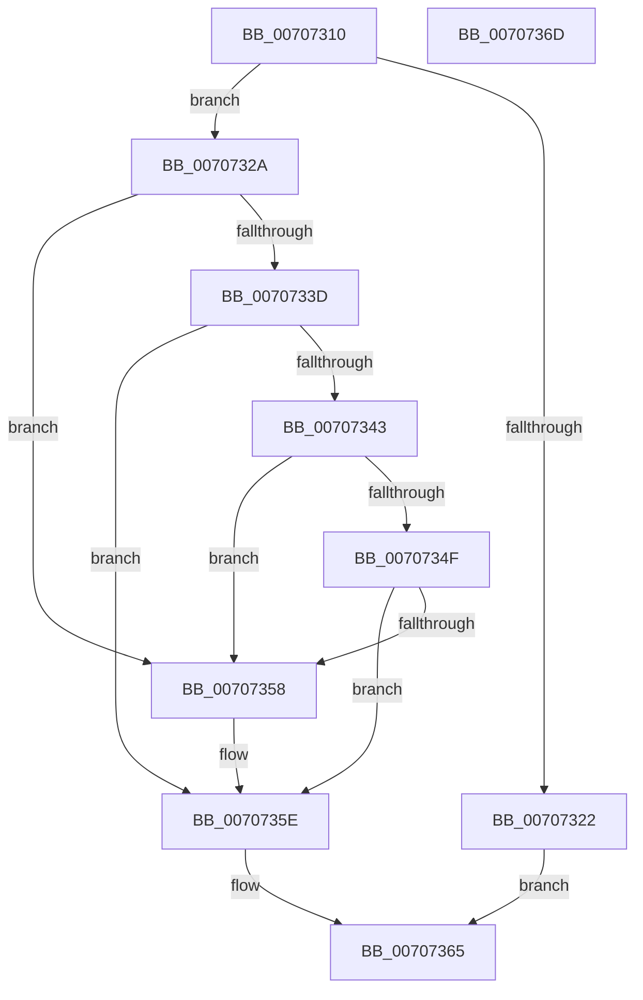

# HalpInterruptQueryControllerInfo

- RVA: `0x00707310`–`0x0070736E` (길이 `94` bytes)
- VA: `0x0000000140707310`
- 실행 섹션: `PAGE`
- PDB 이름 있음: `예`; PDB Function 태그: `아니요`
- unwind 정보 RVA: `0x0005C788`
- 디코드: `28`개 명령, `94/94` bytes 표시
- 미해석 바이트: `0` (있으면 어셈블리에 `.byte`로 보존)

> 이 문서는 커널 이미지의 기계어와 PDB 기호를 분석해 생성했습니다. 4번과 5번은 함수 원형과 자료형을 바이너리 사용 방식에서 추정한 C 해석이며 원본 소스 복구 결과는 아닙니다.

## 1. Dependencies

- 직접 호출 지점: **2**; 고유 호출 대상: **2**
- 직접 호출자로 확인된 함수: **1**
- RIP 상대 이미지 참조: **1**

### Outgoing calls
- `0x0070732D` → [HalpInterruptModel](../../text/4A/HalpInterruptModel_function_004ACA38.md) (function, `0x004ACA38`)
- `0x0070734F` → [HalpInterruptIsRemappingRequired](../../text/4B/HalpInterruptIsRemappingRequired_function_004B7AB0.md) (function, `0x004B7AB0`)

### Direct callers
- [sub_00B80AC2](../../pagelk/B8/Unknown_function_00B80AC2.md) at `0x00B80C61`

### Static image references
- `0x00707346` → RVA `0x00FC1CA8` (`.data`; read)

## 2. Other-region calls and transfers

- 다른 실행 섹션으로 향하는 call: **2**
  - `0x0070732D` → [HalpInterruptModel](../../text/4A/HalpInterruptModel_function_004ACA38.md) (`PAGE` → `.text`)
  - `0x0070734F` → [HalpInterruptIsRemappingRequired](../../text/4B/HalpInterruptIsRemappingRequired_function_004B7AB0.md) (`PAGE` → `.text`)
- 별도 외부 분기/꼬리 이동을 확인하지 못했습니다.

## 3. Assembly (complete function range)

```asm
00707310  48 83 EC 28                     sub rsp, 0x28
00707314  45 33 C9                        xor r9d, r9d
00707317  4D 8B D0                        mov r10, r8
0070731A  45 89 08                        mov dword ptr [r8], r9d
0070731D  83 F9 04                        cmp ecx, 4
00707320  73 08                           jae 0x14070732a
00707322  41 B9 23 00 00 C0               mov r9d, 0xc0000023
00707328  EB 3B                           jmp 0x140707365
0070732A  44 89 0A                        mov dword ptr [rdx], r9d
0070732D  E8 06 57 DA FF                  call 0x1404aca38
00707332  44 8B C0                        mov r8d, eax
00707335  83 C0 FE                        add eax, -2
00707338  83 F8 01                        cmp eax, 1
0070733B  76 1B                           jbe 0x140707358
0070733D  41 83 F8 01                     cmp r8d, 1
00707341  75 1B                           jne 0x14070735e
00707343  44 89 02                        mov dword ptr [rdx], r8d
00707346  4C 39 0D 5B A9 8B 00            cmp qword ptr [rip + 0x8ba95b], r9
0070734D  75 09                           jne 0x140707358
0070734F  E8 5C 07 DB FF                  call 0x1404b7ab0
00707354  84 C0                           test al, al
00707356  74 06                           je 0x14070735e
00707358  C7 02 03 00 00 00               mov dword ptr [rdx], 3
0070735E  41 C7 02 04 00 00 00            mov dword ptr [r10], 4
00707365  41 8B C1                        mov eax, r9d
00707368  48 83 C4 28                     add rsp, 0x28
0070736C  C3                              ret
0070736D  CC                              int3
```

## 4. C-style interpretation (structured pseudocode)

```c
__int64 __fastcall HalpInterruptQueryControllerInfo(int a1, __int64 a2, __int64 a3, int a4)
{
    __int64 result;
    __int64 v_rsp;

    v_rsp = (v_rsp) - (40);
    a4 = 0;
    *(unsigned int *)(a3) = 0;
    if (a1 >= 4) goto loc_0070732A;
    goto loc_00707365;
loc_0070732A:
    *(unsigned int *)(a2) = (unsigned int)((unsigned int)(0xC0000023ULL));
    result = HalpInterruptModel(a1, a2, a3, (unsigned int)(0xC0000023ULL));
    result = (unsigned int)((result) + (-2));
    if (((unsigned int)(result)) <= 1) goto loc_00707358;
    if (((unsigned int)((unsigned int)((unsigned int)(result)))) != 1) goto loc_0070735E;
    *(unsigned int *)(a2) = (unsigned int)((unsigned int)((unsigned int)(result)));
    if ((*(unsigned __int64 *)(v_rip + 9152859)) != ((unsigned int)(0xC0000023ULL))) goto loc_00707358;
    result = HalpInterruptIsRemappingRequired(a1, a2, (unsigned int)((unsigned int)(result)), (unsigned int)(0xC0000023ULL));
    if ((unsigned __int8)(result) != 0) {
        *(unsigned int *)(a2) = 3;
    }
    *(unsigned int *)(a3) = 4;
loc_00707365:
    v_rsp = (v_rsp) + (40);
    return (unsigned int)((unsigned int)((unsigned int)(0xC0000023ULL)));
}
```

## 5. (Beta) C Style

```c
int64_t HalpInterruptQueryControllerInfo(int32_t Arg1, void *Arg2, void *Arg3, int32_t Arg4)
{
    uint8_t *arg2 = (uint8_t *)Arg2;
    uint8_t *arg3 = (uint8_t *)Arg3;

    int64_t result;
    int64_t local_rsp;

    local_rsp = (local_rsp) - (40);
    Arg4 = 0;
    *(uint32_t *)(arg3) = 0;
    if (Arg1 >= 4) goto loc_0070732A;
    goto loc_00707365;
loc_0070732A:
    *(uint32_t *)(arg2) = (uint32_t)((uint32_t)(0xC0000023ULL));
    result = HalpInterruptModel(Arg1, Arg2, Arg3, (uint32_t)(0xC0000023ULL));
    result = (uint32_t)((result) + (-2));
    if (((uint32_t)(result)) <= 1) goto loc_00707358;
    if (((uint32_t)((uint32_t)((uint32_t)(result)))) != 1) goto loc_0070735E;
    *(uint32_t *)(arg2) = (uint32_t)((uint32_t)((uint32_t)(result)));
    if ((*(uint64_t *)(v_rip + 0x8BA95B)) != ((uint32_t)(0xC0000023ULL))) goto loc_00707358;
    result = HalpInterruptIsRemappingRequired(Arg1, Arg2, (uint32_t)((uint32_t)(result)), (uint32_t)(0xC0000023ULL));
    if ((uint8_t)(result) != 0) {
        *(uint32_t *)(arg2) = 3;
    }
    *(uint32_t *)(arg3) = 4;
loc_00707365:
    local_rsp = (local_rsp) + (40);
    return (uint32_t)((uint32_t)((uint32_t)(0xC0000023ULL)));
}
```

### 관측된 메모리 오프셋

구조체 형식이 확인되지 않은 접근은 인자 기준의 오프셋으로만 기록했습니다.

| 기준 인자 | 오프셋 표현 | 폭 (bit) | 접근 |
|---|---:|---:|---|
| `Arg2` | `+ 0x0` | `32` | `W` |
| `Arg3` | `+ 0x0` | `32` | `W` |

## 6. Execution-region graph

[열기: 2D/3D 그래프와 함수 탐색 컨트롤 패널](../../../control-panel.html?section=page&rva=0x00707310&view=graph)

- 2D 그래프는 위에서 아래로 흐르고, 3D 그래프는 빈 공간을 드래그해 회전합니다. Shift+드래그는 이동, 휠은 확대·축소, 함수 노드 선택은 대상 보고서 이동입니다.

### Static fallback


